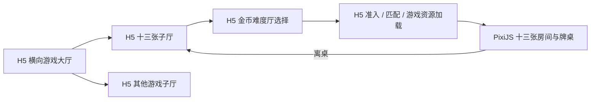
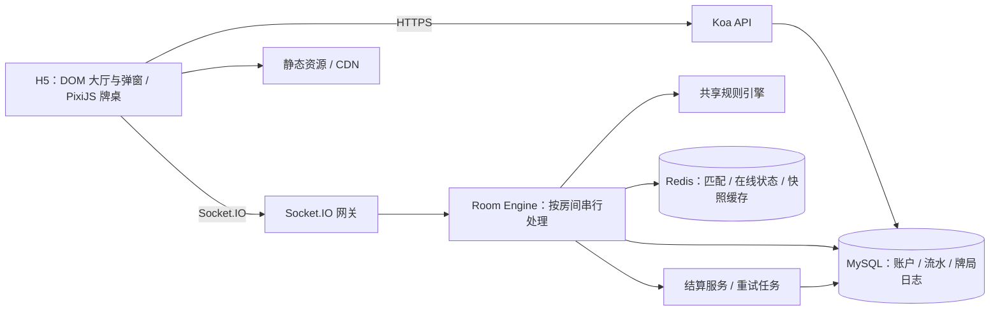
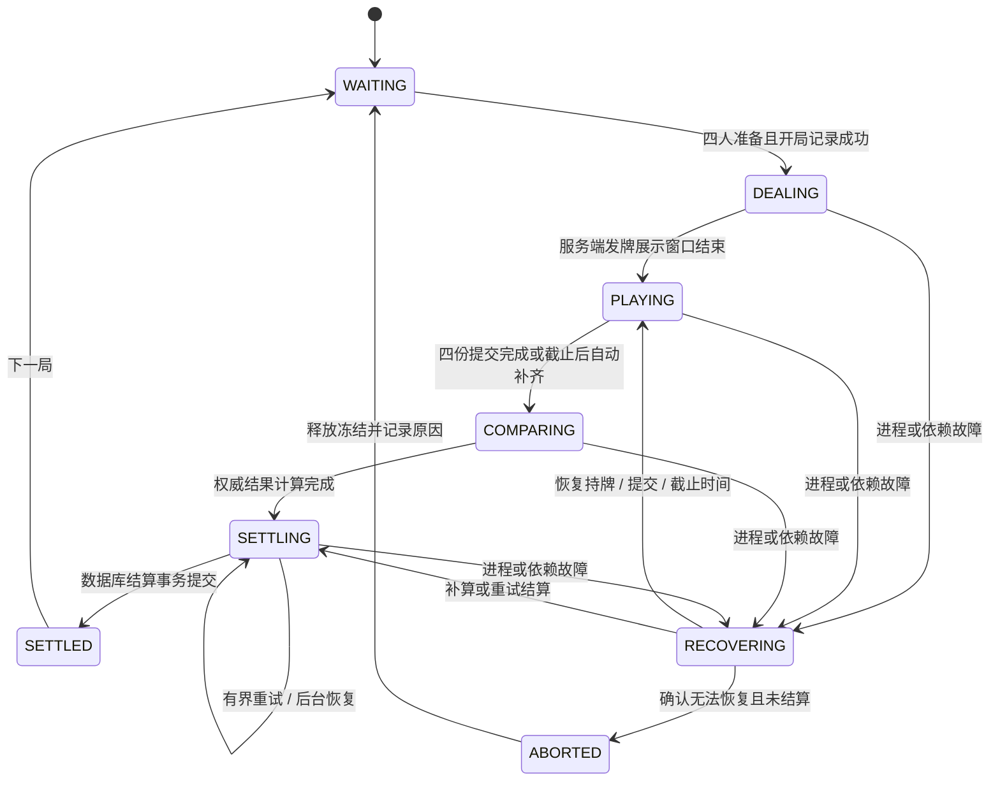

# 十三张项目可行性与技术分析报告

初稿日期：2026-10-07。架构修订：2026-10-08。阶段：立项与设计评审。依据：用户提供的玩法与系统需求，以及本文链接的官方技术资料。

本文中的规则、性能指标、排期与费用均为建议或估算，不代表已有实现或实测结果。当前仓库仅有 Git 初始化目录，尚无客户端、服务端、依赖或部署配置。因此本报告按从零开发评估。

用户已确认的技术约束与具体领域设计见 [技术架构决策说明](../02_architecture/技术架构决策说明.md)。该文档补充设备登录、金币转账与绑定、Admin、弱网资源加载、两万在线容量和 Docker 环境；细化评估见 [架构评估与落地方案](../02_architecture/架构评估与落地方案.md)，目录以 [项目结构规划](../02_architecture/项目结构规划.md) 为准，下载控制以 [网络预加载设计](../02_architecture/网络预加载设计.md) 为准。与本文早期建议有差异时，优先用户确认约束与上述专项设计。

## 1. 可行性结论与首版边界

**项目技术上可行，PixiJS + TypeScript + Node.js 24 + Koa + MySQL + Redis 的组合适合十三张这类低频操作、强规则校验的实时棋牌游戏。首版同时提供横向 H5 游戏大厅、子游戏厅、金币档位选择，以及十三张四人对局闭环。**

核心难点是规则一致性、截止时间竞态、断线恢复和结算幂等。52 张牌及少量特效的渲染规模较小，但能否流畅仍取决于纹理、滤镜、设备和资源生命周期，不能只凭 WebGL 或 Node 版本承诺性能。

| 维度 | 评估 | 落地条件 |
| --- | --- | --- |
| 玩法与算法 | 可行，难度中等 | 冻结地区规则，使用纯函数与确定性测试 |
| 四人实时对局 | 可行，难度中等 | 服务端权威、单房间串行处理、重连快照 |
| 积分与战绩 | 可行，难度较高 | 数据库事务、唯一约束、可恢复结算 |
| H5 卡牌交互 | 可行，难度中等 | 先验证手机理牌体验与 WebView 兼容性 |
| AI 美术与音效 | 可行，需验证一致性 | AI 创作全部视觉资产，自动校验、修复与打包 |
| 大规模上线 | 尚需验证 | 定义并发目标，压测和故障演练后确定容量 |

首版边界：手机/PC 浏览器，以及 iOS、Android、Windows、macOS、Linux 封装 App，优先横屏；大厅横向布局，支持选择不同游戏；进入子游戏厅后选择不同金币下限/上限的难度厅，通过准入后才加载具体游戏。首个实现的游戏为十三张，四人、52 张标准牌、45 秒理牌、通过 game_config 管理并在开局固定规则版本。采用非负游戏金币进行准入与结算，新增充值购买金币、返点入余额、金币兑换余额后提现；金币与余额独立记账，详见《双资产充值兑换与提现》。不接入微信体系；采用设备指纹与设备摘要生成登录设备码，配合服务端设备凭证验证。首版增加游戏内金币转账、邀请人/代理绑定能力以及独立 Admin 后台，绑定明确指邀请人或代理关系，最多 5 级，换绑仅 Admin 操作，采用独立 referral 领域。

用户已确定两项约束：全部美术由 AI 创作；具体游戏之外的全部界面使用 H5 DOM/CSS/TypeScript。PixiJS 只在具体游戏运行时创建。多游戏入口属于第一阶段范围，其他游戏的玩法实现需单独排期，未实现的入口明确显示“即将开放”。

部署目标为国外云服务，通过 Cloudflare 代理与静态资源 CDN 接入，主要用户位于中国大陆；大陆 IP 将路由到用户安排的独立大陆优化云主机，接入方案视为已确定，应用重点控制资源体积与弱网恢复；预计同时在线不超过 20,000 人。开发阶段使用 Docker Compose，项目分组名固定为 `gameing-hall-pixi`。H5 采用 Vue 并按业务领域拆分，通信采用 HTTP + Socket.IO；monorepo 承载自家游戏，外部游戏接入先保留 Stub。依赖有 LTS 时选最新受支持 LTS，无 LTS 时选最新稳定版本，并固定锁文件与容器版本。

## 2. 原需求需要补齐的规则

原文中的“通常”“或”“2 倍或 3 倍”不能直接进入结算代码。建议形成 `classic-v1` 规则文件，房间创建时固定版本，牌局记录保存该版本及配置摘要。下表是首版建议，并非各地统一玩法。

所有可选玩法（特殊墩奖励、打枪、全垒打、相公赔付及整手特殊牌等）均作为 `game_config` 中的独立启用开关与参数；关闭的功能在该局不参与比牌计分或结算，开启项使用开局时冻结的配置快照。规则引擎按配置执行，不为每种组合建立独立结算代码分支。

| 项目 | 建议的 classic-v1 定义 |
| --- | --- |
| 点数与花色 | A 为高点；花色不参与大小比较 |
| 顺子 | A2345 为最小顺子，10JQKA 为最大；不支持 QKA23 等环绕 |
| 头墩 | 仅高牌、对子、三条；不认三张顺子或同花 |
| 平局 | 该墩双方均得 0 水；平局不算胜，不触发打枪 |
| 同牌型 | 比主体点数，再比踢脚牌；两对先比大对、小对、踢脚牌；葫芦先比三条再比对子 |
| 特殊奖励 | 使用原需求数值，作为该墩胜出的总水数，不再额外加普通 1 水 |
| 打枪 | 三墩严格全胜，该对玩家的墩分合计乘 2；不采用“额外加 3 水” |
| 全垒打 | 四人中一人对另外三人均打枪；其涉及的三组两两分数再乘 2，双方同步计入 |
| 相公 | 牌数与归属正确，但头 > 中或中 > 底；对每位正常玩家固定赔 6 水 |
| 多人相公 | 相公之间计 0；正常玩家之间照常比牌；全员相公全员 0 |
| 相公与奖励叠加 | 相公赔付不叠加特殊墩分、打枪或全垒打；存在相公时不触发全垒打 |
| 十三张特殊牌 | 首版不启用一条龙、三同花、六对半等整手特殊牌，后续单独定义 |
| 提交策略 | 首次有效提交锁定；不支持撤回，重复请求返回同一确认结果 |
| 超时 | 使用服务端合法自动摆牌；不足以完成搜索时采用预先计算的合法兜底方案 |

“固定赔 6 水”是为了使首版相公规则明确，并不是从原文推导出的唯一答案。开发时须把这类建议在规则说明和房间入口公开，避免玩家根据其他地区习惯理解结算。

### 2.1 头墩与中墩的跨张数比较

不能仅比较牌型等级，否则同为对子但头墩对 A、中墩对 K 也会被错误放行。建议统一 `HandRank = { category, tieBreak }`，按牌型等级与点数向量逐项比较。

同等级比较时，三张与五张的点数向量以 0 补齐再比较。例如：头墩 `AAK` 为 `[A,K,0,0]`，中墩 `AAKQJ` 为 `[A,K,Q,J]`，前者较小；头墩 `AAQ` 大于中墩 `AAJT9`，属于相公。三条同样比较三条点数，再比较踢脚牌。此规则只用于定义本项目的跨墩合法性，应列入公开规则与测试用例。

### 2.2 结算公式与可解释明细

对两名正常玩家 i、j，逐墩比较。i 胜则取 i 该墩的奖励值，j 胜则取负的 j 奖励值，平局为 0。先求三墩合计，再应用打枪、全垒打倍率。相公组合走独立赔付规则。

```text
base(i,j) = front(i,j) + middle(i,j) + back(i,j)
pair(i,j) = base(i,j) × slamMultiplier × homeRunMultiplier
pair(j,i) = -pair(i,j)
score(i) = Σ pair(i,j)，j ≠ i
```

例：A 对 B 的头墩以三条获胜得 3，中墩以葫芦获胜得 2，底墩普通获胜得 1；基础合计 6，打枪后 A +12、B -12。若 A 同时对 C、D 打枪，全垒打使 A-B 这一组变为 +24/-24，其余两组也各乘 2；B、C、D 之间的分数不因此变化。

结算 UI 应逐项展示“墩分、打枪倍率、全垒打倍率、相公赔付、最终变动”。无抽水时四人总分必须为 0，不能只放大赢家收入而不调整对方支出。

## 3. 范围与产品流程

| 阶段 | 必须包含 | 暂缓项 |
| --- | --- | --- |
| 本地原型 | 横向 Vue/H5 大厅、子游戏厅、金币档位页、AI 风格母版、十三张本地理牌与结算 | 正式网络、账户、匹配；可用模拟金币 |
| 联机 MVP | 大厅目录、金币准入、档位内匹配、建房/入房、准备、四人对局、倒计时、自动摆牌、重连、金币流水、战绩 | 多规则、其他游戏玩法、商城、复杂聊天 |
| 内测版 | 设备登录、绑定与转账、回放、故障恢复验证、监控与 Admin 后台 | 排位赛、社交体系、商业化 |

主要流程：登录 → 横向游戏大厅 → 子游戏厅 → 选择金币难度厅 → 服务端准入校验 → 匹配/加入房间 → 加载游戏模块 → 四人准备 → 发牌 → 理牌 → 提交 → 比牌 → 得分明细 → 下一局或返回子游戏厅。

### 3.1 大厅层级与界面职责



| 层级 | 内容 | 技术与行为 |
| --- | --- | --- |
| 全局大厅 | 横向排列的游戏封面卡片、头像、金币、设置 | H5 DOM/CSS；超出可视区可横向滑动；不初始化 PixiJS |
| 子游戏厅 | 游戏介绍、规则、难度厅卡片、返回大厅 | H5；每张难度卡显示金币范围、每水金币、状态 |
| 难度厅 | 选定档位、准入提示、匹配进度、取消/加入房间 | H5；可作为子厅内状态或独立路由，无需重复增加中间页 |
| 具体游戏 | 等待准备、牌桌、理牌、比牌、当局结果 | PixiJS；允许 DOM 实现输入与长文本覆盖层 |
| 通用页面 | 登录、账户、历史战绩、规则、设置、消息 | H5；与游戏模块共享会话和金币状态 |

建议路由：`/lobby`、`/games/:gameId`、`/games/:gameId/tiers/:tierId`、`/play/:roomId`。点击难度卡即启动准入与进入流程；匹配期间在原页面展示进度。浏览器刷新和返回需恢复对应路由；若玩家已在牌局中，入口提供“返回对局”，不允许通过导航重复参加另一局。

首版可展示多个游戏卡片，但只有十三张为可进入状态。游戏卡片数据由服务端配置，`gameId` 对应前端内置的模块注册表，不能把后台任意 URL 当作脚本执行。新游戏可复用登录、钱包、大厅、档位、匹配和连接管理；规则引擎与对局界面保持独立。

### 3.2 金币难度厅与准入规则

“难度”首先表示金币门槛与每水金币，不默认改变牌型规则或对手 AI。建议配置：`tierId、gameId、name、minCoins、maxCoins、coinsPerWater、ruleVersion、configVersion、enabled`。上下限均包含端点；无上限使用 `null`，不要用 0 表示无上限。

以下仅为配置示例，最终金额待产品确定：

| 难度厅 | 金币范围 | 每水金币 | 按 144 水保守上界冻结 |
| --- | --- | --- | --- |
| 初级厅 | 2,000–19,999 | 10 | 1,440 |
| 中级厅 | 20,000–199,999 | 100 | 14,400 |
| 高级厅 | ≥200,000 | 1,000 | 144,000 |

准入以数据库中的钱包总余额 `balance` 比较上下限，并检查可用金币 `balance-frozen` 足以覆盖冻结额。配置发布时验证 `minCoins ≥ maxLossWater × coinsPerWater`；匹配阶段不冻结，四人确定并开局时重新检查且同事务冻结。金币档位不自动等于可输掉的全部余额。

前端用接口余额显示“可进入、金币不足、超过本厅上限、维护中”；点击后服务器再次检查；排队期间余额变化，开局时仍需复查。重复点击使用进入请求幂等键，并约束每个用户只有一个有效匹配/房间归属。匹配队列按 `gameId + tierId + ruleVersion + configVersion` 隔离。

当局赢输导致余额越界时，允许完成当前结算；下一局准备前重新准入，不足或超过上限则提示返回子厅选择合适档位，不在当局中强制移除。房间绑定创建时的档位配置快照；配置修改只影响新房间，紧急停厅时停止新开局。取消匹配只释放匹配归属；若开局已完成，则返回房间状态，不把已经开始的牌局当作取消成功。

### 3.3 大厅接口与加载边界

建议接口：`GET /api/games` 获取游戏目录；`GET /api/games/:gameId/tiers` 获取档位与当前配置摘要；`GET /api/me/wallet` 获取总额/冻结/可用额；`POST /api/game-entry` 创建幂等进入请求；`GET /api/game-entry/:entryId` 恢复进度；`DELETE /api/game-entry/:entryId` 幂等取消。返回匹配中、准入失败、房间已分配或已有对局等明确状态。

大厅启动只加载公共样式、封面、头像和通用音效；可交互后通过闲时预取下载并缓存游戏 JS/核心资源，进入游戏时再导入执行和创建渲染器。缓存与调度已确认采用 Workbox + vite-plugin-pwa + 小型调度器，以近期下载吞吐和延迟的保守估计利用网络空闲，详见架构决策说明第 4.6–4.7 节。用户点击后先并行执行预准入与加载核心资源，失败时不创建渲染器；核心资源成功后再发起正式匹配并重新校验，避免弱网下载长期占座。分配房间后发送 `clientReady`，四人加载与准备完成才开始发牌；等待席位超时释放，避免其他玩家一直等候。离桌销毁游戏实例、Ticker、监听器和专属资源，恢复 H5 子厅的档位选择与滚动位置。

理牌界面须同时支持拖拽与“点击选牌后点击墩位”，提供一键排序、清空、撤销最近操作、自动摆牌。相公风险实时提示；提交前明确告知，服务端仍重新判定。重复牌、伪造牌、缺牌属于无效协议输入，直接拒绝；相公属于正确持牌下的玩法结果，两者不能混为一类。

## 4. 技术架构与选型



首版采用模块化单体：Koa、WebSocket、房间引擎和结算模块可以在同一 Node 进程内运行，但接口独立。不要一开始拆分大量微服务。后续按房间分片扩容，一个房间只由一个权威实例处理。

| 技术 | 推荐用途与边界 |
| --- | --- |
| Vue / H5 DOM / CSS / TypeScript | 登录、大厅、子厅、难度选择、匹配、账户、规则、设置与历史页面 |
| PixiJS 8.x | 仅用于具体游戏：房间、卡牌、牌桌、粒子和动画 |
| TypeScript | 客户端、服务端、规则引擎、协议类型共享；网络输入另做运行时校验 |
| Node.js 24 | 使用受支持的 24.x 补丁版本，固定容器和锁文件；CPU 密集搜索可交给 Worker |
| Koa | 设备登录、房间入口、转账、战绩与 Admin HTTP API；与 Socket.IO 共用 HTTP Server |
| Socket.IO | 大厅通知、钱包版本、上线/离线和游戏内部事件；补充幂等、确认与快照 |
| 最新受支持 MySQL LTS / InnoDB | 账户资产、牌局、结算、关键日志；迁移、事务、备份和恢复 |
| Redis | 在线连接映射、ZSet 匹配、房间缓存；不作为资产的最终依据 |
| Vite / pnpm workspace | 构建客户端与管理共享包，降低重复维护 |

按官方发布计划，Node 24 在报告日期处于 Active LTS，计划于 2026-10-20 进入维护期，2028-04-30 结束支持；日期可能调整，应纳入升级计划。[Node.js 发布计划](https://github.com/nodejs/Release)

Koa 可组合 HTTP 中间件；Socket.IO 提供连接、确认与恢复机制，但应用仍需处理关键事件的可靠投递与幂等。PixiJS 提供资源加载、交互和渲染扩展；精简显示树、批处理与合理使用滤镜仍需工程控制。[Koa 文档](https://koajs.com/)、[Socket.IO 文档](https://socket.io/docs/v4/)、[PixiJS 架构](https://pixijs.com/8.x/guides/concepts/architecture)、[PixiJS 性能指南](https://pixijs.com/8.x/guides/concepts/performance-tips)

目录已细化为 apps/web、admin、server、worker、mobile、desktop；共享代码按实际复用拆包，服务端领域先在 packages/backend 内部隔离；十三张 rules/client 分包。完整目标树、exports、构建、Docker 和 CI 规则见 [项目结构规划](../02_architecture/项目结构规划.md)，该规划替代本报告初稿目录。

## 5. 规则引擎与自动摆牌

牌用 `0..51` 的整数标识，约定例如 `suit = floor(id/13)`、`rank = id%13+2`，A 为 14。逻辑身份与贴图名称分离，任何洗牌或渲染调整都不能改变牌的身份。

服务端按以下顺序处理提交：鉴权 → 检查房间/牌局/阶段/截止时间 → 检查 3/5/5 → 检查 13 个唯一合法 cardId → 检查正好等于玩家持牌集合 → 评估三墩 → 判定相公 → 固化提交。牌型和分数均由服务器计算，不接收客户端自报结果。

建议纯函数接口：`evaluate3`、`evaluate5`、`compareRanks`、`validateArrangement`、`scorePair`、`settleRound`。结算不读取系统时间或随机数，相同牌局输入和规则版本产生相同结果。

自动摆牌可枚举 `C(13,3) × C(10,5) = 72,072` 个候选分配；缓存 3 张/5 张子集的牌型结果，过滤倒道后按确定性启发式选择。首版目标是“合法、及时、稳定”，不承诺最优赢率。启发式可综合底墩、中墩和头墩强度，候选同分时按 cardId 排序决胜。

应在发牌后预先准备合法兜底排列，避免四人同时超时才启动搜索。重搜索放 Worker 或限时任务，测量 p95/p99 耗时与事件循环延迟；客户端建议算法可放 Web Worker，最终校验仍在服务器。

洗牌使用 Fisher–Yates，索引取样使用 `node:crypto` 的 `randomInt` 无偏整数随机接口；禁止 `sort(() => Math.random()-0.5)`。牌局保存牌序及算法版本供审计，不向未完成对局的客户端公开全牌序或可推导他人手牌的种子。[Node.js 24 Crypto 文档](https://nodejs.org/docs/latest-v24.x/api/crypto.html#cryptorandomintmin-max-callback)

## 6. 状态机、截止时间与重连

原状态机需要区分展示、持久化和失败恢复：



`SETTLING` 表示尚未确认落库；`SETTLED` 只能表示已提交成功。失败不能直接开始下一局，也不能向用户显示已到账。

房间保存 `roomId、roundId、ruleVersion、phase、stateVersion、ownerEpoch、deadlineAt、seatMap、submittedFlags`；私有持牌和提交单独存储，不能作为公共广播内容。

倒计时以服务器 `deadlineAt` 为准，客户端根据 `serverNow` 校准展示。每条提交在权威 owner 完成基本解析并登记入队时记录 `admittedAt`，定义 `admittedAt < deadlineAt` 才有效；相等视为超时，不使用客户端时间或 OS 网络接收时间。截止任务和提交走同一串行队列，截止任务以 barrier 入队，须先处理已登记的截止前请求；内部转发排队延迟纳入监控。持久化失败的请求不发送成功确认，也不伪称已锁定。

发牌不需要 52 次网络通知：服务器私发每人 13 张牌，前端根据统一时间轴播放发牌动画。拖拽完全本地执行；其他玩家只看座位状态、剩余人数和准备/提交状态。

重连携带会话、牌局 ID 和最后接收序号。服务器返回权限过滤后的权威快照：自己的手牌与提交、其他人的公开状态、当前阶段、截止时间/剩余时间和已公开结果。断线不重置倒计时；到截止时间后由十三张 handler 为该用户生成、校验并提交一次合法摆牌。自动提交是当前牌局该项动作的超时托管，不会替玩家自动进入或操作下一局。其他棋牌的超时策略同样只代行当次到期动作；下一次待操作仍要求玩家提交，若再次超时才再次托管。当前整局尚未结束时重连，恢复到同一牌局与服务器快照：尚未被托管/提交的有效操作由玩家继续，已受理的托管动作不回滚；牌局已结算则不重新进入旧局。已通过有效账号凭证验证的另一设备登录可按账号策略接管活动游戏连接，并用连接代次拒绝旧连接后续命令；不能仅凭相似设备指纹接管账号。

房间控制权多实例转移时，需要递增的 `ownerEpoch`。控制权与关键事件写入采用数据库条件更新/事务验证 epoch 和事件序号，阻止旧实例持锁过期后继续写入；Redis 租约可用于快速发现和路由，不能独自授权最终写入。

## 7. 通信协议与匹配

建议从 JSON 协议开始，便于联调；是否二进制化由实际带宽决定。共享 TS interface 不能校验恶意网络数据，需要 schema 校验、长度限制、枚举检查和未知字段策略。

```ts
type SubmitArrangement = {
  type: 'round.submit';
  requestId: string;
  roomId: string;
  roundId: string;
  ruleVersion: string;
  payload: {
    front: [number, number, number];
    middle: [number, number, number, number, number];
    back: [number, number, number, number, number];
  };
};

type ServerEnvelope<T> = {
  type: string;
  requestId?: string;
  roomId: string;
  roundId?: string;
  seq: number;
  stateVersion: number;
  serverNow: number;
  payload: T;
};
```

身份取自鉴权上下文，不能取自 payload 的 userId。提交的幂等键是 `(roundId,userId)`，`requestId` 用于请求关联和响应重放。其他玩家提交造成房间版本增加，不应自动拒绝本玩家仍在有效阶段的提交；按命令语义判断是否需要乐观版本检查。

核心事件：`room.snapshot、room.playerJoined、room.readyChanged、round.dealt（私有）、round.started、round.submitAck（私有）、round.playerSubmitted、round.reveal、round.settlement、room.closed、error`。错误码至少包含：未授权、房间满员、牌局过期、阶段错误、无效持牌、已提交、截止超时、服务暂不可用。

Socket.IO over HTTPS/WSS、来源校验、单连接速率限制、消息大小限制、心跳、指数退避重连、发送缓冲上限属于基础能力。慢客户端积压时合并可替换快照；不可替换的提交确认和结算结果可从服务端重取。应用日志不记录完整 token 或未公开的全量牌局。

匹配使用按游戏、金币档位和规则快照摘要分组的 Redis ZSet，分值为入队时间；原子领取四人并生成唯一 matchId。设置领取租约，建房失败或玩家离线时回退；确认阶段防止玩家同时进入两个房间。联机 MVP 必须支持点击难度厅后进入该档位的匹配；邀请房同样绑定档位，并校验所有玩家准入资格。

## 8. 数据一致性、资产与恢复

### 8.1 修正 Redis 与 MySQL 的职责

“Redis 有锁，所以宕机不会错乱”不是可靠保证。Redis 的异步复制、持久化与故障切换存在不同的数据丢失窗口，即使使用 `WAIT` 也不会自动获得强一致性。Redis 适合缓存与协调，资产正确性必须落在数据库约束和事务上。[Redis 复制说明](https://redis.io/docs/latest/operate/oss_and_stack/management/replication/)、[Redis 分布式锁说明](https://redis.io/docs/latest/develop/clients/patterns/distributed-locks/)

原需求“不在游玩中频繁写 MySQL”应落实为“不写拖拽、动画帧、心跳”。开局、成功提交、结算意图等少量不可丢的业务边界需要持久化，否则无法保证成功确认后的恢复。首版可用 MySQL 关键事件日志实现，之后再根据测量结果考虑独立持久消息系统。

建议持久化顺序：开局写入规则与牌序后才发牌；提交写入成功后才 ACK；结算输入与结果意图固化后再进行资产事务。进程崩溃后从日志和快照重建；若日志完整即恢复同一局，不重新洗牌。数据库不可用时停止新开局和成功提交确认，展示可恢复状态。

### 8.2 推荐数据表

| 表 | 关键字段与约束 |
| --- | --- |
| user / device / session | 账号、设备指纹/摘要、设备凭证与会话；设备码不等于登录秘密 |
| referral_binding / referral_binding_event / referral_reward_allocation | 每个用户的四级固定祖先链、换绑审计及充值返点事实；关系链查询字段和累计收益投影便于代理统计 |
| asset_operation / asset_entry | 一项转账作为一个原子资产操作；同操作内分别记录发送方扣款和收款方入账，包含手续费，按账户分录对账 |
| game / game_tier | game_tier 保存 game_id、金币上下限、每水金币、启用状态；开局时冻结解析后的配置快照 |
| game_entry | id、user_id、game_id、game_tier_id、状态；请求幂等及有效归属约束 |
| asset_account | user_id、asset_type、amount、frozen_amount、version；余额使用精确整数，系统金币可负 |
| room / room_membership | 房间规则、epoch；活跃归属约束防止重复入局 |
| round | id、room_id、规则摘要、状态、牌序、结果摘要 |
| round_player | round_id + user_id 唯一；持牌、三墩、相公、得分 |
| round_event | round_id + event_seq 唯一；事件版本与时间 |
| settlement | round_id 唯一；结算状态、结果校验值 |
| asset_entry | asset_account_id、asset_operation_id；变动、记账后金额与版本 |
| outbox | 同事务写入待发布通知，发送后标记完成 |

所有表具有 id、status、三个 DATETIME 与完整注释，字段以 [最新数据库规范](../05_data/数据库设计规范与Sequelize方案.md) 为准。`outbox` 用于解决“事务提交后进程崩溃，通知没有发送”；消费仍按业务 ID 幂等。回放使用规则版本、持牌、最终排列、公开时间轴和结算，MVP 不记录每次拖拽轨迹。牌局中禁止对外获取全手牌回放。

### 8.3 结算事务

1. 获取或锁定该 round 的唯一结算记录，已有完成结果则直接返回。
2. 校验被冻结的结算输入摘要、round 状态和有效 epoch。
3. 按固定 userId 顺序锁定四个钱包，避免不同事务反向加锁。
4. 验证积分总和为 0，检查冻结和余额约束。
5. 写入四人流水、更新四人钱包、释放冻结、更新战绩、标记结算完成、写 outbox。
6. 提交事务后发布结果；死锁或瞬时错误按同一幂等键有界重试。

读后更新资产需要锁定读或等效条件更新；普通 SELECT 不足以阻止并发修改。事务保持短小，不在锁内调用外部服务。[MySQL InnoDB 锁定读](https://dev.mysql.com/doc/refman/9.7/en/innodb-locking-reads.html)

首版使用非负游戏金币，应在开局时事务冻结该规则下的最大可能损失。此规则正常单对最大墩分为 `3+10+5=18`，打枪 ×2、全垒打再 ×2，即单对 72 水。一个玩家至多负于一个全垒打赢家，其余两组至多各损失 36 水，因此 `72+36+36=144` 水可作保守冻结上界；这只是安全上界，不代表存在同时实现全部最大值的牌局。实际冻结额乘以档位配置中的每水金币，并随规则版本重新核算。钱包 `balance` 含被冻结的金币，结算仅按净变动更新余额并解除该局冻结，不重复扣除冻结额。准入与次局复查遵循第 3.2 节。

### 8.4 故障处理标准

| 故障点 | 处理方式 |
| --- | --- |
| 提交日志成功、ACK 丢失 | 重试返回原提交，不创建第二份 |
| 结算事务提交前宕机 | 回滚或恢复同一意图，再次执行 |
| 事务提交后通知前宕机 | 查询已完成结果，outbox 补通知 |
| Redis 状态丢失 | 从 MySQL 关键日志恢复房间；匹配可重新入队 |
| 房间主实例丢失 | 新实例取得 epoch，旧实例写入被拒绝 |
| 持牌/关键日志无法恢复 | 未结算局标记作废并释放冻结，保留原因；已结算局不自动退款 |

需要定期备份、恢复演练与日志访问控制。RPO/RTO 应针对进程、Redis、数据库主节点等故障分别定义，不能用“有事务”声称任意基础设施故障下零数据丢失。

## 9. 前端渲染与交互设计

推荐初始设计坐标 1280×720 横屏；牌桌按可用区域缩放，独立处理安全区和 DOM 面板。竖屏提供明确的切换横屏提示；若必须支持竖屏完整理牌，应另做布局原型，而不是简单整体缩小。

渲染分层：背景 → 其他玩家区域 → 三墩槽位 → 手牌 → 拖拽牌 → 特效 → 提示。拖拽牌提升到独立容器，指针取消、越界、窗口切后台后回到合法位置；吸附时使用统一槽位坐标。卡牌显示内容与点击区域可分开，重叠手牌保留可点击边缘，选中时抬高并放大预览。

纹理按牌面、UI、特效拆分图集，复用 Sprite；滤镜只覆盖小区域；空闲时减少无意义更新。进入与退出房间须释放事件监听、Ticker 回调和不再使用的资源，防止多局运行后内存增长。场景状态与动画状态分离，收到恢复快照时可直接跳到当前阶段，动画中断不影响牌局。

重复变化的数字采用 BitmapText 或减少普通 Text 更新；中文规则、昵称与输入优先 DOM/普通文本，不为完整中文字符集生成巨大位图字库。声音在用户操作后解锁，提供音量与静音，切后台暂停装饰动画。[PixiJS 纹理说明](https://pixijs.com/8.x/guides/components/textures)

## 10. 完全依赖 AI 的美术生产方案

新增明确约束：素材创作必须通过 AI API 调用完成，正式流程不依赖人工网页生成与下载。内部生成工具管理凭证、任务、重试、成本和候选资源，再经批准构建发布；玩家端只加载已发布素材。具体见 [AI 素材接口生产方案](../07_assets/AI素材接口生产方案.md)。

### 10.1 创作边界与可行性

全部视觉美术由 AI 创作：大厅背景、游戏封面、难度厅装饰、牌桌、牌背、牌面插画、头像、图标、按钮皮肤和特效贴图。取消购买现成美术、委托设计师和人工绘制作为生产路线。人工负责需求、选择方案与验收；具体创作、修改、生成模板和资源处理由 AI 工具与 AI 编写的脚本完成。

“AI 创作”包含两种生产方式：图像模型生成插画/纹理，编码 AI 生成可编辑 SVG/CSS 与规则化模板。牌面、UI 和数字采用两者组合，保证视觉原创与内容准确。AI 生成原图需经自动裁切、缩放、透明通道检查、图集打包及验收后进入运行时；不要求每张最终图片都是未经处理的模型原图。

系统文本、金币数字和扑克牌点数由代码准确渲染，不烘焙到不易修改的背景图片中。运行字体使用系统或带授权的基础字体，不把“AI 美术”扩展成必须训练一整套中文字体。音效不是视觉美术；建议同样采用 AI 音频生成方案，若工具尚不可用，原型可先使用代码合成的短提示音，不让声音阻塞视觉和玩法开发。

完全 AI 创作的主要风险是跨批次风格、图标可读性、透明边缘与卡牌语义一致性，需要纳入生产验收，不能按“一次生成即完成”计算工期。

### 10.2 首版资源清单

风格初步建议：深青色、米白、少量金色；横向 H5 大厅与 PixiJS 牌桌共用色板、圆角、光照、装饰纹样和按钮状态。

| 类别 | 交付内容 | AI 生产方式 |
| --- | --- | --- |
| 全局大厅 | 横向背景、每个展示游戏的封面、导航图标 | 图像 AI 生成背景/封面，编码 AI 制作可伸缩装饰 |
| 子游戏厅 | 十三张主题背景、介绍装饰、返回与规则图标 | 以大厅母版和参考资产派生，保持统一风格 |
| 金币难度厅 | 初/中/高级 3 组装饰、徽章、可进入/禁用/选中状态 | AI 生成母版，脚本派生状态；数值由 H5 显示 |
| 扑克牌 | 52 张完整牌面、1–2 张牌背、状态装饰 | AI 设计模板、花色与 J/Q/K 插画，脚本组合牌面 |
| 牌桌 | 背景、纹理、三墩槽位、席位框 | 图像 AI 与 AI SVG/CSS 模板组合 |
| UI | 按钮、面板、进度条、弹窗、头像框 | 编码 AI 输出 SVG/CSS 母版，图像 AI 提供局部材质 |
| 头像 | 8–12 个统一构图的默认头像 | 固定参考图与提示词，逐个生成和修复 |
| 特效 | 胜负、打枪、全垒打的透明贴图 | AI 生成关键贴图，PixiJS 实现位移/缩放/粒子动画 |
| 音效 | 发牌、放牌、提交、倒计时、胜负等 | AI 音频生成，脚本统一响度与导出格式 |

未实现游戏的封面同样由 AI 创作，但 UI 明确显示未开放；生成封面不代表已完成该游戏。

### 10.3 生产流水线与风格控制

1. 编码 AI 根据界面线框生成设计约束：色板、间距、圆角、按钮状态、图标线宽、光照、文字安全区与导出尺寸。
2. 图像 AI 生成 3–5 个候选风格；选定一套参考母版，保存其原图、提示词、模型/工具版本及可用的生成参数。
3. 使用同一母版派生大厅、子厅、档位卡与牌桌；每次按单个资产或小批次生成，避免从整张界面截图切出不可复用素材。
4. AI 生成 SVG/CSS 组件与牌面模板；背景、头像、牌背、人物插画由图像 AI 生成。文字、金币范围和准确点数由程序组合。
5. AI/脚本进行尺寸统一、透明边缘处理、格式转换、命名与图集打包；不合格图片回到 AI 修复环节。
6. 自动检查资源覆盖、尺寸、透明通道、映射与体积；在黑/白底、缩略图和目标手机上验收，批准后冻结版本。

资产清单建议保存 `assetId、用途、尺寸、toolVersion、prompt、referenceAssetIds、generationParams、revision、contentHash、approvalStatus`。不是所有工具都提供 seed，不应把复现仅依赖于 seed；保存最终原图与母版是必要条件。修改已批准资产时保留历史版本，避免修复一个按钮导致整套风格变化。

背景提示词示例：“横屏 2D 游戏大厅背景，深青色与少量金色，柔和均匀光线，横向游戏卡片区域留白，顶部账户栏留白，简洁几何装饰，无文字、无金币数字、无按钮标签。”实际卡片、按钮与文字由 H5 布局覆盖。

难度厅提示词示例：“与参考大厅相同材质和色板的独立难度卡装饰框，正视图，中央和下方大面积留白，透明背景，无文字、无数字、无货币符号，适合横向界面。”三个档位优先从同一母版派生，以徽章复杂度和局部色彩区分，不分别自由生成三种画风。

### 10.4 扑克牌的准确生产

不让图像模型逐张自由生成 52 张完整牌面。AI 先创作空白牌框、四个花色、J/Q/K 插画和牌背，再由 AI 编写的脚本根据 cardId 组合成牌面。点数、花色数量、排列规则、角标旋转和文件命名全部来自确定配置。

这仍是全部美术由 AI 创作，但生产包含受约束的程序组合。它能避免模型出现“点数写成别的字符、花色数量错误、同一张牌尺寸变化”等问题。普通牌的花色排列、人物牌的裁切区和角标区均在模板中固定。

自动验收至少包括：52 个 cardId 各有唯一牌面、4×13 映射完整、点数/花色配置匹配、统一宽高、角标安全区、贴图引用存在。语义检查不能仅相信图片 OCR；以生成配置与程序组合保证准确，再用视觉检查确认小屏清晰度。

### 10.5 H5 与 PixiJS 的资产交付

- 大厅和子厅使用响应式 DOM/CSS，不把整页做成单张图片；AI 只提供背景、装饰和封面，真实文字与按钮由 H5 实现。
- H5 按钮优先采用 AI 生成的 SVG/CSS，支持 hover、pressed、disabled、focus 等状态；PixiJS 可使用同一母版导出的九宫格切图。
- 牌面初始逻辑尺寸约 120×168，提供 2× 贴图；背景提供约 1920×1080 母版，最终尺寸依手机可读性调整。
- AI 图像工具直接请求透明背景，并检查实际 alpha；棋盘格或白底不能当作透明资产交付。
- 运行时静态图片与图集优先 WebP，动图优先 AVIF，视频优先 H.265；按端能力选择后备格式，详见架构决策说明第 4.5 节。
- 图集初始不超过 2048×2048，超限拆分；设置 padding/extrusion；卡牌裁边须保存原始尺寸与偏移。
- 命名示例 `lobby_bg、game_shisanshui_cover、tier_beginner_frame、card_spades_A、card_back_default、fx_slam_flash`；H5 与游戏资产分别打包，进入具体游戏才加载游戏专属资源。
- 短音效保留无损母版，脚本控制峰值、前后静音和格式；按照目标浏览器测试声音解锁与播放。

打包可采用 PixiJS AssetPack 的纹理打包流程，固定配置并在 CI 中验证 frame 引用。[PixiJS AssetPack 纹理打包文档](https://pixijs.io/assetpack/docs/guide/pipes/texture-packer/)

2048² RGBA 纹理仅像素数据约 16 MiB；下载文件小不代表 GPU 内存小。因此大厅不加载牌桌图集，退出游戏释放专属资源，避免多游戏切换不断增加内存。

### 10.6 生产成本与留档

AI 美术预算包括图像/音频调用或订阅、失败重试、同风格修复、自动处理与视觉验收的工程时间，不再设置人工绘制或美术外包费用。先用“一张大厅背景、一张游戏封面、一套档位装饰、一张样例牌”验证生产流程，再推算全量资源的生成与修复成本。

保存工具使用条款、参考资产来源和生成日期；只采用项目有权使用的参考资料。生成文件与模型输出不意味着自动具备任何使用权结论，按实际工具和参考来源留档。本文更新生产方案，不在本阶段批量生成素材。

## 11. 验收与性能验证

以下是内测目标，尚未经压测。先登记真实目标设备、服务器规格、地域与网络条件，再执行验证。

| 类别 | 建议验收标准 |
| --- | --- |
| 规则 | 已确定规则的牌型、平局、跨墩、相公与叠加计分用例全部通过 |
| 大厅导航 | 横向大厅 → 子厅 → 档位 → 游戏及返回流程完整，刷新可恢复，无重复参局 |
| 金币准入 | 上下限端点、余额不足、冻结不足、排队余额变化、次局越界与配置更新均按规则执行 |
| 加载隔离 | 大厅不创建 PixiJS 或加载游戏专属图集，进入按需加载，退出后释放实例 |
| AI 美术 | 全部视觉资产有生成记录；牌面覆盖 52 张且映射准确；三层大厅与牌桌风格一致 |
| 守恒 | 无抽水时所有随机牌局四人总分为 0，pair(i,j) = -pair(j,i) |
| 数据 | 重复提交/结算不重复入账；故障后流水与余额一致 |
| 超时 | 断线及无操作玩家可合法自动摆牌；边界时间行为确定 |
| 隐私 | 发牌与提交阶段无法从响应、快照和 API 获得对手手牌 |
| 交互 | 目标中端手机争取 60 FPS，低档模式争取 30 FPS；记录帧时间分布 |
| 资源 | 游戏首次必需静态资源先以压缩后 ≤5 MB 为目标，装饰资源延后加载 |
| 服务延迟 | 同地域正常网络下提交 ACK p95 ≤200 ms；拆分网络、排队、落库耗时 |
| 容量目标 | 按 1,000 → 5,000 → 10,000 → 20,000 活跃连接逐步验证；覆盖最多 5,000 桌、同时提交与重连风暴 |
| 稳定性 | 连续 100 局观察资源释放、监听数量、内存趋势与结果一致性 |

算法测试应覆盖 A2345、同花顺识别、葫芦主体比较、两对踢脚、相同点数不同花色、三张/五张跨墩、重复/缺失/他人牌、多人相公、全垒打与平局阻断。可离线遍历全部 `C(52,5)=2,598,960` 个五张组合验证分类分布，日常 CI 使用精选边界与性质测试。

集成与故障测试覆盖四人提交、截止前后、ACK 丢失、MySQL 超时/死锁、Redis 重启、进程被终止、旧 epoch 写入和事务提交后断连。负载脚本应模拟整局而不只建立空闲连接。

监控至少记录在线数、活跃房间、阶段滞留、提交 ACK 分位数、事件循环延迟、自动摆牌耗时、数据库锁等待、结算重试、outbox 堆积和异常断线。请求用 requestId/roundId 关联，避免把完整私有手牌写入常规日志。

## 12. 排期、人力与费用估算

以下按一名前端、一名后端、兼职测试，开发人员负责 AI 美术生产与整合估算；不设置人工美术岗位。是工作量规划，不是报价。全 AI 美术不等于没有资源整合时间；新增多层大厅与金币档位需要纳入第一阶段。其他游戏的玩法开发不包含在本排期中。

| 阶段 | 估算周期 | 可验收成果 |
| --- | --- | --- |
| 规则与 AI 风格验证 | 第 1 周 | classic-v1、金币档位、三层大厅线框、AI 参考母版 |
| H5 大厅与本地原型 | 第 2–3 周 | 横向大厅、子厅、档位选择、模拟金币、十三张理牌与结算 |
| 四人联机与金币准入 | 第 4–6 周 | 档位匹配、邀请房、开局冻结、准备、计时、提交、比牌、重连 |
| 持久化与恢复 | 第 7–8 周 | 金币流水、幂等结算、关键日志、故障恢复、次局准入 |
| 内测完善 | 第 9–12 周 | 回放、负载测试、全量 AI 资产、跨设备及多次进出游戏验收 |

H5 大厅与本地游戏预览目标约 2–3 周，四人联机开发预览约 5–6 周，具备上述数据与故障验收的内测版约 10–12 周。该估算尚未完整计入新增设备凭证、邀请/代理绑定、金币转账与 Admin 全功能；将这些纳入首版后，建议内测按 12–16 周重新规划。五端 App 的容器、构建/签名、升级和设备验证另预留约 3–6 周工程窗口，可部分并行；资源压缩/弱网加载与代理关系换绑事务纳入验证。单人兼做前后端及 AI 资产整合时可先按 14–22 周规划，并在原型阶段后重新估算。

预算用“人日 × 项目约定日成本 + AI 生成费用 + 基础设施费用”计算。可先按前端 40–55 人日、后端 45–60 人日、AI 资产生成/处理/验收工程 5–12 人日、测试/运维 12–22 人日估算，再增加约 20% 需求与联调预留。AI 资产工程可由前端承担或部分并行，总投入仍需计入人日，不能默认在上述日历周期外免费完成。

仅作预算占位：开发/小规模内测基础设施可先预留每月人民币 500–2,000 元，包含应用、数据库、Redis、存储与基本监控；不是云厂商报价，也不代表支持 20,000 活跃连接的承诺。生产高可用、流量与备份需按部署区域和实测规格询价。AI 生成预算待母版试制后按“资源数量 × 平均尝试次数 × 每次调用成本 + 固定订阅”核算，本报告不预设具体服务价格。

部署流程应至少包含构建、类型检查、规则测试、数据库迁移、资源映射校验和测试环境冒烟。发布时先停止向旧实例分配新房间，等待现有牌局完成或按恢复机制接管，避免直接终止正在结算的进程。

## 13. 风险与决策清单

| 风险 | 影响 | 对策 |
| --- | --- | --- |
| 地区玩法不一致 | 结算争议、返工 | 单一规则版本、公开说明、固定样例 |
| 把 Redis 锁当资产保证 | 重复扣款、丢失结算 | 数据库幂等键、事务、epoch 与关键日志 |
| 手机理牌空间不足 | 误触、相公、体验差 | 先真机原型，拖拽与点击双模式 |
| 自动摆牌阻塞 Node | 全房间延迟升高 | 缓存评估、提前兜底、Worker 与耗时预算 |
| 多实例同时控制房间 | 重复状态与结算 | 单房间权威、带 epoch 的数据库写入门禁 |
| AI 资产风格与语义不稳定 | 界面割裂、牌面错误、反复生成 | 固定母版、代码组合点数花色、自动校验与 AI 修复 |
| AI 资源尺寸/来源不清 | 包体膨胀、无法追溯 | 统一规格、生成记录、参考资料与工具条款留档 |
| 金币档位仅前端检查 | 越级参局、余额不足、重复入局 | 后端准入、开局复查、事务冻结和归属约束 |
| 多游戏生命周期未隔离 | 切换后监听和纹理泄漏 | 模块注册、按需加载、显式销毁、反复进出验收 |
| 多游戏玩法同时扩张 | 首版延期 | 首版实现平台入口与十三张，其他游戏独立排期 |

已确定：全部视觉美术通过 OpenAI API 创作，主模型 GPT-6，大厅为卡通风格；非具体游戏界面均为 H5；第一阶段有横向多游戏大厅、子游戏厅和金币难度厅。已确定 Vue 领域拆分、HTTP + Socket.IO、国外云 + Cloudflare、20,000 在线上限、Docker 分组、设备登录、金币转账/Admin 与 monorepo。浏览器先交付，五端 App 最后封装；大陆路由由用户提供。新增确定 game_config/system_config 配置表、5% 转账手续费且无限额/无保留余额、同表用户角色常量、邀请奖励与五级返佣、邮箱/手机与密码保护二维码/用户名密码恢复。具体定义和仍需补充的配置值见 [业务配置与账号代理细化](../04_domains/业务配置与账号代理细化.md)。这些新增功能需重新估算，不能视为此前工期已经包含；未确定数值可先用明确标为示例的配置验证原型。

推荐第一阶段交付物为：横向 H5 游戏大厅、十三张子厅、金币档位选择、规则配置与测试样例、共享牌型引擎、手机可操作的本地牌桌，以及 AI 风格母版与生成台账。它们同时验证大厅进入流程、金币边界、AI 生产可行性和理牌体验，再进入正式联网与持久化开发。

### 当前施工清单

- ✅ 建立隔离的 `@gameing/shisanshui-rules` 纯 TypeScript workspace，不依赖 Vue、PixiJS、数据库、网络或系统随机数。
- ✅ 实现三张/五张牌型评估、同牌型踢脚比较、A2345 最小顺子、花色不比大小，以及 3/5/5 牌数、持牌归属、重复牌和倒道校验。
- ✅ 实现四人两两结算、特殊墩配置、相公赔付、打枪与全垒打倍率，并确保每组对局反向计分、整桌零和。
- ✅ 为各标准五张牌型、跨张数比较、非法布局、相公、整副牌结算及特殊奖励倍率建立纯函数测试。
- ✅ 完成确定性的 72,072 种 3/5/5 分法枚举；缓存子集牌型，按底墩→中墩→头墩启发式取稳定合法布局。
- ⬜ 将自动摆牌放入可取消/限时的 Worker 执行，并准备开局兜底方案；目标设备与并发耗时仍需测量。
- ✅ 完成 H5 多游戏大厅 → 十三张专属子厅（独立 AI 背景、入厅过渡、横向难度厅）→ Pixi 本地练习牌桌的直接导航。
- ✅ 背景图层独立固定到视口，按原始比例覆盖并在视口边界裁切；页面过渡变换不再改变背景定位尺寸。
- ✅ 完成本地 13 张发牌、手动分配 3/5/5、点牌取回、自动摆牌参考、倒道校验、对三个演示玩家比牌；开牌后逐行展示四家完整的 13 张牌面与总水数，支持重新开局。使用虚拟牌局，不连接资产或服务端结算。
- ✅ 大厅已补齐线框图中的钱包、战绩、邀请/代理、社区/私信、消息、个人资料、客服和设置入口；设置可保存本机音效与低流量偏好。
- ✅ 完成手机大厅独立竖版 WebP 背景、底部固定五项快捷导航；十三张手机卡内显示规则与三档下注/倍率并直达练习，桌面保留子厅选档；离线状态入口可点击重连。
- ✅ 规则弹层增加底部抽屉过渡；进入 Pixi 练习按模块导入/画面初始化/牌局准备展示阶段，慢载可返回、失败可重试，并按来源页返回。
- ⬜ 钱包/支付、战绩、邀请关系、社区/私信、通知、客服工单与账号安全依赖的服务端领域尚未实现；当前入口明确显示未接通，不作为已完成业务功能。
- ⬜ 对真实手机与桌面浏览器做视觉/触控验收；当前只完成编译、类型与组件测试，真机安全区/地址栏伸缩/读屏检查待做。
- ⬜ 用固定 seed 扩大整局性质测试，并对五张牌分类进行完整组合分布校验。


## 变更历史

| 日期 | 变更 |
| --- | --- |
| 2026-10-10 | 完成十三张纯规则包的确定性自动摆牌搜索与固定输入回归用例；明确 Worker/兜底仍未验收。 |
| 2026-10-10 | 增加 PixiJS 8.22.0 本地牌桌与 H5 子厅/练习档位流程；标记本地理牌与演示结算闭环完成，真实设备交互验收仍未完成。 |
| 2026-10-10 | 完成玩家大厅 Mobile 固定导航与竖版背景首轮施工；真机与无障碍验收仍列待办。 |
| 2026-10-10 | 手机游戏卡内嵌规则与难度参数、取消额外子厅步骤；大厅/子厅离线状态控件统一承担重连。 |
| 2026-10-10 | 增加规则弹层过渡与进入牌桌加载状态反馈、弱网取消和失败重试。 |
| 2026-10-10 | 子厅接入专属 AI 背景 WebP，加入大厅到子厅的场景转场，难度卡横向展示并直接进入本地牌桌；移除多余的档位过渡页。 |
| 2026-10-10 | 修正子厅背景定位：从过渡页面伪元素移至视口级图像层，以等比 cover 裁切并限制在视口溢出范围内。 |
| 2026-10-10 | 移除背景图层的缩放变换，只保留透明度淡入淡出，避免进出子厅时背景位置和尺寸产生视觉跳动。 |
| 2026-10-10 | 固定背景层使用显式视口宽高、稳定滚动条槽位与统一居中裁切，并将页面转场改为纯透明度变化，避免路由切换改变背景几何尺寸。 |
| 2026-10-10 | 子厅背景先解码并完成一帧布局后再激活交叉淡入，避免首次插入图片时跳过淡入状态而瞬间切换。 |
| 2026-10-10 | 修复难度厅进入游戏的转场时序：为页面分支设置稳定 key，并在牌桌页 after-enter 后再加载 Pixi，避免 out-in 转场期间目标容器尚未挂载。 |
| 2026-10-10 | 将 Pixi 客户端动态导入延后到牌桌页转场完成后，校验目标容器已连接，再创建游戏实例。 |
| 2026-10-10 | 为 H5 子厅至 Pixi 的入口时序新增 Happy DOM 回归测试，确认转场后才挂载且目标节点仍连接。 |
| 2026-10-10 | 增加施工清单；标记十三张纯规则评估、倒道校验与四人计分核心已实现和已测。 |
| 2026-10-10 | 明确棋牌超时托管仅代行当前到期动作，未结束牌局重连加载权威状态并继续。 |
| 2026-10-10 | 按项目约束新增变更历史区块；未改动原有正文。 |
| 2026-10-10 | 按文档性质归档并更新相关链接。 |
| 2026-10-10 | 大厅补充线框图内的业务入口、可用的本地偏好设置及未接入功能说明；十三张开牌结果增加四家牌面和总水数展示。 |
