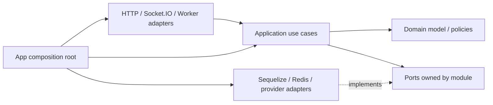

# 代码分层、接口与公共契约实施规范

阶段：开工前编码边界 SDD。本文回答各领域模块里的接口、service、工具函数、公共类型和函数应放在哪里、由谁依赖、如何测试。它落实[项目结构规划](./项目结构规划.md)和[技术架构决策说明](./技术架构决策说明.md)，不改变已经确定的 Vue/TypeScript、Koa、Socket.IO、Sequelize、pnpm monorepo 技术选型。

## 1. 当前覆盖度与目标

已有文档已确定：monorepo 包边界、前后端共享 TypeBox 契约、后端领域模块按 `domain/application/ports/adapters` 分层、Sequelize 仅在适配层、模块通过 `public.ts` 协作、workflows 编排跨域操作，以及禁止无归属的 `common/utils`。这些是架构原则，尚不足以让团队对 service 职责、接口形状、纯函数/副作用函数、事务传播、错误处理和公共工具归属形成一致实现。

本文把这些原则定成可直接用于代码评审与 CI 的规则。文中的 `wallet` 示例用于说明层次，不规定所有模块必须复制完全相同的文件数量；简单模块可合并文件，但不能跨越依赖边界。

## 2. 依赖方向铁律



- 外层可以依赖内层；domain 不依赖 Koa、Socket.IO、Vue、Sequelize、Redis 或 provider SDK。
- application 可依赖本领域 domain 和本领域定义的 ports；不能直接构造 ORM model 或 socket。
- adapter 实现 ports，可使用 Sequelize、Redis、支付 SDK、时钟、日志 exporter 等外部依赖。
- HTTP controller、Socket handler 和 worker consumer 是输入适配器：认证上下文解析、schema 校验、调用公开用例、映射响应；不放规则和账务逻辑。
- 跨域协调放 `backend/src/workflows`，依赖参与域的 `public.ts`；不直接 import 对方 `domain` 私有文件、仓储、adapter 或数据库表。
- 前端 feature 和 game client 可依赖公开 contracts 与浏览器能力包；不得依赖 backend、Sequelize Model、服务端配置或隐藏牌局数据。

不允许循环依赖。模块公共 API 的依赖图必须是 DAG；初始化时由 composition root 装配，而不是通过运行时互相 import 获取服务。

## 3. 什么叫接口

项目中“接口”分四类，各类不能混为一谈：

| 类型 | 位置/所有者 | 表达什么 | 示例 |
| --- | --- | --- | --- |
| 外部传输契约 | `packages/contracts`、`packages/admin-contracts` 或 `games/<key>/contracts` | HTTP/Socket 输入、输出、错误码及运行时 schema | `TransferCoinsCommandSchema` |
| 应用用例 API | 后端模块的 `public.ts` | 其他模块可以请求本领域完成什么业务 | `wallet.transferCoins(command, scope?)` |
| Port 接口 | 被依赖方模块的 `ports/` | 模块需要什么外部能力 | `WalletRepository`、`Clock` |
| 领域策略/协作者类型 | 所属 domain | 某个业务规则如何参与实体决策 | `PayoutPolicy`、`RoundScorer` |

TypeScript 的 `interface` 是结构类型，不是自动授权边界。调用 application API 时仍校验操作者、资源范围和当前状态。TypeScript 没有 Rust `trait`；以窄 interface/type contract 表达端口，不用继承链模拟 trait。

## 4. 后端领域模块标准布局

```text
modules/wallet/
  domain/
    money.ts                    Money value object / 精确单位运算
    wallet-policy.ts            纯规则、边界校验
    wallet-errors.ts            本领域错误码与失败类型
  application/
    transfer-coins.ts           一个业务命令/用例
    settle-round.ts
    get-wallet-summary.ts       查询用例
    commands.ts                 内部命令 DTO（若有必要）
  ports/
    wallet-repository.ts        本领域拥有的持久化能力接口
    asset-ledger.ts             本领域需要的 ledger port
    unit-of-work.ts             只在确有事务参与时引用共享事务契约
  adapters/
    sequelize-wallet-repository.ts
    sequelize-asset-ledger.ts
    row-mappers.ts
  transport/                    可由 server 装配，也可在 server/http 独立放路由
  public.ts                     唯一跨模块入口
  tests/
```

复杂游戏模块另按[游戏引擎与游戏模块边界](./游戏引擎与游戏模块边界.md)放 `contracts/rules/client/server/math`。不把业务领域再次拆成 workspace package，除非它已有独立构建、部署、版本兼容或多个消费者的真实需要。

文件可以合并，但语义边界不合并。例如小模块可把 entity 和 policy 放在一个 `domain.ts`；不能因为文件较少就让 controller 直接调用 Sequelize 或让 handler 持有钱包 model。

## 5. Service / Use Case / Function 的职责

### 5.1 Application use case

一个 application use case 表达一个可授权、可幂等、可审计的业务动作或查询，例如 `TransferCoins`、`SettleRound`、`ApproveAgentDomain`。它负责按顺序调用领域规则、仓储/外部 ports、事务和 outbox；它不负责 HTTP 状态码、Socket event 名或界面文案。

- 命名优先使用具体动作：`transferCoins`、`settleRound`、`getRoundSnapshot`，避免含义模糊的 `process`、`handleData`、`commonService`。
- 一个 use case 只编排一个业务意图。不要创建含几十个无关方法的 `WalletService` 或 `GameService` 巨型门面。
- 注入依赖；用例不从全局 singleton、Vue store、`process.env` 或隐式 service locator 取依赖。
- 查询不产生账务/状态副作用；命令明确说明幂等键、事务和重试语义。
- use case 输出领域结果或 `Result`；HTTP/Socket adapter 再映射到传输 DTO。

项目里的 `Service` 一词容易同时指业务编排、领域规则和外部客户端，因此新代码不以 `XxxService` 作为默认命名。优先命名为 `transferCoins`（应用用例）、`calculateReferralReward`（领域策略）或 `TronPaymentClient`（外部 adapter）。已有模块若保留 `XxxService`，必须在模块文档中写明它属于哪一类、谁可以调用、事务由谁拥有；不得让一个类同时承担三类职责。

应用用例采用显式输入、显式依赖和可判别结果。TypeScript 后端优先使用函数工厂，避免为了单一方法创建生命周期不明的对象：

```ts
type TransferCoinsDeps = {
  unitOfWork: UnitOfWork;
  wallets: WalletRepository;
  ledger: AssetLedger;
  ids: IdGenerator;
};

export function createTransferCoins(deps: TransferCoinsDeps) {
  return async function transferCoins(
    command: TransferCoinsCommand,
  ): Promise<Result<TransferReceipt, WalletFailure>> {
    return deps.unitOfWork.run(async (scope) => {
      const existing = await deps.ledger.findByRequestId(command.requestId, scope);
      if (existing) return { ok: true, value: existing.receipt };

      const accounts = await deps.wallets.lockTransferAccounts(command, scope);
      const decision = decideTransfer(accounts, command);
      if (!decision.ok) return decision;

      return deps.ledger.appendTransfer(
        { operationId: deps.ids.next(), command, decision: decision.value },
        scope,
      );
    });
  };
}
```

示例仅展示责任和依赖方向：金额计算、冻结及手续费规则属于 wallet domain；账户锁和分录持久化通过 port 完成；requestId 的唯一约束仍需数据库保证。依赖参数应保持窄小、按用例需要注入，不能把整个 infrastructure/container 传进去。

### 5.2 Domain service / policy

领域服务只承载不适合放入单一实体/值对象的领域规则，例如牌桌结算、返佣切分或奖励倍率计算。尽可能是无状态纯函数：相同输入与规则版本产生相同结果，不读取时钟、Redis、数据库、Socket、文件或网络。

如果规则自然属于一个 entity/value object，就放回该对象；不为每个概念机械创建 `XxxService`。领域服务不保存用户会话、不做 repository 查询、不提交事务。

### 5.3 Infrastructure service / adapter

Infrastructure adapter 封装外部技术接口，例如 `SequelizeWalletRepository`、`RedisPresenceStore`、`TronProviderClient`。它实现本领域 port，不定义产品策略，不通过 adapter 名字暴露成跨模块业务 API。

### 5.4 何时写函数、类或 interface

- 纯确定性计算、校验和转换优先写具名函数；纯函数不需要为“可测试”包成 class。
- 需要注入多个依赖并代表可识别业务动作的 application handler 可用函数闭包或 class；团队统一选一种风格后保持一致，不因 class 更“面向对象”而强制采用。
- 有生命周期、身份和不变量的业务对象用 class/聚合或受控 factory；不要把普通 DTO 变成可变 class。
- 多个实现需要替换、测试隔离或外部系统端口时定义 interface；只有一个稳定纯函数且没有替换需求时不为它制造 interface。
- 不写 `BaseService`、`BaseRepository`、`AbstractManager` 等通用继承框架；遇到真实重复时用小型组合函数/接口抽取。

实现评审按以下顺序判断：规则可由输入确定且不依赖外部状态，写 domain 函数；需要读取/写入端口并完成一项业务意图，写 application use case；需要把第三方/数据库协议翻译成 port，写 adapter；需要共享运行时结构时定义 interface/type。类仅在对象确有生命周期、身份/不变量或需维持一组有状态依赖时采用。函数不因为“以后可能复用”提前搬家，interface 不因为“方便 mock”而给每个纯函数套一层。

## 6. 函数与工具类规范

不存在全局“什么都能放”的 `common` 或 `utils` 业务目录。每个 helper 必须按所有权归档：

- 纯通用、无平台依赖的基础函数：`packages/domain-kernel`（仅稳定且至少有两个真实消费者时）。
- 业务概念函数：拥有该规则的领域 `domain/`，不可因另一个模块调用就迁到 `common`；跨域使用公开用例/明确定义的 shared value object。
- Sequelize、Redis、日志、时间、加密、网络 provider 的 helper：`backend/infrastructure` 对应 adapter/util 子域。
- Vue/Pixi DOM/渲染辅助函数：UI 或游戏 client 所有，不进入 domain-kernel。
- 配置和测试 fixture 是专用目录，不伪装成工具模块。

### 6.1 格式转换的归属判断

“格式转换”不是一个天然的公共领域。转换代码放在最靠近语义所有者的边界，并通过显式命名说明两端类型。评审时依次回答：转换是在解释业务含义，还是只改表示？它属于哪两个模型/协议？是否已有多个真实调用者且语义完全相同？

| 转换内容 | 放置位置 | 示例 | 是否进入公共包 |
| --- | --- | --- | --- |
| 外部输入字符串的语法解析/规范化 | 对应 transport schema/parser | 十进制整数字符串校验、UUID 解析 | 只有多个消费者、语义一致时共享纯 parser |
| HTTP/Socket DTO ↔ application command/response | 对应 HTTP 或 Socket adapter | `toTransferCoinsCommand`、`toWalletSummaryDto` | 通常不共享；传输协议本身共享于 contracts |
| Sequelize row ↔ domain entity | 拥有该 repository 的 adapter | `toWalletAccount(row)` | 不共享，避免 ORM 形状泄漏 |
| 单位、状态、资格、产品语义转换 | 负责该规则的领域 | CNY 分↔金币、USDT 汇率换算、派奖配置→规则快照 | 不进入通用包；放领域并使用精确单位类型 |
| 面向用户的日期、金额、文案展示 | web/admin/game UI 的呈现层 | `Intl.NumberFormat`、本地化时间 | 仅 UI 语义相同且多个客户端确实共用时进入 UI 包，不进 domain-kernel |
| 无业务语义的稳定表示转换 | `packages/domain-kernel` 或 contracts 的明确子模块 | 明确编码规则的 byte/base64 处理 | 满足下述共享门槛后才共享 |

公共转换必须同时满足：至少两个当前真实消费者；两端类型及规则完全相同；纯函数、无时钟/配置/环境/I/O；有明确维护 owner 和直接测试；不会把某一领域的单位、状态或隐含默认值带给其他领域。仅仅函数名都叫 `format`、代码重复几行或“以后可能复用”都不满足条件。达不到门槛时保留局部实现；第二个真实调用者出现后再比较语义，决定是否抽取。

命名必须写出方向和语义，例如 `parseCoinAmountInput`、`toWalletSummaryDto`、`toWalletAccount`。避免无上下文的 `formatData`、`convert`、`mapToModel`。跨层转换不能隐式发生；边界处显式调用 mapper，并验证不能表示的输入。金额、时间、汇率、游戏概率不得用通用 `number` 互相转换或靠字符串格式化推导业务值：领域使用最小单位整数/十进制定点表示和单位明确的类型；展示格式化只能发生在呈现层。

共享转换的测试覆盖边界值和往返/规范化性质（适用时）；协议 mapper 由 adapter contract test 验证；数据库 mapper 由 repository 集成测试验证。不得为了一个 mapper 单独建立“全项目格式转换中心”或万能 barrel。

工具函数应有单一且可描述的职责、显式参数/返回类型、无隐藏 I/O；名称说明动作/转换，如 `normalizePhoneNumber`、`formatCoinAmount`。有副作用的过程使用动词并放 application/adapter 边界，例如 `publishAnnouncement`，不要把写库函数命名为 `mapData`。

禁止：

- 函数内部读取 `process.env`、当前用户全局状态或默认 Redis client。
- `any`、无界泛型、静默吞异常、catch 后返回空对象/0/空数组掩盖失败。
- 通过 `index.ts` 万能 barrel 导出整个模块内部；公共导出只能走明确的 `public.ts`。
- 为单次调用机械拆文件、创建单方法工具类或重复封装原生 `map/filter`。
- 以字符串拼接、浮点金额或隐式时区处理金币/CNY/汇率/时间规则。

## 7. DTO、Schema、类型和常量

- 外部可控输入先经过一个运行时 schema，再进入应用用例；schema 是对应 DTO 静态 TS 类型的单一来源。契约使用项目最终选定的 TypeBox/相容库，不能另手写一套 validator/interface/OpenAPI。
- `packages/contracts` 仅导出玩家可见的公开 DTO/schema/非零常量；Admin 独立使用 `packages/admin-contracts`；游戏专属 payload 归属具体 `games/<gameKey>/contracts`。
- DTO 不等于 ORM model/domain entity。不能返回 Sequelize instance、数据库 row、隐藏牌、全量 config 或未经授权的代理数据。
- HTTP 与 Socket 输入字段采用显式版本、金额单位和幂等标识；钱以最小单位十进制整数字符串传输，日期以 ISO 8601 UTC 字符串传输。
- 状态/角色/领域错误 code 都在各自领域集中定义、不可用 0；0 只在明确约定的筛选输入中作“未选择”哨兵，进入领域命令前转换为 `undefined`/无 filter。
- 联合状态优先用带判别字段的 discriminated union；不要把许多 nullable 字段拼成非法组合。
- 外部/API enum 值发布后视为兼容承诺；移除/改义须升级 schema version 和迁移窗口。

```ts
// contracts/wallet.ts
export const TransferCoinsCommandSchema = Type.Object({
  requestId: Type.String({ format: 'uuid' }),
  receiverUserId: Type.String({ pattern: '^[1-9][0-9]*$' }),
  amountCoins: Type.String({ pattern: '^[1-9][0-9]*$' }),
  expectedWalletVersion: Type.Integer({ minimum: 1 }),
});
export type TransferCoinsCommand = Static<typeof TransferCoinsCommandSchema>;
```

schema 同时规定长度、范围、单位、可选字段和未知字段策略；数据库权限/余额等事实由服务端用例校验，不试图用 schema 替代领域授权。

## 8. 错误与返回值

### 8.1 分类

| 类别 | 例子 | 表达方式 | 由谁转换 |
| --- | --- | --- | --- |
| 预期业务拒绝 | 余额不足、房间已满、阶段已过、权限不足 | 稳定的领域错误 code，带安全所需最小字段 | HTTP/Socket adapter |
| 输入格式错误 | 字段缺失、金额格式非法 | schema validation issues | HTTP 400 / Socket validation ACK |
| 可重试依赖故障 | DB 暂不可用、provider timeout | infrastructure error + retryability，不泄露堆栈 | application boundary / adapter |
| 未知程序故障 | invariant 被破坏、未分类异常 | 记录 trace/correlation id，返回通用失败 | 最外层 error middleware |
| 结果未知 | 命令可能已提交但 ACK 丢失 | 原 `requestId/commandId` 查询/重试，不创建新业务动作 | 对应用用例的重查接口 |

预期业务拒绝应由团队统一的判别联合表达，而不是用异常控制常规分支：

```ts
type Result<T, E extends { code: string }> =
  | { ok: true; value: T }
  | { ok: false; error: E };
```

数据库、网络等非预期故障可抛基础设施异常，由单一边界映射为安全错误并保留 cause/trace。禁止在 controller、worker 和 use case 多层重复 catch/re-wrap，禁止把内部错误 message/SQL/provider secret 返回客户端。

错误 code 有所属领域和稳定名称，例如 `WALLET_INSUFFICIENT_AVAILABLE_BALANCE`、`ROOM_ROUND_ALREADY_SUBMITTED`；不要让前端依赖 message 文本。传输层同时使用合适 HTTP 状态和业务 code；Socket ACK 有成功/失败判别结构及可恢复状态摘要。

每个领域维护自己的 `Failure` 判别联合和非零错误常量；用例只返回预期业务拒绝。Schema 错误在输入 adapter 转成协议验证响应，不能进入 domain；唯一键冲突、死锁等仅在可识别且有确定业务语义时由 repository/application 边界映射成已有失败 code。其余数据库/网络异常保留 cause 并抛给最外层错误边界。不得把异常直接当作业务 Result 返回，也不得把内部异常文本传给用户。

错误映射集中在每种 transport 的边界映射表中：例如同一 `WALLET_INSUFFICIENT_AVAILABLE_BALANCE` 可映射为 HTTP 409 与 Socket 业务 ACK code，客户端文案按 `code` 本地化。权限拒绝、资源不存在等是否区分须遵循该 API 的信息披露规则。日志包含 request/correlation id、领域 code 和可重试标记，不记录密钥、JWT、完整支付凭证或不必要的个人信息。

## 9. 事务、Sequelize 与 Repository

- Sequelize 只出现在 `adapters` 与 `infrastructure/database`。Domain、public contracts、游戏纯规则不能 import Sequelize、mysql2、Model、DataTypes 或 `Transaction`。
- Model 与数据库列映射集中在 adapter；公开 repository 返回领域对象/投影 DTO，不把 ORM 实例泄露给 application。
- Sequelize `sync({ alter: true })` 不用于部署；schema 变化通过版本化 migration，按[数据库设计规范与 Sequelize 方案](../05_data/数据库设计规范与Sequelize方案.md)执行。
- 事务由 Sequelize adapter/infrastructure 建立；应用 use case 定义业务原子边界。锁顺序、唯一幂等约束、资产分录和 outbox 的提交顺序由领域 SDD 决定。
- 若工作流要让 wallet/referral/game 变化同事务提交，使用共享的 opaque `TransactionScope` 协议传递事务参与权；它不暴露 SQL connection、Sequelize Transaction 或 query interface。只能由 infrastructure 创建 scope，各 repository adapter 验证 scope 属于当前 Unit of Work。
- 单域用例没有外部 scope 时建立并拥有事务；已加入跨域 Unit of Work 时加入同一事务，不可静默另开提交事务。嵌套事务/保存点只有在用例明确需要并通过 DB adapter 提供时使用。
- 不在事务中调用慢 HTTP/provider；支付流程先创建本地幂等订单，再在事务外调用 provider，回调/查询结果再以幂等事务落库。资金和 outbox 同库原子提交。
- 每一个资产写操作必须通过 wallet application API；service/repository 无权直接更新资产余额来代替分录。

`TransactionScope` 是 infrastructure 创建的 opaque capability。repository port 中涉及同一原子边界的方法显式接收 scope；scope 不含可供业务代码读取的 transaction 属性。实现形态如下，接口名可微调，但传播语义必须一致：

```ts
declare const transactionScopeBrand: unique symbol;
export type TransactionScope = { readonly [transactionScopeBrand]: true };

export interface UnitOfWork {
  run<T>(work: (scope: TransactionScope) => Promise<T>): Promise<T>;
}

export interface WalletRepository {
  lockTransferAccounts(command: TransferCoinsCommand, scope: TransactionScope): Promise<TransferAccounts>;
}
```

`UnitOfWork.run` 在 Sequelize adapter 内开启事务、创建 scope，并在 callback 成功时 commit，异常时 rollback；不会把 Sequelize `Transaction` 返回给 application。各 Sequelize repository 仅接受由当前 UoW 创建的 scope，并从受控的 scope registry 取得真实 transaction。`run` 不自动吞掉/重试业务错误；Result 作为正常返回值时是否 commit 由用例约定，通常预期拒绝发生在写入前，若拒绝可能发生在写入后则应抛出内部 rollback signal 或先完成所有校验，避免“失败 Result 却提交部分写入”。

事务所有权必须显式且只有一个：普通入口用例调用 `unitOfWork.run`；由跨域 workflow 统一开事务时，调用参与者的 scoped API 并传入同一个 scope，参与用例不得再次调用 `run`。对外的默认 API 不暴露可选 scope 造成调用者随意改变原子边界；若确有 workflow 参与需求，在 `public.ts` 暴露单独命名的内部协作 API（例如 `transferCoinsInScope`），并限制其使用范围。禁止静默嵌套事务、scope 缺失时降级为非事务写入、跨请求保存 scope。

单元测试以 fake UoW 记录 callback 与失败回滚；MySQL 集成测试验证真实 Sequelize transaction、锁、死锁映射及 outbox 原子性。业务代码和测试 fake 均不能构造假的 Sequelize transaction。

## 10. Public API、Composition Root 与依赖注入

每个后端领域仅 `modules/<domain>/public.ts` 是其他模块可依赖的入口。它可导出：

- 本领域授权后的 command/query use case 接口或可调用函数。
- 其他领域确实需要的稳定 DTO/结果 code；跨端 DTO 仍由 contracts package 所有。
- composition root 所需的 adapter 工厂类型（仅当其他层要装配它）。

它不导出 repository implementation、Sequelize model、私有 domain policy、内部 SQL row mapper 或未经筛选的用户数据。

Composition root 位于 `apps/server/src/bootstrap`、`apps/worker/src/bootstrap` 或测试入口，负责一次性创建 Sequelize、Redis、日志、clock、repository adapters、use cases，再把它们注入 HTTP/Socket handlers。领域模块内部不得 `new Sequelize()`、读取 env、连接 Redis 或在 import 时启动 timer。浏览器应用在 `apps/web/src/app` 装配 platform-client、feature services 和 game registry；Admin 独立装配自己的 contracts/权限 UI。

不要求引入重型 DI 容器。构造函数参数、工厂函数和显式对象组合即可；避免全局 service locator。每个 bootstrap profile（HTTP server、worker、测试）都要能控制真实/Stub adapter。

装配以显式模块工厂为单位，bootstrap 保留创建真实 adapter 和连接的唯一职责：

```ts
const walletPorts = createWalletAdapters({ sequelize, redis, logger, clock });
const wallet = createWalletModule(walletPorts);
const server = createHttpServer({ transferCoins: wallet.transferCoins, auth, logger });
```

`createWalletModule` 组合本模块用例，不连接资源；`createWalletAdapters` 实现 ports；`createHttpServer` 只接收 handler 所需能力。依赖按最小能力注入，不传通用 `AppContext` / `Container`。测试直接以 fake ports 调用工厂，不启动整个服务。模块不得在 import 时连接 DB、启动 timer 或读取环境变量；所有环境配置在 bootstrap 解析后作为不可变配置对象传入。

## 11. 公共代码包归属

| 代码 | 唯一权威位置 | 可以被谁使用 | 示例 |
| --- | --- | --- | --- |
| 玩家 HTTP/Socket schema 和 DTO | `packages/contracts` | web、backend transport、game host | wallet command、room snapshot |
| Admin schema/DTO | `packages/admin-contracts` | admin app、backend admin transport | Admin user query |
| 纯稳定值对象/跨域无副作用基元 | `packages/domain-kernel` | server domain 与批准使用者 | 金额单位 primitives、结果类型 |
| 平台游戏 ABI | `packages/game-sdk` / `game-protocol` | Host、games modules | manifest、通用 envelope |
| 领域规则与用例 | `packages/backend/src/modules/<domain>` | 通过 public API 调用 | wallet transfer、identity recovery |
| UI 组件 | `packages/ui` | web/admin H5 | Button、dialog shell |
| 运行时/DB/Redis 工具 | `backend/infrastructure` | backend adapters | unit of work、Redis connection |
| 游戏规则/玩法 DTO | `games/<gameKey>` | 对应游戏模块与其 handler/math | thirteen-card scoring |

“被两个地方用到”本身不足以抽成公共库。只有语义相同、变更节奏一致、没有环境副作用并有明确 owner，才抽取共享实现；否则允许小段显式重复，避免公共包演变成无法归属的业务大杂烩。

## 12. 游戏接口与公共领域接口

游戏 server handler 通过窄端口接入平台服务：`RoundContext/RulesSnapshot`、合法动作校验、可恢复状态、结算意图及 math model。Handler 不拿 wallet repository；只能返回由平台 settlement workflow 校验的 `GameSettlementIntent`。客户端 game module 通过 SDK 收到经授权快照和能力对象，不拿原始 JWT、Koa context、原始 Socket.IO socket 或全局 Pinia store。

平台提供 session/room/wallet/asset/resource 端口；游戏之间不能调用另一款游戏的私有实现。机器人的策略属于对应 `games/<gameKey>/bot`，不能从平台通用工具获取真人隐藏状态。

## 13. 测试对应关系

| 单元 | 必要验证 |
| --- | --- |
| Domain pure function/policy | 边界、性质/不变量、非零状态、精确整数金额；不启动 DB/Redis |
| Application use case | 成功/业务拒绝/幂等/事务回滚；ports 用 stub/fake |
| Sequelize adapter/repository | MySQL 集成测试、索引/锁/唯一约束、migration 与领域映射；不可只 mock ORM |
| HTTP/Socket adapter | schema、鉴权拒绝、DTO/error mapping、ACK 与重试保持 command ID |
| Workflow | 跨域同事务、outbox 原子性、回滚不部分入账 |
| Game handler | 固定 rules snapshot、序号/fencing、恢复重放、不可伪造结果、模块 contract |
| Browser feature/service | 公开 DTO 消费、过期会话、重连/加载/错误 UI；不验证服务端业务权威 |

测试不复写实现细节；纯规则测结果，adapter 测技术映射，workflow 测边界和事务。跨应用 e2e 只覆盖高风险闭环，不为每个 helper 建测试文件。

## 14. CI / Code Review 闭环

- TypeScript `strict`、`noUncheckedIndexedAccess` 和一致的 ESLint/formatter；禁止隐式 `any` 与忽略编译错误作为常态。
- `dependency-cruiser`（或同等轻量工具）校验层级、workspace 依赖、Node/browser 环境边界和循环引用。
- CI 校验 contracts schema/type 一致、OpenAPI/AsyncAPI 产物无意外破坏、领域状态/error 常量无 0 值。
- 检查 backend module 对外 import 只能经过 `public.ts`；游戏 client bundle 中不得包含 backend/ORM/密钥配置。
- migration lint 检查全表公共字段、状态常量、注释、FK 列命名及 Sequelize migration/model 对齐。
- Code review 问题：规则归属哪一域？是否纯函数？是否有副作用？谁有权调用？事务是否同一个？DTO 是否运行时校验？失败是否可幂等重查？是否新造公共工具或抽象？

## 15. 端到端示例：转账

```text
Socket/HTTP adapter
  ├─ 验 JWT、请求权限
  ├─ TransferCoinsCommandSchema.parse(input)
  └─ wallet.public.transferCoins(command)
       ├─ application：幂等检查、调用 wallet domain policy、开 UnitOfWork
       ├─ wallet port：锁定 sender/receiver accounts
       ├─ domain：校验余额、5% 发送方额外手续费、冻结和可用额
       ├─ ledger adapter：写一出两进 asset_entry + asset_operation
       ├─ outbox adapter：同事务写资产变更提示
       └─ 返回 TransferReceipt / WalletFailure
  └─ adapter 映射 HTTP status 或 Socket ACK；绝不直接改前端资产状态
```

Domain policy 可以做纯函数测试；use case 用伪仓储测业务流程；MySQL 集成测试验证锁与分录守恒；弱网 e2e 验证同一 requestId 重试不重复转账。这些工作遵循资金领域既有规则，不另创造第二套转账语义。

## 16. 开工 Checklist

- ✅ 领域包依赖方向、Sequelize adapter 边界、contracts 归属与禁止公共 `common/utils` 已有架构决定。
- ✅ 明确接口四类、application/domain/infrastructure 职责、Service 命名、函数/class/interface 取舍、错误分类与 transport 映射、事务 scope 传播、composition root 与测试对应关系。
- ✅ 明确格式转换归属、共享门槛、显式 mapper 命名及跨层金额/时间单位约束；禁止建立无 owner 的公共转换中心。
- ✅ 本文与项目结构、数据库规范和架构评估形成链接；每项规则有评审/CI 落点。
- ✅ 初始 workspace 已启用 TypeScript `strict`、`noUncheckedIndexedAccess`、浏览器/Node 独立 module resolution，并以共享 TypeBox schema 跑通 H5/API 探活。
- ⬜ 增加 `public.ts` import boundary、cycle/environment checks 与完整 schema contract CI。
- ⬜ 用 identity、wallet、game-host 各实现一个纵向切片，验证 `TransactionScope`、Result error、DI 和 migration 约束够用后再批量铺模块。
- ⬜ 把运行契约映射到 OpenAPI/Socket event schemas 和 admin permission paths；保证 contract 测试覆盖弱网重复/结果未知场景。

## 17. 关联文档

- [项目结构规划](./项目结构规划.md)
- [技术架构决策说明](./技术架构决策说明.md)
- [HTTP 接口与共享 DTO 协议 SDD](./HTTP接口与共享DTO协议SDD.md)
- [架构评估与落地方案](./架构评估与落地方案.md)
- [数据库设计规范与 Sequelize 方案](../05_data/数据库设计规范与Sequelize方案.md)
- [游戏引擎与游戏模块边界](./游戏引擎与游戏模块边界.md)

## 18. 前端离线闭环与后端 DTO 复用

前端施工按领域 application use case 划分，离线模式不是 Vue 页面直接维护一套“假业务”，而是同一 use case/DTO 契约的本地 adapter。正式 HTTP/Socket.IO adapter 和本地 adapter 接受相同的契约输入、返回相同的领域结果 DTO；View 只负责呈现和派发用户意图，不直接计算返佣、钱包资格、房间状态或游戏结算规则。

依赖方向为 `Vue View → 前端领域 application use case → port → adapter`。纯规则放领域模块，跨层输入在 use case 前按共享 TypeBox Schema 验证；offline adapter 将领域仓储 port 实现为进程内/in-memory 状态，不访问生产 API、数据库、Redis 或真实支付渠道。若需要页面刷新后继续 demo，可单独使用版本化的浏览器存储 adapter，但不能把它当作服务端权威账本或身份。

运行模式由 composition root 注入，不允许页面按 URL 参数、LocalStorage 可编辑值或用户输入自行提升权限：

| 模式 | Adapter 与行为 | 可允许范围 |
| --- | --- | --- |
| `LOCAL_DEMO` | 本地 application adapter + 内存仓储，使用共享请求/响应 schema；不签发身份凭证 | 导览、页面 CRUD 演示、社区草稿、模拟流程和游戏练习；资金/支付/赔率/后台发布只能运行隔离模拟，不产生真实交易或服务端事实 |
| `LOCAL_BROWSER_SERVER` | 浏览器内 Request/Response dispatcher + IndexedDB；调用与 Koa 相同的 endpoint registry/DTO/envelope，可发行独立 dev issuer/audience 的本地 access token | 只在开发构建验证完整 HTTP API 与页面会话流程；数据仅属于当前 origin，不测试真实认证安全，不产生正式账号、资产或服务端事实；production build 禁止装配 |
| `REMOTE` | HTTP/Socket.IO adapter，携带 JWT/会话、稳定 request/idempotency key，按服务端响应呈现 | 只有服务端授权及领域用例确认后才呈现为正式业务结果 |

离线演示的边界：

- 同一 UI use case 不因 adapter 不同复制第二套领域规则；adapter 只负责读取/保存演示状态、模拟可预期故障并映射到同一 `Result/DTO`。
- 演示数据使用独立的 `demo` source 标记/容器，不能混入真实账户快照、服务端列表、缓存或报表；切换到 `REMOTE` 时丢弃或明确保留为本地草稿，不自动提交。
- `LOCAL_DEMO` 不得伪造 JWT、userId 授权、TOTP challenge 或正式登录成功。`LOCAL_BROWSER_SERVER` 是经用户明确选择的开发模式例外：可用 IndexedDB、本地凭证与独立 dev issuer/audience 模拟正式端点形状，但本地 token 不能被 REMOTE 或正式服务接受，也不能作为认证安全验收证据。详见[浏览器开发服务器与 IndexedDB 适配器 SDD](./浏览器开发服务器与IndexedDB适配器SDD.md)。任何需要真实认证才能授权的命令在 REMOTE 模式仍由服务端验证。
- 钱包、返佣、充值、提现、支付、真实赔率/概率发布等高风险流程可在 demo 中演练表单校验、确认摘要、状态变化、取消和错误恢复，但结果必须标注演示且只写本地 sandbox；不能展示为真实到账、审核通过、账户已绑定或全局配置已发布。
- 游戏对局若使用本地 handler，只能标识本地练习。需要机器人、随机数或奖励的演示结果不得进入用户资产、运营统计或 RTP 生产数据。
- demo 命令同样走运行时 DTO 校验、use case 和失败类型。测试必须覆盖正常、业务拒绝、取消、重复动作/幂等、关闭返回原页和刷新/离开行为；不要在 View 中 `setTimeout` 一段成功文案代替状态转换。
- 每个可操作入口都必须给出完整终态或安全退出：成功返回来源页并更新本地投影；拒绝留在当前表单并保留有效输入；未知结果显示查询/恢复入口；取消不改数据并能回到来源；暂未支持的终端动作可禁用，但页面必须提供可用的返回、继续浏览或联系/帮助路径。

测试按层组织：domain unit tests 验规则；application tests 使用内存 port 验用例序列；adapter contract tests 使用共享 DTO schema 确认 Local/HTTP adapter 投影一致；浏览器 E2E 覆盖页面路由、几何及完整离线旅程。离线 adapter 测试不得计作服务端联调证据。

## 变更历史

| 日期 | 变更 |
| --- | --- |
| 2026-10-10 | 补全应用用例代码模式、Service 命名、错误映射、事务 scope 传播及模块工厂式依赖装配；新增格式转换归属矩阵与公共化门槛。 |
| 2026-10-10 | 回写基础 workspace 的 strict TS 与 H5/API 共享 schema 验证状态，保留依赖边界 CI 未完成项。 |
| 2026-10-10 | 增加 HTTP envelope、共享 DTO/schema 与 OpenAPI 专项协议文档的关联。 |
| 2026-10-10 | 新增接口、service/use case、函数/工具类、公共契约、错误、事务与 DI 的可施工编码边界和验收规范。 |
| 2026-10-14 | 定义纯前端离线闭环的 DDD adapter、共享 DTO、演示身份及资金/权限模拟边界。 |
| 2026-10-14 | 增加用户要求的 LOCAL_BROWSER_SERVER 模式；限定为 dev-only、IndexedDB 隔离和独立 JWT issuer/audience，并链接专项 SDD。 |
