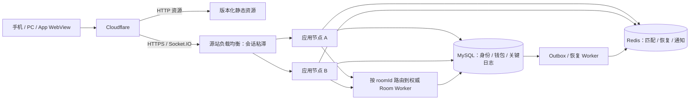

# 技术架构决策说明

更新：2026-10-08。本文记录用户已确认的技术方向，并给出建议实现。当前仓库尚无应用代码；以下容量、超时、资源体积与排期均为设计目标，不是实测结果。

本轮细化见 [架构评估与落地方案](./架构评估与落地方案.md)、[项目结构规划](./项目结构规划.md)、[网络预加载设计](./网络预加载设计.md) 与 [资料查阅索引](../08_reference/资料查阅索引.md)。目录/依赖以结构规划为准；本页保留用户确认约束，参数与实现细节由专项设计补充。

## 1. 已确认约束与待定事项

| 项目 | 已确认方向 |
| --- | --- |
| 客户端 | 手机/PC 浏览器，及 iOS、Android、Windows、macOS、Linux App；不接微信体系 |
| 界面 | 大厅/Admin 使用 Vue 3 + TypeScript + Vite；Admin UI 使用 Element Plus；具体游戏使用 PixiJS；全部视觉美术由 AI 创作 |
| 通信 | 大厅请求主要 HTTP；通知、资产与在线状态用 Socket.IO；游戏内部用 Socket.IO |
| 网络 | 特别优化高丢包弱网下的资源加载与恢复 |
| 容量 | 同时在线不超过 20,000 人；按上限规划并压测 |
| 部署 | 国外云 + Cloudflare；大陆 IP 路由到独立大陆优化云主机，该接入由用户负责；尚无数据库与服务器 |
| 开发/发布 | 开发、构建和发布均在 Docker 环境执行；Docker Compose 项目名 `gameing-hall-pixi`，数据卷显式持久化并配置容器外备份 |
| 登录 | 设备指纹 + 设备摘要形成设备码；不接微信 |
| 资产 | 充值购买金币；返点入余额，金币兑换余额后提现；本人计入五级；换绑仅 Admin 操作；Admin 管理双账本与配置 |
| 仓库 | monorepo 开发自家游戏，外部接入先保留 Stub |
| 版本 | 有 LTS 采用最新受支持 LTS，其余采用最新稳定版；固定版本并维护升级 |

已确定 user 单表角色/奖励常量、JWT、本人计入五级/四个上级比例、Admin 换绑、5% 发送方转账费、浏览器优先、卡通 AI 美术及全表基础字段。最新人民币余额/默认 1:10、代理方式/TRON USDT、注册赠币 1000、提现费 5%、二维码/邀请链接 2 年、客服文件保留 2 年、赠币统一金币/有效下注流水/禁转出、客损代理线下结算、玩法由 game_config 开关、整数倍提款和身份三选一、开发/测试 Mock 支付页面、直连 Redis 最新邀请码见 [支付与流水设计](../04_domains/支付渠道流水要求与直连归因.md) 与 [数据库 SDD](../05_data/数据库设计SDD.md)。生产支付商户/出款商、汇率源/时点、链确认数、客户端资源加密密钥服务及阶段性运营细则在对应模块前锁定；大陆分流由用户安排。

## 2. Vue 与服务端的领域规划

数据规范最终以 [Sequelize 数据库方案](../05_data/数据库设计规范与Sequelize方案.md) 为准：id BIGINT UNSIGNED、非零 status、created_at/updated_at/deleted_at DATETIME、snake_case 引用与注释，物理表单数命名。系统账户资产来源、净充值、返点/兑换和提现见 [记账设计](../04_domains/系统账户与资产记账设计.md)，旧复数/前缀引用仅为已被替代草案。

玩家端使用 Vue 3 + Vue Router + Pinia + TypeScript + Vite；管理端使用 Vue 3 + TypeScript + Vite + Element Plus。两者是独立应用，各自按需引入 UI 和业务 chunk。Pinia 保存身份、目录、钱包版本与界面状态；规则计算与资产操作不放进 Vue 组件或全局 store。pnpm workspace 管理 monorepo。共享契约包提供运行时 schema、DTO、接口类型与状态/业务常量；共享纯领域包仅放跨端确实共用的无副作用值对象/函数。Sequelize Model、仓储和服务端用例不得进入浏览器共享包。TypeScript 没有 Rust `trait`，用窄 interface/type contract 表达跨域端口，不通过继承式 mixin 共享隐藏行为。Vite 会转译 TS，但构建流程需另跑 `vue-tsc`/`tsc` 做类型检查。[Vite TypeScript](https://vite.dev/guide/features.html#typescript)、[Element Plus 按需导入](https://element-plus.org/en-US/guide/quickstart)

| 领域 | 所有权与职责 | 不应承担的职责 |
| --- | --- | --- |
| identity | 账号、设备注册、会话与凭证轮换 | 直接修改钱包或代理关系 |
| referral | 邀请码、邀请/代理绑定、关系校验与变更审计 | 自动合并账号或直接发放佣金 |
| wallet | 余额、冻结、发放、转账、结算流水 | 计算十三张牌型 |
| payments | 充值购买金币、出款渠道、结果验证、对账 | 绕过双资产账本直接变更余额 |
| catalog | 游戏目录、封面、档位、当前规则配置及牌局快照 | 控制牌局状态 |
| configuration | game_config/system_config 校验、版本发布、审计与白名单读取 | 保存客户端可读的密钥或修改当局快照 |
| matchmaking | 排队、领取、取消、唯一归属 | 独立决定资产扣除 |
| room | 座位、准备、控制权、房间生命周期 | 接受客户端自报胜负 |
| game-shisanshui | 持牌、三墩、相公、比较与当局得分 | 直接读写用户钱包 |
| presence | 连接代次、在线/重连状态、授权范围内订阅 | 向全服广播所有用户状态 |
| history | 战绩、已授权回放、历史查询 | 修改已完成结算 |
| administration | 管理员权限、审计、管理操作编排 | 绕过 wallet 直接改余额 |
| game-integration | 自家模块注册、生命周期、外部 Stub | 允许外部游戏直接访问钱包数据库 |

赠币与普通金币统一，赠送增加有效下注流水要求，未完成禁提款/转出。客损模式由代理线下掌握充值/提现并结算；平台依据直属上级模式限制用户资产入口，祖先链上级可向该用户供币。余额 CNY、默认 1:10、代理方式/TRON USDT、1000 枚整数倍与身份三选一见 [最新细化](../04_domains/支付渠道流水要求与直连归因.md)。

依赖方向：界面/传输层 → 应用用例 → 领域模型 → 仓储端口；MySQL、Redis、Socket.IO 和浏览器存储是端口的适配器。领域模型不依赖 Vue、Koa 或 Socket.IO。

monorepo 细化为 apps（入口）、packages/backend（平台领域模块与通用游戏集成）、contracts/platform/resource-runtime/game-sdk/game-host 等共享包，以及 games/shisanshui 的 manifest/contracts/rules/client/server/assets/tests 自包含模块。平台运行时通过版本化契约支持 room-round（十三张）、spin-round（跳高高/夺宝奇侠，稳定 ID 为 slot5/slot3；麻将胡了系列、赏金女王）、realtime-session（捕鱼）及 scheduled-draw（3分钟投注并从外部数据源开奖的“3快”）。各游戏只实现自己的 client 与权威 server handler；新增自研游戏不复制大厅、身份、资产账本和资源调度。陪玩机器人、数学模型与概率展示按独立设计执行；跨模块事件通过 outbox、受控 event evaluator 与脱敏广播 projector 处理。外部游戏使用隔离适配器 Stub，不与本地模块共享信任边界。初版不把每个后端领域做成独立 workspace 包；HTTP 与 worker 通过同一 backend 包公开入口复用用例。完整责任边界见 [游戏引擎与游戏模块边界](./游戏引擎与游戏模块边界.md)、[平台事件与广播系统设计](../03_game_systems/平台事件与广播系统设计.md)、[陪玩机器人与概率模型设计](../03_game_systems/陪玩机器人与概率模型设计.md) 与 [项目结构规划](./项目结构规划.md)。

服务端权威代码与公开客户端协议独立导出，不能通过共享包把数据库配置、Admin 操作或全量牌局信息打进浏览器。禁止跨领域访问私有仓储；Admin 使用相同领域用例并附加权限与审计。目录配置引用受控资源清单，不能执行任意远程脚本。

## 3. HTTP 与 Socket.IO 的职责

HTTP 负责设备注册/登录、会话刷新、绑定申请、游戏目录、档位、钱包查询、转账、战绩、配置与 Admin。POST 转账和金币调整带幂等键；超时后查询原操作状态，不使用新业务 ID 盲目重发。

Socket.IO 负责 `wallet.changed、presence.changed、notification.created、match.updated` 等推送，以及进入房间后的准备、提交、快照、比牌和结算事件。资产变更通知只携带用户有权查看的余额/版本与业务 ID；实际变更在服务端事务完成，不因收到通知而再次入账。

建议一个共享 Socket.IO Manager，逻辑上区分 `/platform` 和 `/game` namespace；正常情况下复用一条底层连接。进入游戏不再单独重复建平台连接，具体复用行为在真实容器中验证。Admin 使用独立 audience 和权限校验入口，但账号主记录仍是统一 user。namespace 和 Socket.IO room 都不是天然权限边界，每次加入与敏感命令均验证会话、账号和业务归属。



首版保留 Socket.IO 的 polling 与 WebSocket upgrade，以覆盖不能正常建立 WebSocket 的网络；不能只凭“丢包高”假定 polling 更快，选择以真实链路测试为准。启用 polling 后，多节点需要粘滞会话；优先使用负载均衡 Cookie，不依赖会随 Wi-Fi/蜂窝切换而变化的 IP。[Socket.IO 多节点部署](https://socket.io/docs/v4/using-multiple-nodes/)

跨节点采用 Redis Streams adapter，支持 connection state recovery；传统 Redis Pub/Sub adapter 不提供同样的恢复能力。建议恢复窗口先试 120 秒、`skipMiddlewares: false`，重连后重新验证账号是否封禁或会话撤销。恢复成功也要检查 roundId、版本和钱包版本；恢复失败则发送完整授权快照。[Socket.IO 恢复机制](https://socket.io/docs/v4/connection-state-recovery/)、[Redis Streams adapter](https://socket.io/docs/v4/redis-streams-adapter/)

Socket.IO 默认投递是 at-most-once，ACK/retry 不能自动解决重复业务执行。关键命令携带 `commandId/requestId、roundId、schemaVersion`，服务端先查幂等记录再执行；临时提示可丢弃，提交与转账确认必须可重查。客户端仅在会话和牌局仍有效时重发，过期命令从缓存清除；重连后不能把离线积压的“准备/提交”不经检查地全部发出去。[Socket.IO 投递保证](https://socket.io/docs/v4/delivery-guarantees/)

钱包推送带 `walletVersion`：忽略旧版，发现跳号或不确定时 HTTP 重取。在线状态按账号当前有效连接聚合，断线先标记重连中，短暂宽限后离线；牌局截止时间不随在线状态暂停。订阅仅限自己、同桌和业务允许的相关用户。

### 3.1 Socket.IO 消息格式与共享契约

首版固定使用 Socket.IO 事件名 + JSON payload，不另造传输协议，也不立即切换 MessagePack。Socket.IO 的事件、ACK、重连和连接恢复负责传输层能力；业务消息的字段、运行时校验、版本演进及幂等由共享契约和领域用例负责。Socket.IO 支持自定义 parser，MessagePack 在部分载荷上可降低体积，但会增加调试成本；只有压测确认实时消息带宽成为瓶颈后才评估启用，并要求服务端及所有客户端 parser 一致。[Socket.IO 工作机制](https://socket.io/docs/v4/how-it-works)、[自定义 parser](https://socket.io/docs/v3/custom-parser)

玩家端的事件名、TypeBox schema、DTO、事件常量和推导出的 TypeScript 类型集中在 `packages/contracts`。TypeBox schema 同时作为静态类型来源和服务端运行时输入校验依据；浏览器类型检查不构成安全校验。管理端专属契约放在 `packages/admin-contracts`，服务端对每个客户端命令在领域用例入口校验权限、归属、牌局阶段和 payload。游戏特有消息由 `games/<gameKey>/contracts` 定义，平台引擎只依赖稳定的游戏模块接口，不解释不同玩法的业务 payload。HTTP envelope、状态码、OpenAPI 生成及与 Socket.IO 共用业务 DTO 的边界见[HTTP 接口与共享 DTO 协议 SDD](./HTTP接口与共享DTO协议SDD.md)。[TypeBox](https://github.com/sinclairzx81/typebox)

Socket.IO event name 是消息类型的唯一来源，不在每个 payload 里重复写 `eventType`。命令与服务端事件使用不同 DTO：

```ts
type SocketCommand<TPayload> = {
  commandId: string; // 同一逻辑操作的弱网重试沿用同一 ID
  schemaVersion: number; // 首版从 1 开始
  payload: TPayload;
};

type SocketEvent<TPayload> = {
  eventId: string;
  schemaVersion: number; // 首版从 1 开始
  stateVersion?: number; // 房间/钱包等权威状态单调递增
  payload: TPayload;
};
```

ACK 表示该 `commandId` 已被服务端接受或得到明确拒绝；对可能因断线而不确定的命令，客户端使用相同 `commandId` 重试，服务端通过幂等记录返回原处理结果，不重复执行资产或牌局副作用。ACK 不代表客户端可直接改本地账本；资产最终状态仍以服务端快照为准。临时提示可以丢弃，关键结果需可由 HTTP 或状态快照重新取得。

每个房间/权威对象维护单调递增的 `stateVersion`。客户端收到较旧版本时忽略；发现版本跳跃、重连恢复失败或本地状态不可信时，暂停应用增量事件并通过 HTTP/受权快照重建，再继续接收更高版本事件。普通通知可用 eventId 去重；需要可靠补拉的聊天、结算与资产历史仍以持久化记录和业务游标为准，不能把 Socket.IO adapter 或内存事件当作长期队列。

契约变更默认向后兼容：只增加可选字段或新增事件；不可兼容变更提升 `schemaVersion`，在服务端按已协商/支持的版本解析，并在旧客户端退出支持前提供迁移窗口。枚举/状态常量在代码中集中定义，合法业务值从 1 开始，0 保留给“未选择/无值”等约定。CI 至少执行 schema 示例校验、共享包类型检查和破坏性契约变更检查。

AsyncAPI 可作为后续的机器可读事件目录与文档生成输入，描述消息、通道和协议；它不替代 Socket.IO parser、TypeBox 运行时校验或领域授权。首版不为文档引入独立服务。[AsyncAPI 3.0 规范](https://www.asyncapi.com/docs/reference/specification/v3.0.0)

## 4. 高丢包弱网下的加载与恢复

弱网设计分三条链路：HTTP 下载、Socket 状态同步、客户端渲染启动。图片和代码不经 Socket.IO 发送。大陆 IP 使用用户安排的独立大陆优化云主机接入，网络选型不再作为未解决事项。应用侧重点是资源体积、缓存复用与高丢包下的重试，不把线路配置作为开发阻塞。

### 4.1 资源分级与缓存

- P0：登录与大厅最小代码、公共样式、轻量封面；最小可交互目标先控制在压缩后约 500 KB。
- P1：十三张核心代码、牌面、基础桌面与当前规则；进入游戏必需资源目标约 1–2 MB，不含装饰音效。
- P2：高清背景、声音、头像细节、打枪装饰，后台延后加载；失败不阻止发牌与理牌。
- 资源使用内容 hash URL 和版本化 manifest；不可变资源长缓存，HTML/manifest 更新及时检查；客户端每次入局固定一份兼容资源版本，避免新旧 JS 与图集混用。
- Service Worker/Cache Storage 管理离线资源和缓存版本，客户端持久化已完成文件及清单。API 身份、钱包与私有牌局不纳入公共 CDN 缓存或离线复用。
- 浏览器缓存可能被回收，不能承诺永久离线可用；原生容器可通过平台适配实现随包资源与磁盘缓存，但不因此另写一套游戏逻辑。

### 4.2 下载策略

核心代码按游戏拆分，不在首次进入大厅拉取所有游戏；拆分同时避免数百个极小请求。图集按用途控制体积，弱网先取低分辨率。先以 2–4 个并发下载作为测量起点，按超时和失败率调整；加载超时与重试采用退避和抖动，保留已成功文件。

“恢复下载”首版保证不重下已完成文件；大型单文件如需断点续传，则验证完整链路支持 Range，按 ETag/内容版本续传并校验最终 hash，不能直接把两个不同版本的片段拼接。高丢包时缩小单文件通常比给所有图片实现断点续传更简单。

进度区分下载字节、解码与初始化，展示当前步骤、失败重试和返回入口，不显示虚假的匀速百分比。离开页面取消不再需要的下载；匹配取消与资源预取取消独立处理，不能因 abort 一个请求误取消已经开局的房间。

### 4.3 先加载再匹配与准备屏障

点击档位后先做 HTTP 预准入并加载 P1，不提前占四人房间座位。P1 成功后建立正式进入请求，服务端重新校验余额与版本，再开始匹配。匹配后以 `clientReady + 四人准备` 为开局屏障，资源或版本不兼容时不发牌。等待席位超时释放并回到子厅；需要下载新版本时保留明确提示。

运行时短暂断线允许本地继续理牌，显示离线/等待提交确认；提交未收到 ACK 时显示“确认中”，不能显示成功。重新连上先取快照，对齐当前牌局与截止时间；无论下载还是连接失败，都不能要求服务器延长已经开始的对局截止时间。

### 4.4 验收场景

分级测试带宽 10 Mbps / 1 Mbps / 256 Kbps、RTT 50 / 200 / 500 ms、随机与突发丢包 0 / 5 / 10 / 20%，再加 5–30 秒断网、Wi-Fi/蜂窝切换、App 切后台、缓存冷启动与热启动。使用网络模拟代理或 Linux 测试环境制造真实丢包；浏览器限速不能覆盖所有丢包场景。

记录大厅可交互时间、P1 加载 p50/p95、失败率、重下字节、重连时间、重复执行次数和渲染初始化耗时。256 Kbps 下 2 MB 理论传输时间已约 62.5 秒，尚未算丢包和协议开销，所以弱网目标是可见进度、缓存复用和及时恢复，不能统一承诺数秒进桌。

### 4.5 资源格式与构建体积规范

用户确定优先采用：静态图片 WebP、动图 AVIF、视频 H.265/HEVC、代码 tree shaking。运行格式由资源生产流水线生成，AI 原图保留作母版，不直接整张原始大图上线。

| 类型 | 首选交付 | 加载与验收要求 |
| --- | --- | --- |
| 背景、头像、封面、图集 | WebP | 按实际显示尺寸导出；牌面点数/透明边缘用无损或经验证质量；校验视觉与解码耗时 |
| 装饰动图 | 动态 AVIF | 放 P2；验证动画帧播放与透明度，不能以静态 AVIF 支持推断动画可用 |
| 视频 | H.265/HEVC + MP4 | 按场景控制分辨率、码率与长度；能力检测及实际播放失败时选择兼容版本 |
| 简单图标、牌面符号 | 精简 SVG/CSS | AI 生成可编辑矢量，去冗余路径/元数据，避免比位图还大的复杂矢量 |
| 代码 | ESM、tree shaking、minify、Brotli/gzip | 按路由与游戏拆分，生成构建分析与压缩体积清单 |

AVIF/HEVC 按五端能力选择，尤其 HEVC 支持还受系统、硬件解码与容器编解码能力影响。建议动图保留 WebP 或静态关键帧后备，视频保留 H.264 后备；客户端只下载实际选择的一份，不同时拉取所有格式，也不为兼容而在首包引入大型软件解码器。使用精确 codecs 的能力查询并以实际解码结果兜底。[MDN 图片格式](https://developer.mozilla.org/en-US/docs/Web/Media/Guides/Formats/Image_types)、[MDN 视频编码](https://developer.mozilla.org/en-US/docs/Web/Media/Guides/Formats/Video_codecs)

PixiJS 牌桌内的发牌、翻牌、吸附和多数特效使用程序动画；需要精确控制逐帧的动画使用 WebP 图集/纹理序列。浏览器 DOM 能播放 AVIF 动图，不代表将它加载为单张 Pixi 纹理后就会自动更新各帧；具体使用点先做动画加载验证。视频同样只在需要的模块按需加载，不成为 P1 开局资源。

PixiJS 的模块化架构用于精简依赖：采用命名导入和可分析的 ESM，不通过动态属性引用整个命名空间；核查默认注册的渲染器、加载器、扩展和第三方插件，只保留项目需要的能力，并在裁剪后验证文字、交互和资源加载。大厅入口不导入 PixiJS，Admin 不进入玩家 bundle，游戏注册表使用动态 import，避免注册所有游戏时把它们静态打入首包。[PixiJS 架构](https://pixijs.com/8.x/guides/concepts/architecture)

tree shaking 不能清除所有副作用注册，也不会压缩图片。CSS 按模块生成，字体按实际字符与场景控制，音效去静音并压缩；JS/CSS/JSON 用传输压缩，WebP/AVIF/视频以实际编码大小统计，不期待 HTTP 再次压缩明显获益。

**当前生产构建实测（2026-10-11）**：项目现有 `vite.config.ts` 未单独设置 tree-shaking 开关，但 Vite 8.3.4 使用 Rolldown 1.2.13，默认生产构建已经执行 tree shaking。使用同一源码分别构建默认配置与临时 `rolldownOptions.treeshake: false` 配置，其他生产 minify、插件与代码保持一致；关闭开关的配置只在临时 Docker 构建命令中使用，未写回项目。chunk 总数为各 chunk 构建日志四舍五入值之和，因此标为约数。

| 测量口径 | 默认生产构建（tree shaking 开） | 对照构建（关闭） | 默认构建减少 |
| --- | ---: | ---: | ---: |
| 首屏入口 JS | 145.58 KB（Vite gzip 49.72 KB） | 不作为等价入口项比较 | — |
| 所有产出 JS chunk 合计 | 707.55 KB（Vite gzip 216.44 KB） | 1007.96 KB（Vite gzip 298.81 KB） | 300.41 KB（gzip 82.37 KB） |
| 按需加载的游戏入口 chunk `src-*` | 295.39 KB（gzip 88.99 KB） | 546.74 KB（gzip 155.02 KB） | 251.35 KB（gzip 66.03 KB） |
| 首屏 CSS | 23.78 KB（gzip 6.06 KB） | 同源码同产物 | 不适用 |

对照构建关闭 tree shaking 后出现超过 500 KB 的单 chunk 警告。默认构建一共转换 981 个模块；chunk 合计是所有发出的静态与异步 JS，不表示大厅初次打开就下载这些代码。Vite manifest 显示首屏仅静态依赖 `index-*` 入口；游戏入口经动态导入，在用户进入十三张后再取用其代码及 PixiJS 运行依赖。上述数字只算 JS/CSS，不含 HTML、游戏卡片图、大厅背景、Web 字体、服务端流量和浏览器缓存命中；线上 gzip/Brotli/CDN 的实际传输值还需在网络面板或真实 CDN 下测量。

这次测试确认项目已经在 tree shaking，不需要再引入额外插件。总 JS 仍是约 708 KB 未压缩、216 KB gzip 的“全量发出 chunk”上限；初始 JS 入口约 146 KB，约 50 KB gzip。后续主要预算应分别看首屏入口和按需游戏增量，并通过 manifest 报告检查每款游戏是否意外进入大厅首包，而不是把所有 chunk 合计当作首页下载大小。

初始预算沿用 P0 ≤500 KB、P1 增量 1–2 MB，P1 包含 PixiJS 和具体游戏代码但不重复计算已下载公共包。CI 输出原始/压缩代码大小、首屏请求数、P0/P1/P2 各自的去重传输字节与资源变化；超过预算显式失败，只有记录理由后才调整预算，不靠“框架足够小”代替最终 bundle 实测。图片还记录解码尺寸/GPU 内存与清晰度，防止仅为了文件小牺牲牌面可读性。

### 4.6 大厅闲时预取与成熟开源方案

用户进一步要求：进入大厅后利用空闲带宽提前加载较大的游戏 JS 和资源。预取只负责下载与缓存，不提前挂载游戏、不创建 PixiJS renderer，也不默认执行游戏模块。点击游戏时将对应资源提升为必需任务，复用已完成或正在进行的同 URL/版本请求。

用户已确认采用 **vite-plugin-pwa + Workbox + 小型业务预取调度器**，调度依据是网络余量，不是线程空闲。使用 `injectManifest` 自定义 Service Worker，Workbox 管理资源请求、缓存与淘汰，业务调度器决定游戏优先级、并发、取消和流量预算。SW 的安装预缓存只纳入 P0，不把所有动态游戏 chunk 加入 install 阶段，避免首次注册时全量下载游戏。[Vite PWA 自定义 SW](https://vite-pwa-org.netlify.app/guide/inject-manifest)、[Workbox](https://developer.chrome.com/docs/workbox)

| 方案 | 已提供能力 | 在本项目的定位 |
| --- | --- | --- |
| Workbox + vite-plugin-pwa | Service Worker 构建、请求路由、缓存策略与更新管理 | 推荐缓存基础；另补领域调度 |
| Quicklink | 可见链接/指定 URL 的闲时预取，尊重部分弱网与省流设置 | 可选轻量方案；Vue 游戏依赖清单仍需生成，不仅预取 SPA HTML |
| 独立 Web Worker | 可承担 CPU 计算与自定义下载任务 | 普通异步下载无需专门 Worker；用于重计算/重解析再评估 |

Quicklink 可对显式 URL 列表预取，并不仅支持 HTML；但它不自动理解本项目的金币档位、版本、Pixi 图集和游戏生命周期，不足以直接取代游戏资源调度。[Quicklink 官方仓库](https://github.com/GoogleChromeLabs/quicklink)

调度状态建议为 `queued → fetching → cached`，另有 paused/failed；以内容 hash URL 去重。Vite 构建产物生成游戏 manifest，列出入口 chunk、递归静态依赖、CSS 与 P1 贴图，不靠手写文件名；动态可选模块仍按其用途分级，不能为了遍历依赖把所有游戏拉进来。

执行策略：大厅可交互且关键请求完成后启动；优先近期玩过/当前可见游戏的 P1，其次其他已开放游戏，最后 P2。从单个后台请求起步，依据第 4.7 节的保守吞吐估计与应用延迟反馈，逐渐增加到测量确定的并发上限。进入子厅提高该游戏优先级；开始正式加载时暂停无关下载，并复用对应 in-flight 请求。不能先 abort 同一文件再以新任务重下，造成带宽浪费。

网络控制只依据近期资源吞吐、前台请求和延迟/失败反馈；大厅帧时间用于控制解码与执行，不替代网络余量判断。收到显式省流设置则暂停推测下载，仍允许用户主动进入时下载。Network Information API 仅作可用时的辅助提示；requestIdleCallback 不参与判断带宽是否空闲。

Service Worker 是缓存代理，可能被浏览器结束运行，不作为永不停止的后台下载守护进程。采用短批次/有界任务并用事件生命周期保护当前工作，缓存保存已完成文件；页面回来或重新连接后按清单重新调度。App 切后台可暂停预取，不承诺系统持续下载。无需额外 Web Worker 仅为把 fetch 移出主线程；异步 fetch 本身不要求同步等待。[Service Worker API](https://developer.mozilla.org/en-US/docs/Web/API/Service_Worker_API)

浏览器按相同请求 URL、模式、缓存规则和版本从 SW 读取；跨域静态资源配置必要的 CORS，无法读取的 opaque 响应不作为已校验缓存。SW 暂不可用时退回异步预取与 HTTP 缓存；移动/桌面容器复用调度器，通过各自资源适配缓存本地文件。

JS 下载与模块执行分开：后台 fetch + 缓存不调用 import；正式入游戏才 dynamic import。CSS 预取不立即应用，图片预取不批量解码并上传 GPU。若以后做 modulepreload，其解析/编译成本另行测量，不能把它当作纯下载缓存等价操作。

hash 资源采用匹配版本的缓存优先策略；新的 SW/资源版本就绪后不在活动牌局中强制刷新。保留当前使用版本，退出游戏后再更新并清理不再引用的旧缓存，配置缓存容量与淘汰策略。测试冷/热缓存、预取中点击入厅、断网恢复、多标签去重、缓存回收与版本切换。P0/P1 启动预算仍按当次实际必需资源统计，闲时预取流量另列，不能借此隐藏总流量增长。

### 4.7 基于近期加载记录的保守网络调度

用户要求通过此前文件加载速度估算当前网络状况，并使用略悲观的指标运行后台下载。落实为 `NetworkEstimator → PrefetchScheduler → ResourceCache` 三个职责：估算器采集与输出，调度器安排请求，Workbox/容器缓存保存响应。无需为这种小量统计增加 Web Worker。

估算的是“当前应用到对应资源/服务端路径的可用吞吐与响应延迟”，不宣称测到用户宽带套餐上限或其他 App 的实际占用。历史记录有参考价值，近期窗口权重更高；冷启动用单并发预取真实需要的文件积累样本，不额外下载大文件测速。

| 指标 | 采集方式 | 解释与校正 |
| --- | --- | --- |
| 有效下载吞吐 | Resource Timing 的 encodedBodySize 与响应传输时段 | 按压缩后的响应字节估计；不是解压后的 JS 大小 |
| HTTP 响应延迟 | requestStart 到 responseStart，必要时加入 Server-Timing | 包含服务端处理与路径耗时，不直接叫纯 RTT |
| 应用往返延迟 | Socket 应用级轻量 echo/ACK 的发送到返回 | 包含节点处理、浏览器调度与网络，不等同 ICMP RTT |
| 链路不稳定性 | 超时、网络失败、吞吐下降、延迟波动 | 形成 instabilityScore，不当作真实 TCP/QUIC 丢包率 |
| 活跃前台需求 | HTTP 任务分类、正式资源加载与关键游戏命令 | 优先保证前台，未知竞争通过延迟反馈收缩 |

使用 PerformanceObserver 收集近期资源记录，并附带网络/本地缓存来源、origin、用途、开始/结束时间和是否用户取消。SW 命中、本地文件、304 等不形成完整下载吞吐样本；transferSize=0 也可能因跨域计时受限，不能一律解释为缓存。对跨域静态资源配置 Timing-Allow-Origin，并与 CORS 分别处理；看不到的字段标为未知，不当作零延迟或无限带宽。[Resource Timing](https://developer.mozilla.org/en-US/docs/Web/API/PerformanceResourceTiming)、[transferSize](https://developer.mozilla.org/en-US/docs/Web/API/PerformanceResourceTiming/transferSize)、[Timing-Allow-Origin](https://developer.mozilla.org/en-US/docs/Web/HTTP/Reference/Headers/Timing-Allow-Origin)

足够大且非缓存资源可用 `encodedBodySize / ((responseEnd-responseStart)/1000)` 估算该请求的响应体吞吐。小响应受计时精度与首包缓冲影响较大，降低权重；应用取消、页面切后台造成的中断不计为网络丢失。并发请求不得简单相加单文件速率，应按同一传输批次的总字节与起止窗口算聚合吞吐，并记录并发数、空档和样本可信度。[encodedBodySize](https://developer.mozilla.org/en-US/docs/Web/API/PerformanceResourceTiming/encodedBodySize)

普通网页没有通用接口读出资源连接上的真实包丢失/重传比例；TCP/QUIC 可在请求成功前内部重传。HTTP 失败率不是丢包率，服务器 5xx/429 也不算网络丢包；分别触发源站错误处理、退避和后台减速。原生容器若以后提供可靠网络统计，可作额外输入，但五端基础调度不依赖它。

初始算法建议使用最近约 30 秒/20 个有效批次的滑动窗口，按资源 origin/网络变化分组，保留低分位吞吐与平滑值。以下系数为可调起点，不是准确带宽公式或压测结论：

```text
safeThroughput = 0.7 × min(recentThroughputP25, throughputEWMA)
backgroundBudget = 0.5 × max(0, safeThroughput - foregroundEstimatedRate)
```

上述量统一用字节/秒。数据不足时标记低置信度，只试一个真实待取文件；数据过旧、网络切换或离线重连后降低置信度并重新采样。asset origin 的估算用于资源预算，Socket 的延迟用于保护实时交互，不能把 CDN 吞吐直接当 API 路径容量。

浏览器 fetch 不提供通用、精确的每请求限速器；backgroundBudget 是调度目标，不是强制传输上限。用小批次、并发数、批次间隔和优先级实现平均流量控制，不能仅靠延缓读取 ReadableStream 就声称限制了底层下载速度。首版采用统一的请求队列与请求开销预算，原生适配可进一步提供下载限速能力。

控制采用“缓慢增加、快速退让”：延迟稳定且样本可信时逐步增加后台并发/减小批次间隔；Socket/HTTP p95 相对无背景下载基线明显上升、超时增加或前台资源到达时立即减半或暂停派发。设置上下阈值、最短保持期与冷却时间避免频繁振荡。离线/省流暂停；恢复后先低并发；进入 PLAYING 默认暂停无关游戏预取，保障弱网下的提交与恢复。

前台任务到来先停止派发无关任务；已在下载的同一资源直接复用并提升逻辑优先级。只有实时交互受影响且不能及时恢复时，才考虑取消无关在途请求；保留已完成缓存并接受被取消文件需要重下的代价。HTTP 优先级提示可辅助，不能代替业务队列。

验收新增：排除缓存样本后估计不会虚高；并发样本不重复累加；不同 origin 分别采样；初始快网突然变慢可快速降速；弱网重新稳定后不永久停滞；后台预取期间前台 ACK 延迟受控；记录吞吐估计、预算、置信度、并发和暂停原因，便于调参。网络模拟的真实丢包率只作为测试输入，客户端报告仍使用可观测 instabilityScore。

## 5. 设备码、登录凭证与邀请/代理绑定

设备码按用户方向由版本化设备指纹及规范化设备摘要计算，作为设备识别信息；账号使用独立稳定 `userId`。相同设备的不同浏览器、浏览器更新、隐私设置、清缓存或重装 App 都可能改变设备观测信息，不能直接据此推断账号归属。哈希公开信息不会把它变成不可伪造的凭证。[W3C 浏览器指纹说明](https://www.w3.org/TR/fingerprinting-guidance/)

首次访问没有设备凭证时自动注册：客户端收集最小必要的设备摘要 → 调用 `POST /api/v1/auth/device-register` 上报指纹版本与设备码 → 服务端分配 deviceId、userId 和随机设备注册凭证、建立会话，并通过注册 workflow 按每账号一次、幂等发放配置的新用户赠币及流水要求。不增加设备/IP 级额外限领，也不承诺识别同一自然人跨账号重复注册。后续启动验证已有设备凭证，不再次注册/赠币。设备码只是识别/风控输入，不能作为认证秘密或跨账号限领依据；指纹变化只更新设备属性或触发复核，不自动创建新账号、合并账号或接管他人账户。

登录确定采用 JWT：浏览器将短期 access token 存内存，用 Bearer 调用 HTTP、Socket.IO auth 完成握手；刷新凭证采用同站 Secure/HttpOnly Cookie 及 CSRF 防护，App 使用平台安全存储。保留服务端撤销与刷新轮换记录，Socket 过期后重新认证，详见 [JWT 设计](../04_domains/JWT登录与会话设计.md)。设备凭证不能由公开设备码推导，也不与 JWT/二维码恢复凭证混用。

清除存储后的账号恢复不能凭一个类似指纹直接获取原金币账户。已确定采用验证邮箱/手机、用户名密码与密码保护的账号凭证二维码；二维码不放明文登录密码。邀请人/代理绑定不授予账号登录权，也不是账号恢复凭证。设备码用于识别/风控，不作为一次性赠币唯一限制条件。具体流程见 [账号恢复细化](../04_domains/业务配置与账号代理细化.md)。

邀请/代理关系采用“一名用户有一个有效上级”的树形模型。本人是第 1 级、最多四个上级，总共 5 级；无上级用户树深度为 0，到根路径最多 4 条边。上级距离 1–4 分别为 10%/8%/5%/3%，本人不占用这四个比例。此前最多五个上级草案作废，详见 [邀请归因返佣与数据规范](../04_domains/邀请归因返佣与数据规范.md)。

网站/App 调用不经 CF 的归因接口，Redis 保存同 IP 最新有效邀请码及 TTL；JWT 授权初绑，不追加共享 IP 候选选择步骤。数据库校验初绑/防环/层级，已有上级仅 Admin 换绑；其余 API/页面/Socket 继续原有 CF 路径。

物理设计已收敛到 SDD 的 `referral_binding`：每个被绑定用户一行，直接保存 `parent_1_user_id` 至 `parent_4_user_id` 和各层已发返点统计投影。`referral_binding_event` 保存换绑审计；邀请码在 `user`；短期 IP 邀请候选只存 Redis。不创建邻接表、闭包表、关系成员表或独立邀请码/归因表。绑定用例校验不能成环、最多四个上级；换绑时在事务中重算受影响后代的固定祖先字段并保存前后快照。

Admin 换绑须预览受影响人数和新关系、填写原因，并拥有 `referral.rebind` 权限；使用幂等键提交。事务检查不能成环，并验证移动后的受影响用户仍不超过四个上级。合法后更新被邀请用户及受影响后代的固定祖先列，记录旧/新祖先链、操作者、原因和业务 ID；超出四级或形成循环则整体拒绝，不截断下级关系。

关系写入按被邀请用户行加锁，并使用统一关系写入门禁避免并发形成循环；换绑涉及的后代更新必须在一个数据库事务内完成。预计下级规模有限，当前不预设批处理；返点统计投影随新绑定重建，历史收益以奖励分配明细和事件时祖先快照为准。监控事务耗时与锁等待，只有实测成为瓶颈时再调整。

换绑对后续关系查询生效；历史转账与流水不重写。如果未来引入代理奖励，相关业务必须保存发生时的上级链快照及规则版本，换绑不能重新归属历史奖励。代理查询权限限定到其授权后代范围，邀请/代理身份本身不授予金币调整或账号登录权。

绑定本身不转移金币、不赋予代理任意调整金币权限。仅充值返点由平台按已确认的配置、成功订单实付金额及事件时上级链计算，wallet 按唯一业务键入账；客损返点由代理线下结算，平台不计算、不发放。关系写入与奖励用例的职责分开。

## 6. 金币转账与 Admin

### 6.1 钱包与账本

所有金币变更由 wallet 领域执行。建议金币用 MySQL BIGINT，HTTP/Socket 用十进制字符串传输并运行时校验，避免 JS number 超出安全整数。金额必须正整数；统一 `balance、frozen、available=balance-frozen、walletVersion` 定义。

每个业务操作拥有唯一 ID，包含种类、参与账号、金额、原因与关联牌局/管理员。流水追加保存，不覆盖历史。玩家间转账通过同一个 `asset_operation` 下双方及手续费账户的 `asset_entry` 分录表达；赠币与 Admin 增减计入系统发放/回收账户或对应系统分录，使账本可对账。

早期概念表清单中的 `admin_users/roles` 已由当前 SDD 收敛：所有身份统一使用 `user`，Admin 由 role_type 与 permissions JSON 表达，`admin_permission` 保存路径目录，`admin_audit_event` 记录操作。其余旧复数概念表也不得直接生成迁移；物理 schema 以当前 SDD 为准。

### 6.2 转账用例

HTTP 创建转账，收款方以稳定 userId/可验证公开账号标识确定，确认页面显示收款方，禁止按设备指纹转账。已确定手续费 5% 由发送方额外支付、单笔/每日无业务限额、无最低保留余额，非整数手续费向上取整。拒绝自转、非法金额和未授权操作，冻结余额不可转出；确认并记录费用预览采用的费率与计算结果，不静默改变确认后的扣款。

事务按固定账号顺序锁定双方钱包 → 检查可用余额与限制 → 创建一个 `asset_operation` 并在其中写发送方扣款、手续费和收款方入账分录 → 更新双方账户余额/版本 → 写 outbox → 提交。一次转账不能只完成单边扣款。玩家在局中可转可用金币，冻结金币不可转；转账和开局冻结共用钱包锁/条件更新，避免并发透支。重复请求返回原结果。用户申请资金退回走 `withdrawal/payout_attempt`；其他已确认纠错通过关联原操作的新反向 `asset_operation` 记账，不删除旧流水。

转账、Admin 调整与结算都使用相同事务边界，提交后再通过 Socket.IO 通知双方。通知丢失时通过钱包版本和 HTTP 查询恢复。新设备首次赠币、每日奖励和补偿都有独立领取唯一键，防止重复触发。

### 6.3 Admin 范围

独立 Vue 3 + TypeScript + Vite + Element Plus Admin，包含管理员登录与权限、账号/设备/绑定查询、封禁与会话撤销、钱包查询、受审计资产调整、转账/战绩/流水查询、对账与导出、游戏目录与难度配置、期望计算器、事件/广播、社区/客服、支付 Mock、素材管理、维护状态、异常任务和审计；详见[管理后台功能规划](../06_ux/管理后台功能规划.md)。

Admin 调整走 `adjustCoins` 用例，要求原因、业务 ID 和操作人；扣减不得侵占冻结金币，不直接 SQL 修改 balance。已结算错误通过补偿分录修正。配置不另存 version/effective_version；修改前后值由 `admin_audit_event` 记录，回滚通过受审计的反向配置修改完成。当前牌局继续使用开局时保存的配置快照。权限在服务端按操作检查，隐藏按钮不等于授权控制。

后台与玩家设备登录分开，管理员使用独立 audience 和授权门禁；user 的 TOTP 对 Admin 和普通用户均为自愿选项，不设强制启用策略。必要导出只向有权限角色开放并记录审计；流水、绑定与金币调整均可追溯到操作 ID。

## 7. 两万在线与全球部署

20,000 在线不等于 20,000 人同时理牌。压测分别覆盖大厅在线、混合在线，以及最坏的 20,000 游戏玩家/5,000 个四人房间。若平均每局 60 秒，5,000 桌约产生 83 次结算/秒；若全员集中在同一阶段提交，则短时到达量远高于均值。这个计算用于工作负载建模，不是服务器容量结论。

开发阶段模块化单体，至少保留可独立启动的 HTTP/Socket 节点、房间 Worker 与后台 Worker。部署可先合并运行；面向两万上线须多节点压测。Socket.IO adapter 只解决跨节点通信，不自动把房间逻辑串行化；按 roomId 指派唯一 owner，命令转发至 owner，继续使用 epoch、幂等与 MySQL 关键日志。

预算连接数还要计入多设备、Admin、发布重叠和重连风暴。分阶段测试 1k/5k/10k/20k，另测扩容、节点下线、房间接管和连接集中重试；根据内存/连接、CPU、数据库锁等待、Streams 吞吐与事件循环延迟决定节点数，不给出未经测试的“每台固定承载人数”。数据库连接池须有总量预算，不能每个 Socket 占一个数据库连接。

Cloudflare 用于静态资源缓存与 HTTP/Socket.IO 代理，源站仍负责长连接和牌局。普通 CDN 缓存不会把权威房间自动放在全球边缘；大陆 IP 由用户安排的独立大陆优化云主机接入，其他流量按 Cloudflare 网络配置接入。该分流属于部署层职责，业务代码不自行判断 IP 选择凭证目标。资产账户保持明确的写入权威，不能直接做多地区钱包双写。[Cloudflare WebSocket 文档](https://developers.cloudflare.com/network/websockets/)

Cloudflare 网络更新可能断开 WebSocket，因此必须具备重连与快照；源站负载均衡需配置 polling 会话粘滞、升级透传和合理超时。静态 hash 资源可缓存，`/api` 私有响应与 `/socket.io/` 握手/polling 不缓存，接口避免交互挑战阻断合法 App 请求，仍保留认证、速率限制与来源检查。[Cloudflare WebSocket 文档](https://developers.cloudflare.com/network/websockets/)

生产 MySQL/Redis 使用私网访问、备份与监控；Redis 可分离匹配/在线缓存与恢复 Streams，避免缓存淘汰挤掉恢复数据。Streams 长度与恢复窗口按事件速率核算，超出保留范围走快照，不宣称永久可靠投递。大陆优化接入节点不能形成独立的钱包副本或同一房间的第二个权威 owner；无论代理还是独立应用节点，都通过统一资产权威和房间路由处理。

### 7.1 已确定的网络边界

用户负责 CF 分流配置，大陆 IP 路由到独立大陆优化云主机；该网络接入视为已确定的部署前提，不再要求选用 China Network，也不把具体线路研究纳入应用开发范围。仅按部署提供的同源或可信地址配置接入 HTTP/Socket.IO/资源，保留会话粘滞与协议兼容。

应用验收聚焦弱网下载、资源字节数、缓存命中、加载重试和状态恢复；真实目标网络可作为测试条件，不要求用户重新确认网络方案。部署侧保持统一账号/钱包和单房间 owner，地址切换不得引起重新注册、重复转账或重复结算。

## 8. Docker、版本与外部接入 Stub

### 8.1 本地环境

Docker 的“Group name”落实为 Compose project name，顶层 `name: gameing-hall-pixi`，并可显式运行 `docker compose -p gameing-hall-pixi up -d`。该名字保留用户指定拼写。目录路径不作为分组名，避免不同机器得到不同命名。[Docker 项目名说明](https://docs.docker.com/compose/how-tos/project-name/)

已实现服务包括默认 `mysql、redis` 和 `dev/full` profiles 下的 `server、web、admin`。MySQL/Redis 开发卷是预先创建的 external named volumes；普通 `down` 与 `down -v` 都不会删除它们，显式删除卷须单独执行受控的 `docker volume rm`。Linux 容器分别使用命名 `node_modules` 卷，并在容器内按 frozen lockfile 安装依赖，避免仓库源码 bind mount 把 macOS 原生模块（如 esbuild）带入 Linux；pnpm store 独立持久化。依赖卷可重建，不承载业务数据。代理、worker、监控与弱网测试仍是后续 profile。测试账号和密码从本地 `.env` 提供，不提交真实秘密。

开发基线已通过 Compose 验证：Node `24.21.0-bookworm-slim`、MySQL `9.7.2`、Redis `8.10.2`；前端/服务端依赖由 pnpm `12.10.1` 和 `pnpm-lock.yaml` 精确锁定。生产部署需再锁定镜像 digest，不得使用浮动 `latest`。开发 Compose 不代表生产高可用部署；生产 external volume、异机备份、恢复与滚动发布单独验收。

### 8.2 最新 LTS 的落实

| 依赖 | 版本策略 |
| --- | --- |
| Node.js | 初始化时最新受支持 LTS，当前使用 24.x 最新补丁；26.x 正式进入 LTS 后验证升级 |
| MySQL | 9.7.2，官方 LTS 路线；Compose 与数据库 SDD 一致 |
| Redis Open Source | 8.10.2，稳定版；不能套用 Redis Software/Enterprise 生命周期 |
| Vue / Router / Pinia / PixiJS / Koa / Socket.IO / TS / Vite / pnpm | 无适用 LTS 承诺时采用最新稳定、非预发布、相互兼容版本；初始化时核实版本 |
| 第三方 SDK / adapter | 与运行时及协议兼容，固定精确版本，进行集成验证 |

Node 官方计划中 24.x 为当前 LTS，26.x 计划 2026-10-28 进入 LTS；计划可能调整。MySQL 分 Innovation 与 LTS，不能把当前最高版本号直接当 LTS。Vue 官方按语义版本发布，没有固定发布周期，不能声称所有前端包都有 LTS。[Node 发布计划](https://github.com/nodejs/Release)、[MySQL LTS 路线](https://dev.mysql.com/doc/refman/9.7/en/mysql-releases.html)、[Vue 发布说明](https://vuejs.org/about/releases)、[Redis Open Source 支持政策](https://github.com/redis/redis/security/policy)

首轮 Compose 已实际拉取并启动 MySQL、Redis，两个健康检查通过；镜像版本依据[Node 官方镜像标签](https://hub.docker.com/_/node)、[MySQL 官方镜像标签](https://hub.docker.com/_/mysql?tab=tags)、[Redis 官方镜像标签](https://hub.docker.com/_/redis)在施工时核实。

生成依赖台账与锁文件，记录支持周期；例行检查补丁更新，安全修复及时验证，主版本升级先跑规则、转账、加载、重连、Admin 与数据库迁移测试。构建时选择新版本，运行时保持可复现，不因自动升级破坏已发布牌局协议。

### 8.3 自家游戏与外部 Stub

自家模块约定 `manifest、preload、mount、handleSnapshot、unmount/dispose`；GameContext 提供会话能力、房间连接、资源与导航端口，不提供数据库或任意金币写入接口。

外部接入保留 `ExternalGameAdapter`：能力描述、创建短期进入凭证、启动、退出、状态查询和结算回调验证接口。当前 Stub 明确返回“未接入”，不能模拟成功扣款。未来按外部游戏实际可信边界设计 iframe/独立来源或容器隔离；外部结算须校验签名、防重放并通过 wallet 用例处理，不允许凭 postMessage 或 URL 参数调整金币。

### 8.4 五个平台的 App 封装

建议移动端采用 Capacitor（iOS/Android），桌面端采用 Electron（Windows/macOS/Linux），浏览器继续直接运行同一 Vue + PixiJS 代码。它们是推荐实现，不把五个平台拆成五套业务代码。Capacitor 官方目标包括 iOS、Android、Web；Electron 提供 Windows、macOS、Linux 桌面运行环境。[Capacitor 环境说明](https://capacitorjs.com/docs/getting-started/environment-setup)、[Electron 文档](https://www.electronjs.org/docs/latest/)

容器通过 `PlatformAdapter` 暴露凭证存储、网络/前后台事件、资源解析、窗口/横屏、外部链接和升级能力；浏览器、移动与桌面分别实现。iOS 使用 WebKit 系列运行环境，Android WebView 与 Electron 的引擎不同，PixiJS、文本、触摸与音频仍须各端验收，不能以桌面 Chrome 验收替代真机。

App 安装包内置大厅与十三张核心代码和资源，启动从本地已发布版本加载；后续装饰与服务器目录按需下载。网络资源缓存由容器适配承担，不强依赖 WebView 内的 Service Worker。客户端与服务器交换 appVersion、protocolVersion 和 resourceVersion；不兼容时提供升级入口，不在发牌后才发现不能运行。

Electron 渲染进程关闭 Node integration，开启 context isolation 与 sandbox；通过最小范围的 preload bridge 访问平台功能，外部 Stub 页面不获得本地文件或凭证能力。远程内容不继承桌面主进程权限。[Electron 安全指南](https://www.electronjs.org/docs/latest/tutorial/security)

移动端包使用平台构建工具，桌面端使用对应平台构建/签名流程；iOS 构建需要 macOS/Xcode，Android 需要 Android Studio/SDK，不能假设 Docker 包办全部五端。CI 按平台和 CPU 架构建立矩阵，初始考虑 Windows x64、macOS x64/arm64、Linux x64，其他架构按实际需求纳入；最低系统版本在选择具体稳定容器版本后冻结。[Capacitor 构建环境](https://capacitorjs.com/docs/getting-started/environment-setup)、[Electron 分发说明](https://www.electronjs.org/docs/latest/tutorial/distribution-overview)

签名证书、安装包、下载站点和升级 manifest 独立于游戏资源版本管理。容器更新走完整的平台发布流程，不能默认所有平台接受同一种远程代码更新。Electron 自带 Node/Chromium 跟随 Electron 支持版本，不强行替换为服务端 Node LTS；因此容器采用最新受支持稳定版本并持续跟进更新。[Electron 发布周期](https://www.electronjs.org/docs/latest/tutorial/electron-timelines)

## 9. 首版实施与验收补充

新增范围包含设备凭证、邀请/代理绑定、转账、Admin 与弱网验证。按一名前端、一名后端及兼职测试，建议把具备数据与故障验收的内测版从 10–12 周调整为约 12–16 周，再以原型和代理关系规则复核。五端容器适配、构建、签名、升级和真机/桌面矩阵另预留约 3–6 周工程窗口，可部分并行；最终排期取决于证书与渠道、最低系统版本及测试设备，不含平台外部审核时间。两万在线正式容量验证与生产高可用按压测结果安排，不用开发环境预算替代生产预算。

必要验收：同键重复转账不重复扣款；并发转账/冻结不透支；指纹相似不能接管账号；邀请/代理不能自绑定、成环或超过 5 级；非 Admin 换绑被拒绝，移动子树超深被整体拒绝，历史流水不随换绑改写；Admin 权限与调整审计有效；弱网资源失败可恢复且不重复下载已完成文件；节点重启后结算与钱包不变；20,000 连接及重连风暴下记录延迟与资源曲线；自家游戏退出释放资源，外部 Stub 不产生资产变更。

五端补充验收：iOS/Android 前后台与网络切换、桌面窗口缩放、各端安装/升级和本地核心资源冷启动；用户指定接入链路下的弱网加载与格式兼容结果；所有平台均复用权威钱包与房间协议。


## 变更历史

| 日期 | 变更 |
| --- | --- |
| 2026-10-11 | 实测 Vite/Rolldown 默认 tree shaking 与关闭状态的 JS 产物体积，并记录首屏入口、按需游戏 chunk 和统计口径。 |
| 2026-10-11 | 将 Slot 展示名校准为跳高高/夺宝奇侠，同时保留 slot5/slot3 稳定目录 ID。 |
| 2026-10-10 | 链接 HTTP status/envelope、共享 DTO 与 OpenAPI 的专项协议 SDD。 |
| 2026-10-10 | 确认 Socket.IO 使用 JSON payload；补充共享 TypeBox 契约、命令/事件格式、幂等、状态版本恢复及 AsyncAPI 文档边界。 |
| 2026-10-10 | 按项目约束新增变更历史区块；未改动原有正文。 |
| 2026-10-10 | 按文档性质归档并更新相关链接。 |
| 2026-10-10 | 记录已验证的 Compose 基础服务、镜像版本和当前已实现的服务范围。 |
| 2026-10-15 | 隔离宿主机与容器依赖：各 Node 服务使用容器平台专属具名依赖卷、容器内 frozen install 和独立 pnpm store，修复 macOS esbuild 被 Linux server 加载导致 Koa 不健康。 |
| 2026-10-14 | 明确首次访问自动注册设备账号并由注册 workflow 幂等发放配置的新用户赠币及流水要求。 |
| 2026-10-14 | 明确新用户赠币按账号一次，不启用设备/IP 级限领或跨账号自然人识别。 |
