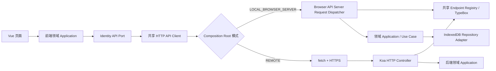

# 浏览器开发服务器与 IndexedDB 适配器 SDD

状态：已审核，离线身份、欢迎赠币/钱包摘要/转账/金币兑换/提现申请、充值订单与 USDT/TRON 本机演练、客服文本会话、社区帖子/回复、好友与私信、通知摘要及邀请/代理申请已施工；真实链上收款、附件和真实服务仍在推进。当前已实现共享 Identity/Wallet/WalletFunding/Support/Social/Notification/InviteAgent contracts、浏览器 Request/Response dispatcher、IndexedDB v11、设备注册/登录、账号安全设置、TOTP/恢复码/二维码、access refresh、首次赠币及充值/转账/兑币复式账本、JWT 钱包摘要/明细/充值订单/转账/兑换/收款方式/提现报价和申请、客服会话创建/续写/关闭、社区帖子/回复按本地 owner 持久化、直属上级 reward_type 社交门禁与共享 access DTO、好友码/用户名查找、好友申请与一对一文字私信、两年邀请链接本地签发、按 system_config TTL 暂存邀请码并在首次设备注册时绑定四级本地祖先链及 agent_domain 申请/撤回；通知 application 从现有业务来源实时聚合，不创建通知表或本地通知副本。消息导航徽标只计需要用户处理的待办：待本人回复的客服会话和入站好友申请；历史公告与资产流水不算未读。社区导航另显示已发布新帖数，按当前浏览器为每个用户保存的已读游标计算，首次使用展示最近 24 小时的帖子，进入社区后推进游标；生产跨设备同步仍需服务端读状态接口。提现报价只计算金额和手续费；有效流水在最终创建提现申请的事务中校验，失败不占款，由前端在确认提交后显示弹窗。提现 Browser API 仅冻结余额、查看待审状态或取消申请，绝不模拟审核通过或实际出款；充值仅能由显式开发模拟 endpoint 演练，不等同真实渠道支付。演练收款资料只存名称和末四位；USDT 订单仅返回明确标记的不可转账演练标识，不生成 TRON 地址。本文不把浏览器数据库定义为产品后端，也不把本地身份、账本、社交会话或读模型当成线上事实。

## 1. 目标与边界

开发阶段即使 Koa、MySQL、Redis 尚未就绪，玩家 Web 仍可完整走过页面发起请求、校验 DTO、处理状态码/envelope、建立本地会话、刷新页面恢复状态和处理业务错误的流程。浏览器端 API 与正式 Koa API 使用相同的 method、path、共享 TypeBox 请求/响应 schema、HTTP status 和响应 envelope；替换运行模式只替换 API transport/adapter，不改 View、DTO 或业务 use case。

认证请求遇到 `401 ACCESS_TOKEN_INVALID` 时，adapter 使用 refresh cookie 执行一次 `POST /api/v1/auth/refresh` 并重试原请求一次；并发请求共用同一 refresh promise，避免同时轮换 refresh cookie。refresh 收到 401 时清空内存 session、抑制静默设备登录并清除个人资料敏感状态；网络错误或 5xx 不清空 session，允许调用者重试。刷新后原请求仍失败则按原错误返回，不循环刷新。

浏览器端模拟服务简称 `Browser API Server`。它运行在页面 JavaScript 中，用 Request/Response 作为 transport 边界，用 IndexedDB 保存隔离的开发数据，并执行与端点对应的 application use case。它不通过 Service Worker 拦截页面请求，不代理/模拟一般互联网请求，不调用生产支付、资产或游戏结算服务，也不能验证实际部署安全性、并发隔离或跨设备状态。



`Browser API Server` 的入口形状为 `handle(request: Request): Promise<Response>`。即使实现不经过 TCP，也必须先解析 URL、method、headers 和 JSON body，再走 endpoint registry、schema 校验、身份上下文、application 和统一 envelope；不允许页面直接调用 IndexedDB 仓储来冒充 API 流程。正式 API client 与 Browser API client 暴露同一 `fetch(input, init)` 端口，业务端只依赖共享 API client。

## 2. 运行模式与隔离

Composition Root 只接受构建环境注入的 `LOCAL_BROWSER_SERVER` 或 `REMOTE`。开发服务器默认采用 `LOCAL_BROWSER_SERVER`，也可由开发环境配置选择 `REMOTE` 联调；生产构建必须强制 `REMOTE`，将 Browser API Server、种子数据和开发账户生成器从产物排除。模式不得由 URL 参数、LocalStorage、用户输入、普通页面状态或服务器响应动态升权；运行时如果发现 production build 配置为本地模式，启动直接失败。

| 模式 | API 实现 | 会话和数据 | 可验证内容 |
| --- | --- | --- | --- |
| `LOCAL_BROWSER_SERVER` | Browser API Server，走共享 API client、端点路径、DTO、status 和 envelope | 当前浏览器 origin 下的 IndexedDB；使用本地测试账户、本地签名密钥和隔离的开发会话 | 前端请求/响应、表单、错误处理、登录态恢复、页面流程及端点契约 |
| `REMOTE` | HTTPS `fetch` 到 Koa API | 服务端 MySQL/Redis/JWT 与真实业务数据 | 与真实服务的联调和线上业务行为 |
| `LOCAL_DEMO` | 纯页面演示/内存 adapter | 无持久账号身份；只用于不需认证的 UI 预览与游戏练习 | 纯 UI 与游戏练习；不得显示为完成登录 |

本 SDD 为满足“用浏览器数据库独立运行、保持正式 API 契约”增加 `LOCAL_BROWSER_SERVER`，作为 `LOCAL_DEMO` 的明确例外。它允许创建**仅供开发使用**的本地 user、模拟登录及产生本地 JWT；此 JWT 的 issuer/audience/key 与线上完全隔离，任何 REMOTE adapter 和正式服务都必须拒绝它。`Browser API Server` 不是浏览器安全边界：DevTools 可读写 IndexedDB、篡改代码和调用处理器，所以其认证通过不得作为服务端安全验收证据。

生产用户密钥、支付数据、真实联系方式、线上 access/refresh token 和线上响应 cache 均不得复制到此数据库。Browser API Server 的测试账户与会话只属于本地开发源，切换到 REMOTE 时不迁移、不自动导入，也不携带开发 token。

## 3. 共享 API 契约

`packages/contracts` 是正式后端、Browser API Server 和 H5 API client 的唯一 wire contract 来源。合同包含 endpoint registry（method/path、认证 audience、请求/响应 schema、成功/失败 status、错误码和幂等规则）、TypeBox schema、静态 DTO 与统一 JSON envelope。后端 Koa route 和浏览器 dispatcher 分别消费同一 endpoint definition；Browser API 不得另写一份相似字段的 `LOCAL_* DTO`。

玩家 JSON API 统一使用 `/api/v1/...` 和 [HTTP 接口与共享 DTO 协议 SDD](./HTTP接口与共享DTO协议SDD.md) 定义的 envelope。认证错误、字段校验错误、账号不存在/密码错误、凭证过期/已替换、TOTP 错误和限速错误按共享错误 registry 返回；页面只根据 error code 映射文案，不能根据 `message` 分支。模拟端与正式端的业务响应 DTO 结构一致，开发来源只由 composition root 决定，不额外把 `source: LOCAL_DEMO` 塞进正式业务 DTO。

首批 Identity endpoints 与 JWT SDD 对齐：

| Method / Path | 用途 | 认证 | 请求与响应 |
| --- | --- | --- | --- |
| `POST /api/v1/auth/device-register` | 首次访问无设备凭证时自动创建 user/device/session，并触发一次性新用户赠币 workflow | 无；`Idempotency-Key` | 共享设备摘要 request 与 `SessionResponse` |
| `POST /api/v1/auth/device-login` | 读取/验证本机已绑定设备凭证；未绑定返回稳定业务错误 | 无 | 共享 `DeviceLoginRequest/SessionResponse` |
| `POST /api/v1/auth/password-login` | 用用户名/邮箱/手机号与密码登录；启用 TOTP 时进入同一登录 challenge 协议 | 无 | 共享 `PasswordLoginRequest/SessionResponse` 或 challenge DTO |
| `POST /api/v1/auth/recovery` | H5 本地解密二维码后，以凭证 ID/secret 与（若启用）当前 TOTP 恢复账号并创建会话 | 无 | 共享 `AccountRecoveryRequest/SessionResponse` |
| `POST /api/v1/auth/refresh` | 轮换刷新凭证并签发新 access token | refresh cookie/本地 refresh jar | 共享 `SessionResponse`；响应 envelope 相同 |
| `POST /api/v1/auth/logout` | 撤销当前会话 | 玩家 access token | 共享 logout response；正式接口不使用 204 |
| `GET /api/v1/auth/device-credential` | 查询当前 origin 是否持有设备凭证 | 当前 origin device credential | `{ available: boolean }` |

表内名称与下文字段是 endpoint registry 的设计基线；实现时直接落入共享 contracts 并生成 OpenAPI。当前 `PlayerEntryResultDto` 带 `source: LOCAL_DEMO` 和 `IDENTITY_SERVICE_REQUIRED`，不能充当正式 API contract；首个实现应由正式 envelope、稳定错误码和 session/challenge DTO 替换。账号不存在或凭证错误不得用成功 envelope 包装“尚未接入”。

Browser API Server 必须与后端使用相同 JSON 序列化边界：HTTP 2xx/非 2xx、相同 `code`、`requestId`、`message`、`data`、`serverNow`，字段大小写、可选字段及 ID 字符串化相同。错误返回不得泄露密码、恢复 payload、TOTP、密码摘要、session key 或签名密钥。

### 3.1 首批端点 wire contract

以下字段是首个 Identity 切片的实现基线，落代码时由 TypeBox schema 逐项表达；不得再由 Vue 表单临时定义另一套 API DTO。所有 JSON request `additionalProperties: false`。账号标识符保留用户输入供登录，服务端/模拟端另行按账号规则规范化索引；密码不 trim。下表中的 `SessionResponse` 和错误均仍包在 HTTP SDD 的 envelope `data` / `code` 中。

| Endpoint | Request body / header | 成功 status 与 `data` | 主要失败 status/code |
| --- | --- | --- | --- |
| `POST /api/v1/auth/password-login` | `{ identifier: string(1..128), password: string(1..256), challengeId?: string, totp?: 6 位 TOTP 或 16 位十六进制备用码 }` | `200 SessionResponse`；启用 TOTP 且未提交验证码时返回 `200 LoginChallengeResponse`，`challengeId`、`challengeType: "TOTP"`、`expiresAt` | `400 VALIDATION_FAILED`、`401 INVALID_CREDENTIALS`、`401 TOTP_INVALID`、`403 ACCOUNT_LOCKED`、`429 AUTH_RATE_LIMITED` |
| `POST /api/v1/auth/device-login` | `{}`；当前 origin 的 transport 提供设备 credential，不接受 body 中任意 userId/deviceId | `200 SessionResponse` | `401 DEVICE_CREDENTIAL_MISSING`、`401 DEVICE_CREDENTIAL_REVOKED`、`401 DEVICE_CREDENTIAL_EXPIRED`、`429 AUTH_RATE_LIMITED` |
| `POST /api/v1/auth/device-register` | `{ fingerprintVersion: string, deviceCode: string, deviceSummary: { platform: string, browser: string } }` + `Idempotency-Key`；deviceCode 仅设备识别/反滥用信号，不作认证秘密 | 首次访问自动创建 user 与 device，`201 SessionResponse`；同幂等键重试返回同一创建结果 | `400 VALIDATION_FAILED`、`409 IDEMPOTENCY_KEY_REUSED`、`429 AUTH_RATE_LIMITED`、`503 IDENTITY_STORAGE_UNAVAILABLE` |
| `POST /api/v1/auth/recovery` | `{ credentialId: BigIntIdString, recoverySecret: string, totp?: string(6 digits) }`；二维码由 H5 本机读取并解密，二维码密码绝不上传 | `200 SessionResponse`；恢复成功撤销旧 session 并建立新 session。恢复凭证保持可重复使用，直到被新凭证替换、主动撤销或过期 | `400 VALIDATION_FAILED`、`401 RECOVERY_CREDENTIAL_INVALID`、`401 RECOVERY_CREDENTIAL_REPLACED`、`401 TOTP_REQUIRED`、`401 TOTP_INVALID`、`429 AUTH_RATE_LIMITED` |
| `POST /api/v1/auth/refresh` | `{}`；REMOTE 用 HttpOnly refresh cookie；LOCAL 用私有 `LocalCookieJar`，不让 View 接触凭证 | `200 SessionResponse`，原子轮换 refresh token | `401 REFRESH_INVALID`、`401 REFRESH_REVOKED`、`401 REFRESH_REUSE_DETECTED`、`429 AUTH_RATE_LIMITED` |
| `POST /api/v1/auth/logout` | `{}`；Bearer access token | `200 { loggedOut: true }` | `401 ACCESS_TOKEN_INVALID`、`401 SESSION_REVOKED` |
| `GET /api/v1/auth/device-credential` | 无 body；当前 origin transport 自动附带设备 credential | `200 { available: boolean }` | `401 DEVICE_CREDENTIAL_REVOKED`、`500 INTERNAL_ERROR`、`503 IDENTITY_STORAGE_UNAVAILABLE` |
| `GET /api/v1/me/identity-settings` | Bearer access token | `200 IdentitySettingsResponse`，返回 username、脱敏且已验证的 email/phone、passwordConfigured、TOTP 开关、恢复凭证状态与有效期；不含任何秘密 | `401 ACCESS_TOKEN_INVALID`、`503 IDENTITY_STORAGE_UNAVAILABLE` |
| `GET /api/v1/me/wallet/summary` | Bearer access token | `200 WalletSummaryResponseDto`，返回金币/CNY 余额、冻结、可用余额、流水剩余及欢迎赠币摘要 | `401 ACCESS_TOKEN_INVALID`、`503 WALLET_STORAGE_UNAVAILABLE` |
| `GET /api/v1/me/wallet/activity` | Bearer access token；可选 query `cursor=ISO_UTC~entryId` | `200 WalletActivityResponseDto = { items: WalletActivityItemDto[], nextCursor: string|null }`，每页至多 50 条当前用户资产账户分录，按时间倒序；游标用 occurredAt+entryId 稳定翻页。分录含 entry/operation ID、常量化 activityType、assetType、币种、delta、balanceAfter 和 ISO UTC occurredAt | `400 VALIDATION_FAILED`、`401 ACCESS_TOKEN_INVALID`、`503 WALLET_STORAGE_UNAVAILABLE` |
| `GET/POST /api/v1/me/wallet/payout-accounts` | 登录会话；创建请求含收款方式、名称、演练标识和幂等键 | 读取/创建当前 user 的收款方式；响应只含脱敏账号，不回显原标识 | `PayoutAccountDto[]` / `PayoutAccountDto`；本机模拟仅接受虚构标识，线上必须使用受控加密存储 |
| `DELETE /api/v1/me/wallet/payout-accounts/:payoutAccountId` | Bearer access token | 无未终态提现引用时删除本机演练方式；默认项在事务内切换 | `{ deleted: boolean }`；被未终态申请引用时返回冲突 |
| `POST /api/v1/me/wallet/withdrawals/quote` | `{ payoutAccountId, netCnyFen }`；需邮箱/手机验证或用户名+密码 | 读取配置、校验收款方式/可用余额/最低金额整数倍并计算费用；不检查有效流水，返回 72 小时后可出款时刻和短时报价 | `WithdrawalQuoteDto`；比例 `cny_to_coin_ratio`、`minimum_withdrawal_coins`、`withdrawal_fee_rate_percent` |
| `GET/POST /api/v1/me/wallet/withdrawals` | Bearer access token；创建提交 `{ quote, idempotencyKey }`，同样执行身份门槛 | 读取最近申请；提交在单个 IndexedDB 事务内重新校验报价、身份、有效流水和余额，并增加 CNY `frozenAmount`，初态 `REQUESTED`；流水不足时以 `TURNOVER_INCOMPLETE` 拒绝且不占款 | `WithdrawalDto[]` / `WithdrawalDto`；不在此端点调用商户或完成结算 |
| `POST /api/v1/me/wallet/withdrawals/:withdrawalId/cancel` | Bearer access token | 只允许 `REQUESTED` 撤销；原子标为 `CANCELLED` 并释放冻结金额，重复撤销返回原状态 | `WithdrawalDto`；其他状态不允许客户端取消 |
| `POST /api/v1/me/identity/username` | `{ username: string(3..32), password: string(1..256), totp?: 6 位 TOTP 或 16 位十六进制备用码 }` | `200 IdentitySettingsResponse`；创建或替换唯一用户名，必须用当前密码重新认证 | `400 VALIDATION_FAILED`、`401 REAUTHENTICATION_FAILED`、`409 IDENTIFIER_ALREADY_USED`、`422 USERNAME_INVALID` |
| `POST /api/v1/me/identity/password` | `{ currentPassword?: string, newPassword: string(8..256), totp?: 6 位 TOTP 或 16 位十六进制备用码 }`；已有密码时 currentPassword 必填；首次设置依赖已授权当前 session | `200 { changed: true }`；密码摘要保存后撤销其他 sessions，当前 session 保持有效 | `400 VALIDATION_FAILED`、`401 REAUTHENTICATION_FAILED`、`409 PASSWORD_REUSE` |
| `POST /api/v1/me/identity/contact-challenges` | `{ contactType: "EMAIL"|"PHONE", contactValue: string, password: string, totp?: 6 位 TOTP 或 16 位十六进制备用码 }`；每次发码先重新验证当前密码，TOTP 已启用时还需一个未使用因子 | `201 { challengeId: string, expiresAt: ISO8601 }`；LOCAL 只在 dev challenge inspector 内存显示测试码，生产经邮件/短信发送；验证码 5 分钟过期，连续 5 次错误后失效 | `400 VALIDATION_FAILED`、`401 REAUTHENTICATION_FAILED`、`403 TOTP_REQUIRED`、`409 IDENTIFIER_ALREADY_USED`、`429 AUTH_RATE_LIMITED` |
| `POST /api/v1/me/identity/contact-challenges/:challengeId/confirm` | `{ code: string(6 digits) }` | `200 IdentitySettingsResponse`；验证后绑定并释放被替换旧值 | `400 VALIDATION_FAILED`、`401 VERIFICATION_CODE_INVALID`、`404 CHALLENGE_NOT_FOUND`、`410 CHALLENGE_EXPIRED`、`409 IDENTIFIER_ALREADY_USED` |
| `POST /api/v1/me/security/totp/setup` | `{ password: string, totp?: string(6 digits) }` | `201 TotpSetupResponse = { setupId, otpauthUri, expiresAt }`；仅创建短时待确认 secret | `401 REAUTHENTICATION_FAILED`、`409 TOTP_ALREADY_ENABLED`、`429 AUTH_RATE_LIMITED` |
| `POST /api/v1/me/security/totp/confirm` | `{ setupId: string, code: string(6 digits) }` | `200 TotpEnabledResponse = { enabled: true, recoveryCodes: string[10] }`；十个 16 位随机十六进制备用码只返回一次 | `401 TOTP_INVALID`、`404 SETUP_NOT_FOUND`、`410 SETUP_EXPIRED` |
| `POST /api/v1/me/security/totp/disable` | `{ password: string, code: string(6 digits) }` | `200 { enabled: false }` | `401 REAUTHENTICATION_FAILED`、`403 TOTP_REQUIRED` |
| `POST /api/v1/me/security/totp/recovery-codes/rotate` | `{ code: string(6 digits) }`；必须是当前启用的 TOTP，不接受备用码 | `200 TotpEnabledResponse = { enabled: true, recoveryCodes: string[10] }`；一个 IndexedDB transaction 撤销全部旧备用码并写入新码，新码仅返回一次 | `401 TOTP_INVALID`、`409 TOTP_NOT_ENABLED` |
| `POST /api/v1/me/security/recovery-credentials/prepare` | `{ password: string, totp?: 6 位 TOTP 或 16 位备用码, recoverySecret: string }`；H5 本地生成随机 secret，二维码密码不上传 | `201 RecoveryCredentialIssueResponse = { credentialId: BigIntIdString, expiresAt: ISO8601 }`；只创建 10 分钟有效的 `PENDING` 凭证，当前 ACTIVE 凭证不变 | `401 REAUTHENTICATION_FAILED`、`401 TOTP_INVALID`、`403 TOTP_REQUIRED` |
| `POST /api/v1/me/security/recovery-credentials/:credentialId/activate` | 空对象；必须由当前 Bearer session 调用 | `200 IdentitySettingsResponse`；在 credentials 单事务内将旧 ACTIVE 标为 `REPLACED`、新凭证设为 `ACTIVE` | `401 ACCESS_TOKEN_INVALID`、`404 RECOVERY_CREDENTIAL_NOT_FOUND`、`410 RECOVERY_CREDENTIAL_PENDING_EXPIRED` |

共享响应 schema 固定如下：`SessionResponse = { accessToken: string, tokenType: "Bearer", expiresAt: ISO8601, user: { userId: BigIntIdString, displayName: string, roleType: nonzero integer }, device: { deviceId: BigIntIdString, trusted: boolean } }`。`LoginChallengeResponse = { challengeId: string, challengeType: "TOTP", expiresAt: ISO8601 }`。密码登录的 TOTP challenge 由同一个 endpoint 完成：第二次请求在同一 request body 增加 `challengeId` 并提交 6 位动态码或 16 位十六进制备用码；challenge 尚未过期、未消费且绑定原 identifier 才接受。challenge 只能成功消费一次；备用码的摘要状态原子变更为已消费，不能重用。

其他共享 DTO 的字段基线如下：

```ts
type IdentitySettingsResponse = {
  username: string | null;
  email: { maskedValue: string; verified: boolean } | null;
  phone: { maskedValue: string; verified: boolean } | null;
  passwordConfigured: boolean;
  totpEnabled: boolean;
  recoveryCredential: { available: boolean; expiresAt: ISO8601 | null };
};
type ContactChallengeResponse = { challengeId: string; expiresAt: string };
type TotpSetupResponse = { setupId: string; otpauthUri: string; expiresAt: string };
type TotpEnabledResponse = { enabled: true; recoveryCodes: string[] };
type RecoveryCredentialIssueResponse = { credentialId: BigIntIdString; expiresAt: string };
```

`otpauthUri` 和 `recoveryCodes` 属于一次性敏感响应，View 只在当前设置步骤的内存展示，离开/完成后清除；不得写入 IndexedDB、日志、埋点或全局 session store。`IdentitySettingsResponse` 只返回脱敏联系方式和凭证状态，不返回登录 identifier 索引、二维码 payload、TOTP secret、二维码密码或恢复码。DTO 中 `null` 表示未绑定/未签发，不使用空字符串表达未设置。

所有错误码均属于 `ApiErrorCode` 的非零/非空字符串常量，不以 HTTP status 代替领域错误码。字段错误经 envelope `details[]` 返回 JSON Pointer 和稳定字段 code，不回显输入值。未知账号与错误密码统一为 `INVALID_CREDENTIALS`。本地账号 bootstrap 不属于公开 `/api/v1` endpoint：它只能是 dev-only application command，生产 contracts 和 OpenAPI 不导出。

### 3.2 登录及凭证状态转换

| 当前状态 | 命令/条件 | 新状态及响应 |
| --- | --- | --- |
| 首次打开、无本机设备凭证 | Web runtime 自动调用 `device-register` | 创建 user、device credential 与 session，随后发放配置的新用户赠币及对应流水要求；不要求用户先进入登录页 |
| 有本机设备凭证 | Web runtime 调用 `device-login` | 校验现存设备凭证并建立 session；不会重复注册或重复赠币 |
| 无本地测试账号 | 开发者显式执行 dev fixture bootstrap | 创建 disposable user、密码 credential、设备 credential；仅显示一次随机初始密码。此测试夹具与普通首次访问自动注册分开 |
| 已有账号、无设备 credential | device login | `401 DEVICE_CREDENTIAL_MISSING`，不创建用户、不建立会话 |
| 密码正确、TOTP 未启用 | password login | 建立 session，返回 `SessionResponse` |
| 密码正确、TOTP 已启用、无 code | password login | 建立短时、单次 challenge，不签发 session token |
| challenge 有效且 TOTP 正确 | password login + challengeId | 原子消费 challenge，建立 session；错误 code 不建立 session |
| recovery credential 当前有效、密码及 TOTP 正确 | recovery | 撤销该 user 的旧 session，建立新 session；恢复凭证本身仍可复用 |
| recovery credential 已被替换/过期/撤销 | recovery | 对外返回对应稳定错误，不签发 session |
| session 有效 | refresh | 原子轮换 refresh token；同一 refresh attempt 的弱网重放按 JWT SDD 30 秒窗口返回原结果 |
| session 有效 | logout | 撤销本地 session 和 refresh family；后续 refresh/access 校验失败 |

账号锁定、attempt 计数及 challenge TTL 是客户端流程模拟参数，不复制生产风控结论。首版本地 challenge TTL 5 分钟、失败连续 5 次后锁定 15 分钟；二者仅为可配置开发 fixture，明确不作为生产参数。锁定统一用 HTTP `403 ACCOUNT_LOCKED`，遵守 HTTP SDD 的 status 列表。

账号资料绑定完整流程包括：设置/更改用户名与密码；邮箱/手机免验证码绑定，换绑时输入完整旧联系方式；若已设置密码需重新输入当前密码，若启用 TOTP 需当前 TOTP。联系方式与安全事件在同一个 IndexedDB 事务提交，成功后旧值立即释放；绑定状态不代表邮箱或手机可达性已验证。可选启用 TOTP 并展示一次性备用恢复码；可选签发/替换密码保护的恢复二维码。TOTP 遗失且没有可用备用码时不提供自助重置，走客服人工流程。遗留的 challenge DTO/路由仅为兼容已有开发数据，不再被联系方式表单调用。TOTP seed 通过 otpauth URI 一次性返回页面，以手动录入方式添加验证器；IndexedDB 只存 AES-GCM 加密后的 seed。启用 TOTP 前必须确认有效 6 位码；登录先签发 5 分钟单次 challenge，成功消费后建立会话。启用后返回 10 个一次性备用码，数据库仅保存每个码的 SHA-256 摘要；登录 challenge 可消费单个备用码，不能重复使用。二维码默认有效 2 年，在替换前可重复使用，旧版本保留为 REPLACED 历史，账号最多一份有效凭证。账号恢复二维码流程要求当前 TOTP，不接受备用码替代。

恢复二维码采用本机加密边界：二维码明文载荷包含 `formatVersion=1`、`credentialId`、256-bit 随机 `recoverySecret` 与 `expiresAt`；H5 使用 Web Crypto 的 PBKDF2-HMAC-SHA-256（600,000 iterations、16-byte random salt）派生 AES-256-GCM 密钥，12-byte random nonce、128-bit authentication tag，AAD 固定为 UTF-8 `LOTTERY-GAME-RECOVERY-V1`。QR 字符串使用 `LGRC1.<base64url(salt)>.<base64url(nonce)>.<base64url(ciphertext+tag)>`；解密后必须校验 payload version 和各字段格式。用户设置的二维码密码只在浏览器内经 KDF 派生加密密钥，不发送、不记录、不保存。[OWASP 密码存储建议](https://cheatsheetseries.owasp.org/cheatsheets/Password_Storage_Cheat_Sheet.html)给出的 PBKDF2-HMAC-SHA-256 基准是 600,000 次；登录恢复前端需测低端手机耗时，并在 UI 显示可感知的处理中状态，不得静默降低 KDF 成本。恢复时先扫描/读取 QR 并在浏览器本机解密，再将 `credentialId`、`recoverySecret` 和（仅 TOTP 已启用时必需的）当前 TOTP 通过 HTTPS 提交；服务端只存 `recoverySecret` 的单向验证摘要。覆盖错误密码、篡改 ciphertext、过期凭证和跨账号凭证测试；不得让 API handler 接收二维码密码或整张 QR 原文。

## 4. IndexedDB 设计

数据库名固定为 `gameing_hall_browser_dev`，仅 `LOCAL_BROWSER_SERVER` 打开。使用小型 Promise IndexedDB 包装库 `idb`，保持底层 IndexedDB transaction、object store 和 versionchange 语义；它提供类型化的 `openDB`/数据库 schema 及 Promise API，项目仍负责自己的领域仓储和 schema migration。[idb 官方仓库与用法](https://github.com/jakearchibald/idb)

首版只建足以支持 Identity 纵向切片的 object stores，避免复制 MySQL 的全套表：

| Object store | 记录用途 | 不保存 |
| --- | --- | --- |
| `users` | 本地测试 userId、展示名、非零 role/status 常量和账号状态 | 线上 user、线上代理/资产事实 |
| `credentials` | 本地 identifier 索引、PBKDF2 salt/hash、设备凭证摘要、恢复凭证密文及有效/替换状态 | 明文密码、明文 TOTP、恢复二维码密码 |
| `sessions` | 本地 session id、userId、过期时间、token family、refresh 摘要、authVersion | refresh 明文；token 不能跨到 REMOTE |
| `challenges` | 登录 TOTP、联系渠道验证、TOTP setup 的短时状态及到期时间 | 已消费 challenge、明文验证码、生产验证码 |
| `payout_accounts` | 本地提现流程的方式类型、展示名称、脱敏尾号与当前 user | 完整收款标识、真实账户材料或可出款 token |
| `wallet_withdrawals` | 本机提现申请状态、金额快照、幂等键及冻结引用 | provider 请求、审核授权、外部出款结果 |
| `settings` | schema version、开发私钥 CryptoKey、fixture/bootstrap 元数据 | 生产密钥、环境密钥 |

首版 object store 的字段/索引以如下记录类型为准；记录除 `id` 外不复刻 MySQL 公共字段，避免把开发 fixture 误作生产 schema：

```ts
type LocalUser = { userId: string; displayName: string; roleType: number; status: 'ACTIVE'|'LOCKED'; authVersion: number };
type LocalCredential = { credentialId: string; userId: string; kind: 'IDENTIFIER'|'PASSWORD'|'DEVICE'|'RECOVERY'|'TOTP'|'TOTP_RECOVERY'; lookupKey?: string; secretHash?: string; salt?: string; credentialCiphertext?: string; state: 'PENDING'|'ACTIVE'|'REPLACED'|'REVOKED'|'EXPIRED'; expiresAt?: string; pendingExpiresAt?: string };
type LocalSession = { sessionId: string; userId: string; deviceId: string; refreshFamilyId: string; refreshHash: string; authVersion: number; state: 'ACTIVE'|'REVOKED'|'EXPIRED'; createdAt: string; expiresAt: string; refreshExpiresAt: string };
type LocalChallenge = { challengeId: string; type: 'LOGIN_TOTP'|'CONTACT_EMAIL'|'CONTACT_PHONE'|'TOTP_SETUP'; userId?: string; identifierKey?: string; targetValue?: string; expectedCodeHash?: string; secretCiphertext?: string; state: 'ACTIVE'|'CONSUMED'|'EXPIRED'; createdAt: string; expiresAt: string; failedAttempts: number };
type LocalSetting = { key: string; value: unknown };
type LocalCookie = { key: 'player-device'|'player-refresh'; nonce: Uint8Array; ciphertext: ArrayBuffer; updatedAt: string };
```

`credentials` 的 `lookupKey` 对 identifier 使用规范化后的邮箱/手机号/用户名唯一索引；PASSWORD、DEVICE、RECOVERY、TOTP 以 `(userId, kind)` 查询复合非唯一索引，恢复凭证可同时保留已替换历史，因此不能给 user+kind 加唯一约束。`sessions` 的 `sessionId` 唯一、`userId` 和 `refreshFamilyId` 非唯一索引。`challenges.challengeId` 唯一，`userId/type`、`expiresAt` 建非唯一索引；完成、失败锁定或超时后按测试保留窗口清理。dev 验证码原文只在当前页面运行内存中的 challenge inspector sink 保存，不写入 IndexedDB/API response/log。`users.userId`、`settings.key` 唯一。`local_cookie_jar` 是 LOCAL 模式私有 store，分别加密保存设备恢复码和 refresh opaque token，用来模拟浏览器 HttpOnly cookie 生命周期；DevTools 可访问仍不构成安全保护。由于浏览器禁止脚本设置 `Cookie` 请求头，LOCAL 的 `createBrowserApiFetch` 只在 adapter→`BrowserApiServer` 之间使用 `X-Local-Browser-Cookie` 私有头；正式 HTTP/REMOTE 仍必须使用真实的 HttpOnly cookie，绝不发送此头。

本地 ID 由 `settings` 中的十进制字符串序列在 IndexedDB readwrite transaction 内递增，严格保持 `BIGINT UNSIGNED` 字符串语义；禁止 `Number` 转换。DB schema version 由 `openDB(name, version, { upgrade })` 的版本号承担，不另存一个会漂移的 schemaVersion。v1 建立身份 stores；v2 追加 `asset_accounts`、`asset_operations`、`asset_entries`、`turnover_states`；v3 追加客服领域对应的 `support_conversations`、`support_messages`；v4 在 users store 添加唯一好友码索引，并追加 `social_friendships`、`social_conversations`、`social_messages`；v5 追加邀请邀请码索引及 `agent_domains`；v6 追加 `payout_accounts`、`wallet_withdrawals` 两个只服务提现体验的 stores；v7 为 `payout_accounts` 追加唯一幂等键索引；v8 增加一个带 `contentType` 的 `social_content` store，索引支持话题 feed 和帖子回复，记录中的 `ownerUserId` 用于作者归属判断；v9 清理开发验证期间试加但无查询消费者的 `by-owner` 索引。帖子/回复仍是独立 DTO 和领域实体，单个本地 store 仅减少浏览器 schema 维护面。申请占用余额体现在 `asset_accounts.frozenAmount`，不为冻结操作伪造零金额 asset entry；提现记录负责其业务状态和幂等。后续升级只追加迁移，不清库；遇到旧标签页阻塞升级时广播要求刷新，升级异常保留原数据并展示可恢复错误。

所有关系键在浏览器存储中使用十进制字符串，保持与 BIGINT UNSIGNED wire ID 一致；不将 ID 转 JS number。索引最小化，只为 identifier 和 user/session 关系建立唯一/查询索引。数据库升级通过 IndexedDB versionchange 单次事务建索引、变更 object store；升级失败不清库，显示可恢复错误。测试与开发设置页提供“重置本地开发数据”动作，需二次确认且只删除当前 origin 的该数据库。

IndexedDB 存储可能被用户清理或浏览器回收，不能作为跨设备账号、备份、产品数据或资产权威来源。发生清理/不可用时展示“本地开发数据已清除/无法打开”，提供重置/重建测试环境；不静默切换成另一个内存库，以免同一次请求在不同数据源得到不同结果。多个标签页共享同一 DB，跨标签版本更新通过 IndexedDB transaction 保证，通知可用 `BroadcastChannel`，但最终状态必须重新读取数据库。

## 5. 本地账号、登录与 JWT 模拟

正常首次打开时，玩家 Web 检查当前 origin 的设备凭证；没有设备凭证就自动调用 `device-register` 创建本地开发账号/设备并进入大厅，对应生产端首次访问自动注册。客户端先在 IndexedDB `settings` 保存 pending registration 的幂等键和完全相同的 request body，拿到成功响应后清除；弱网/刷新重试复用原幂等键和 body。该流程按每个账号一次发放新用户赠币，金额和流水倍数读取全局配置；不加设备/IP 级额外限领，也不声称阻止同一自然人跨账号注册。账号创建与赠币必须通过注册 workflow 调用 wallet welcome-grant 用例，以同事务或可幂等恢复方式完成，不能由浏览器直接改余额。

开发环境还需有可重复的测试夹具方式，且不把陌生用户任意输入当成成功登录。`/entry` 账号页放置仅 dev build 可见的“创建本地测试账号”入口；显式生成 disposable account、虚构 username 和随机密码后，页面一次性显示并提供复制/填入登录表单操作。生成账号初始只绑定当前 browser device，TOTP/联系渠道/恢复二维码保持未设置，供绑定流程从空状态验收。另提供仅 dev 的“生成恢复测试资料”操作：为一个本地测试身份生成隔离的 TOTP secret、当前 TOTP code、恢复二维码 payload、独立二维码密码及恢复有效期，资料只显示一次并明确标注虚构/本地；不得写进正式 `/api/v1` DTO、生产 contracts、日志或生产 bundle。它用于验证已有凭证恢复路径；常规账号绑定必须经下述设置 UI 和模拟 API 完成。实际 `password-login` 仍按密码校验返回真实的本地成功或凭证错误。fixture/bootstrap 工具只在 Browser API Server 内可见，不添加到正式 `/api/v1` endpoint，不进入 production bundle，也不接触产品用户数据。重置仅清理本 origin 开发库；不得把预置密码暗藏在客户端源码里。

本地密码使用 Web Crypto PBKDF2（SHA-256、高随机 salt、迭代次数由 `system_config` 开发默认值定义）保存派生摘要；此做法仅让前端完整运行密码流程，不等同生产后端密码哈希实现或抗离线破解安全。未知账号与错误密码采用相同公开错误，尝试计数/锁定只验证 UI 行为，不能证明抗暴力破解能力。

本地 API 生成结构符合共享 Session DTO 的开发 access JWT。使用 Web Crypto 支持的 ES256；本地 signing key 在 `settings` 以不可导出的 CryptoKey 保存，issuer/audience 固定为专用开发值，例如 `lottery-game-browser-dev` / `player-browser-dev`，与服务端生产 issuer/audience 永不相同。session 与 refresh 状态写入 `sessions`，JWT claim 字段遵循共享 JWT contract；本地 token 只能由 Browser API Server 验证。无法持久化或读取 CryptoKey 时撤销并重建本地会话，不降级为未签名 token。实际生产密钥轮换、Redis 撤销、cookie 策略、弱网刷新重放仍以服务端 JWT SDD 和集成测试为准。

恢复二维码走与正式 API 完全相同的 request/response schema 和错误码；本地 fixture 生成的恢复 payload、口令及 TOTP secret 只属于可丢弃测试身份。用户设置页签发/更换恢复二维码采用两阶段流程：当前密码与已启用 TOTP/备用码校验后准备凭证；客户端用至少 8 位二维码密码经 PBKDF2/AES-GCM 加密 QR payload，动态加载 QR renderer 生成 PNG；用户下载后显式确认才激活。下载/渲染失败、取消或 10 分钟未确认时，旧 ACTIVE 凭证保持可用，待确认 PENDING 凭证到期；激活在 IndexedDB 单事务切换状态，不增加表。二维码密码与明文恢复 secret 不进入 IndexedDB、日志或共享 response。TOTP 未启用时恢复不要求 TOTP；启用后恢复必须验证当前 TOTP。fixture 流程覆盖旧二维码替换后拒绝、错误 TOTP/二维码密码、旧凭证替换前可重复使用及 TOTP 遗失转客服提示。开发短信/邮件 challenge 使用本地验证码发件箱：API response 形状与正式接口一致，但验证码通过 dev-only challenge inspector 查看，不泄入共享 DTO；生产仍由真实 provider 发送。二维码本机解密、TOTP 校验成功只能说明前端流能正确解析服务响应，不能证明生产恢复协议安全。

同一用户每次新建待确认恢复 QR 时，repository 在 `credentials` 单一读写事务中将既有 `PENDING` 凭证标记 `EXPIRED` 后写入新凭证，因此每个用户最多有一个有效待确认 QR；这避免用户反复重试产生无期限累积的无效凭证记录。TOTP 备用码重新生成必须提交当前 6 位 TOTP；identity application 生成新码摘要，repository 在同一个 credentials 写事务中撤销旧 ACTIVE 备用码并写入 10 个新 ACTIVE 码。明文新码只经共享响应返回，在 View 一次展示，离开页面或显式关闭后清空；生成后旧码立即不可用。

## 6. 端点处理顺序与错误映射

每个 Browser API 请求按以下顺序处理：

1. 匹配精确 method/path；未知路径返回标准 `404` envelope，不回退到模糊路由。
2. 读取有上限的 JSON body、验证 content type 和共享 TypeBox request schema；错误映射到正式 endpoint 的 400/415/413。
3. 校验 access/refresh 本地凭证和 endpoint audience；失败以正式 status/error code 结束。
4. 调用 Identity application use case；业务拒绝转换为与 Koa transport adapter 相同的 status/envelope。
5. IndexedDB 写入必须在完成态前等待 transaction `done`；涉及 user credential/session 多 store 的转换在一个 readwrite transaction 内提交。
6. 创建统一 envelope 并由 Response 返回；所有成功/失败均带 `requestId` 与 UTC `serverNow`。

Dispatcher 不吞掉未知异常，不向浏览器 UI暴露堆栈。contract test 使用相同输入分别调用 browser dispatch 和 backend Koa app，比较 status、envelope、错误码和 payload schema。若某端点尚无正式 Koa controller，则只做 shared contract 测试，结果明确标为“服务端未联调”，不能称完全一致已验证。

## 7. 依赖与数据安全

页面只调用 feature application / typed API function；View 不 import IndexedDB wrapper、DB schema 或 Browser API handler。IndexedDB repository adapter 归属具体 domain；dispatcher 只做 transport parsing 和 handler 装配。IDB 事务禁止跨越 `fetch`、定时器或 Crypto/WebCrypto 运算等待；先在事务外完成昂贵 hash/crypto，再用短事务提交，并在事务里重读关键版本、校验 compare-and-set 条件。

运行时配置由 `apps/web/src/platform/composition` 装配。API client 同时支持本地 dispatcher 与 remote fetch，但二者共享同一公开 `request<T>()`、envelope/schema parse、错误类和领域 API service；只有底层 transport 不同。LOCAL 模式下开发专属数据库名称、JWT issuer/audience 和 IDB repository 通过模块依赖实现隔离，不能仅靠数据里的 `source` 文本字段来隔离真实数据。

本地 Identity fixture 只用虚构标识符，禁止粘贴真实手机号、邮箱、真实账号密码或生产 recovery QR。浏览器安全存储不等于保密区；账号登录页使用 autocomplete 适当值，成功/失败/切模式/离开页面后清除密码、恢复口令、TOTP 和 QR payload，IndexedDB 只保留验证需要的派生摘要/密文。开发日志只允许 requestId 与错误 code，不记录任何认证输入。

### 7.1 前端模块边界与依赖注入

Browser API 不放进 Vue component，也不直接放在当前 `apps/web/src/platform/player-entry`。首个实现按下列结构拆分；暂不新建 workspace package，因为 Browser API、IDB adapter、composition root 目前只有 H5 一个真实消费者：

```text
apps/web/src/
  features/identity/
    identity-api.ts                 # endpoint registry 的 typed API 调用，不含 fetch/IDB
    identity-application.ts         # 登录/恢复 use case orchestration
    identity-session-store.ts       # 仅内存 access token + 当前用户状态
    components/PlayerEntryPage.vue  # View，只调用 props 注入的 application
  platform/http/
    api-client.ts                   # envelope/schema/error/requestId/timeout 解析
    api-fetch-port.ts               # fetch-compatible interface
  platform/browser-api/
    dispatcher.ts                   # Request -> route -> Response，不依赖 Vue
    routes/identity-routes.ts       # 将 endpoint registry 绑定 application handlers
    identity/                        # IDB repository 与本地 identity use cases
    database.ts                     # idb open/upgrade/transaction owner
    local-cookie-jar.ts             # 仅模拟 LOCAL HttpOnly refresh cookie
  platform/composition/
    create-player-runtime.ts        # 根据 Vite build-time mode 装配 ports/adapters
    player-runtime.ts               # root app 获得的只读依赖对象
```

依赖只允许向内：View → identity application → identity API function → shared API client → `ApiFetchPort`。`Browser API Server` 与 remote fetch 都实现 `ApiFetchPort`；Browser dispatcher 可依赖 contracts、identity application 和 IDB adapter，但不能被 identity feature、Vue、普通页面 store 导入。只有 `create-player-runtime.ts` 可引用两种 transport 并选择其一。组件测试注入 identity application mock；端点测试直接以 Request 调 dispatcher；不得挂载 Vue 才能测试 Browser API。

首切片代码落位为 `packages/contracts/src/identity.ts`、`apps/web/src/platform/http/api-client.ts`、`apps/web/src/platform/browser-api/{dispatcher.ts,database.ts,local-cookie-jar.ts,local-jwt.ts}`、`apps/web/src/platform/browser-api/identity/local-identity-application.ts` 和 `apps/web/src/components/PlayerEntryPage.vue`。开发夹具 UI 单独位于 `DevelopmentIdentityTools.vue`，由 `import.meta.env.DEV` 控制动态导入。注册客户端把待处理 request body 与 Idempotency-Key 保存在 `settings`，同一设备码的重试复用既有账号；覆盖响应丢失后的顺序重试，跨标签并发首次注册仍需加入唯一约束/CAS 测试。`LocalIdentityApplication` 通过 identity 域私有 repository port/adapter 访问记录，平台实现隔离 IndexedDB 细节。现阶段登录成功的会话只保存在运行时内存，并显示在个人资料中；服务器端 Koa 适配器及生产远端 composition 未落地。

`PlayerEntryPage.vue` 通过 props 注入玩家身份用例。Browser development composition 使用 `BrowserPlayerIdentityAdapter`；恢复二维码文本/图片只由 adapter 在本机解密，再把共享 `AccountRecoveryRequestDto` 交给 API client。二维码图片读取优先使用原生 `BarcodeDetector`；不支持该能力时，用户可粘贴已加密的 `LGRC1` 内容继续，不会因浏览器缺少条码 API 被锁在页面中。`OfflinePlayerIdentityAdapter` 只供没有 identity composition 的隔离组件测试使用，不得显示真实登录成功。

Identity application 通过 identity 域私有 `LocalIdentityRepository` port 访问本地数据；`IndexedDbLocalIdentityRepository` 独占 transaction/store/index 操作。请求解析、共享 DTO 验证和 envelope 仍归 Browser API dispatcher。开发测试夹具使用相同恢复 QR v1 编码器签发一份两年有效测试凭证，工具页仅在当前页面内存显示密码和 `LGRC1` 文本；该工具不写入生产构建。恢复凭证可重复使用，签发新凭证会原子地把旧凭证标为 `REPLACED`。

### 7.2 构建隔离和验收门槛

运行 mode 由 Vite `import.meta.env.MODE` / 明确 build-time define 决定；开发默认 `LOCAL_BROWSER_SERVER`，显式 `REMOTE` 用于服务端联调，production define 固定为 `REMOTE`。禁止使用运行时 `window.location`、query、localStorage 或服务端响应选择本地模拟。构建配置在 production 下不导入 browser-api composition root；只在 dev composition 动态装配会导致 tree-shaking 不稳定，因此生产 entry 的静态 import 图本身不得触达 browser-api 目录。

Vite 开发服务器仅在 `serve` 模式安装响应压缩 middleware，响应体达到 1 KiB 才压缩，级别为 6；按客户端 `Accept-Encoding` 协商 Brotli/gzip，production build 不受此开发插件影响。浏览器开发工具的 `Size` 可能显示解压后的资源大小，应同时检查 `Transferred` 或 Resource Timing 的 `encodedBodySize` 才能确认网络传输收益。生产 Brotli/gzip 由部署边缘层或正式静态资源服务器负责，不在 Vite 开发服务器上重复配置。

施工验收必须包含：

- contracts tests 对每个 endpoint 的 method/path、request schema、success DTO、status/error registry 和 OpenAPI operation 作快照/结构断言。
- Browser dispatcher contract tests 对每种成功/主要失败输入断言 HTTP status、envelope shape、错误码及无敏感字段；无需 Vue 或真实浏览器。
- IDB adapter tests 覆盖 v1 建库、唯一索引冲突、账号/credential/session 原子写入、恢复撤销旧 session、refresh 单次轮换和弱网同 operation 重放。
- web application tests 覆盖成功登录回大厅、错误留在表单、TOTP 两步 challenge、刷新后恢复、登出后状态清除；密码/TOTP/恢复 payload 不进入日志或 session store。
- production `pnpm --filter @gameing/web build` 后检查产物无 `BrowserApiServer`、dev bootstrap 文案、local JWT issuer、PBKDF2/local fixture markers；dev build 能找到它们。检查采用脚本对 manifest/chunk source 搜索固定 sentinel，若压缩改变命名仍以静态 chunk 文本标记和依赖图断言为准。
- Browser 端到端验收至少覆盖首次访问自动 device-register + 一次欢迎赠币 → reload/device-login 或 refresh → logout；另覆盖开发 fixture bootstrap → password login → 设置/恢复资料 → recovery。重复注册/重放不得重复赠币。记录 IndexedDB 被禁用/清除时的可见错误。真实 Koa endpoint 未实现时，验收状态标记为 `LOCAL_BROWSER_SERVER_ONLY`，不得称生产身份闭环。

## 8. 逐项施工 Checklist

- ✅ 新增公共 ApiSuccess/ApiFailure、ApiErrorCode、Endpoint Registry 和登录/设备/恢复 session challenge DTO；contracts 使用 TypeBox schema。尚需补齐独立 contracts 全量测试。
- ✅ 定义 `ApiFetchPort`，typed API client 可注入本地 Request/Response fetch adapter 或普通 fetch。
- ✅ 建立 `idb` 数据库模块与 v9 stores/indexes、upgrade/blocked 处理及清库函数；v1→v9 追加迁移保留已有数据；清库确认 UX 和全量迁移/冲突测试待补。
- ✅ `LocalIdentityApplication` 通过 identity 域私有 repository port/adapter 访问身份记录；IndexedDB 细节留在 platform adapter。
- ⬜ 完成本地测试身份 bootstrap/重置 UX，不在源码 hard-code 预置密码，不生成产品正式账户。
- ✅ 完成显式 dev-only 随机测试账号生成、真实 PBKDF2 密码校验、本地 ES256 access JWT 签发及基础 refresh/logout handlers；错误尝试锁定、refresh 重放保护、REMOTE 拒绝本地 issuer 与完整 logout/UI 尚待补齐。
- ✅ 完成设备凭证与恢复 QR 本地纵向闭环：支持本机解密、共享 recovery DTO、session 签发、旧 session 撤销、凭证重复使用及替换语义；个人资料可 prepare→加密 PNG 下载→显式 activate，旧 QR 在新 QR 激活前有效。错误码由共享 endpoint envelope 返回。
- ✅ 个人资料安全概览通过 Bearer JWT 读取共享 `IdentitySettingsResponseDto`，Browser API 校验签名、session 状态及 authVersion；未登录或已撤销 session 返回共享错误 envelope。
- ✅ 从个人资料完成首次密码设置、重新认证修改密码、设置/修改用户名，并通过共享 DTO 与本地 Browser API 登录验证；更改密码在一个 IDB 事务中撤销其他会话，当前会话保持有效。
- ✅ 邮箱/手机绑定与更换使用共享联系方式 DTO、Bearer session、当前密码（如已设置）和 TOTP（如已启用）重新认证，并原子更新/释放旧值；覆盖旧值不匹配、重复联系方式、替换释放和 UI 回显。旧 challenge API 保留兼容，不属于当前绑定流程。
- ✅ TOTP 启用/关闭、登录 challenge、备用恢复码一次性展示和单次消费已通过共享 DTO 与本地 Browser API 闭环；seed 在 IndexedDB 加密保存。验证器需手动录入 otpauth secret。
- ✅ dev-only 恢复测试资料生成器保留；个人资料通过动态加载 qrcode renderer 生成 PNG，不将二维码 renderer 放进首屏 bundle。
- ⬜ 在 Composition Root 增加 dev-only `LOCAL_BROWSER_SERVER` 与 `REMOTE`；当前 production build 已验证不含 BrowserApiServer、local JWT issuer、数据库名和测试账号 UI，但生产远端 composition 与自动化产物隔离测试待补。
- ✅ 将玩家登录页由无效提示改为调用共享 Identity API；本地密码/设备成功建立内存 DTO session 并返回大厅，错误留在当前表单。Vitest 已通过真实页面点击→本地 HTTP client→dispatcher→IndexedDB credential→JWT/session 的 password login 集成测试；REMOTE/Koa 联调未完成。
- ✅ 欢迎赠币与钱包摘要/明细使用共享 TypeBox `WalletSummaryResponseDto`、`WalletActivityResponseDto` 和 JWT endpoints；首次正常设备注册后由钱包 application 在单一 IndexedDB readwrite transaction 中幂等创建玩家/系统 COIN 账户、`asset_operation`、两条相反 `asset_entry`、`gift_grant` 与 `turnover_state`。默认配置 1000 金币、5 倍有效下注流水；key 为 `welcome-registration:<userId>`，重复注册读取已存在 grant，不重复记账。创建 user/session 与 grant 是相邻事务：grant 失败则注册 endpoint 不返回成功，客户端保留相同注册 body/key 供顺序重试；fixture test accounts 不发赠币。钱包面板显示实际余额、冻结、总额、流水剩余及本人账本明细，最多 50 条一页并按 timestamp+entry ID 稳定游标翻页；分录只从本人资产账户读取，不展示系统对手账户。转账和金币兑余额均复用已有资产 stores/operation，不新增 IndexedDB store；兑币报价按 `cny_to_coin_ratio` 快照计算，不足一分向下取整，提交校验流水、比例与系统人民币可用额，并以一笔 operation 写入用户/系统的 COIN 与 CNY 四条分录。提现另有本机 payout account/withdrawal 两个 store：只存虚构账户名称和尾号，余额以 `frozenAmount` 表达占用；报价校验净到账金额最低门槛整数倍、配置手续费、身份三选一及流水，提交原子冻结净额+手续费且同幂等键重试不重复冻结；仅待审核时允许取消并原子释放。此离线流程不完成审核、出款或返佣，也不提供真实账号加密保存。生产直属上级模式判断、服务端并发锁和真实资金仍未模拟；真实充值和提现服务仍待实现。
- ✅ 用户客服文本会话使用共享 Support DTO、`SupportUseCases` 与 IndexedDB repository，在 `support_conversations`/`support_messages` 中落地并由 JWT owner scope 保护；支持分类建单、历史读取、弱网同 messageKey 重试、续写、关闭和关闭后拒绝发送。没有生成虚假客服回复。附件加密/Asset、客服后台接单回复、Socket 实时投递与生产 Koa endpoint 仍待实现。
- ✅ 社区话题浏览、发帖和一级回复使用共享 Social DTO、领域校验、application 与 `SocialRepositoryPort`；Browser composition 从当前 session 提供 actor，离线内容按所有者保留帖子/回复作者与本人标记。IndexedDB v8 新增单一按内容类型区分的 `social_content` store 和话题/帖子索引；v9 移除未被查询使用的所有者索引。重建 application 后可读回，不再因页面刷新丢失。`GET /api/v1/me/social/access` 使用共享 DTO 返回直属上级 reward_type 门禁；所有社交私有端点执行同一策略，H5 据此隐藏入口。生产授权、代理域、附件/Asset、审核、举报屏蔽、通知和 Socket 仍待实现。
- 🟡 Browser API/页面测试覆盖密码登录、TOTP challenge/备用码、RFC 6238、首次设备注册、刷新 Browser API adapter 后同设备恢复、恢复与会话撤销、身份设置、联系方式挑战、QR 两阶段更换、stale access refresh、welcome grant 守恒/幂等、本人账本明细、50+ 记录游标分页与非法游标拒绝、钱包转账/兑币/提现门槛、费用/幂等冻结/取消释放、身份三选一门禁、提现 UI 添加收款方式→报价→申请→取消、未授权钱包读取、客服建单/历史/消息重试/关闭/跨用户拒绝、社区发帖/一级回复跨 application 恢复和未登录拒绝；也覆盖 PENDING 超时不撤销旧 QR、每用户仅保留最新一个待确认 QR。refresh-token replay 和 logout replay 专项测试尚待补齐。当前 web suite 为 98 项通过；桌面/移动钱包抽屉几何已测，生产服务端契约实现仍未完成。
- 🟡 Chrome MCP 已覆盖恢复 QR、钱包摘要/资产明细、客服工单及同设备重载：首次访问创建游客账户后打开钱包，显示 1000 金币、0 冻结、5000 剩余有效下注流水和 +1000 金币本人账本分录；刷新后游客账号保持不变。客服实际建单→详情→关闭成功，关闭态禁用发送。桌面 viewport 1200×2029：根节点 scrollWidth/clientWidth=1185/1200、scrollHeight/clientHeight=2029/2029；钱包面板现为 510×555，scrollWidth/clientWidth=508/508、scrollHeight/clientHeight=553/553；客服空态盒子 510×466，scrollWidth/clientWidth=508/508、scrollHeight/clientHeight=464/464；详情盒子 510×494，scrollWidth/clientWidth=508/508、scrollHeight/clientHeight=492/492；关闭态盒子 510×421，scrollWidth/clientWidth=508/508、scrollHeight/clientHeight=419/419。系统 Chrome Headless 的设备模拟 viewport 390×844：根节点 scrollWidth/clientWidth=390/390、scrollHeight/clientHeight=844/844；钱包面板 390×543.5，scrollWidth/clientWidth=388/388、scrollHeight/clientHeight=541/541，赠币明细可见且面板内部无溢出。个人资料 QR 展开尺寸见前次验收。IndexedDB access refresh、refresh 重放、多标签同步及清库提示仍待验；本地结果不计作线上认证证据。
- ✅ Chrome MCP 实际发帖并回复后重新载入大厅，仍以游客 662 恢复同一帖子与回复。桌面 viewport 1200×2029：根节点 scrollWidth/clientWidth=1185/1200、scrollHeight/clientHeight=2029/2029；帖子和展开回复时抽屉 510×597、scrollWidth/clientWidth=508/508、scrollHeight/clientHeight=595/595，无根页面溢出。此轮 Chrome MCP 无法更改实际 viewport；社区页本次变更后的移动视口几何未重新实测。IndexedDB access refresh、refresh 重放、多标签同步及清库提示仍待验；本地结果不计作线上认证证据。
- ✅ 已更新 HTTP DTO SDD、JWT 登录 SDD、客服领域 SDD、玩家页面交互目录、用户流程线框、README 与本 SDD，并为每份文档追加变更历史。

## 9. 未闭环与审核事项

充值购买金币的本机离线切片现已完成：共享 WalletFunding DTO/API、五种代理支付方式与 TRON/TRC-20 USDT 演练入口、创建/读取订单、配置兑换比例快照、金额校验、显式模拟付款和一次性账本履约；IndexedDB v11 `orders` store 以 `orderType` 区分金币购买，不为 USDT 增表。USDT 读取 `system_config:fx.usdt_cny_rate`（默认 6.7 CNY/USDT）并快照报价，金额向下抹至 0.1 USDT 后按有效窗口递增分配 0.001 尾数；默认 `system_config:usdt.deposit_window_minutes=15`，到期状态进入 EXPIRED，错额及过期订单不入账，开发模拟只接受精确 USDT 毫位金额。页面展示无效的 `LOCAL-TRON-NOT-AN-ADDRESS` 标识并严禁用户转账。所有支付 fixture 仅证明浏览器流程，不能证明线上支付。真实商户渠道、支付回调验签、手续费结算、充值返点、Koa/MySQL order/payment_event/external_settlement、真实地址生成/链上监听及跨设备余额同步仍未完成。钱包余额/账本同时涵盖赠币、充值、转账、兑换和提现申请的本地切片；提现审核、生产账务与 Agent 客损门禁仍依赖服务端。

当前线上服务仍只有健康检查及 `GET /api/v1/platform/announcements/active` 空列表 Koa endpoint，因此浏览器身份、钱包或客服成功只证明 `LOCAL_BROWSER_SERVER_ONLY` 开发流程可运行，不能作为生产服务完成的证明。生产 Koa handler、安全密钥保护、速率限制及正式 `system_config`、MySQL/Sequelize 持久化仍待服务端实现。真实充值订单创建与支付确认、兑换/转账/提现的生产账本、提现审核/出款、资产历史、游戏结算流水、客服附件加密/Asset、Admin 接单和 Socket 实时消息尚未接入。Headless Chrome 实测提现抽屉：桌面 1200×2029 根 1185/1200×2029/2029、Sheet 510×680；手机 390×844 根 390/390×844/844、Sheet 390×709 scroll/client 388×1369/388×707；窄屏 320×568 根 320/320×568/568、Sheet 320×477 scroll/client 318×1501/318×475。三个视口无根节点溢出或横向溢出，长钱包内容由 Sheet 内部滚动；账号资料在 v8 重载后保留，删除后消失。

施工决策已确认：首次访问自动创建设备账号；开发页显式生成随机测试账号；新密码默认最少 8 位。安全架构决策继续遵守 JWT SDD 的生产规则；本地 JWT 与生产 issuer/audience/key 隔离。钱包交易、客服附件/客服后台、access refresh 重放专项、移动几何验收和 Koa 同契约联调仍是未完成 checklist，不是需要产品方再裁决的事项。

## 变更历史

| 日期 | 变更 |
| --- | --- |
| 2026-10-14 | 新建设计稿，定义与正式 HTTP 同契约的浏览器开发 API、IndexedDB、身份端点、dev-only JWT 隔离和实现 checklist；供开工前审核。 |
| 2026-10-14 | 补充 Identity 端点 wire contract、登录状态转换、IndexedDB v1 记录/索引、前端依赖注入边界与构建隔离验收门槛，使首个切片可拆分施工。 |
| 2026-10-14 | 按审核结论确定 dev 页面显式创建测试账号、生成恢复测试资料，并将邮箱/手机、用户名密码、TOTP 与恢复二维码设置闭环纳入首个身份切片。 |
| 2026-10-14 | 对齐既有恢复规则：二维码密码仅在客户端解密使用，API 只接收凭证 ID 与恢复秘密；TOTP 仅对已启用账号必需，并补明默认 2 年有效期及 QR 加密边界。 |
| 2026-10-14 | 固定恢复 QR v1 的 PBKDF2/AES-GCM 参数、载荷及认证数据，减少实现时的协议分歧。 |
| 2026-10-14 | 按决定增加首次访问自动设备注册、幂等欢迎赠币 workflow，并把新密码默认最小长度定为 8 位；区分正常自动注册与开发测试夹具。 |
| 2026-10-14 | 确认 Browser API 与正式注册按每个账号一次发放新用户赠币，不增加设备/IP 级限领规则。 |
| 2026-10-14 | SDD 审核通过并进入施工；统一设备 credential 由当前 origin transport 提供，修正正式 endpoint contract 表述。 |
| 2026-10-14 | 实施首个登录纵向切片：TypeBox Identity contracts、IndexedDB v1、浏览器 API dispatcher、随机 dev 账号、密码校验、ES256 session、设备注册/登录及页面接线；登记已完成与待续 checklist。 |
| 2026-10-14 | 复核构建隔离并将开发测试账号 UI 拆成 dev-only 动态组件；记录登录用例当前的 IDB 边界、生产 composition 和后续拆 repository 的施工项。 |
| 2026-10-14 | 补齐首次设备注册的弱网顺序重试：持久化原始请求体和幂等键，并验证相同设备码不会重复创建本地账号。 |
| 2026-10-14 | 增加页面到本地 API 的登录集成测试，确认点击登录确实校验凭证、建立会话并触发返回大厅。 |
| 2026-10-14 | 完成本机恢复 QR 加密/解密、共享 DTO 恢复端点、恢复会话签发与旧会话撤销；开发测试账号同时生成两年有效恢复资料，页面增加 QR 文本粘贴回退，并将身份用例访问 IndexedDB 的责任移入 identity repository port/adapter。 |
| 2026-10-14 | 个人菜单接入本地 logout endpoint；退出后清除内存 session、撤销 refresh session 并抑制重载自动设备登录，用户主动选择本设备登录后解除抑制。 |
| 2026-10-14 | 个人资料安全概览改为调用有 Bearer JWT 校验的共享 identity settings endpoint；账号绑定与 TOTP 修改流程继续列为未闭环。 |
| 2026-10-14 | 修正 identity repository checklist 和首切片说明，反映 IndexedDB 已移至 platform repository adapter。 |
| 2026-10-14 | 完成首设密码、重新认证改密和用户名设置离线闭环；统一 settings DTO 字段，验证其他会话撤销与当前会话延续。 |
| 2026-10-14 | 完成邮箱/手机验证 challenge 离线闭环；测试验证码仅存开发态内存 inbox，确认后原子消费 challenge、替换旧标识并释放旧值，个人资料接入 dev-only 检查器。 |
| 2026-10-14 | 将邮箱绑定的 Chrome MCP 交互结果、身份抽屉桌面几何及 challenge 失败/过期测试纳入验收 checklist。 |
| 2026-10-14 | 记录 TOTP setup/disable、RFC 6238 校验、加密 seed、登录 challenge 与一次性备用码闭环，并同步桌面浏览器实测结果。 |
| 2026-10-14 | 对齐备用码 wire format 和 one-time semantics，明确敏感身份修改可接受 6 位 TOTP 或 16 位备用码，QR account recovery 仍只接受当前 TOTP。 |
| 2026-10-14 | 复核 SDD 与离线实现状态；最终前端验证为 72 项测试通过、TypeScript 检查通过、生产构建通过。 |
| 2026-10-14 | 复验邮箱 challenge 提交成功；记录 1200×2029 桌面视口的根节点与抽屉实际滚动尺寸，并通过 70 项前端测试、类型检查和生产构建。 |
| 2026-10-15 | 将恢复二维码替换改为 prepare/download/activate 两阶段；下载前旧凭证保持有效，待确认凭证 10 分钟过期，并复用现有 credential 存储事务切换状态。 |
| 2026-10-15 | 完成恢复二维码个人资料 UI、延迟 QR PNG 渲染、Browser API 流程和替换测试；当时 web 测试 73 项、类型检查、生产构建通过，并用 Chrome MCP 完成下载/激活及桌面几何验收。 |
| 2026-10-15 | 将新准备 QR 的 PENDING 清理由 credential repository 在单一读写事务完成，并补充超时保留旧 QR 与仅保留一个待确认记录的测试。 |
| 2026-10-15 | 完成 TOTP 备用恢复码轮换的共享 DTO、身份用例、原子替换、一次性展示 UI 和登录回归测试。 |
| 2026-10-15 | 完成失效 access token 自动刷新、并发 refresh 去重、撤销态敏感状态清理与对应测试；弱网/5xx 不主动清除 session。 |
| 2026-10-15 | 完成首次注册赠币与钱包摘要离线闭环：IndexedDB 升级至 v2、单事务双分录/流水幂等发放、JWT 钱包摘要 DTO/API、钱包面板真实余额展示；78 项测试与 Chrome MCP 桌面几何验收通过。 |
| 2026-10-15 | 完成用户客服文本会话本地 DDD 流程、共享 DTO/JWT endpoints、消息幂等和关闭规则；扩展 IndexedDB 至 v3，并将附件、客服后台与实时投递列为未闭环。 |
| 2026-10-15 | 使用 Chrome MCP 实测客服空态、会话详情和关闭态桌面尺寸；页面无额外横向/纵向溢出，移动端模拟仍未提供。 |
| 2026-10-15 | 修复浏览器禁止脚本写入 Cookie header 导致每次重载都注册新设备的问题；本地 adapter 改用仅内部的 X-Local-Browser-Cookie，并添加跨 adapter 设备恢复回归测试。 |
| 2026-10-15 | 校准浏览器开发服务器 SDD 的跨 adapter 设备恢复、客服领域完成状态和 81 项测试记录；使用已连接的 Chrome MCP 复核当前大厅桌面视口尺寸。 |
| 2026-10-15 | 增加只读钱包资产明细共享 DTO、JWT API、IndexedDB 适配器及稳定游标分页；明确用户只能读取本人资产账户分录，其他交易流程仍待实现，并记录桌面及 390×844 移动 Chrome 几何验收。 |
| 2026-10-15 | IndexedDB 追加 v4 好友码索引、好友关系、私信会话和消息 store；登记共享 DTO、JWT 保护的好友与私信离线 API。 |
| 2026-10-15 | 增加按来源聚合的通知摘要 application 和共享 DTO；不新增通知持久化表，私有来源受现有 JWT API 保护，失败来源可重试。 |
| 2026-10-15 | IndexedDB 升级至 v5：复用 users 行保存开发态邀请码，新增与生产 agent_domain 对应的本地 store，实现邀请签发及代理申请/撤回 API。 |
| 2026-10-15 | 完成金币转账离线端到端流程：好友码/用户名找人、60 秒报价、5% 向上取整、流水/余额门禁、三方原子分录、幂等回放和历史摘要；未增加 IndexedDB store。 |
| 2026-10-15 | 完成金币兑余额离线流程：共享报价/提交 DTO、比例快照与向下取整、流水/余额门禁、四条双资产原子分录及幂等重试；复用 IndexedDB v5，不新增 store。 |
| 2026-10-15 | 完成提现与收款方式的离线申请切片：新增共享 DTO/端点、身份及流水门禁、配置化手续费/最低金额报价、幂等冻结与待审取消释放；IndexedDB 升至 v7，明确不模拟审批和实际出款。 |
| 2026-10-15 | 为提现补充账户幂等重试和访客身份门禁测试，并记录 390×844、320×568 的钱包抽屉几何验收。 |
| 2026-10-15 | IndexedDB 升级至 v8；社区帖子/回复改为按当前会话用户持久化，并覆盖 application 重建后的读取和未登录门禁测试。 |
| 2026-10-15 | IndexedDB 升级至 v9，移除开发验证期间添加但没有查询消费者的社区所有者索引；按最少必要索引保留本地 schema。 |
| 2026-10-15 | IndexedDB 升级至 v10，增加最小 referral_bindings 本地关系 store、system_config TTL 候选暂存共享接口及首次设备注册绑定；区分固定本机模拟来源与生产 IP/Redis。 |
| 2026-10-15 | 完成直属上级 reward_type 社交门禁的 Browser API 与页面接线；修正社交离线范围和生产授权边界说明。 |
| 2026-10-15 | IndexedDB 升级至 v11，新增通用用户订单本机切片；接入充值 DTO、模拟付款幂等与原子资产入账，并将 USDT 和真实支付留在未闭环清单。 |
| 2026-10-15 | 在既有通用 `orders` store 上完成 USDT/TRON 本机报价和支付演练：汇率快照、有效窗口内递增尾数、EXPIRED 门禁及客服入口；没有新增 IndexedDB store，演练不生成真实链上地址。 |
| 2026-10-17 | 将有效流水门禁移至最终提现申请事务；报价可先查看，提交失败不占款并由前端弹出门槛说明。通知 DTO 增加待处理标记，消息导航徽标仅计待本人回复的客服会话和入站好友申请。 |
| 2026-10-17 | 社区导航增加新帖数量 badge；复用社交帖子读取接口，按用户本地已读游标计算并在进入社区时更新，不增加通知表或 IndexedDB store。 |
| 2026-10-18 | 联系方式绑定改为免验证码；换绑要求完整旧邮箱/手机号并在本地事务中核验、替换和释放，不再由个人资料调用 challenge inbox。 |
| 2026-10-18 | Vite serve 模式增加 1 KiB 门槛、级别 6 的 Brotli/gzip 响应压缩，并明确生产压缩由部署边缘层负责。 |
