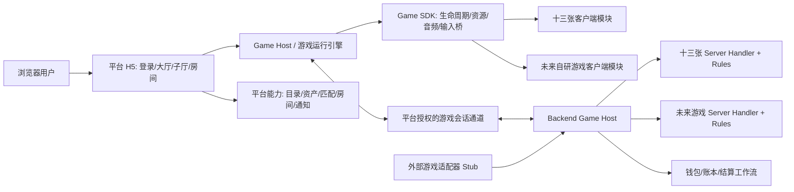
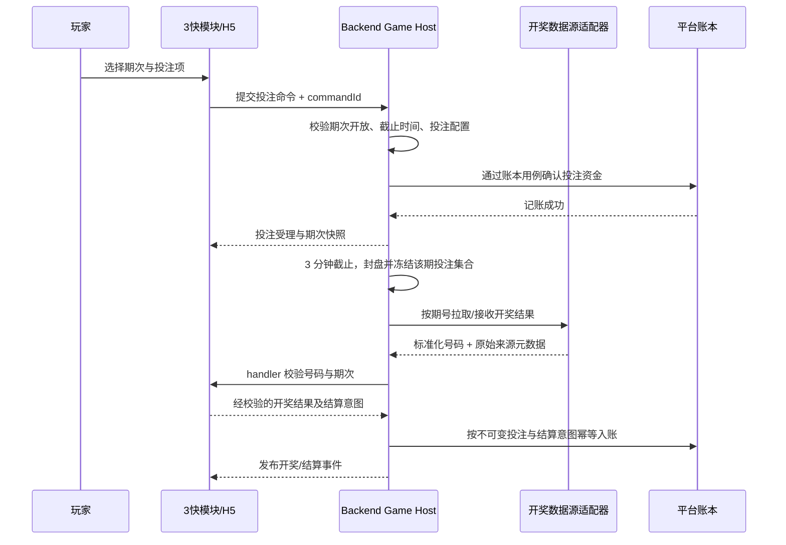
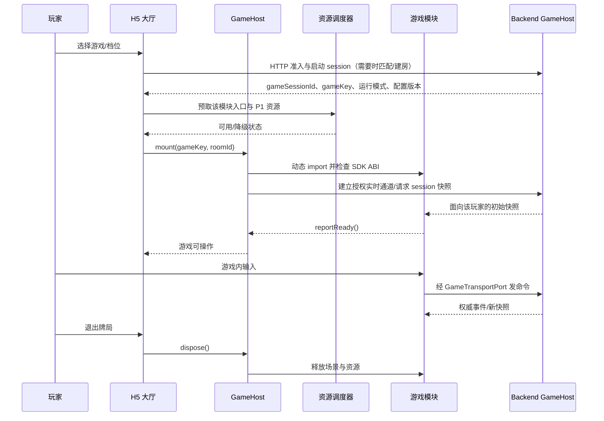

# 游戏引擎与游戏模块边界

阶段：平台扩展性设计。目标是后续增加自研游戏时主要新增一个自包含游戏模块，通过受控注册接入；大厅、账户、资产、预加载等平台能力不复制到每款游戏中。玩法范围不仅有十三张，还考虑跳高高（目录 ID `slot5`）、夺宝奇侠（目录 ID `slot3`）、麻将胡了、麻将胡了2、捕鱼、赏金女王等。因此运行时必须同时支持房间牌局、单次旋转/局次结算和持续实时场景，不能把“房间”和“四人对局”设成所有游戏的前提。此处“游戏引擎”指本项目的平台游戏运行时与集成协议，不意味着实现一个新的 PixiJS 渲染器或通用游戏编辑器。

## 1. 核心拆分



**平台壳负责“所有游戏共用的服务”**：身份与 JWT、游戏目录、封面/介绍、难度或投注档位、金币准入、可选匹配/房间、平台通知、钱包与资产、战绩入口、网络状态、资源下载调度及 Admin 配置。平台只知道 `gameKey`、公开目录信息、配置版本和通用会话/房间状态，不解释具体游戏牌型、赔率、鱼种或玩法。

**游戏引擎负责“装载与运行契约”**：校验游戏包兼容性、动态加载/卸载、注入最小能力、传递公开快照和命令、报告加载状态、呈现断线重连状态、协调资源/音效、清理 renderer/事件/纹理。它不代替服务端裁定胜负，不持有钱包仓储，不把 PixiJS 强加给非 Pixi 游戏。

**游戏模块负责“该游戏的全部独有规则和体验”**：游戏客户端视图与输入、游戏专属 UI、规则/自动操作、服务端权威 handler、游戏配置 schema/default、游戏事件和命令 schema、游戏资源与加载清单、回放/结果 payload 的解释、针对本玩法的测试。十三张模块才理解三墩和倒道；Slot 模块才理解转轴/中奖线/免费旋转等；捕鱼模块才理解场景、炮台、弹道和命中规则。

共享协议放入 `contracts` / `game-sdk`，不能把某款游戏的规则泄露到平台通用包。金币/房间等公共领域仍由 backend 自己拥有，游戏模块通过明确端口请求开始会话、下注预留/扣款、结算入账或结束会话，不直接写钱包表。通用协议区分长会话 `GameSession` 与可选短局 `GameRound`：Slot 的每次旋转可以是一局；捕鱼可在一个持续会话中产生多次命令和结算；十三张则使用房间会话和一轮一轮牌局。

## 2. 推荐目录

```text
apps/
  web/                              H5 平台、目录、路由和 GameHost 装配
  server/                           Koa/Socket.IO 应用入口
packages/
  game-sdk/                         浏览器游戏模块 ABI 与宿主能力
  game-host/                        客户端模块加载、生命周期和错误边界
  game-protocol/                    通用房间信封、版本与序号定义
  contracts/                        identity/wallet/catalog/room 等平台协议
  backend/                           平台领域与通用 GameHost 编排
games/
  shisanshui/
    manifest.ts                      gameKey、SDK 兼容区间、入口和资源清单
    contracts/                       该游戏的命令/状态/结果 payload schema
    rules/                           纯规则算法；不依赖 UI、Socket、DB
    client/                          Pixi 场景、交互、动画、演示层
    server/                          权威 handler、自动提交、游戏结算解释
    bot/                             可选的本游戏陪玩策略
    math/                            本游戏概率模型与模拟/校验工具
    assets/                           该游戏资源规格/manifest 引用
    tests/                            规则/协议/模块契约测试
  future-game/
    ...                              同一模块边界
```

首批游戏按模块登记、按类别配置，不应做成一个不断增长的巨大 `gameType` 条件分支：

| 游戏/类别 | 推荐运行模式 | 游戏模块专属职责 | 平台共用职责 |
| --- | --- | --- | --- |
| 十三张 | `room_round` | 三墩规则、理牌、比较、特殊牌型 | 房间/座位、准入、用户资产与牌局结算入账 |
| 跳高高（`slot5`）、夺宝奇侠（`slot3`） | `spin_round` | 多线转轴、积分规则、服务端随机结果与派奖意图 | 用户会话、配置/档位、账本借贷、战绩入口 |
| 麻将胡了、麻将胡了2 | `spin_round` | 各自独立的玩法配置、动画、服务端结果解释 | 与其他 Slot 相同的平台钱包/会话/资源能力 |
| 赏金女王 | `spin_round`（待按具体玩法确认） | 游戏独有玩法、状态和结果解释 | 平台通用会话、结算、记录能力 |
| 捕鱼 | `realtime_session` | 场景状态、炮台/弹道/鱼群、服务器命中校验与事件流 | 长会话、连接恢复、资产端口、限额与结算记账 |
| “3快”（暂称） | `scheduled_draw` | 三分钟下注窗口、封盘、外部开奖数据适配、开奖校验与按期次结算 | 用户会话、资金预留/下注账本、结算入账、开奖记录查询 |

表中的具体产品名与运行模式是规划标签，不代表已经确定其数学模型、奖表/返奖率或规则。“3快”按用户补充暂理解为：每期开放下注 3 分钟，之后从外部数据源取得开奖号码并结算；外部数据源、期号格式、封盘边界和异常处理仍需在该游戏模块设计时确定。开奖数据验真、派奖和金额由服务端权威处理；客户端只负责呈现状态与发送合法操作意图。游戏配置负责玩法开关、版本和允许值，Admin 对发布进行审计。

如果 server handler 与纯规则在构建时有不同依赖要求，可将 `rules`、`client`、`server` 做成 workspace 子包；这些子包属于同一个 `games/<gameKey>` 产品模块，不把每个业务小文件都抽成包。Server handler 可调用共享钱包结算用例，但只能返回经过验证的结果意图，不能直接访问 Sequelize Model。

对既有目标目录的调整：`backend/modules/shisanshui` 中的玩法专属逻辑迁入 `games/shisanshui/server` 与 `rules`；backend 保留通用 `game-integration`、房间/匹配和结算工作流。原 `external-game-stub` 变成由通用 external adapter 加载的一个 Stub 模块，不让外部代码进入自研游戏 SDK 的信任边界。

## 3. 客户端模块契约

以下是边界示意，不是已实现 API；正式初始化时将它定为版本化 TypeScript 接口及运行时 schema：

```ts
export interface GameModuleManifest {
  gameKey: string;
  moduleVersion: string;
  gameSdkApi: { min: number; max: number };
  runtimeMode: 'room_round' | 'spin_round' | 'realtime_session' | 'scheduled_draw';
  renderer: 'pixi' | 'dom_canvas' | 'external_adapter';
  clientEntry: () => Promise<GameClientModule>;
  resourceManifestId: string;
}

export interface GameClientModule {
  create(context: GameRuntimeContext): GameInstance;
}

export interface GameRuntimeContext {
  session: Readonly<GameSessionSnapshot>;
  room?: Readonly<RoomSnapshot>; // 只对房间型运行模式提供
  round?: Readonly<GameRoundSnapshot>; // 短局/旋转或牌局；持续会话可为空
  gameConfig: Readonly<unknown>; // 先由对应 game schema 校验后注入
  transport: GameTransportPort;
  assets: GameAssetPort;
  audio: GameAudioPort;
  viewport: ViewportPort;
  reportReady(): void;
  requestExit(): Promise<void>;
}

export interface GameInstance {
  mount(target: HTMLElement): Promise<void>;
  applySnapshot(snapshot: GameSnapshotEnvelope): void;
  applyEvent(event: GameEventEnvelope): void;
  setConnectionState(state: ConnectionState): void;
  dispose(): Promise<void>;
}
```

`runtimeMode` 决定宿主提供哪些通用能力，不让游戏模块反向改变平台协议：`room_round` 使用房间/座位/准备流程；`spin_round` 使用游戏会话下的一次次 round 命令与结算；`realtime_session` 使用长会话和连续事件，不强造每个动作都是一局；`scheduled_draw` 按服务端期次管理下注开放、封盘、开奖数据接收和结算。对大厅的表现由 manifest 中的 H5 子厅 schema 描述（如房间列表、投注档位、开始按钮、期次/倒计时），由平台提供有限的通用模板；复杂自定义子厅仍由该游戏的 H5 extension 组件实现并受 SDK 隔离。

关键约束：

- `GameRuntimeContext` 只提供白名单能力，不提供全局 Vue store、原始 Socket.IO socket、HTTP 任意请求、登录令牌读取或钱包写接口。
- `dispose()` 必须可重复安全调用；路由离开、模块加载失败、重连重建时释放 Pixi Application、Ticker、监听器、计时器和非共享纹理引用。
- 游戏资源通过资源端口/manifest 拉取，不能游戏模块自行绕过缓存版本、完整性校验和网络调度。
- UI 不属于游戏 Canvas 的内容（账号、资产、全局客服/设置）由 H5 平台呈现；牌桌和玩法操作由游戏模块呈现。游戏模块可请求宿主打开通用弹层，但不能自己实现第二份钱包。
- 首版只承诺 Web 动态模块。原生封装复用同一个 web 构建，不再复制玩法模块。
- 陪玩机器人由 server-side `BotSeatPort` 按本游戏策略驱动，通过与真人相同的 handler 校验；bot 标识、权限与结算隔离见 [陪玩机器人与概率模型设计](../03_game_systems/陪玩机器人与概率模型设计.md)。机器人不是通过客户端塞入的第二套游戏逻辑。
- 真人座位的超时托管由对应游戏 handler 为单个过期动作生成合法动作，不创建 bot user/seat，也不改变机器人陪玩的入座、身份或统计口径。托管动作来源需与真人命令区分。

## 4. 服务端游戏 handler 契约

Backend Game Host 对每款自研游戏暴露统一的 server port；handler 内部调用自己的规则包。游戏专属 payload 按已确认的方案放在版本化 JSON envelope 中，由该 `gameKey` 对应 handler/schema 解释与校验。

```ts
export interface ServerGameHandler {
  gameKey: string;
  runtimeMode: 'room_round' | 'spin_round' | 'realtime_session' | 'scheduled_draw';
  validateConfig(config: unknown): ValidatedGameConfig;
  createSession(input: CreateGameSessionInput): GameSessionState;
  validateCommand(state: GameSessionState, command: GameCommand): CommandResult;
  applyCommand(state: GameSessionState, command: GameCommand): GameSessionState;
  resolveTimer?(state: GameSessionState, timer: GameTimer): GameSessionState;
  createRound?(state: GameSessionState, input: CreateRoundInput): GameSessionState;
  verifyExternalResult?(state: GameSessionState, result: NormalizedDrawResult): VerifiedDrawResult;
  buildSettlementIntents(state: GameSessionState): GameSettlementIntent[];
  buildQualifiedMilestones?(state: GameSessionState): QualifiedMilestone[];
  buildSnapshot(state: GameSessionState, viewer: PlayerId): GameSnapshotEnvelope;
  closeSession(state: GameSessionState, reason: CloseReason): GameSessionState;
}
```

平台通用 session host 负责命令鉴权、顺序号、幂等、恢复和持久化边界；只有房间模式额外使用房间 actor 的成员/座位、截止时间 barrier 和 owner epoch。handler 负责游戏业务合法性和游戏状态变换。`GameSettlementIntent` 是 handler 输出，平台结算工作流验证身份/重复事件后通过 wallet 用例写账。下注扣款/预留和中奖入账使用钱包公开用例；禁止 handler 直接改余额或自行标记账本成功。连续实时模式可批处理高频展示事件，但影响资产的命令必须可验证、可幂等并在服务端结算。

可选 `QualifiedMilestone` 只描述经过服务端规则确认的游戏事件（例如大额中奖/特殊击杀），不发钱、不改 RNG；若触发厅级促销，由平台 promotion service 检查公开配置、适用难度和预算，再通过钱包用例发放明确的奖励流水。陪玩机器人不能触发或领取真人促销。具体边界见 [陪玩机器人与概率模型设计](../03_game_systems/陪玩机器人与概率模型设计.md)。

### 自动模式、倍数与超时托管

产品规则与通用配置项见[自动游戏与每轮投入设计](../03_game_systems/自动游戏与每轮投入设计.md)。

玩家可以选择手动模式或自动模式；具体游戏未实现自动能力时不展示自动选项。两种模式都明确展示“每一轮投入”。启动自动模式时，该值默认取当前所选档位的单轮金额，玩家可在启动前改为游戏规则允许的金额/档位；若同时提供投注倍数，界面显示换算后的实际每轮投入。自动运行期间锁定这份设置，调整需停止后重新确认。服务端对每一轮重新校验档位、投入上限、钱包可用余额和游戏配置；余额不足或设置失效时停止自动模式，并返回明确原因，不接受客户端自行决定结果。

平台引擎只提供自动运行的生命周期、停止条件校验、命令幂等和恢复状态；是否支持自动操作、哪些动作可自动执行及其合法选择由游戏模块定义。自动模式的局数档位、每轮投入、投注倍数和游戏自身的派奖/技能倍数是不同字段，不能共用一个含糊的 `multiplier`：仅该游戏确实支持时才开放对应配置；服务端校验单局投入、余额、档位和配置上限。局数可由模块配置多个有限选项，并按产品配置决定是否提供“无限”；投注倍数只按公开规则缩放投入及相应派奖，不改变随机概率或 RTP；派奖/技能倍数则由游戏规则单独解释。游戏模块还可声明免费轮与翻倍轮：免费轮作为触发它的付费局的延续，不产生新扣款，也不计为新的付费自动局；翻倍轮的效果目标由模块规则明确。需要按房间累计的积分归属当前 `room_membership`，有效断线保留，离房/移出/关房清零，重进创建的新 membership 重新累计；handler 在 round 结算时以幂等方式更新成员私有状态。触发条件、积分、次数、倍数、状态和派奖结果由 handler 权威计算，放入该局结果/事件 payload 与规则快照，不新增奖励或积分专属业务表。详细边界与验收见[奖励轮与派奖倍数机制 SDD](../03_game_systems/奖励轮与派奖倍数机制SDD.md)及[自动游戏与每轮投入设计](../03_game_systems/自动游戏与每轮投入设计.md)。

玩家主动开启的连续自动游戏，由服务端维护执行意图。网络断开后，已受理的当前局继续完成权威结算；服务端停止启动下一局。重连后返回会话快照、最近结算局和停止原因，需玩家重新确认才能开启新一段自动运行。断线期间客户端不得缓冲并补发下注、旋转或发射命令。运行意图可先放 Redis 会话状态，不新增自动游戏专属表；每局权威结果和资产变化仍写入已有牌局/订单与资产流水。Redis 状态丢失或服务重启时采取停止策略，不自动续跑。

棋牌类“机器人托管”是对真人座位某个超时动作的一次性代行，不是陪玩机器人入座，也不等同于玩家主动开启自动游戏。每个待操作窗口独立计时；当前窗口超时后，游戏 handler 通过合法动作策略完成该动作，并记录动作来源为 `timeout_bot`。这次代行不授权机器人连续接管后续回合：下一次需要玩家操作时仍等待玩家提交，只有该次再次超时才代行。用户在当前整局尚未结束时重连，服务端返回当时的权威快照并恢复该座位控制；尚未执行且仍有效的操作可由用户继续，已经被服务端接受的托管动作不回滚。若当前局已结算，不恢复旧局；断线中的自动游戏也不启动下一局。棋牌房间下一局的开局仍按该游戏流程，玩家后续需要操作时必须手动提交，超时后才托管。

托管动作与玩家命令进入同一个房间串行队列，由服务端 deadline barrier 决定先后；玩家在截止前已受理的命令优先按入队顺序处理，超时托管与玩家命令不得对同一动作重复生效。13 张牌的超时动作是生成并校验合法三墩后提交；其他棋牌由各自 handler 定义有限且公开的超时策略。托管 handler 不能访问对手隐藏信息、钱包画像或未公开游戏状态。托管事件在快照和回放中可辨识，但不能伪装成玩家亲自操作。

每条通用协议信封包含 `gameKey、gameModuleVersion、protocolVersion、gameSessionId、roomId?、roundId?、stateVersion/eventSeq、payload`。`payload` 由游戏专属 schema 校验，通用 envelope 只负责路由、顺序和版本。公开场景状态与玩家私有状态分离；服务器只能向适格玩家生成私有快照。配置在 session 或 round 启动时固定版本，后续 Admin 修改不改变运行中的状态。

Slot 类每次旋转是明确的 `round`：服务器验证下注参数与可用资产、生成随机结果、计算结果和应入账金额，客户端不可提交中奖结果或控制随机种子。捕鱼的视觉轨迹可以客户端插值，但服务器决定有效目标、弹药/成本、命中和奖励；客户端动画不作为结算凭证。定时开奖类以 `drawPeriodId` 标识每一期：服务器截止下注、记录数据源响应及校验结果、固定开奖结果，再按不可变下注记录幂等结算；客户端不能延长投注时间或自行设置号码。

“3快”建议运行路径：



数据源适配器负责供应商协议、认证、重试和原始响应留痕；游戏 handler 负责期号/号码格式与玩法匹配校验；backend 负责封盘边界、唯一期次、幂等和账本。必须明确源数据暂不可用时是否延迟结算、如何校验/处理供应商更正，以及时间同步与封盘的权威时钟。首版使用哪家源和异常决策可在“3快”模块开工前确认，不阻塞当前通用引擎设计。

## 5. 注册、发布与增加一款游戏

自研游戏注册表是构建期的受信任白名单，不能从数据库读取任意 JS URL 后执行。大厅目录的 `gameKey` 必须能匹配客户端模块和服务端 handler；任一端未部署时显示维护/未开放状态。



增加自研游戏的标准工作量应收敛为：新增 `games/<key>` 模块及资源/配置；实现客户端与服务端 handler；编写 schema、迁移（仅新增游戏自身需要的数据时）和契约测试；在构建注册表中注册；向 Admin 游戏目录配置添加展示信息和开放状态。不能因此复制大厅、匹配、JWT、Socket 连接、钱包、通知或预加载实现。

构建注册示意：

```ts
// 可由受控 workspace 清单生成；每款游戏仍是独立异步 chunk。
const clientRegistry = {
  shisanshui: () => import('@gameing/shisanshui-client'),
  // future-game: () => import('@gameing/future-game-client'),
};
```

预取只下载模块 chunk 和被 manifest 列为 P1/P2 的资源，不执行动态 import、不创建 Pixi renderer。正式进入牌桌才调用 registry loader。新增模块需经过 SDK/API 区间检查；不兼容时显示可恢复错误，不进入空白 Canvas。

## 6. 外部游戏接入

外部游戏不能直接获得 `GameRuntimeContext` 的全部平台能力。为未来接入保留 `ExternalGameAdapter`：平台签发短时、单房间、限定用户及权限的 launch ticket；外部游戏通过隔离 origin/iframe 或专用托管适配器运行，仅接收最小协议；支付/结算仍经平台服务端验签和对账。首版只做可演示流程的 Stub，不实现通用远程代码执行或任意 URL 嵌入。

自研模块与外部接入模块可以共用目录、session 识别和受控结算意图接口，但信任模型不同，不能为简化而把外部 JS 当成本地自研包。

## 7. 版本兼容与验收

- 平台声明支持的 `gameSdkApi` 区间；模块声明兼容区间和模块版本。SDK 升级先通过兼容测试，不要求所有游戏同时改版。
- 协议 payload 有运行时 schema；未知协议版本拒绝并提供升级/退出提示，不能忽略关键资产或对局命令。
- CI 对每个游戏分别运行纯规则测试、server handler 契约测试、客户端 mount/dispose 测试、资源 manifest 完整性与 bundle budget。
- 新游戏独立动态 chunk；打开大厅不得加载 PixiJS 或所有游戏模块。构建报告需验证新模块没有进入 H5 首屏包。
- 平台共用端到端流程分别用 room-round、spin-round、realtime-session、scheduled-draw 四种测试模块验证：目录展示 → 准入 → session → mount → snapshot/command → settlement intent → dispose。
- 服务器升级支持 handler 与运行中 session/round 的模块版本并存，或在滚动发布前排空相关会话；禁止用新 handler 随意解释旧版本状态。


## 变更历史

| 日期 | 变更 |
| --- | --- |
| 2026-10-11 | 用跳高高/夺宝奇侠替换 Slot5/Slot3 产品名，并明确目录稳定 ID 与多线积分玩法边界。 |
| 2026-10-10 | 明确奖励积分按单次 room_membership 累积：有效断线保留，离房/移出/关房清零，重新入房重置。 |
| 2026-10-10 | 补充通用引擎对免费轮/翻倍轮的能力边界，奖励状态进入游戏局事件/结果与规则快照，不新增平台表。 |
| 2026-10-10 | 将自动局数规则调整为多个可选档位且按游戏可提供无限选项。 |
| 2026-10-10 | 链接自动模式与每轮投入产品规则，补充各游戏支持能力边界。 |
| 2026-10-10 | 补充手动/自动模式选择与每轮投入；自动模式默认沿用当前档位并在启动前可调整。 |
| 2026-10-10 | 明确自动游戏断线后完成当前局并停止；棋牌超时仅托管当前动作，未结束牌局重连恢复权威快照。 |
| 2026-10-10 | 按项目约束新增变更历史区块；未改动原有正文。 |
| 2026-10-10 | 按文档性质归档并更新相关链接。 |
