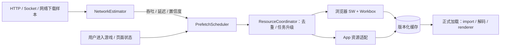

# 网络预加载设计

日期：2026-10-08。方案已获用户确认：Workbox + vite-plugin-pwa + 业务资源调度器。**控制依据是网络余量，不是线程空闲。** 本文规定初版实现和验收，参数为可调起点；没有声称已测得实际带宽或包丢失率。

## 1. 目标与职责

大厅可交互后，在不影响 HTTP 操作和 Socket 游戏状态的前提下，提前下载候选游戏的 JS/CSS/核心贴图；点击游戏复用缓存与在途请求，再执行模块并创建 renderer。



估算器不依赖 Vue、Pixi 或网络 API 全局对象，接收已标准化样本与 Clock；调度器输出 dispatch/pause/promote/cancel 决策；缓存适配器处理请求、存储、权限、消息与版本。页面不自行启动第二套下载队列。

## 2. 资源 manifest

```ts
type ResourceItem = {
  id: string;
  url: string;                    // 内容 hash URL
  kind: 'js' | 'css' | 'image' | 'audio' | 'video';
  tier: 'P0' | 'P1' | 'P2';
  decodedBytes: number;           // 原始文件内容大小；不是 JS 内存大小
  contentDigest: string;          // 构建输出内容校验摘要
  transferEstimates?: { br?: number; gzip?: number; identity?: number };
  variant?: string;               // webp-low / webp-high / avif / hevc 等
  dependencies: string[];         // 对应已选 variant 的依赖
};

type GameResourceManifest = {
  manifestVersion: number;
  resourceVersion: string;
  protocolRange: string;
  gameId: string;
  entryResourceId: string;
  resources: ResourceItem[];
};
```

Vite manifest 中的 imports/CSS 用于生成静态依赖图，游戏素材清单补贴图/图集/声音。仅展开当前游戏必需依赖；dynamicImports 中的其他游戏和可选装饰保持独立。删除不可达资源，校验图中无缺失引用与非法 URL。[Vite 构建 manifest](https://vite.dev/guide/backend-integration)

内容 digest 对应构建文件内容，HTTP br/gzip 解码后的 Response 字节才与其校验一致。压缩传输大小用于带宽估计，解压文件大小用于完整性/缓存预算，两者不能混用。P0 ≤500 KB，P1 增量目标 1–2 MB；去重后统计，P2 后置。大型 JS 优先合理拆 chunk，控制单请求剩余时间；不把公共框架复制到每个游戏。

## 3. 请求协调与任务模型

key 包含实际 URL、variant 与影响响应的请求模式，hash URL 对应确定内容；资源版本管理决定哪些 key 属于某局。相同 key 只有一个活动网络请求，多个订阅者共享 Promise/进度与结果。

状态：`QUEUED → DOWNLOADING → VERIFYING → CACHED`；失败进入 RETRY_WAIT/FAILED，未启动任务可 PAUSED。`CACHED` 是已完整可读，不是收到响应 headers。订阅者有 background/foreground 优先级与引用计数；取消一个预取订阅不等于取消仍被正式加载使用的下载。

升优先级不重下同一文件；在途浏览器请求无法保证即时改网络优先级，只提升队列与后续依赖。低优先级任务暂停主要指停止派发新请求。前台点击已完成缓存零网络复用，点击在途资源等待同一请求，缺失项优先调度。

SW 控制页面时由其统一请求与预取消息处理，避免“页面 fetch → SW”和“SW message fetch”创建两个请求。跨标签所有预取走同一 SW 协调，页面背景下载状态只是视图。SW 不受控/不可用时走页面协调器与 HTTP 缓存；多标签协调能力不可用时允许保守降级，不把互斥正确性依赖在永久存活的 JS 对象上。

失败重试保持 key，建议网络瞬时错误最多 3 次、指数退避并加入抖动；离线等网络恢复，429 尊重服务端退避信号，404/hash 不匹配先核对 manifest 不无限重试。用户取消不计网络失败。查询金币和 Socket 命令不通过该静态下载队列。

## 4. 样本采集与误差

### 4.1 可用指标

| 样本 | 采集 | 使用 |
| --- | --- | --- |
| 页面 HTTP 下载 | PerformanceObserver，type=resource，buffered 按支持检测 | 文件传输时间、encodedBodySize、缓存来源 |
| SW/原生后台下载 | 适配器直接记录真实 fetch 开始至完整响应/写入结束、可用字节信息 | 补充页面 Observer 看不到的后台任务 |
| HTTP 响应 | requestStart/responseStart、接口用例耗时 | 应用响应延迟，不直接当 TCP RTT |
| Socket echo/ACK | 客户端单调时钟差，包含处理与调度 | 前台交互保护与拥塞反馈 |
| 网络失败/超时 | 统一分类，与用户取消/HTTP 错误区分 | instabilityScore 与降速 |

采集已有正常请求；已有心跳不是自动可见的应用 RTT，必要时低频发送带 ACK 的轻量 echo，初始 10 秒一次、有抖动，活动业务 ACK 可补充。服务器不在 echo 中查询 DB。后台可能被系统暂停的时段不与正常前台窗口混合。

Resource Timing 可读取网络阶段和压缩响应大小，跨源需 Timing-Allow-Origin。PerformanceObserver 的 buffered 使用方式按 API 要求，避免误把多个 entryTypes 与 buffered 混用。[Resource Timing](https://developer.mozilla.org/en-US/docs/Web/API/PerformanceResourceTiming)、[Observer](https://developer.mozilla.org/en-US/docs/Web/API/PerformanceObserver/observe)、[TAO](https://developer.mozilla.org/en-US/docs/Web/HTTP/Reference/Headers/Timing-Allow-Origin)

**页面 Resource Timing 不作为 SW 自发请求的唯一采集入口。** SW/原生适配器上报样本来源、起止与字节口径；fetch resolve 通常只是 headers 到达，需等完整 body/cache 写入才判定下载结束。缓存写入耗时可能计入该保守样本，明确标识，不能与精确响应体吞吐盲目合并。

读取流得到的 body 字节常为 HTTP 解压后的内容，不直接当网络传输字节。优先用可观测 encodedBodySize 或有效 Content-Length/响应编码；不可观测时用 manifest 对应编码估计并降低置信度，无法确定编码则不用于高置信吞吐样本。跨源需要暴露相关响应头，CORS 与 TAO 分别配置。

### 4.2 清洗与分组

排除本地缓存/SW 缓存、304、用户取消、小于测量阈值的响应、计时字段隐藏和长期后台暂停。transferSize=0 可表示本地缓存，也可因为跨源限制，不独自决定样本含义。缓存命中由适配器标识与计时联合判断。

按 origin/网络代次/采集口径分组；实际路径改变、Wi-Fi/蜂窝切换或离线恢复清除旧高置信状态。不同 origin 的速度不能互相推断，调度同时保留应用总并发预算，防止每个 origin 各自放满请求挤占共同网络。

单个资源速率是 `encodedBytes / bodyTransferSeconds`，不代表整条线路带宽。并发下载使用一组请求的总字节/整体观测窗口，仅在集合完整或已结束的批次形成聚合样本，不能重复相加重叠单文件速率；有空档时样本偏低，保留并发数和空档比例降低权重。

普通网页无法从这些字段获得 TCP/QUIC 包重传的真实丢包率。`instabilityScore` 使用延迟上升、超时/失败、吞吐波动；测试工具配置的 packetLoss 是外部真值，不把应用 HTTP failureRate 输出成丢包率。服务端 5xx/429 与网络失败单独统计。

## 5. 控制器：保守估算与逐步探测

### 5.1 起始参数

| 参数 | 初始建议 | 用途 |
| --- | --- | --- |
| 样本窗口 | 近 30 秒，最多 20 个有效批次 | 避免长期历史掩盖网络变化 |
| 估算器 | P25 + EWMA，alpha=0.2 | 低分位与平滑共同约束 |
| 安全系数 | 0.7 | 保守吞吐估计 |
| 后台份额 | 0.5 | 保留前台余量 |
| 初始/最大后台并发 | 1 / 4 | 冷启动谨慎，实测后改上限 |
| 增加间隔 | ≥10 秒稳定窗口 | 避免快速占满带宽 |
| 恢复冷却 | ≥5 秒稳定观察 | 网络异常后逐步恢复 |
| 任务总预算 | 每次大厅会话先限 10 MB | 防无边界预取；产品可配置 |

低样本量时不计算貌似可靠的 p95；使用 EWMA/最大近期值与低置信标记。下式单位均为 B/s：

```text
safeRate = 0.7 × min(recentBatchRateP25, rateEWMA)
backgroundTarget = 0.5 × max(0, safeRate - observedForegroundRate)
```

前台资产下载进行时默认停止无关预取，不仅依赖残余预算公式。普通低流量 HTTP 操作可与后台共存，但延迟恶化立即退让。PLAYING 默认暂停其他游戏预取；自己的 P2 也要满足实时交互保护。

### 5.2 解决自我压低估计

如果只观察被自身限速后的下载，把实测速率再次乘安全系数，会不断降低目标。样本必须标注 dispatchDelay、是否预算受限、并发和空档；用预算受限样本判断当前路径的下界，不把它当容量上界持续折扣。

允许在没有前台资产下载且应用延迟稳定时，使用真实待取资源的小批次探索：并发一次增加 1 或减少批次间隔，观察聚合吞吐增益与 ACK 延迟。增益不明显停止增加；延迟恶化回退。不要发送专门大测速文件。老估算过期后从 1 并发重新探索，而非永久用旧低值。

### 5.3 拥塞与退让

建立无后台流量或轻载时的按路径延迟基线，避免基线随着拥塞升高而掩盖问题。开始预取后若 Socket/HTTP 延迟超过 `max(baseline×1.5, baseline+100ms)` 的建议阈值并持续两个观察窗口，则并发减半；发生连续网络超时/连接重连则暂停。阈值用于试制，按目标链路测量调整，不把正常跨境高 RTT 直接当异常。

暂停后留冷却期；恢复先单并发。上升阈值和恢复阈值分开，防止频繁震荡。服务端负载增高也可触发保守减速，但日志原因写“应用延迟恶化”，不能声称已证实网络丢包。

## 6. 调度目标不等于底层限速

普通 fetch 无通用精确限速器，控制目标通过并发、文件大小、批次间隔和令牌预算实现。令牌按预计传输字节计费并在完成后校正；最多积攒一个小批次，防止长时间空闲后立即突发大下载。文件超过余额时允许按预计时长单独调度，不能永远饿死大 chunk。

限制最大低优先级文件尺寸、派发速率和在途数量比声称“延缓读 stream 能控制 TCP”更可靠。前台到来先停止派发；仅在实时交互仍受影响时 abort 无关在途文件。对同一资源仍有前台订阅时不 abort；已完成缓存永不因取消预取丢弃。

本实现充分利用网络余量，但不会承诺持续最大化测速吞吐；优化目标是减少用户入厅等待，同时保持 HTTP/Socket 响应与总流量受控。

## 7. Workbox 与版本管理

`injectManifest` 的 P0 precache 清单由工具显式生成，不使用覆盖全 dist 的通配规则。游戏 P1/P2 使用版本化 runtime cache。Workbox 负责策略和存储，调度器不覆盖其生命周期；正式资源 fetch 与预取必须使用同一匹配路由。[Vite PWA injectManifest](https://vite-pwa-org.netlify.app/guide/inject-manifest)、[Workbox precaching](https://developer.chrome.com/docs/workbox/modules/workbox-precaching)

runtime cache 采用 immutable hash 资源 CacheFirst；API、私有响应、Socket polling 不匹配该规则。以显式 cache name 区分版本；Workbox expiration 可限制条目/年龄，但项目仍要实现字节预算与当前版本保护，不能把 maxEntries 当 MB 限制。[Workbox expiration](https://developer.chrome.com/docs/workbox/modules/workbox-expiration)

在对局期间不能自动 skipWaiting + 刷新页面。新版本先下载到新缓存，等所有相关活动游戏完成或页面允许安全切换后激活；多标签仍使用旧版时保留旧游戏 runtime cache。worker 被重启后重新检查完整缓存，不信任内存的 cached 标记。资源 manifest 版本和当前局规则版本分别固定。[更新提示模式](https://vite-pwa-org.netlify.app/guide/prompt-for-update)

跨版本引用追踪可用客户端租约与 TTL 防死页面永久保留；被动淘汰允许下次恢复重新下载，不能在用户仍运行时主动删必需资源。cache.put 失败或 QuotaExceeded 时报告缓存失败，降级为当前加载，不能宣称已持久预取成功。partial response 不直接当完整 cache entry。

后台 JS fetch 不调用 import，CSS 不注入 document，贴图不提前创建 Pixi texture。模块执行和图片解码属于 CPU/内存阶段，独立调度。AVIF 动画/HEVC 选择在 manifest variant 阶段完成，只下载兼容格式。

## 8. 验收用例与观测

| 场景 | 必须满足 |
| --- | --- |
| 10 Mbps →256 Kbps / RTT 突增 | 控制器快速退让，前台保持可恢复 |
| 弱网 →快网 | 不被预算受限的低样本永久锁死，逐步增加 |
| 缓存/隐藏计时字段 | 不出现无限带宽或零 RTT 错误估计 |
| 两标签同时预取同文件 | 协调正常时仅一个请求，重启后不缓存半文件 |
| 预取中点击入厅 | 同 key 复用，不重新下载，不提前执行 |
| 省流/离线/后台 | 停止新任务；恢复后低并发重新评估 |
| SW 新版就绪且正在游戏 | 不刷新，不删除活动版本 |
| 内容 hash 不符/404 | 不无限重试，不进入错误游戏版本 |
| 页面没有 SW/容器本地资源 | 正确降级，不强求相同下载性能 |
| 已在 PLAYING | 无关预取暂停，提交 ACK 可查，命令不被静态队列阻塞 |

纯控制器使用记录样本回放验证，真实网络测试在 HTTP/Socket 代理或 Linux 环境执行。仅浏览器 DevTools 限速不构成高丢包验证。记录 cold/warm 首屏、入厅等待、有效/浪费预取字节、缓存命中、重试、各路径 ACK 分位数、估计置信度与降速原因。

UI 只呈现用户需要的“资源准备中/已准备/网络重试”，吞吐模型和控制参数属于开发监控，不堆到大厅产品界面。


## 变更历史

| 日期 | 变更 |
| --- | --- |
| 2026-10-10 | 按项目约束新增变更历史区块；未改动原有正文。 |
| 2026-10-10 | 按文档性质归档并更新相关链接。 |
