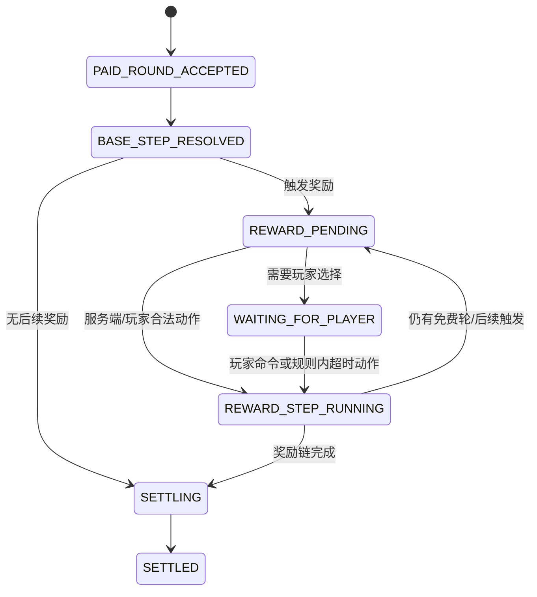

# 奖励轮与派奖倍数机制 SDD

状态：跨游戏施工基线。本文定义免费轮、积分触发奖励轮和翻倍轮如何接入游戏引擎、自动模式、结算、期望计算器和 UI。各游戏的概率、积分来源、次数与奖励规则仍由对应游戏模块设计；平台不提供一套伪装成通用玩法的固定赔率。

## 1. 目标与非目标

需要支持游戏在一次已经扣款的付费局中，按概率、积分门槛或两者组合触发零次、一次或多次奖励轮；奖励轮可以免费继续游戏，也可以按该游戏明确的规则提高奖励结果。系统必须能恢复进行中的奖励链、避免重复扣款/派奖、把奖励完整纳入数学报告，并在自动模式和弱网下保持一致行为。

本文覆盖：

- **免费轮（Free Round）**：在已受理的付费局中触发的后续游戏步骤，不再扣一次新投注。
- **积分触发轮（Points-triggered Round）**：游戏模块定义积分累积/门槛，满足规则后授予的免费轮或增强轮。
- **翻倍轮（Multiplier Round）**：游戏模块定义一种结果派奖倍率效果。倍率对象必须明确；平台绝不默认把它解释成下注翻倍。
- 单局状态持久化、断线恢复、自动模式、账本/流水和模拟报告的共同约束。

本文不定义各游戏的触发概率、RTP 目标、积分兑换比例、奖励轮图像/动画或具体奖表；不允许根据真人的输赢、充值、设备/IP 或画像动态改变奖励触发率。

## 2. 领域名词与计数口径

| 名词 | 定义 | 付费局数计数 | 新增扣款 |
| --- | --- | --- | --- |
| 付费局（paid round） | 服务端受理并确认实际投入的一次完整局 | 计 1 | 按该游戏规则记一次实际投入 |
| 奖励链（round chain） | 付费局以及其触发的全部免费/翻倍后续步骤 | 仍计 1 | 不因奖励步骤再次扣款 |
| 免费轮（free round） | 奖励链内的一次免费步骤 | 不另计付费局 | 0 |
| 翻倍轮（multiplier round） | 奖励链内应用明确派奖倍率的步骤/状态 | 不另计付费局 | 不增加投入 |
| 有效下注流水 | 用于满足赠币流水要求的合格实际下注额 | 只计算实际合格下注 | 由 handler 返回实际值 |

自动模式选定的局数指**付费局数**。一个付费局即使产生多次免费轮，也只消耗所选局数中的 1 局。免费轮的有效下注流水默认为 0；付费局的实际合格投注额只累计一次，不因奖励链重复计入。翻倍轮也不增加有效下注流水。游戏规则确实存在免费轮中的新投入时，该动作不再是免费轮，必须作为额外付费选项处理，并遵守[自动模式规则](./自动游戏与每轮投入设计.md)中的跳过/暂停规则。

## 3. 领域边界

**平台 Game Host** 负责标准 round 生命周期、用户/会话授权、幂等命令、事件顺序、房间 owner/fencing、通用快照传递、断线恢复、账本调用和自动运行状态。平台不判断触发中奖条件、不产生游戏 RNG 结果、不计算游戏派奖。

**游戏 handler** 负责奖励 schema、触发条件、伪随机/积分规则、积分变化、允许动作、奖励链步骤、派奖金额、免费轮和倍率展示数据、超时动作及规则快照。**游戏 math model** 使用相同版本的纯规则计算/模拟期望值。客户端只能呈现服务端奖励事件，不能提交“已触发”、次数、积分或派奖金额。

不同游戏可选择不实现奖励能力。manifest 未声明能力或对应玩法配置关闭时，客户端不显示该奖励状态，handler 不运行该奖励分支。

## 4. 游戏模块契约

### 4.1 Manifest / handler 能力声明

每个游戏在 manifest 中声明版本化能力。建议形状如下，最终共享类型放 `packages/game-sdk` 与 `packages/game-protocol`；具体奖项 payload 留在游戏自身 contracts：

```ts
type RoundRewardCapability = {
  schemaVersion: number; // 正整数，不能使用 0 表示默认/未选择
  supportsFreeRounds: boolean;
  supportsPointsTriggers: boolean;
  supportsPayoutMultiplierRounds: boolean;
  canResolveRewardChainWithoutPlayerInput: boolean;
};

type RewardChainSummary = {
  paidRoundId: string;
  paidWagerCoins: string;      // 实际金币最小单位，十进制整数字符串
  validTurnoverCoins: string;  // 本付费局合格有效下注额，不包含免费轮
  freeRoundCount: number;
  payoutMultiplier?: { numerator: number; denominator: number; target: string };
  totalPayoutCoins: string;    // 整条链返还总额，handler 权威计算
};
```

不得将泛型 payload 定义成 `any`。游戏模块必须提供 TypeBox/同类运行时 schema，用共享 envelope 封装游戏专属事件。共享能力 DTO 不意味着所有游戏必须同时支持三种机制。

### 4.2 奖励事件

Socket.IO 使用明确的服务端事件名；事件 payload 遵循项目通用 envelope 和游戏专属 schema。推荐最低语义字段：

```ts
type RoundRewardEvent = {
  schemaVersion: number;
  eventId: string;              // 稳定去重 ID
  paidRoundId: string;          // 因果父局
  eventSeq: number;             // round 内单调递增序号
  rewardKind: 'FREE_ROUND_GRANTED' | 'FREE_ROUND_RESOLVED' |
    'POINTS_CHANGED' | 'PAYOUT_MULTIPLIER_APPLIED' | 'REWARD_CHAIN_COMPLETED';
  rewardStateVersion: number;
  publicSummary: unknown;       // 经模块 schema 校验的 UI 摘要；不得泄露私有 RNG 状态
  playerPrivateState?: unknown; // 仅授权玩家可见，单独过滤
};
```

字段使用非零版本和严格状态常量；`rewardKind` 是非空字符串联合，不以 0 表示“无”。未发生奖励时省略 reward event，不伪造一个空奖励事件。金额在传输中用十进制整数字符串，禁止 JS 浮点金额。

事件应表达**已发生的权威事实**，例如“授予 3 次免费轮”“本步骤适用派奖 ×2”“奖励链结束”。UI 可以播放动画，但 ACK/结算状态不依赖动画加载或客户端确认。

## 5. 状态机与局生命周期

每一条奖励链仍使用现有通用 `round`：



说明：

1. 进入 `PAID_ROUND_ACCEPTED` 前，服务端验证投入、档位、权限、可用资产并通过钱包用例记账/冻结；只有一次付费投入。受理响应包含 round id 与版本。
2. 每一步由 handler 顺序执行：读取锁定规则和权威状态、按服务端随机源/游戏积分规则决策、生成结果、产生派奖意图、决定奖励链是否继续。
3. 免费轮中不再次调用扣款用例。投注金额、积分、免费次数、倍率和派奖都由 handler 输出，不能由前端上报作为事实。
4. 倍率明确应用对象和阶段（如中奖组合派奖额、某类符号奖等），并使用整数有理数或游戏声明的精确单位运算。结算舍入规则属于该游戏 math schema，不能使用浮点数累计资产。
5. 只在奖励链完成后提交最终 `settlement`；默认将奖励链的累计 payout 作为该付费局结算的一部分，使 `settlement` 唯一约束及账本操作幂等可沿用。需要分阶段实际入账的特殊游戏必须单独提出其资产/冲正模型，不得绕开通用结算或直接写余额。
6. SETTLING 后禁止改变奖励触发、次数、倍率和结果。重放使用原 handler/schema/math 版本和已封存的结算输入。

有限链保护：每个游戏 schema 必须有合理上限（最大免费轮步数、最大触发深度或可证明有界的消耗规则），并通过平台硬边界校验。达到上限时，handler 必须依公开规则停止继续触发并给出可审计终止原因；不能静默丢弃已授予奖励。无法证明奖励链终止的配置拒绝发布。

## 6. 积分触发规则

积分是游戏模块命名空间内的玩法状态，不自动等同金币、有效下注流水或可提现余额。积分按用户在房间内的一次连续停留累积：断线但房间成员/席位仍有效时保留；主动离房、被移出或房间结束时清除；之后重新进入房间从初始积分重新开始。积分只属于该玩家、该次 room membership 与该游戏，不跨玩家/房间/游戏或离房后的新 membership。启用积分触发的游戏配置与 handler 必须定义：

- 积分由哪些已结算游戏事实产生，是否只在付费局产生；不能依据客户端事件。
- 积分来源、整数精度、阈值、扣减/保留语义和奖励次数；积分生命周期由本设计固定为一次 room membership。
- 达到阈值时的触发时点、扣减/保留规则、奖励次数、并发触发顺序以及超过阈值的余数如何处理。
- 断线、离房、换房、结算失败和版本更新时积分的恢复/清理规则；断线保留有效 membership，离房清零。
- Admin/Agent 可编辑字段、不可突破的上下限，以及模型如何精确模拟积分初始条件。

积分触发不得通过增加玩家金币余额、修改历史下注或重复增加流水实现。由于积分按房间停留周期跨付费局累计，权威状态保存在现有 `room_membership.game_state_ciphertext`，并用 `game_state_version` 控制并发，不新增 `reward_points` 表。每个 `round_player` 固定记录开局时的 `room_membership_id`，因此结算只能尝试更新原 membership，不能按 user_id 查找当前 membership。当前付费局/奖励链内临时积分变化仍放 `round.game_state_ciphertext` 与 `round_event`；最终 round 结算事务锁定原 membership、校验版本，并将积分变化与结算一并提交，保证同一局不可重复增加积分。离房事务也锁定同一 membership：若结算先提交，离房随后清空更新后的积分；若离房先提交，结算只完成资产/牌局部分并舍弃积分变化。之后即使玩家重进创建新 membership，旧局也绝不更新新 membership。Redis 仅作热点缓存，不能作为唯一权威积分存储。

## 7. 配置、快照与发布

配置继续使用当前 `game_config` 和已有平台/代理审计，不添加 `free_round`、`multiplier_round` 或配置历史表。游戏模块注册强类型 schema，保存为当前配置值；禁止动态脚本和未知 key。建议每个游戏自行定义结构化 key，例如：

```text
rewards.free_rounds.enabled
rewards.free_rounds.trigger_mode       // PROBABILITY / POINTS / HYBRID
rewards.free_rounds.probability_weights // 仅概率模式需要，使用整数权重
rewards.free_rounds.points_threshold    // 仅积分模式需要
rewards.free_rounds.grant_count_options
rewards.free_rounds.max_chain_steps
rewards.multiplier_rounds.enabled
rewards.multiplier_rounds.options       // 倍率及其明确 target
```

以上是语义示例，不要求所有游戏都照搬字段或建独立 DB 列；可按一项强类型 JSON 配置或若干现有配置键落在 `game_config`，以本游戏 schema 为准。数值使用正整数/整数权重和有理数；开关负责表达关闭，不能用状态常量 0 代表关闭。

开局时将有效配置（平台基线加允许的代理域 override）、来源 scope、配置摘要、handler 版本、reward schema 版本、math model 版本锁入 `round.rules_snapshot`。运行局不能被新配置或代理域变更追溯修改。发布前校验：schema 范围、权重归一、积分逻辑可达、奖励链有界、最大暴露/赔付、安全硬边界，以及计算器报告。

## 8. 资产、下注流水与结算

资产操作仍由平台 wallet/settlement application service 完成，handler 只返回意图：

```text
玩家实际付费投入 ──一次──> round 的 paid wager / 有效下注流水
免费轮投入       ──0───> 不产生金币扣款、asset_entry 或有效下注流水
翻倍效果         ──────> 改变该局规则允许的派奖计算，不改变下注和流水
奖励链最终派奖   ──一次──> 关联该 round 的 settlement / asset_operation
```

- `round_player.wager_coins`（或对应运行模式的已有实际投注字段）只表示真实受理的付费投注，不能将免费轮数量或倍率相乘填入 wager。
- `round_player` 的 `net_coin_delta` 与 settlement payload 反映整条奖励链按规则结算后的最终结果。
- 赠币流水要求仅按实际合格付费投注累计；奖励轮不会把同一付费额重复计入。该规则与奖励派奖无关。
- 若玩法启用的特殊奖励金额由平台 promotion service 另行发放，须使用该奖励机制既有资产 operation/entry；不得把奖励藏在免费轮结果里规避审计。
- 失败重试以 `round_id + settlement` 现有幂等键约束。客户端重复收到免费轮事件，只去重展示，不重复产生账本写入。

## 9. Socket.IO 命令、事件与弱网恢复

使用既有游戏 namespace、版本化 envelope、Socket.IO ACK 和 `commandId`；不另造传输协议。奖励结果事件携带 `eventId/eventSeq/rewardStateVersion/paidRoundId`，采用 at-least-once 应用层重发时客户端按 ID/序号幂等。提交每个需要玩家输入的奖励动作时使用新的稳定 `commandId`，ACK 超时重试沿用同 ID。

处理顺序：

1. handler 事务/房间 actor 校验当前 `roundId`、`stateVersion`、fencing token 与命令幂等键。
2. 先持久化该奖励步骤必要的 `round_event`/检查点，再 ACK 命令；无法持久化不得报告已受理。
3. 推送状态事件。客户端发现序号间断或版本未知，获取授权 round snapshot；快照包含奖励链当前 phase、已授予/已完成次数、当前 multiplier 状态和允许动作。
4. 重连后不重新抽取已确定的触发结果，不重复授予奖励，不从客户端补投旧动作。服务端恢复或重新计算时必须与已保存的输入/状态一致。

不把 Socket.IO Redis Streams 保留记录当作 round 的权威恢复日志。重连快照来自 round 与已有 `round_event`/checkpoint；Redis adapter 只承担多节点投递与短时连接恢复。

## 10. 自动模式、托管与暂停

- 自动计划一个 unit 是一条付费局及其奖励链。奖励链内已获授且 handler 声明无需玩家输入的免费轮自动由服务端完成；不得再次扣款或增加 plannedRounds 计数。
- 一条奖励链完成且结算后，才将自动计划 `settledRounds` 增加 1，并在连接/余额/计划仍有效时启动下一付费局。
- 奖励步骤若必须由玩家做选择，且无公开、确定的默认策略，自动计划暂停并发送 `GAME_REQUIRES_INPUT`；由游戏定义当前局的继续期限和超时行为。客户端手动处理后，依游戏规则决定该局可否继续完成；自动续跑不能未经玩家重新确认而恢复。
- 断线发生在付费局已受理后，当前奖励链依 handler 声明的无输入执行能力完成；如必须等待玩家，则保存暂停状态供恢复，不能伪造输入、取消已发生奖励或提前重复开新付费局。重连后不得自动恢复后续局计划。
- 棋牌超时机器人只执行当前到期动作；奖励机制若存在于棋牌模块，也不能将一次托管升级为持续托管。

## 11. 期望计算器与模拟

每个 game math model 复用生产 handler 的纯规则组件，以隔离 simulation adapter 执行；禁止访问钱包、生产随机源、MySQL 写入或真实支付接口。

**模拟单位**为一个付费局及完整奖励链。每个样本只在分母加入一次付费投入；分子统计基础局和免费轮等全部实际返还。至少输出：

- 免费轮/翻倍轮各自触发率、样本次数和适用配置/模型版本。
- 每个付费局平均免费轮数量、奖励链步数分布、达到最大链限制的比例。
- 免费轮单独与整条奖励链的总返还贡献；翻倍轮对中奖概率、平均返还和尾部风险的影响。
- 理论/精确 RTP、模拟观察 RTP、下注和返还分母/分子，轮空率、大奖率、方差、标准差、P95/P99 及置信区间。
- 对积分触发，明确初始积分 cohort、积分获得和消耗规则，报告条件触发率；多种初始积分状态不得无说明混成一个均值。
- 基础局与完整奖励链并排报告，避免用基础 spin 的 RTP 冒充玩家实际经历的总 RTP。

1000 次快速试算仍是预览，不足以证明稀有免费轮或高倍率事件的长期概率。零次样本不能展示为概率为零；低样本区间必须警示。候选配置先 schema 校验再模拟，优化器只能返回候选，不得自动发布或参考真实玩家近期输赢。

## 12. 前后台交互与文案

**游戏内：** 游戏模块以 DOM/H5 overlay 呈现奖励状态和关键信息，Pixi 可负责装饰动效。触发时显示奖励来源（按概率/积分，由产品文案配置）、免费次数/剩余次数或有效倍率和目标；若积分机制在该玩法中向玩家公开，则显示当前积分与触发门槛。房间内积分进度属于当前 membership，离房提示中应说明离开将清零；结算展示奖励链合并返还及实际付费投入。不能把免费轮表现成“又投注了一次”或让用户误读倍率为扣款翻倍。

**自动设置/进行中：** 设置确认页只展示基础每轮实际投入和所选付费局数；若游戏支持奖励链，在帮助项解释免费轮不额外扣款，进度显示“付费局 n/N · 奖励轮 k”。奖励轮数量不能充当已完成付费局数。

**管理端：** 根据 game schema 展示触发模式、权重/概率或积分阈值、奖励次数、最大链深度、翻倍 target 与倍率；显示硬边界、当前值、候选值、完整模拟指标和配置差异。Agent 仅可改 handler 白名单并在域范围内生效。发布操作使用已存在配置发布及审计流程。

## 13. 持久化与表扩增决定

首版不新增任何奖励轮专属表。复用：

- `game_config`：游戏级/档位级当前奖励参数。
- `round.rules_snapshot`：本局冻结的配置/模型版本与有效值。
- `round.game_state_ciphertext`、`round_event`：必要的权威恢复状态、触发决定和低频奖励链步骤；私有信息只存加密 payload。
- `settlement.result_snapshot`：完整奖励链的结果摘要和 schema/version。
- `asset_operation/asset_entry/asset_hold`：按通用 wallet settlement 边界记录资产变化。
- Admin/Agent 已有 audit event：配置发布前后值和数学报告摘要。

不将动画帧、每个转轴图像、客户端进度轮询写为 `round_event`。仅持久化恢复所需的触发决定、需要继续交互的奖励状态、步骤检查点及最终结算；是否逐个免费步骤落事件由游戏 handler 依恢复/审计需要定义，且需有界。跨付费局但限于单次房间 membership 生命周期的积分放 `room_membership` 通用加密状态，不新增专属表；membership 离开时清空。每个 `round_player.room_membership_id` 锁定积分归属；旧局结算只更新仍有效的原 membership，不能把进度加到用户后来新建的 membership。模拟轮次放内存/worker 和 Redis 短 TTL 任务状态，不落业务表。

若代码审查发现 `round`/`round_event` 当前通用 schema 无法支持非房间 spin 类型的权威恢复，需先完善通用 round/session 生命周期设计；不得借机创建 `free_round`、`bonus_round` 等游戏专属表。额外表必须提交明确的查询/保留/并发需求和替代方案评估，再修订数据库 SDD。

## 14. 失败处理

| 故障 | 权威处理 | 客户端处理 |
| --- | --- | --- |
| 触发事件 ACK 丢失 | 按 eventId 重发或 snapshot 重建，不重复发奖 | 去重，未知版本先拉快照 |
| 玩家奖励动作 ACK 丢失 | 相同 commandId 查询/重试；不重新抽奖 | 保持“确认中”，不能新建动作 |
| handler/worker 在步骤中崩溃 | 从已持久化 round state/event 恢复；校验 fencing token | 显示恢复中，不能客户端判负/派奖 |
| 配置在进行中被修改 | 当前 round 继续用 rules_snapshot | 展示当前局快照对应效果 |
| 达奖励链上限 | 按已发布的 handler 规则安全收束并记终止原因 | 呈现结果，不隐藏终止条件 |
| 无效积分/倍率/超范围 payout | 拒绝配置或进入隔离恢复流程；不提交资产 | 给出可重试/联系客服错误状态，不乐观加币 |
| 重复 settlement 请求 | 唯一 round settlement 与 wallet idempotency 返回既有结果 | 展示原结果 |

## 15. 施工 Checklist

- ✅ 平台概念层：免费轮/翻倍轮属于付费局奖励链；不额外扣款、不增加自动付费局数。
- ✅ 有效流水口径：只累计实际合格付费下注一次；免费轮与翻倍效果不增加流水。
- ✅ 引擎/自动模式/RTP/UX/数据库边界已统一回链，首版不新增奖励专属持久化表。
- ⬜ 在 `packages/game-sdk` 注册版本化奖励能力与通用事件 envelope；由实现者补齐 TypeBox runtime schemas。
- ⬜ 在首款实现奖励链的游戏内选定概率/积分规则、状态所有权、上限、乘数目标、舍入和 timeout behavior。
- ✅ 积分范围确定为单次房间 membership：有效断线保留，离房/踢出/房间结束清零，重进重新累计；复用成员记录承载加密状态与版本，不新增积分表。
- ✅ 每个 round_player 固定引用开局 membership；离房后的旧局仍结算，但不得将积分写回新 membership。
- ⬜ 将奖励链的 trigger/step/result 写入当前 round 恢复路径；完成弱网重复命令、重复事件、断线接管和崩溃恢复测试。
- ⬜ 结算实测证明免费轮扣款 0、流水增量 0、整条链唯一结算且 wallet 幂等。
- ⬜ Math model 以固定 seed 对照 handler；输出基础局与完整奖励链 RTP、奖励率、分布和区间。
- ⬜ 前台及管理端按 PC/Mobile 完成奖励状态、等待选择、错误恢复和配置模拟页面验收。

## 16. 参考关联文档

- [游戏引擎与游戏模块边界](../02_architecture/游戏引擎与游戏模块边界.md)
- [自动游戏与每轮投入设计](./自动游戏与每轮投入设计.md)
- [游戏期望计算器与参数优化设计](./游戏期望计算器与参数优化设计.md)
- [数据库设计 SDD](../05_data/数据库设计SDD.md)
- [后台与前台页面交互目录](../06_ux/后台与前台页面交互目录.md)

## 变更历史

| 日期 | 变更 |
| --- | --- |
| 2026-10-10 | 按用户确认积分按单次房间停留周期累积；复用 room_membership 加密状态/版本，并由 round_player 固定来源 membership，规定离房与结算并发边界，不新增积分表。 |
| 2026-10-10 | 新增奖励轮与派奖倍数跨游戏施工 SDD，定义领域边界、状态、传输、记账、恢复、模拟、UI 与首版不扩奖励专属表原则。 |
