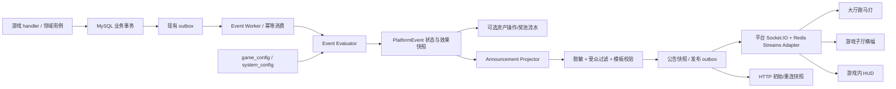
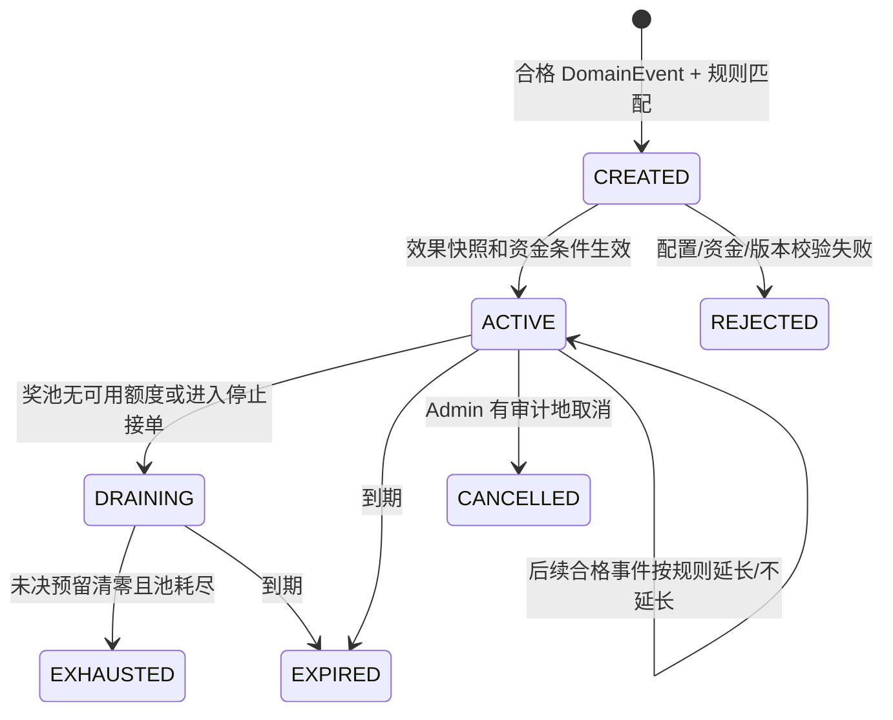

# 平台事件与广播系统设计

阶段：平台级方案。目标是让游戏、大厅、资产和运营模块产生的可信业务事实能够按配置触发平台事件，并把经过脱敏、按受众过滤的公告同步到游戏大厅、子厅和游戏内。事件事实、促销效果、广播内容和客户端动画分层，避免 handler 直接对所有在线用户发任意字符串。

## 1. 术语与边界

| 概念 | 示例 | 负责方 | 是否直接推给客户端 |
| --- | --- | --- | --- |
| 领域事实 `DomainEvent` | 某局结算完成、活动里程碑达成、奖池耗尽 | 对应领域/游戏 handler，必须服务端确认 | 否 |
| 触发规则 `EventRule` | 指定游戏/难度达到配置条件时触发活动 | configuration + event evaluator | 否 |
| 事件实例 `PlatformEvent` | 一次活动已开启、作用范围、有效时间、状态版本 | event service | 经 projection 后 |
| 广播公告 `Announcement` | 玩家大厅跑马灯、子厅横幅、牌桌 HUD 文案 | broadcast projector | 是，受众过滤后 |
| 传输消息 | Socket.IO event envelope | platform Socket.IO | 是，但不作为持久账本 |

`DomainEvent` 记录“发生了什么”；规则决定是否产生平台事件；平台事件可改变已批准的活动状态；广播只是展示投影。任何游戏 handler 都不能自行拼接并全服发送公告，也不能以浏览器事件触发赔率或奖池变化。

事件规则可按 `gameKey、difficultyKey、eventType` 配置，不在平台硬编码“连输”等单一触发。可用来源 actor 为 `USER / BOT / SYSTEM`；公告必须标识真实来源类别，不能把机器人包装成人类玩家。主体本人不接收该条以自己为主体的全局公告，但仍能看到自己的结算、账户流水和安全提示。代理域公告另带 `agent_domain_id`，只能由对应域的服务端 room 与 HTTP 查询返回；全局事件不带域 ID，代理无权把域公告升级为全局公告。域边界见[代理域设计](../04_domains/代理域设计.md)。

## 2. 总体数据流



### 2.1 处理步骤

1. 游戏/业务操作在服务端完成权威判定。若产生资金变动，资产流水、游戏结果和 `outbox` 事件在同一 MySQL 事务内提交；私牌、令牌、完整 user 资料不写公开 outbox。
2. worker 至少一次读取 outbox，以 `event_key` 做幂等。规则 evaluator 验证事件类型、游戏配置版本、难度、阈值、来源 actor 和当前活动状态。
3. 符合规则时创建或更新一次 `PlatformEvent`。若效果涉及奖池、赔率或派奖，先验证游戏模块能力与数学报告，再提交事件效果快照；必要资产变动调用 wallet/asset operation 用例。
4. 效果状态成功落定后才生成公告投影。消息模板只取服务端审核过的字段，计算主体脱敏标签和受众；不允许前端或外部游戏直接提供公告正文。
5. 公告版本写入持久 outbox/公告快照，再通过 Socket.IO 广播；在线推送失败由重试或客户端快照补齐。outbox 的 `sent_at` 只表示服务端已投递，不代表每个浏览器已展示。

## 3. 配置模型与效果执行

### 3.1 配置职责

沿用 `game_config` 和 `system_config`，首版不做泛化规则语言，也不允许 Admin 输入任意脚本：

- `game_config`：特定 `gameKey + difficultyKey` 的触发器启停、允许的来源 `eventType`、经 schema 校验的阈值、效果 profile、展示范围和持续时间。
- `system_config`：平台级默认广播开关、频率限制、公共模板策略、默认保留时间、客户端展示上限。
- Event Evaluator 只执行代码内注册的 event type handler 与 JSON schema；未知 event type、超范围概率值、未审核 profile、错版本配置拒绝并记审计。
- 配置修改保存审计前后值。正在运行的 `PlatformEvent` 固定规则/赔率/派奖 profile 版本；后续改配置只影响新事件。

逻辑规则示意：

```ts
interface EventRule {
  ruleKey: string;
  enabled: boolean;
  sourceEventType: RegisteredEventType;
  gameKey?: string;
  difficultyKey?: string;
  predicate: ValidatedPredicate; // 由 event type 专属 schema 约束
  audience: AudienceScope[];
  effects: ValidatedEffectProfile[];
  broadcastTemplateKey?: RegisteredTemplateKey;
  excludeSubject: boolean;
}
```

`predicate` 不能访问个人充值、提现、代理链等营销画像。若某个事件需要用玩家本人特定状态判定，默认为私有事件；要提升为全局公告需独立的隐私与产品审核，服务端只向公告层提供最小脱敏投影。

### 3.2 概率/派奖类效果

`EffectProfile` 使用游戏模块的受控类型，不采用一个全平台统一的 `probability += x`：

```ts
type ValidatedEffectProfile =
  | { kind: 'broadcast_only'; profileVersion: string }
  | { kind: 'pool_payout'; payoutProfileVersion: string; poolAccountKey: string }
  | { kind: 'odds_profile'; oddsProfileVersion: string; mathReportId: string }
  | { kind: 'odds_and_pool_payout'; oddsProfileVersion: string; payoutProfileVersion: string; mathReportId: string; poolAccountKey: string };
```

- `odds_profile` 只对本游戏真正控制结果的 handler 有效；必须定义具体 outcomes 的概率分布、基础/活动 RTP、命中率、派奖倍数和有效时段。配置中的“增加 X 个点”由模块解析成合法完整概率分布，不能简单给所有结果都加 X。
- 十三张等 P2P 对战不通过改发牌/配桌来提升胜率；外部数据源开奖游戏不改数据源概率。两者如有活动，只能使用规则公开、资金有来源的派奖效果。
- `pool_payout` 需要可核对的资金账户/asset operation，校验资金池、待结算预留和单次最大敞口；池耗尽时停止承接新活动投注，已接受下注按其 `effectProfileVersion` 完成结算。
- 概率效果与“事件由谁触发”解耦：任何 trigger 都不得根据公告主体的输赢历史改这个人的个人赔率。跨游戏效果需每个目标游戏单独配置并通过自己的 schema/math report。

### 3.3 状态机



状态更新由服务端单个 event actor 或可比较更新/事务完成，`eventId + stateVersion` 幂等。多实例不可依赖各节点本地计时器决定结束；统一使用服务端 `endsAt`、奖池可用额和持久版本。广播“活动已开启”必须发生在效果 ACTIVE 之后；“已结束/奖池耗尽”必须与状态提交一致。

## 4. 事件与广播数据形状

`DomainEvent` 是内部 envelope，`Announcement` 是外部安全 DTO；两者不要共用一份包含 `userId`、`assetOperationId`、奖池私有控制信息的 JSON。

```ts
interface DomainEventEnvelope<TPayload> {
  eventId: string;
  eventType: RegisteredEventType;
  schemaVersion: number;
  occurredAt: string;
  gameKey?: string;
  difficultyKey?: string;
  actor?: { type: 'USER' | 'BOT' | 'SYSTEM'; userId?: string; botKey?: string };
  sourceRef: { type: string; id: string };
  payload: TPayload;
}

interface AnnouncementDto {
  announcementId: string;
  platformEventId?: string;
  eventType: RegisteredAnnouncementType;
  stateVersion: number;
  kind: 'EFFECT' | 'BROADCAST_ONLY';
  titleKey: RegisteredTemplateKey;
  safeParams: Record<string, string | number>;
  scope: AudienceScope[];
  publicActorLabel?: string; // 例如经策略处理后的“陈先生”；不含 user_id
  startsAt: string;
  expiresAt: string;
  clickAction?: { route: 'PLATFORM_ANNOUNCEMENT_DETAIL'; params: { announcementId: string } };
}
```

- user ID、排除主体 ID、真实姓名、联系方式和资产流水引用仅供服务端路由/审计，不进入客户端 `AnnouncementDto`。
- `publicActorLabel` 后端按 masking policy 产生，只接受已授权公开昵称或明确配置的掩码（如“陈先生”）；找不到合规公开标签时使用“有玩家”/“某位玩家”。禁止把手机号、邮箱、用户名直接模板化。对用户本人排除的判断使用可信 JWT session 的 user ID，不信任客户端传来的 exclude 参数。
- `scope` 使用代码常量：`GLOBAL_HALL`、`GAME_HALL(gameKey)`、`DIFFICULTY_HALL(gameKey,difficultyKey)`、`GAME_SESSION`；游戏局 ID 不随公开 scope 下发，所有 room membership 均由服务端鉴权建立。
- 公告模板是本地注册表/受校验配置，禁止 HTML/raw script。文案长度、数字范围、URL route 都校验；支持客户端纯文本安全渲染。

### 4.1 浏览器端公告投影契约

浏览器只负责把白名单 `titleKey` 映射为本地静态文案，并插入经过 TypeBox 校验的 `safeParams`；未知 key 显示通用标题和安全说明。客户端不得读取 `DomainEvent`、主体 ID、活动内部效果 profile 或自拟公告。玩家端首批登记模板 key 为 `PLAYER_BURST` 与 `PLAYER_STREAK`；其变量分别限于 `gameName/difficultyName` 与 `gameName/difficultyName/roundCount`。变量是纯文本，由 Vue 文本插值渲染，不接受 HTML、Markdown、URL 或模板表达式。`publicActorLabel` 只能使用服务端已掩码值。

跨端 schema 唯一来源为 `packages/contracts/src/platform-events/announcement.ts`，运行时验证包括封闭对象字段、UUID announcement ID、UTC 时间、scope、模板参数数量/长度和有限数值。公告投影 DTO 为 `PlatformAnnouncement`；长详情为 `PlatformAnnouncementDetail`，包含内嵌公告、活动状态、规则版本，以及仅在 `EFFECT` 类型时出现的 `effectTargets`。每个目标只暴露经审核的摘要、可选概率百分点/派奖变化、奖池剩余与单位、真实席位数；客户端还校验席位占用不超过容量、奖池数值和单位成对出现；`ACTIVE/DRAINING` 不得有 `endedAt`，结束态必须提供 `endedAt`。`BROADCAST_ONLY` 不含效果目标。

### 4.2 HTTP 快照与详情端点

| 方法与路径 | 用途 | 查询/响应 | 服务端必须执行 |
| --- | --- | --- | --- |
| `GET /api/v1/platform/announcements/active` | 大厅启动、回到前台、Socket 重连后的当前公告快照 | 可选 opaque `cursor`；标准成功 envelope，`data={ announcements, cursor? }` | 按 JWT 用户排除其本人作为主体的营销公告；按用户可见代理域/游戏/难度过滤；只返回当前有效、安全投影 DTO |
| `GET /api/v1/platform/announcements/:announcementId` | 跑马灯进入可直达的详情页 | 路径 opaque UUID；标准成功 envelope，`data=PlatformAnnouncementDetail` | 同一主体排除与受众授权；检查状态版本并只返回公开效果快照；不得因猜 ID 暴露隐藏公告 |

所有成功响应遵循 `{requestId,code:'OK',message,data,serverNow}`；错误沿用 HTTP/共享错误 code 规范。列表不返回长历史、read receipt 或 recipient 表；分页 cursor 仅用于快照增量，不能代替 Socket 的 `stateVersion`。浏览器端当前在 H5 启动、标签页恢复可见和网络恢复时通过 HTTP 重新读取快照。Koa 已提供 `GET /api/v1/platform/announcements/active` 的空列表响应以保持大厅请求契约可用；announcement projector、持久公告快照、JWT 受众过滤、详情 endpoint、Socket.IO 广播及重连补拉仍未实现，不能将空快照或本地测试视为服务端公告闭环。

### 4.3 Admin 模板草稿与发布边界

Admin 公告模板属于服务端运营配置，不等于公开的 `PlatformAnnouncement` 实例。离线开发端使用 Admin 专属 DTO 保存 `DRAFT`，限定 `PLAYER_BURST`/`PLAYER_STREAK` 的变量白名单、纯文本长度和必填变更原因；HTML、链接、未知变量都拒绝。预览仅在浏览器内用固定脱敏样例替换变量。草稿及 append-only 变更快照通过同一个 IndexedDB readwrite transaction 保存，命令带 `requestKey` 支持幂等重放。

此 LOCAL_DEMO 工作流仅用于验证编辑、筛选、预览、重载后读取和历史查询，不激活模板、不生成领域事件、不建立活动、不改变游戏配置、不广播给玩家。真实模板的发布/启用必须由服务端 capability、schema/version 校验和审计约束；event instance、实际效果快照和投递状态仍分别以平台事件服务为准。缺少事件事实时 Admin 页面不得用静态假实例或虚构送达记录填充列表。

### 4.4 Admin 事件规则与本机流程边界

Admin 本机演练采用共享 `packages/contracts/src/event-operations.ts` DTO、`event-operations` application 与单个 `admin_event_workspace_snapshots` IndexedDB 聚合快照。规则、合成事件、预览投递和操作审计在一次本机事务中读写；规则支持已登记的 `PLAYER_BURST` 与 `PLAYER_STREAK`，仅允许 `BROADCAST_ONLY`。燃尽演练必须同时达到规则阈值并标记“无法继续参与”；连续局数仅按输入的局数阈值判断，平台不推断连输/连胜。来源标签只能使用固定脱敏样例或机器人/系统标记，不接受真实身份字段。

页面流程为：新建/启用本地规则 → 进入活动实例页并打开模拟输入 → 建立 `LOCAL_DEMO` 活动 → 选择受众范围并生成 `PREVIEW_ONLY` 安全文案。规则页启动模拟时必须先转入活动实例路由，因此弹窗确实可见；取消/过期只改变本机实例视图并保留审计。此 slice 不调用保存的模板草稿来投递，也不宣称预览使用了生产模板；模板编辑是独立本地草稿流程。真实模板发布、事件服务触发、活动效果、主体排除、代理域权限、HTTP 快照、Socket.IO 送达与重试均未实现，不能将离线闭环标为生产闭环。

## 5. 受众路由与“主体本人不可见”

所有有效 JWT 的 Socket.IO session 由服务端加入：

```text
platform:all
user:<verified-user-id>
game:<gameKey>
difficulty:<gameKey>:<difficultyKey>
session:<gameSessionId>
```

这些公告房间统一属于 `/platform` namespace。同一用户多设备全部加入同一个 `user:<id>` 私有房间。全局公告使用广播目标 `platform:all`，并在服务端排除公告主体 `user:<id>`；游戏/难度公告同时按范围房间选择。排除主体的规则在广播 selector 中执行，不能只靠前端收到后隐藏。游戏页面继续使用独立 `/game` socket 处理牌局命令；Pixi HUD 通过宿主桥接 `/platform` 的公告，不重复建立一套广播推送。

主体本人也不得通过重连补拉看到自己作为主体的该条营销公告：公告历史/活动列表 HTTP 查询应按 JWT user ID 过滤 `excludedSubjectUserId`；当前活动 snapshot 使用相同过滤。仍须向该用户保留其本人游戏结果、资产流水、客服消息、安全通知等非营销业务数据。公告字段和普通事务数据分开，以免误过滤必要结算信息。

Socket.IO room 是服务端控制的；客户端不能任意加入 `platform:all` 以外的私有用户/游戏房间。Socket.IO 官方 Rooms API 支持向 room 广播并通过 `except(room)` 排除 room；Redis Adapter 可使多服务器房间广播工作。[Socket.IO Rooms](https://socket.io/docs/v4/rooms/) [Redis Adapter](https://socket.io/docs/v4/redis-adapter)

## 6. 传输、补拉和扩展

- 大厅启动：HTTP 拉取当前有效公告/活动快照及 `cursor`；随后订阅 `/platform` Socket.IO 的 `announcement.created/updated/ended`。
- 广播负载携带 `announcementId + stateVersion + expiresAt`；客户端幂等去重。收到序号缺口、重连或新版本时重新请求 HTTP snapshot，不靠 Socket.IO 单次投递保证“人人看见”。
- 子厅/游戏内由 H5 平台会话加入相应服务端房间，读取同一 event state；Pixi HUD 通过 `GameRuntimeContext` 订阅宿主公告桥。同一 `announcementId` 的三种展示不能重复弹窗，只更新原有 ticker/banner/HUD view model。
- 全局跑马灯支持静音/关闭、用户偏好和频率限制；该 UI 与转账、开局或结算无关，永不阻塞游戏操作。
- 发布通道按 Namespace/范围 room 限定。平台全局只下发短小脱敏 DTO；长说明和数学细节点击后由 HTTP 按权限读取。使用排序稳定、白名单路由，不接受广播 payload 提供任意外链。

多节点 Socket.IO 采用官方开源 Redis Streams Adapter，替代基础 Pub/Sub Adapter 作为默认候选：它支持跨节点转发、connection-state recovery，并可从 Redis Streams 的短期保留记录恢复临时断开的 adapter；配置有 `maxLen` 上限，不能当长期事件日志/用户公告历史。已提交业务事件仍以 MySQL outbox 为可靠入口；客户端错过的公告通过 HTTP feed/快照补拉。若事件 worker 需要独立 consumer group/回收 pending，可单独将 outbox 投影到 Redis Streams。资金及活动最终状态仍以 MySQL 事务/资产流水为准。[Redis Streams Adapter](https://socket.io/docs/v4/redis-streams-adapter/) [Socket.IO 投递保证](https://socket.io/docs/v4/delivery-guarantees/) [Redis Streams](https://redis.io/docs/latest/develop/data-types/streams/)

## 7. 数据持久化建议

现有 `outbox` 已支持至少一次投递、消费者幂等和重试，可承载内部领域事件与 `announcement.publish` 任务；它不是公告收件箱，也不能表示用户端已读。首版建议：

1. 继续使用现有 `outbox` 作为事务后可靠工作队列；给 `topic`/payload schema 增加登记类型，不把私牌或完整账户数据塞入全局事件。
2. 首版使用一个 `game_event_instance` 表保存跨牌局、需跨重启恢复的活动生命周期、作用范围、来源幂等键、配置/效果/公告快照和状态版本。此实体有独立的 15 分钟/奖池耗尽生命周期，不能由 outbox 队列行或静态 `game_config` 可靠表达；所有实际资金变化仍落 `asset_operation/asset_entry`，不把账本余额放入 Redis 或活动 JSON。
3. 一个活动实例可用版本化 `effect_snapshot` 描述多个目标游戏/难度和效果，公告安全投影复用同一行。首版不建 `broadcast_message`、recipient、席位或公告已读表；全局广播不设 per-user read receipt，“主体不可见”由服务端过滤条件实现。若未来出现脱离活动生命周期的独立运营公告，再按扩表纪律另行评审。
4. Redis 保存活动热快照、真实席位计数/短期参与资格和 Socket 路由辅助状态；以 MySQL `game_event_instance` 与资金账本为权威，可重建缓存并校验状态版本。

物理字段、非零状态常量、索引与功能映射见[数据库设计 SDD](../05_data/数据库设计SDD.md)；事件活动当前为一个持久实体，不应再为每个效果档位或展示位置拆表。

## 8. 失败、安全与验收

- outbox 重复、worker 崩溃、Redis/Socket 断开、Redis 故障切换、客户端重连、活动过期边界均能以 `eventId/stateVersion` 恢复且不重复发奖。
- 服务端确认一次事件后，在 H5/子厅/game HUD 各显示一次或更新一次；乱序低 `stateVersion` 丢弃，快照校准。
- 公告主体的所有活跃设备和其 HTTP Feed 均收不到该条 announcement；其他玩家看到的只含 `publicActorLabel`，绝无 user ID/contact/account data。
- 未登记 event type、坏 schema、负数/越界概率、未签发 effect profile、过期配置和未经服务端验证的事件均拒绝。
- 如果概率活动在特定 game config 生效，测试确认下注快照绑定 exact profile；配置变更不追溯 active session；活动结束后恢复配置定义的基础 profile。
- 真名 mask、昵称注入、HTML、搜索猜测和重复身份关联做安全测试。跑马灯关闭后不弹窗重现，但重要游戏/资产结果仍按原渠道通知。
- 约两万在线目标压测使用多个 Socket.IO 节点、Redis Streams Adapter 和全局广播/难度分区流量；测量节点 CPU、stream lag/长度、消息尺寸、事件循环阻塞、outbox 队列积压和重连 HTTP 补拉峰值。

## 9. 待确认的产品参数

- 事件类型与每个 game/difficulty 的触发条件、阈值以及机器人事件是否可触发；机器人只能标为 BOT，不可以其身份伪装真人或假造真实资金/输赢。
- 面向玩家显示“陈先生”等称呼的字段来源、掩码策略和用户隐私设置；最安全的默认是公开游戏昵称 mask，无法确认时显示匿名。
- 活动作用范围、真实席位容量/计数方式、时限、池耗尽条件、效果 profile 与是否公告概率值。
- 哪些事件要求主体完全从营销广播与活动 feed 排除；本方案默认全局公告排除 actor 所有设备。


## 变更历史

| 日期 | 变更 |
| --- | --- |
| 2026-10-10 | 按项目约束新增变更历史区块；未改动原有正文。 |
| 2026-10-10 | 按文档性质归档并更新相关链接。 |
| 2026-10-10 | 明确首版单一 game_event_instance 实体及不建公告收件人/已读表。 |
| 2026-10-13 | 补齐客户端公告投影/详情 DTO、模板变量白名单和 HTTP 快照/详情端点，并标明服务端未实现边界。 |
| 2026-10-13 | 澄清 DRAINING 仍属活动生命周期中状态，可无 endedAt；仅终态要求实际结束时间。 |
| 2026-10-13 | 明确 H5 启动、标签页恢复和网络恢复时重拉公告快照；Socket 重连补拉仍待平台 Socket 接入。 |
| 2026-10-15 | 增加 Koa active feed 的契约校验空快照路由，明确公告持久化、受众过滤、详情与 Socket 投递依然未实现。 |
| 2026-10-15 | 定义 Admin 公告模板本机草稿的 DTO、安全预览、原子变更历史和不可越界的发布边界。 |
| 2026-10-15 | 补充 Admin 事件规则 → 合成实例 → 安全公告预览的 LOCAL_DEMO 纵向闭环、路由行为与生产未实现项。 |
