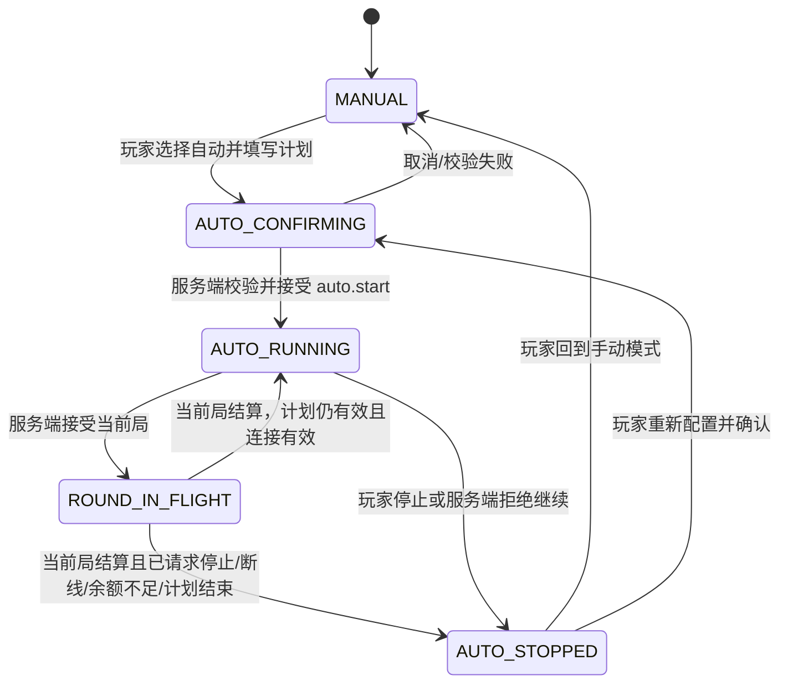

# 自动游戏与每轮投入设计

阶段：首版平台级产品规则。本文定义玩家选择手动/自动操作、设置每轮投入、断线处理及游戏模块的职责边界。各游戏具体金额步长、自动局数上限和可自动动作由各自 `game_config` 与 handler 在该游戏开工时给出；本文不虚构跨游戏共用的数值。

## 1. 设计目标

- 玩家明确选择手动或自动，自动模式不得默认开启或在结束/重连后静默续跑。
- 玩家能在开始自动模式前看清每轮实际投入、计划局数和计划总投入上限。
- 游戏规则、概率和结算由服务端执行；客户端负责参数选择、控制和结果展示。
- 断线不导致未确认命令在重连后排队补发；无限局数仅在玩家明确选择且该游戏开放时运行，并受手动停止、断线、余额和服务端状态约束。
- 不创建通用 `auto_play` 业务表；运行控制状态放 Redis，单局结果继续使用已有游戏/资产记录。

## 2. 手动模式与自动模式

只有声明了 `AUTO_PLAY` 能力且对应配置开启的游戏才展示模式切换。默认进入手动模式。十三张是房间牌局：自动摆牌是可编辑的排牌建议，倒计时托管是某次操作超时后的单动作代行；二者都不等于连续自动开局。其他棋牌是否支持连续自动玩法由该游戏的实际规则确定，不由平台统一启用。

Slot、麻将转轴等支持重复短局的游戏可以提供有限档位及（按配置开放的）无限自动模式。捕鱼等长会话游戏由模块定义一个可计价的自动动作/投入单元及其停止边界，不把“每轮”误解为所有游戏通用的转轴或牌局。定时开奖游戏即使可自动提交连续期次投注，也只能逐期按服务端开放时间受理，不能提前下注未开放期次。

## 3. 每轮投入与倍数

手动模式和自动模式都显示当前实际单轮投入。进入自动设置时，`stakePerRound` 默认取当前选中游戏档位的单轮投入；如果游戏允许其他有效金额，玩家可在该游戏公布的档位/步长范围内调整。若游戏提供投注倍数，UI 可以用倍数快捷选项，但必须同时显示换算后的实际金额。游戏自身派奖、技能或奖励倍数是另一项规则，不能与投注倍数混名或混算。自动运行期间锁定投入；要调整就先停止，再重新选择档位/每轮投入并确认。

```text
单轮实际投入 = 该游戏规则按当前档位、玩家选择及投注倍数计算出的服务端确认金额
有限计划投入上限 = 单轮实际投入 × 计划自动局数
```

上式适用于固定投入的短局；存在可变成本、连续发炮、额外购买或多个结算阶段的游戏，必须由其 handler 计算并返回本次计划的最大可能投入。

“额外付费选项”指超出玩家已确认的每轮投入、需要再次扣款的可选操作，例如老虎机额外付费购买奖励局，或捕鱼中额外购买更高炮台；它不包括已明确显示并确认的正常每轮下注。自动模式不能悄悄追加这类费用：可跳过的额外付费分支自动跳过并继续；若额外付费是继续游戏的必要选择，则暂停自动计划并提示玩家手动决定。游戏模块必须显式标记该分支是否可跳过，并遵守此平台规则。

游戏可在已受理的付费局中触发一个或多个免费轮，也可触发翻倍轮。它们是该局的奖励延续，不再次扣每轮投入；自动计划所选局数按已受理的付费局计数，奖励轮单独由游戏 handler 跟踪，不消耗下一次付费局数。翻倍轮究竟翻倍哪些派奖/奖励由游戏规则明确，不能默认为投入翻倍。若奖励轮需要玩家选择，游戏模块按自动可执行动作处理；不能安全代选时暂停自动计划并等待玩家。免费轮触发概率/积分条件、奖励次数、倍数及结算方式均属于游戏配置和锁定的局规则，不由平台引擎猜测。奖励链详细状态、账务、协议和验收见[奖励轮与派奖倍数机制 SDD](./奖励轮与派奖倍数机制SDD.md)。

自动开始确认时锁定 `stakePerRound`、投注倍数、局数选项及游戏配置快照。局数由各游戏配置提供多个有限数档位，并可按游戏开放“无限”；有限选项不得超过该游戏公布的最大值。无限表示重复当前每轮投入，直到玩家停止或触发其他停止条件，不显示计划总投入上限，并在开始前明示无总投入上限。服务端每局开局前重新检查该局配置与钱包可用余额；不预扣整段计划的总金额。余额不足时不再开下一局，已受理的当前局继续按规则结算。确认页显示每轮投入及选定局数；有限局数显示计划最大总投入，无限模式醒目说明无总额上限。金币值使用安全的十进制字符串传输。

## 4. 自动计划的结束条件

自动计划的局数选项由游戏配置提供多个有限档位，可另行开放无限。有限计划到达所选局数后结束；无限模式没有局数结束点，仍受以下条件约束：

1. 计划局数完成。
2. 玩家点击停止；停止立即生效于后续局，当前已受理局不撤销。
3. 服务端观察到游戏连接/会话失效；当前已受理局完成后停止，不启动后续局。
4. 下一局投入前余额不足、额度/配置失效、游戏停服或会话失效。
5. 游戏模块遇到必须由玩家决定的额外付费分支或无法安全自动处理的分支。

首版不设置止盈/止损触发器，也不按玩家近期胜负动态改变投入、概率或玩法。

“断线”以服务端确认的连接/会话租约失效为准，不以客户端本地网络回调作为资金或牌局事实。服务端只为连接仍有效且自动计划状态有效的会话启动下一局；掉线检测前已经原子受理的那局视为当前局，必须完成结算。客户端重连后恢复当前未结束局的权威快照；自动计划保持停止，玩家可在当前局允许的时间窗口内手动继续，不能自动恢复后续局数。若当前玩法不存在可由玩家继续输入的步骤，就展示该局状态/结果。若当前局已结算，则只能查看结算，不能重开或倒带。

## 5. 状态机与弱网命令



每个 `auto.start/auto.stop/manual.action` 都是版本化 Socket.IO 命令，带 `commandId`；重试必须复用同一 ID。服务端返回受理状态和 `autoRunId/stateVersion`。连接断开后，不能把客户端缓存的下一局命令补发；`auto.stop` 即使未送达，服务端连接租约/运行状态检查仍会阻止失效会话继续开启新局。已受理的 `roundId` 通过游戏持久化状态和资产记录恢复，Redis 自动计划状态仅用于是否允许开始下一局。

如果当前 `roundId` 尚未结束时用户重连，server 返回与 `gameSessionId/roundId/stateVersion` 对应的权限过滤快照。可继续输入的当前局回到手动控制；已经被服务端接受的出牌/摆牌/下注等动作不可撤回。同一房间 command、截止计时器与超时托管共用串行队列，截止后的命令不因重连而恢复有效。

## 6. 游戏模块配置与代理域

每个游戏在 manifest/handler 声明是否支持自动模式、投入单元、金额精度/步长、可选投注倍数、允许自动的动作、有限局数选项、是否开放无限和额外付费分支处理。相应参数由 `game_config` 保存，游戏启动时锁定到当前实例/局快照。平台引擎只做通用状态机、权限/连接检查、幂等和 wallet port 编排，不解释投注规则或替游戏选择动作。

`agent_domain` 可以覆盖已在 handler 白名单中登记为代理可调的域级游戏参数，且仍受平台 hard bounds 和 RTP/期望计算校验。自动模式开关、最大自动局数及可导致额外扣费的安全限制默认属于平台控制项，除非 Admin 明确登记可域覆盖且模型证明安全，否则代理不能放宽。代理调整只能影响本域新开的局；运行中的自动计划和 round 使用原快照。

建议配置 key（具体 key/type 由每个游戏 schema 注册，而不是无类型自由 JSON）：

| 配置语义 | 所属 | 说明 |
| --- | --- | --- |
| `features.auto_play.enabled` | game/tier | 是否展示自动模式；还需模块自身声明支持 |
| `auto_play.round_options` | game/tier | 可选的有限局数档位列表；各值为正整数 |
| `auto_play.infinite_enabled` | game/tier | 是否向玩家提供无限选项；即使开放也受停止条件约束 |
| `auto_play.stake_min/stake_max/stake_step` | game/tier | 每轮投入合法范围与步长；若直接使用档位列表则引用档位 schema |
| `auto_play.multiplier_options` | game-specific | 可选投注倍数；仅展示模块声明支持的值，服务端算实际投入 |

这些 key 是字段语义建议，不意味着每个游戏必须具有所有字段或立即扩充表；现有 `game_config` 按 key/value 存储，关闭功能只在模块声明支持且配置开放时有效。配置变更由已有发布审计与 `round.rules_snapshot` 记录，不另增自动模式配置表。

## 7. 前台交互与引导

```text
游戏操作区
  [手动 / 自动]     [每轮投入：当前档位金额 ▼]
        │ 自动
        ▼
自动计划确认 Sheet
  当前档位与实际每轮投入
  局数选择（多个有限档位；若已开放可选“无限”）
  有限档位：计划最大总投入
  无限：无总投入上限，持续到玩家停止/断线/余额不足等
  奖励局：免费轮剩余次数 / 翻倍效果（由游戏提供时显示）
  停止规则：局数完成 / 手动停止 / 断线完成当前局即停止 / 余额不足停止
  [取消] [确认并开始]
        │
自动进行中：第 n / N 局 · 本局投入 · 当前余额 · [停止自动]
```

- 第一次进入自动设置时，说明“自动模式会按所示每轮投入重复进行；网络断开后完成当前局并停止，不会重连续跑”。有限档位须在最终确认按钮旁显示计划总投入；无限选项须明确显示“无总投入上限”。
- 自动开始受理前按钮显示确认中；ACK 超时时显示“正在确认自动计划”，用原 `commandId` 查询，不创建第二个计划。
- 自动进行中提供常驻可触达的停止按钮；点击后显示“当前已开始局仍会结算，下一局不会启动”。
- 余额不足/配置变化/断线后明确显示停止原因和最后结算局；重新开始需重新选择局数并确认实际单轮投入。
- Pixi 牌面动画可以跳过；投入、局数、当前进度、停止状态、断线状态和最终结算使用可访问的 H5/DOM overlay，不只画在 Canvas 中。
- 低带宽模式可停播自动局之间的装饰动画，不省略投入确认、受理 ACK、轮次状态或结算结果。

## 8. DTO 轮廓

玩家设置传递实际投入金额，不让客户端自行把 `tierId × multiplier` 当成权威金额：

```ts
type AutoPlayStartCommand = {
  commandId: string;
  schemaVersion: 1;
  gameSessionId: string;
  stakePerRound: string; // 按资产最小单位编码的正整数；游戏 schema 校验单位/步长
  plannedRounds: number | 'INFINITE'; // 有限值须在服务端配置选项内；INFINITE 仅按游戏配置开放
  gameOptions?: unknown; // 仅允许对应 handler schema 中声明的选项
};

type AutoPlayStateDto = {
  autoRunId: string;
  status: 'RUNNING' | 'STOPPING' | 'STOPPED';
  stopReason?: 'USER_STOP' | 'DISCONNECTED' | 'ROUNDS_COMPLETED' |
    'INSUFFICIENT_BALANCE' | 'CONFIG_CHANGED' | 'SESSION_EXPIRED' |
    'GAME_REQUIRES_INPUT';
  stakePerRound: string;
  plannedRounds: number | 'INFINITE';
  settledRounds: number;
  currentRoundId?: string;
  stateVersion: number;
};
```

此处是领域 DTO 草案；共享 TypeBox schema 和事件常量最终落在 `packages/contracts`，游戏专属字段由 `games/<gameKey>/contracts` 扩展。服务端回传配置解析后的金额、当前轮次和状态；客户端传入的金额、局数和模式一律重校验。

## 9. 持久化边界

- Redis 保存当前 `autoRunId`、用户/游戏 session 关联、锁定的计划参数、完成局数、状态和有限 TTL；失效或重启后不续跑。
- 不新增 `auto_run`、`auto_round` 或配置历史表。每局本身已经由游戏 session/round 及资产 operation/entry 记录；这些现有业务记录承担账务与结算审计。
- 需要查询自动停止原因时，活动仍在 Redis 由状态接口返回；Redis 已丢失则按“自动计划已终止”安全处理，最后一局结果仍从既有游戏历史/账本取得。若后续运营证明需要永久查询完整自动计划，再审核是否扩表。
- 游戏资产仍走 wallet 用例：每轮按该游戏当前规则对实际投入进行幂等扣除/预留与结算；客户端及自动调度器不能直接改余额。

## 10. 首版设计 Checklist 与验收

- ✅ 手动/自动是显式模式，自动不默认开启、不在断线重连后续跑。
- ✅ 每轮实际投入可见；自动默认沿用当前档位；服务端校验金额、步长和可用余额。
- ✅ 自动局数提供多个配置档位，并可按游戏开放“无限”；每轮投入与局数在一次运行中锁定。
- ✅ 断线后仅完成当前已受理局；重连恢复未结束的权威局，但不恢复自动续跑。
- ✅ 棋牌超时只托管一个到期动作；下次操作重新要求玩家输入，除非再次超时。
- ✅ 不设止盈/止损；自动模式不修改概率/RTP；派奖倍数和投注倍数区分。
- ✅ 额外付费分支处理规则：可跳过则自动跳过并继续，必须选择才暂停等待玩家；不得未经确认追加扣款。
- ✅ 支持游戏模块定义免费轮与翻倍轮；奖励轮不额外扣款、不计作新的付费自动局；具体触发/派奖规则由模块负责。
- ✅ 弱网 ACK 超时沿用相同 commandId；客户端不缓存并补发下一局下注。
- ✅ 不扩新持久化表，自动状态放 Redis，资金和局结果沿用已有流水/round。
- ⬜ 各游戏模块分别填写有限局数档位、是否开放无限、金额步长、模块投入单元及自动可执行动作；不能用一个全局数字冒充。
- ⬜ 高保真 UI/操作可用性、局数与投入输入组件在各目标尺寸验证；进入对应游戏设计时完成。
- ⬜ 自动 run 被暂停、Redis 丢失、连接租约临界和已扣款未 ACK 的故障注入验收；实现阶段完成。

## 11. 变更历史

| 日期 | 变更 |
| --- | --- |
| 2026-10-10 | 补充免费轮与翻倍轮：归属触发它们的付费局，不增加投入或付费自动局计数，规则由游戏模块定义。 |
| 2026-10-10 | 确认自动模式对额外付费分支的统一处理：可跳过则跳过并继续，必须选择才暂停等待玩家，禁止未经确认追加扣款。 |
| 2026-10-10 | 确认自动局数提供多个有限档位并可选无限、运行中调整投入须重新选择、不设置止盈/止损；补充无限模式的投入提示与状态语义。 |
| 2026-10-10 | 建立自动游戏与每轮投入首版规则，明确模式选择、投入/倍数语义、局数、断线/重连、Redis 状态及跨游戏模块边界。 |
