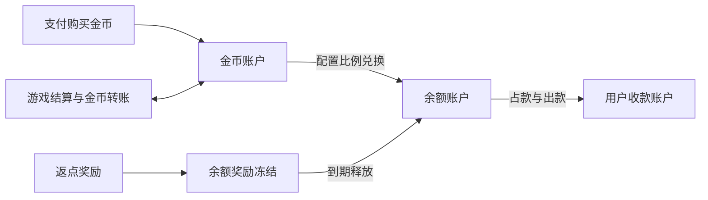

# 双资产、充值兑换与提现

## 1. 已确认资产路径

用户购买金币完成充值；游戏准入、结算及原有玩家转账使用金币。奖励返点直接入余额。金币与余额按配置比例兑换，金币必须先兑换为余额，才可提现到用户指定的收款账户。此决定替代此前“金币仅游戏内发放、暂不设计充值提现”的范围约束。

余额 CNY、配置默认 1 元:10 金币。提现手续费默认 5%，在净到账额之外扣取并向上取整；例如净到账 100 元，默认收费 5 元。支付宝/微信/银行卡/银联二维码/数字人民币由代理商提供，用户可从排序后的已启用商户/渠道中选择；USDT 自建 TRON/TRC-20，每日获取一次汇率并在订单中锁定，逐订单随机分配独立地址。MockHandler 配套开发/测试模拟页面，可操作成功/失败/超时/重复回调，不能产生生产支付成功。1:10 不是 USDT 汇率，见 [支付与流水设计](./支付渠道流水要求与直连归因.md)。

## 2. 独立账本与命名

物理 schema 按最新规范使用 asset_account/asset_entry/asset_hold，以 asset_type 区分金币/CNY 余额；两种资产仍独立记账，系统/玩家沿用同一结构。以前 coin_wallets/cash_wallets 仅为领域草案，不创建两套不一致 ORM。DTO 明确 coins/coinFrozen/cashAmount/cashFrozen/cashAvailable/currency，见 [系统账户](./系统账户与资产记账设计.md) 与 [数据库规范](../05_data/数据库设计规范与Sequelize方案.md)。

金币用整数单位；余额采用明确币种的最小单位整数表示，计算过程中使用 BigInt/精确十进制，DTO 用字符串。不能用 JS 浮点进行费率、兑换和返点计算；MySQL 提供精确整数/DECIMAL 类型，最终精度按币种和业务最小单位确定。[MySQL 精确数值类型](https://dev.mysql.com/doc/refman/9.7/en/fixed-point-types.html?ff=nopfpls)

每种资产独立记账和平衡，不能把金币与货币余额数值直接相加实现所谓守恒。兑换在同一数据库事务内完成：锁操作记录 → 按固定资产类型/userId 顺序锁相关账户 → 验证未冻结、可兑换金币 → 扣金币及记分录 → 加余额及记分录 → 保存兑换及快照 → outbox。任意失败回滚，两种资产均不部分提交。

系统为来源/归宿：兑换同时把用户金币转给系统、系统余额转给用户；实际提现只扣用户已持有余额，不再次扣系统账本。充值净现金流入系统（实付减通道费），用户获币来自系统库存；内部转移与外部入金/出款的守恒边界分别核对。

兑换配置使用系统配置字符串 `cny_to_coin_ratio`，格式为“人民币元:金币”，例如 `1:10` 表示 1 元兑换 10 金币；按分子/分母解析为整数分。兑换只支持金币转余额。兑入余额按人民币分向下取整，不足 1 分的余数舍弃；报价固定金币数、入账分数、比例快照和有效期，提交时若配置变化则要求重新报价。手续费及用户需支付的金币等值仍按其各自规则向上取整。生产端使用 `coin_exchange` 保存唯一操作、比例和舍入快照，并与 `asset_operation/asset_entry` 在同一事务完成；Browser API 暂将等价快照放进既有 asset_operation.extra，不新增 IndexedDB store。

兑换必须同时检查玩家流水已完成、可用金币及系统人民币可用余额；用户金币扣除与系统金币增加、用户余额增加与系统余额扣除必须在单一事务原子提交。直属上级为客损模式时不开放平台兑换。离线浏览器服务只验证其本地模拟数据，不能替代生产侧直属上级权限判定或资金一致性验证。

赠币与普通金币统一使用，不采用永久不可兑或不同游戏房间；赠送时按配置增加游戏流水要求，按已完成有效下注完成，输赢不额外增加流水。要求未完成禁止提现及转出金币。保留赠送来源审计但不增加第二种玩家金币；详见 [流水设计](./支付渠道流水要求与直连归因.md)。用户申请资金退回时沿用 `withdrawal` 提现/出款审核流程；任何已确认的资产冲正都追加反向分录，不覆盖原分录，具体业务触发条件由对应订单用例处理。

## 3. 充值购买金币

创建通用 `order` 固定商品、购买币种/金额、履约快照、汇率和用户；payments 模块向选定服务商创建支付。订单记录先提交，外部 API 不放在钱包锁事务中。前端返回页面只显示支付处理中，不自行增加金币。

经服务端验证的支付通知或查询结果，必须匹配订单、金额、币种和支付状态；持久化 `payment_event` 去重，再在受控事务内通过 `asset_operation/asset_entry` 发放金币、记录订单完成、写 `referral_reward_allocation` 和 outbox。对外收付事实按适用场景记入 `external_settlement`。回调重复或先后乱序均不重复发金币。签名校验及结果查询按选定支付渠道官方文档实施。[OWASP 支付网关接入](https://cheatsheetseries.owasp.org/cheatsheets/Third_Party_Payment_Gateway_Integration_Cheat_Sheet.html)

充值返点以实际支付金额为基数，按收款上级 reward_type 判断，进入余额冻结 2 天；跨币种实际支付先固定计价汇率版本。后台分别展示支付、发金币、返点状态，支持幂等补处理，不把未支付订单改为成功。

## 4. 提现与收款账户

`payout_account` 保存用户提交的收款账户和渠道信息，敏感字段受控存储并在界面脱敏；提交和修改要求有效账号认证，提现固定所选账户版本，处理中修改账户不更改当前出款目标。账户字段取决于最终出款渠道，不猜测银行卡或特定钱包。

提现申请金额表示用户希望实际收到的净额；提现费率单独配置，未给定默认值，费用额外扣取并向上取整到人民币分。申请时一并占款净额和手续费。例如净到账 100 元、假设手续费 10%，账户共扣 110 元；默认 1:10 对应 1100 金币等值。最低 1000 金币整数倍门槛校验净到账额对应的金币数，手续费不计入门槛。申请后至少等待 72 小时才可提交线下/外部出款，审核可提前完成。状态采用常量 `REQUESTED=1、REVIEWING=2、APPROVED=3、PAYING=4、SUCCEEDED=5、REJECTED=6、CANCELLED=7、PAYMENT_UNKNOWN=8、FAILED=9`。

申请时原子占款 `净到账额 + 手续费` 并设定 `payout_not_before_at=申请时间+72小时`；拒绝、合法取消或已确认出款失败时幂等释放；确认支付成功才将占款转为完成扣款。调用支付服务前已持久化内部出款 ID，重试沿用渠道幂等键。支付结果未知进入 PAYMENT_UNKNOWN 并查询/对账，保持占款，不直接重发或释放导致二次出款。外部调用和回调与数据库事务通过持久事件及 outbox 协调，不假设数据库与第三方支付能组成同一原子事务。

客损模式由代理线下核算和结算；平台不参与此类客户提现，不计算、记录或发放客损返点。直属上级为客损模式的客户不使用平台金币充值、兑币及余额提现入口，其当前祖先链上级可以在平台内向其转入金币。平台充值返点仅按有效金币购买订单的实际支付金额计算。具体边界见[代理客损模式](./累计客损结算口径.md)。

## 5. 结构、基础字段与验收

backend 增加 payments 模块，管理支付订单、渠道适配、验证及对账；wallet 管理双资产、兑换与提现占款；referral 只计算返点，不调用出款 API。workflows 协调充值成功、兑换、出款结果与奖励入账，worker 处理对账、返点冻结释放及失败恢复。浏览器新增充值、兑换、提现、收款账户与历史页面；Admin 新增订单查询、审核（如配置启用）、差异处理与审计。

所有新增表均有 created_at/updated_at/deleted_at/status，状态值具名、非零；流水不可软删除。上线前验证重复回调只发一次金币、兑币双账本原子提交、冻结奖励不可提前提现、未知出款不重复支付、不产生无依据余额、补偿可对账。新增支付范围须重新估算，不将“最后封装 App”解释为浏览器支付业务无须专项验证。

已确定新用户首次赠币 1000 枚（默认 5 倍有效下注流水）、未完成流水禁转出；余额 CNY、默认 1:10、非整分兑换向下取整到分、提现费率 5% 且在净到账额外扣、USDT 自建 TRON、每日 FX 采样、每单随机地址、用户选商户、上级模式、充值返点按实付金额、1000 枚整数倍、出款等待 72 小时、身份三选一、客损由代理线下结算。用户资金退回申请复用 withdrawal/payout_attempt；若涉及订单已履约资产的冲正，仍须由相应订单用例定义冲正规则，不改写原分录。生产商户/出款服务商、汇率 provider、链确认数和采样时刻及超额补贴策略仍待定。

### 5.1 当前浏览器提现离线切片

`apps/web` 的钱包 H5 已有仅限 `LOCAL_BROWSER_SERVER` 的收款方式及提现申请流程，仍沿用本文件定义的业务口径，不另建一套页面 DTO。共享 `PayoutAccountDto`/`WithdrawalQuoteDto`/`WithdrawalDto` 位于 `packages/contracts/src/wallet.ts`；Vue 组件调用 wallet application，再经 typed API client 到 Browser API dispatcher 和 IndexedDB repository。

离线版仅允许虚构的 `A-Za-z0-9_-` 演练标识，持久化收款方式名称和末四位，不采集或保存真实支付账号。报价根据 `cny_to_coin_ratio`、`minimum_withdrawal_coins` 与 `withdrawal_fee_rate_percent` 计算净到账、向上取整到分的手续费及总冻结额；核对有效下注流水、可用人民币余额，以及邮箱/手机已验证或用户名和密码已设置。默认 1000 金币按配置比例折为最低人民币净到账额，提现金额必须为其正整数倍。提交沿报价 requestKey 幂等，在单一 IndexedDB 事务内重检报价和账户状态、冻结净额+费用并产生 `REQUESTED` 记录；冻结仅反映在 asset account 的 `frozenAmount`，不会创建零金额流水。待审核状态可取消，事务同时改为 `CANCELLED` 并释放冻结；申请记录和 UI 状态可在重载后恢复。

这条离线切片不允许用户自助模拟审核通过、拒绝、服务商回调或实际到账；系统没有客户端触发的结算动作。Koa endpoint、真实账户敏感信息加密、后台审核、72 小时出款门禁、商户/线下转账结果、asset_entry 最终结算分录和弱网出款恢复仍待服务端工作，Browser API 状态绝不能作为线上资金证据。

### 5.2 当前浏览器充值购买离线切片

`apps/web` 的钱包面板已通过共享 `FundingChannelDto`、`FundingOrderDto` 和命令 schema 完成创建充值订单、订单列表与本机模拟支付步骤。调用链为 Vue workspace → funding application → typed API client → Browser API dispatcher → `IndexedDbWalletFundingRepository`。本机六种渠道方法包含支付宝、微信、银行卡、银联二维码、数字人民币五种代理支付 fixture，以及自建 TRON/TRC-20 的 USDT 本机演练入口；均显式标明演练，不是已配置商户或真实地址。

创建订单读取 `system_config:cny_to_coin_ratio` 并快照汇率、应付人民币分和应入金币，不能精确换成整数金币时拒绝订单。订单及本机回调使用共享生产结构的 DTO；开发 store 保存待支付订单。`/api/v1/dev/.../simulate-payment` 只注册于 Browser API：必须匹配当前用户、订单金额和待支付状态，成功后在一个 IndexedDB transaction 内将订单置为已支付、写玩家金币入账、系统金币负向分录及系统人民币实付入账。该 fixture 不模拟通道费率，演练时将实付全额记入系统人民币资产；生产须扣除实际渠道费。幂等 paymentEventId 重放不重复发币；错额请求拒绝且不改账。充值 activity 从玩家本人账本分录投影订单编号和实付金额。

USDT fixture 从 `system_config:fx.usdt_cny_rate` 读取日更报价（本地缺省 6.7 CNY/USDT），订单固定汇率快照。金额先换算为 USDT 并向下抹到 0.1，再在配置窗口内按同一基数分配 `.010`、`.011`……的递增尾数；默认窗口 `system_config:usdt.deposit_window_minutes=15`。尾数占用计数只写入既有 settings，不增表；同一窗口最多分配 990 个尾数，额度用尽即明确拒单。订单 DTO 返回 USDT 毫位整数、展示金额、汇率快照、过期时间和本机专用无效地址标识；页面特别标明该标识不是 TRON 地址，禁止向其转账。订单过期后转为 `EXPIRED`，不能模拟入账，并提供直达客服入口；错额请求拒绝且不产生账本分录。仅开发模拟支付 endpoint 接受订单精确 USDT 毫位金额，成功后按订单锁定的金币数原子履约，重复事件不重复发币。

本机模拟金额不访问任何真实支付渠道或 TRON 网络，也不代表第三方回调验签、通道费扣除、充值返点、生产 `order/payment_event/external_settlement` 持久化或跨设备资金结算。生产使用相同业务 DTO，由 payments 服务创建并查询通用 `order`，仅经服务端验证的支付事件触发账本履约；客户端永远不能调用成功履约 API。真实商户选择/排序、渠道费率、支付离开页返回、生产汇率 provider 与每日采样任务、真实 TRON 地址分配/链上金额监听/确认数及线上对账仍待服务端切片完成。

## 变更历史

| 日期 | 变更 |
| --- | --- |
| 2026-10-10 | 按项目约束新增变更历史区块；未改动原有正文。 |
| 2026-10-10 | 按文档性质归档并更新相关链接。 |
| 2026-10-15 | 锁定兑换输出精度为向下取整到人民币分；补充配置格式、系统余额门禁、双资产原子分录与 Browser API 的离线边界。 |
| 2026-10-15 | 更新 H5 提现实现边界：共享 DTO、虚构收款资料、资格报价、原子冻结/取消已离线闭环；明确真实审核、账户加密与出款结算仍待服务端。 |
| 2026-10-15 | 完成钱包充值订单到本机模拟支付的共享 DTO/Browser API/IndexedDB 离线流程，明确错额拒绝、回调幂等、原子账本入账及 USDT 和真实支付仍未闭环。 |
| 2026-10-15 | 完成 USDT/TRON 本机充值演练：日更汇率配置快照、0.1 向下取整、有效窗口内递增 0.001 尾数、超时状态/客服入口及错额拒绝；强调演练标识不是可收款地址，真实链上流程仍待服务端。 |
