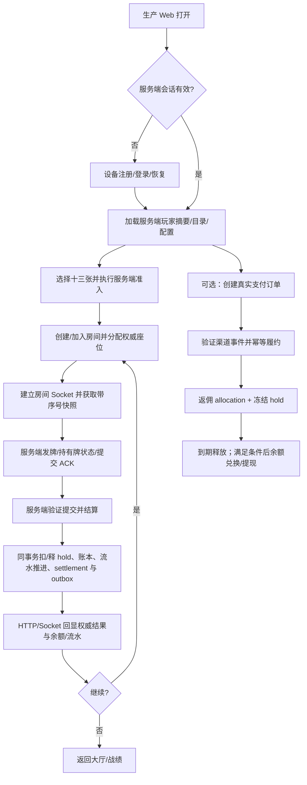

# 玩家核心旅程与业务闭环 SDD

## 1. 目的与范围

本文把现有业务规则转成可按阶段施工和验收的玩家旅程：

> 进入产品 → 建立真实服务端会话 → 发现十三张 → 进入真实房间 → 完成服务端权威牌局与账本结算 → 看见结果并复玩；在核心体验已验证后，再验证充值、返点、兑换和提现。

这是一份**缺口闭环设计**，不是“模块已经可用”的声明。当前 Web 生产入口与开发用 Browser API 的能力不同；后端有模块、路由或单测也不代表生产浏览器端到端通过。验收必须明确标记运行模式、真实玩家/资金边界、所依赖的服务和测试环境。

覆盖：

1. 玩家生产入口、身份会话及其到核心功能的接线；
2. 十三张从入场、房间、发牌/提交、结算、资产流水到结果回显与复玩的主链；
3. 赠币流水推进、充值返点冻结释放、提现申请到出款的资金链；
4. 邀请归因与必要的经营指标；
5. 端到端门禁、运营处置和分阶段上线条件。

不重新定义：身份凭证语义、牌型/计分、代理客损口径、金币与 CNY 资产规则、支付渠道政策、返佣比例/冻结期、提现金额/费用/等待期、Admin 权限等。冲突时以对应权威文档为准，见 §2。

## 2. 权威规则与现状依据

实施前逐项读取并遵循：

- [JWT 登录与会话设计](./JWT登录与会话设计.md)：服务端身份、会话撤销、设备凭证、恢复凭证；
- [双资产充值兑换与提现](./双资产充值兑换与提现.md)：金币与余额、订单履约、提现占款、72 小时等待、状态机与 outbox；
- [支付渠道、流水要求与直连归因](./支付渠道流水要求与直连归因.md)：Mock/真实渠道边界、TRON、流水门槛、IP 归因；
- [邀请归因返佣与数据规范](./邀请归因返佣与数据规范.md)：绑定、五级返佣、2 天奖励冻结与 allocation 事实；
- [累计客损结算口径](./累计客损结算口径.md)：客损模式平台边界；
- [系统账户与资产记账设计](./系统账户与资产记账设计.md)：系统账户、账本守恒和不可变流水；
- [游戏引擎与游戏模块边界](../02_architecture/游戏引擎与游戏模块边界.md)、[后端实施 SDD](../02_architecture/后端实施SDD.md)：游戏权威、模块、事务、Socket 与 outbox；
- [用户流程与低保真线框图](../06_ux/用户流程与低保真线框图.md)：玩家页面路径与交互边界。

截至本 SDD 起草时，项目状态记录了 identity、wallet、payments（Mock）、rooms、referral、social/support、Admin 和 outbox 部分实现；但同时注明生产 Web 业务组合未完整注入、房间 Socket/恢复未闭环、返佣资金事实与 payout 任务处理不完整。状态文件 §2 中较早的概括条目与其后续模块记录存在过期/矛盾，施工判断必须对照当前代码、测试和具体时间记录，不照抄旧概括。

## 3. 产品目标、边界与成功条件

### 3.1 玩家价值目标

玩家能够在生产环境用自己的有效会话进入真实服务端房间，完成由服务端唯一裁定的一局，断线后恢复正确状态，看到可解释的结算和余额/流水变化，并能继续下一局。不能把本地机器人、IndexedDB、练习分数或 Mock 支付包装成真实线上能力。

### 3.2 资金与可信度目标

- 任何影响玩家余额、冻结额、流水进度、返佣或提现状态的操作，均由服务端在事务内决定；客户端只提交意图并显示服务端结果。
- 每笔资产操作有唯一幂等键、不可变 operation/entry、必要的 hold 关系和可追溯业务关联；失败全回滚，重放不得重复结算或发放。
- 不能达到真实提供商验签/链确认/出款结果要求时，界面必须明确处于测试/处理中/人工处理状态，不伪造成已成功。
- 代理客损模式的线下收益不写入平台余额，不显示成平台返点。

### 3.3 建议业务指标（先建立基线，再设目标）

| 漏斗阶段 | 指标定义 | 必须可分群的维度 |
| --- | --- | --- |
| 进入 → 登录/注册完成 | 完成有效服务端会话的去重用户数 / 进入身份流程的去重访客数 | 来源/邀请、设备类型、失败码 |
| 大厅 → 首局开局 | 创建/加入房间并成功开始首局人数 / 有效登录人数 | 游戏、档位、设备、入口 |
| 开局 → 服务端结算 | 完成结算的 round 数 / 已开始 round 数 | 结束原因、客户端版本、弱网状态 |
| 结算 → 复玩 | 24 小时及 7 日内再次开局的用户比例 | 首局结果、入口、设备 |
| 断线恢复 | 成功恢复到服务端最新一致快照的会话 / 发生可恢复断线的会话 | 阶段、恢复耗时、版本 |
| 付费履约 | 经过验证的成功支付并唯一履约订单 / 服务端确认成功订单 | provider/channel、金额、币种、状态 |
| 返点兑现 | 满足策略的奖励 allocation、冻结、到期释放与账本事实对账率 | reward_type、层级、订单来源 |
| 提现到账 | 成功出款并结算的请求 / 可出款请求 | 渠道、未知/失败/重试状态、处理时长 |
| 财务正确性 | 未解释账本/外部结算差异；幂等重复写入数；DLQ 资金任务数 | 账户类型、topic、provider |

指标事件使用服务端业务事实和稳定关联键；不能用客户端点击代替开局/结算/入账事实。初期只记录履约所需的最小数据，遵循隐私与留存要求。损失金额和转化基线必须由真实运行数据计算，本文件不预设业务数值目标。

## 4. 目标端到端旅程

上述是目标流程；任何未通过对应门禁的支路必须对用户显式标记不可用，且不得显示为已上线。

## 5. 生产 Web 组合与会话闭环

### 5.1 行为要求

1. 生产组合经真实 HTTP API 使用 `packages/contracts` 契约；不得从 `platform/browser-api/**`、IndexedDB、LOCAL_DEMO 或开发身份 fixture 提供生产身份、钱包、社交、支付或房间事实。
2. 登录/恢复完成后，客户端保存的只允许是对应 SDD 规定的凭证；余额、用户角色、上级链、准入和会话撤销以服务端查询为权威。
3. API 401/会话撤销时按身份 SDD 刷新或重新认证；其他授权/业务失败不得静默转成本地成功。
4. 用户退出、换设备、凭证过期及服务端撤销在 HTTP 与 Socket 两侧一致生效。
5. 必须有显式运行模式与诊断信息（至少区分生产远端、开发本地 Browser API、本地练习）；production build 验收不得仅测试开发注入分支。

### 5.2 推荐实施切片

- 先实现生产 identity API client/组合：注册、登录/恢复、刷新、登出、当前用户；页面统一消费已有 application ports。
- 首次匿名建号必须 server-side 创建 user/device，使用独立认证秘密（deviceCode 仅作识别），按 Idempotency-Key 重放同一注册结果；SQL 注册事实与 Redis 会话采用 JWT §3 的跨存储恢复/补偿边界，不能假设分布式事务。
- 服务端 refresh cookie、sid、客户端单飞 operationId 必须与 refresh use case 一致；无有效 refresh/session 时 fail closed，禁止本地身份回退。
- 接入大厅所需的真实目录/用户摘要/配置与 feature availability；缺数据时给出不可用态，不能回退伪造目录或余额。
- 再按业务链依次接入房间、钱包/支付、社交/客服；不能把 `main.ts` 注入完成等同全部端点联调完成。

### 5.3 验收

- production build 下真实浏览器注册→登录→刷新→登出→撤销；服务端确认会话，重放旧 refresh/session 被拒绝。
- 禁用/不可达后端时显示明确错误，不创建本地用户/余额/房间。
- Dev Browser API 与 production API 两套 adapter 都符合相同 schema；production 测试证明请求发往配置的真实 API base，而非 dispatcher。
- 未认证访问、越权 userId、过期 token、撤销 token、错误响应 envelope 均覆盖。

## 6. 十三张房间、牌局与结果闭环

### 6.1 入场与房间

1. 游戏目录/档位/准入来自服务端配置快照；每次进入按真实账户可用金币、流水门禁、用户代理模式和房间规则判定。档位文案不得暗示已扣费但实际只是本地数值。
2. 创建/加入房间在服务端原子检查状态、容量、密码/准入与幂等键，返回 roomId、seat、fencing token/版本及有效 game entry；同一请求重放返回同一结果。
3. 建房到入座、准备到开始的状态转换唯一由服务端负责；开局调用者必须已入座于该房间，不以已认证身份替代成员授权。当前经典十三张规则要求四名不同玩家，服务端在切换房间状态或占款前校验 room capacity=4 且恰有四名入座玩家。玩家可提交规范正整数 `waterUnits`；服务端从房间冻结的 `shisanshui.stake` 档位策略解析 coinPerWater、min/maxWaterUnits 与独立 maxLossHoldCoins，计算有效流水 `wagerCoins = coinPerWater × waterUnits × 13`，并将实际值及策略相关值固化到 round 规则快照。客户端不得提交 wagerCoins/maxLossHoldCoins。单玩家结算净输额不得超过其冻结 maxLossHoldCoins，超限则拒绝结算，不能封顶改写结果或透支。缺少或无效策略即在状态/账务副作用前拒绝开局。重复点击、并发加入、房间满员和关闭/过期均返回稳定业务错误。
4. 玩家 Web 接入现有 HTTP 路由/use case；不能以 HTTP 路由存在推断生产 Web 已接线。

### 6.2 Socket 与弱网恢复

- 房间 namespace/room channel 经已认证 session 加入；服务端验证玩家对房间的成员权限，绝不接受客户端自报 userId/seat。
- Socket 消息包含稳定 `eventKey`、roundId、房间/轮次版本或单调序号；命令包含 client command id/idempotency key。客户端 ACK 只表示命令持久化/接受，不代替结算事实。
- 建连、恢复、序号断档、服务器重启后，客户端先获取权威快照，再从游标补事件；重复/乱序事件按 eventKey/版本忽略或重拉快照。
- 断线托管、超时、自动提交和退出的规则沿用游戏/房间 SDD；任何自动操作都须记录行为来源和可复算输入。
- Socket 投递失败不得撤销已提交的结算；客户端以 HTTP snapshot/settlement 补拉。outbox 重试/死信需可观测、可重放，不误标 SENT。

### 6.3 发牌、提交和结算

- 牌局随机性与牌权威在服务端。发牌算法、随机源、牌局 seed/commitment、可审计性和公平性细节须遵守游戏规则 SDD；客户端不得生成权威手牌或对手结果。
- 开局写入完整 `handlerVersion`、不可变规则/计分配置快照及 hash；缺失/无法解析规则时拒绝开局，不能以空对象或不匹配默认配置继续。round 的 `rulesSnapshot.appliedStake` 同时固化配置引用键、coinPerWater、水数、wagerCoins 和 maxLossHoldCoins，供结算、流水和审计使用。
- 服务端向每位玩家仅发送其可见手牌；其他玩家信息、随机种子及私有状态加密存储并按角色授权。不得把全桌私密牌面写入公共事件或普通日志。
- 提交验证牌数、牌唯一性、区域组成、规则合法、提交人 seat、轮次成员资格、状态与 fencing version；输入牌数组槽必须是普通数据属性，拒绝稀疏槽/访问器且不执行 getter；成员校验必须在提交写入前完成；写入前同时拒绝重复 userId、非法用户 ID 或未知 round_player 状态的仓储快照，避免对含糊或损坏的成员集合继续提交；同一提交键内容相同重放原结果，异内容拒绝。
- 结算使用既有纯规则包，服务端传入完整四家手牌、提交快照、规则快照；所有输入 hash、输出 hash 和 handler version 绑定 round。结算重复请求只能返回既有结果；round 与 round_player 状态条件更新必须确认恰好影响一行，零行或多行均在同一事务中失败关闭；写入 `net_coin_delta` 前需验证其为规范有符号整数十进制字符串，不可借存储适配器入口写入格式歧义值；提交前及提交后重读的 round_player 集合须为非稀疏数组，集合或成员上的 Proxy 反射异常须归一化为 STORAGE_UNAVAILABLE；validated 玩家集合必须以已校验的数据描述符快照继续参与 membership/allSubmitted 判定，禁止调用原数组迭代器或遍历成员对象、玩家集合必须是普通数组且只含 length 与稠密下标；各槽位 descriptor 只读取一次并直接复制值，必须为 enumerable 数据属性，读取完成复核 ownKeys 集合仍稳定，校验后复核 Proxy ownKeys 集合未变化（不依赖键顺序），禁止在集合形状变化时继续使用；成员必须是普通对象且只含 userId/status 两个 enumerable 数据属性，拒绝扩展字段/继承字段/非普通原型、userId 唯一且合法，提交后恰有四名成员，异常集合不得写提交事件或推进 SETTLING；用例入口同时拒绝非规范十进制 `userId`/`roundId`，避免幂等键和持久化查询接受格式歧义标识；round-submit 用例 input 仅接受普通对象、恰好必需自有字段均为 enumerable 数据属性（可 writable/configurable=false，以支持冻结输入对象），arrangement 和牌堆通过 descriptor 读取并归一化为新的内部快照；根对象及牌堆 ownKeys 必须与 own-property descriptor 键集合一致，根对象在初始 ownKeys 与 descriptor 提取前后复核键集合稳定，所有牌堆归一化后、任何仓储写入前再次复核根键及 pile descriptor 引用/标志；根值 descriptor 经二次快照核对 pile 引用及 enumerable/configurable/writable 属性标志稳定；descriptor-map 反射 trap 亦归一化为 INVALID_SUBMISSION，完成读取后再次确认键集合稳定，accessor/额外字符串或 Symbol key 在事务和仓储触达前拒绝；反射 Proxy trap 异常（含 arrangement/root/pile 的 getPrototypeOf、descriptor 与 ownKeys）也必须归一化为 INVALID_SUBMISSION，不能泄漏底层异常或进入仓储；锁读 round 快照与锁读 round 与仓储 `submitRound` 返回值及其中的 round_player 快照均须为普通对象和精确字段形状；所有必需字段通过自有 enumerable 数据属性描述符校验对象/布尔/标识/时间完整性，拒绝 accessor、非普通原型及 Proxy trap；捕获 getPrototypeOf/descriptor 反射异常，Date 提交时间仅接受 string 或可通过原生 getTime 读取的 Date，拒绝 Date Proxy 和 coercion，畸形返回不得产生副作用；其中 round_player 的必需字段须通过 enumerable 数据属性描述符读取，非枚举或访问器属性拒绝；锁读 round 的 id、roundKey、status、fencingToken 也必须以数据属性描述符读取；arrangement 根对象 pile 字段同样只允许数据属性，禁止执行根 accessor；根对象必须是普通对象、pile 必须是原生 Array 原型，拒绝 null-prototype/custom-prototype 数据；pile 的 length 必须是原生数据属性且与规范牌堆长度一致，禁止 length accessor 或伪造长度；pile ownKeys 只能包含 length 与规范数字索引，拒绝额外元数据属性；数字索引必须为无前导零且严格落在该 pile 的规范范围内；卡槽索引须为 enumerable 数据属性（冻结数组的 non-writable/non-configurable 槽位仍接受），牌值仅接受安全整数 number（拒绝可 coercion 对象），接受并归一化前拒绝非标准属性描述符，禁止执行仓储返回对象上的 accessor；`inserted=false` 的重放结果只允许出现在 SETTLING，`inserted=true` 的新提交只允许出现在 ACTIVE，状态与返回标记不一致时在事件追加前失败关闭；新提交事件的 `payload_ciphertext` 必须绑定本次 32 字节 `submissionHash`，长度异常不得追加事件。现有结算用例要求提交快照含有效13张手牌与摆牌，并以纯规则 validator 核验摆牌牌数、牌唯一性及归属；进一步拒绝四家手牌跨玩家撞牌，并拒绝稀疏数组、自有额外属性及访问器牌槽，避免畸形数组绕过检查；数组及区域数据属性访问器一律拒绝且不执行；快照字段由 `Object.getOwnPropertyDescriptors` 一次性提取，禁止 heldCards/arrangement getter，且不执行无关提交元数据访问器。该防御仅核验持久化快照一致性，不证明手牌来自可信发牌器；发牌/私牌生成与安全保存仍是未闭环依赖。
- 资产/流水操作与唯一 settlement 在共享事务中完成：锁顺序固定；校验关联 `asset_hold`；按结果消费/释放 hold、写平衡分录、推进有效下注流水、更新 round 状态、写必要 outbox。任一失败全部回滚；不能先发结果事件再提交账本。
- 保留可审计 settlement DTO，向玩家只返回授权的本局结果与自身账务摘要。读取或触发结算前须验证调用者属于该局；成员校验必须在已结算幂等重放之前。触发 SETTLING 结算须通过 `fencingToken` 查询参数携带与锁读 round 当前值匹配的 fencing token；缺失/过期令牌拒绝并映射为冲突，已结算重放可不要求令牌但仍须成员校验。赛后结果读取应支持重试、刷新和跨设备查询。

### 6.4 游戏验收主线

最少使用两个独立真实用户/客户端，并在隔离测试库完成：

1. 两用户登录、创建/加入同一房间，真实准入与座位一致；
2. 房间满员/未满员、重复创建/加入、重复开局、旧 fencing token 均符合规则；
3. 服务端发牌，每个玩家牌唯一且恰为规则要求；客户端不能篡改他人牌、提交或 settlement；
4. 提交 ACK/重复命令/异内容复用 key/超时与离线恢复行为确定；
5. 模拟断线、进程重启及消息重复/乱序后，恢复快照和最终结算一致；
6. 结算由服务端唯一发生一次；同事务检查账户余额、frozen、asset_hold.remaining/status、asset_entry、turnover_state 与 settlement 结果；
7. 失败注入覆盖锁冲突、规则异常、账本失败、outbox 写失败，验证整笔事务回滚且可安全重试；
8. 玩家退出或继续下一局，刷新/跨设备后仍可查已结算战绩，不误入本地练习态。

## 7. 钱包资金业务闭环

### 7.1 充值（Mock 与真实渠道分开验收）

服务端创建订单并固化商品、支付方式/channel/provider、金额/币种、汇率、金币数量、费率与幂等快照；外部服务调用不持有资产账户行锁。只有 provider 验签或链确认满足所选渠道策略，且订单、金额、币种、状态匹配时，才在同一事务去重 payment event、履约金币、外部结算事实、订单状态与 outbox。浏览器回跳不构成成功。

- **Mock 门禁：**只在非生产显式启用；Mock secret/接口不可由生产前端调用。测试可驱动成功、失败、超时、重复、乱序及错金额，账本只履约一次。
- **真实渠道门禁：**供应商、验签算法/密钥轮换、订单查询、退款/冲正策略、渠道费与对账流程经安全审查后分别接入。真实 TRON 需落实合约白名单、区块确认/reorg、唯一事件位置、地址分配和每日 FX；未确认、迟到、错额进入人工队列，不能自动发币。
- 渠道未配置、真实验证未实现或链数据不可用时，不得报告支付成功；新订单按策略暂停或显示待处理。

### 7.2 赠币与有效流水

WelcomeGift 赠币沿权威赠币规则入金币账户，同时创建不可变来源与 turnover requirement；流水不是冻结资产，不阻止玩家正常游戏。有效下注从服务端确认的真实牌局计算，不计虚拟练习、取消/未开局房间或无效下注。结算事务按 wager 记流水，赢输不重复加计；并发结算与重放按 round 唯一键幂等。未完成 requirement 禁止转出/兑出/提现，错误提示给剩余流水和不可完成原因。

验收至少覆盖赠币发放幂等、未完成拒绝、有效局推进、无效局不推进、下注额与剩余额上限、重复结算不重复推进、结算回滚不留下部分流水、全额完成后资格恢复。

### 7.3 充值返点与冻结释放

仅对被服务端验证并成功履约的符合条件充值订单计算。以 order/payment 与成功时 ancestry/reward_type/rate/config 快照生成唯一 allocation；同事务写奖励余额资金事实、关联 hold、冻结分录和 outbox。代理客损 reward_type 按既定边界不生成平台客损 allocation。

到期 worker 按 `expires_at` 幂等释放 hold、更新 allocation/关系投影并写账本；提现在事务内检查 hold 已释放或排除被冻结资金，不信任 UI 倒计时。worker 缺 handler、配置不全或账本校验失败时 fail closed，保持冻结并告警。Admin 可查看订单→allocation→hold→entry 的关联并以补偿流水修正，不编辑原分录。

需产品/财务先确认并记录：比例计算精度/舍入、零分奖励处理、支付退款/chargeback 对已冻结/已释放返点的冲正策略、关系快照时点。未裁决前不得启用生产返佣入账。

### 7.4 余额兑换与提现到账

兑换遵循双资产文档的比例快照、精度、系统余额和客损模式限制。提现沿用现有 REQUESTED/REVIEWING/APPROVED/PAYING/SUCCEEDED/REJECTED/CANCELLED/PAYMENT_UNKNOWN/FAILED 状态与 72h `payout_not_before_at`、身份三选一、最低额、手续费和 hold 规则；本 SDD 不简化这些条件。

补齐出款链路至少包括：Admin 审批与双人复核（若规则要求）→ `payout_attempt` 持久化 → provider 幂等提交/查询 → 成功/失败/未知结果状态推进 → 同事务消费/释放 hold 与账本分录 → external settlement 对账 → outbox/审计。提交前先持久化内部 payout id 与 provider 幂等 key；未知结果不得盲目重发或释放占款，只查询/对账。确认失败才按策略释放并允许安全重试。账户敏感字段必须由批准的 KMS/密钥方案加密，日志/UI 脱敏。

上线前必须真实验证 REQUESTED→72h 门禁→审批→PAYING→成功/失败/UNKNOWN 恢复，重复 provider 回调、请求超时和服务重启不会重复出款或扣款；没有真实 provider 资格时只可做隔离 Mock 验收，并明确不代表已能到账。

## 8. 邀请获客与代理运营闭环

1. 入口邀请链接保存有效邀请码；按既定部署边界由直连接口观测客户端 IP，服务端规范化并摘要后写 Redis TTL 候选。客户端自报 IP 无效，IP 归因不认证身份。
2. 登录/注册成功事务消费候选；仅无既有上级用户可首次绑定，检验邀请码、循环、层级、归因版本并写 binding + append-only event。已有上级不得因访问新链接/IP 自动换绑。
3. 没有真实候选时返回“未归因”，不得将链接点击数伪报成注册邀请；同一用户并发注册/login 重试结果幂等。
4. 玩家邀请页只显示已落库直属关系、匿名信息及真实 allocation/hold/entry 汇总；reward_type=客户损失模式明确提示线下处理，平台值为空而非推算值。
5. 代理审批、权限、下线数据和收益操作经 Admin audience/capability、审计与必要的双人复核；不能用玩家 token 或隐藏 UI 代替授权。社交/客服是增量运营能力，不能作为核心游戏/资金验收的替代品。

验收：无 Redis/候选过期/无效邀请码/IP 伪造/已有上级/同 IP 多新用户等边界用例；明确“同一候选可否由多个新用户消费”和回退邀请码政策（待产品确认）后才决定 Redis 消费语义。代理数据权限需按域隔离验证。

## 9. 故障、支持和运营控制

- 关键流程按 requestId、userId（日志脱敏规则适用）、roomId、roundId、orderId、operationId、withdrawalId、provider event key 关联；不得记录明文密钥、支付账号、私有手牌或完整加密材料。
- 建立核心告警：开局/结算失败率、room 长时间非终态、hold 与账户 frozen 差异、ledger 不平衡、支付回调 backlog、奖励释放过期、payout UNKNOWN/DLQ、Socket 恢复失败、outbox 任务 DEAD。
- 玩家错误须分为可重试、需要重新认证、资金处理中、需联系客服；客服看到的状态必须来自服务端事实。未完成的后台操作显式禁用，不提供可伪造“成功”或绕过锁定的人工编辑。
- 运维手册规定安全补偿命令/权限、双人批准、审计事件、回滚条件和资金差异处理；不允许直接 SQL 改余额、hold、订单状态或 immutable entries。
- 生产试点要有开关、限流/停机条件、数据库备份恢复与回滚方案；停止新局/新支付不能阻止已开始交易被安全结算或对账。

## 10. 分阶段交付顺序与 Go/No-Go

| 阶段 | 业务交付 | 必须先完成的依赖 | 放行门禁 |
| --- | --- | --- | --- |
| 0. 生产入口 | production identity/session 与 API composition、明确线上/本地状态 | 当前 contracts/API 对齐，refresh/revoke 真实可用；首次匿名设备建号须与 JWT SDD 的幂等注册、安全凭证及 SQL/Redis 故障恢复一致 | production build 浏览器注册/登录/刷新/登出；无本地回退 |
| 1. 可玩核心牌局 | Web→房间 HTTP+Socket→发牌/提交→服务端结算→结果/战绩→复玩 | rules snapshot/发牌/权限/恢复、房间 namespace/outbox、游戏账本/流水原子事务 | §6.4 全通过；两客户端/故障注入；真实浏览器闭环 |
| 2. 玩家资金基础 | 赠币流水从真实结算推进、真实余额读取、兑币/提现状态准确展示 | 阶段1账本与 wager 事实；turnover 规则 | §7.2 全通过；钱包/账本/hold 对账一致 |
| 3. 返佣和提现运营 | allocation 冻结释放、Admin 审核、payout provider/UNKNOWN 对账 | 财务规则决策、KMS、Admin 权限、真实渠道契约 | §7.3/7.4 所有资金与重复/失败恢复门禁，账务/外部对账无未解释差异 |
| 4. 生产充值与归因 | 渠道验签/查询、TRON/FX、Redis 归因、邀请收益投影 | 商户/链/FX/归因歧义裁决、风控与运营流程 | 真实渠道沙箱/受控试点、重复/乱序/reorg/错额对账；不得只靠 Mock |
| 5. 增长运营扩展 | 社交安全治理、客服 SLA、代理分析与 Admin 全域运营 | 服务端授权、审核/举报/附件密钥、运营人力与 SLA | 权限/审计/投诉/时效指标实测；不阻塞前述核心链路 |

每一阶段只在其门禁通过后宣称“可用”。测试层级按 `docs/09_agent/TESTING.md`：domain 纯规则、application fake ports、契约与 adapter 测试、DB integration、真实浏览器/E2E。金额路径必须补双账本守恒、幂等重放、事务回滚、并发与 ledger/hold reconciliation。生产 pilot 仅在密钥、监控、备份恢复、客服和资金处置责任人到位后放行。

## 11. 未决业务决定（开工前必须裁决）

1. 牌局发牌随机源、seed 承诺/揭示与公平性审计口径；玩家争议复盘允许暴露的数据边界。
2. 牌局超时/缺席、断线托管以及已开始牌局的取消/退款政策；不得由实现者自行猜测。
3. 有效下注额进入赠币流水的精确规则：不同牌型/输赢、部分退局、取消/争议、最大有效下注/轮次折算口径。
4. 充值返点的精度舍入、零值分配、支付冲正/chargeback 与奖励已释放后的追偿策略。
5. PAYMENT_UNKNOWN 的最终人工/自动对账转换及其可释放条件；出款服务商、重试安全契约、费率和资金结算责任。
6. TRON 合约/网络、确认数、FX provider/时点及超时/迟到/错额处理人员。
7. Redis 邀请候选能否由多个新账号消费、同 IP 候选清除/回退规则，以及直连部署/信任代理边界。
8. 上线地区、法律/合规、年龄/地理限制与服务时间（尤其涉及真实支付和游戏资产时）。这些事项须由产品/法务/运营确认，SDD 不作法律结论。

未决项会影响生产发放或资金风险时按 fail closed 处理；不能用默认值掩盖待决策。

## 12. 变更历史

| 日期 | 变更 |
| 2026-11-06 | round-submit 规范化前显式要求牌数组槽均为数据属性；补强回归确保访问器 getter 不执行。 || --- | --- |
| 2026-11-07 | Round 128 round-settle 校验 SETTLING round 与请求 fencingToken 不超过 BIGINT UNSIGNED 最大值；超限请求/损坏持久快照在结算计算、持久化和资产动作前拒绝。新增请求及存储越界回归，round-settle/start/submit 测试 106/106、backend typecheck、scoped ESLint、Prettier、diff check 通过。 |
| 2026-11-07 | Round 127 round-settle 对 SETTLING 行与入站 fencing token 应用 BIGINT UNSIGNED 上限校验；非法请求在结算计算、持久化及账务前拒绝，损坏持久 token 以 STORAGE_UNAVAILABLE fail closed。新增边界回归；round-settle/round-start/round-submit 测试 106/106、backend typecheck、scoped ESLint、Prettier 和 diff check 通过。 |
| 2026-11-07 | round-settle 对 repository 返回的 PREPARED settlement 写入行验证 round/status/id、输入与结果哈希，并校验结果快照摘要；支持 plain row 与 Sequelize Model `getDataValue` 访问。SETTLED replay 重新计算并比对 round/player input hash、要求 COMMITTED 状态、校验结果快照 digest 与权威手牌/摆牌数据；player 行兼容精确成员投影及显式 allowlist 的完整行。Sequelize commit transition 检查恰好更新一行并读回 COMMITTED 状态。round-settle + Sequelize rooms adapter 测试 89/89、backend typecheck、scoped ESLint、`git diff --check` 和 Graphify 更新通过；未运行 MySQL 并发集成或生产资金 E2E。 |\n| 2026-11-06 | Round 126 round-start 在 maxRoundNo 返回后校验其为 BIGINT UNSIGNED 可递增的有效非负 BigInt；MAX、负值及错误类型在 createRound/资金操作前 fail closed，新增三类回归。定向测试 101/101、backend typecheck、scoped ESLint、Prettier、diff check 通过。 |
| 2026-11-06 | Round 125 round-start 校验持久 roundNo 最大值是 bigint 0≤n<BIGINT UNSIGNED max；负数、错误类型及耗尽序列在创建 round、占款前以 STORAGE_UNAVAILABLE 拒绝，避免 roundNo+1 越界。定向测试 101/101、backend typecheck、scoped ESLint、Prettier、diff check 通过。 |
| 2026-11-06 | Round 124 round-start 在触及仓储/读取资金前限制请求 fencingToken 不超过 BIGINT UNSIGNED 最大值；超限直接 INVALID_SUBMISSION，避免 BigInt 转换及非法请求造成不可控存储访问，补 request 上限+1 回归。定向测试 98/98、backend typecheck、scoped ESLint、Prettier、diff check 通过。 |
| 2026-11-06 | Round 123 round-start 将请求与持久化 room fencingToken 限制到 BIGINT UNSIGNED 最大值 18446744073709551615，拒绝超限令牌并在房间迁移/资金副作用前 fail closed，避免 token bump 越界破坏 fencing 序列；上限+1 与拒绝副作用回归通过。定向测试 98/98、backend typecheck、scoped ESLint、Prettier、diff check 通过。 |
| 2026-11-06 | Round 122 round-start 在权威状态切换与资金副作用前除验证四名不同玩家外，也要求 seated membership seatNo 唯一；重复座位快照 fail closed。定向测试 97/97、backend typecheck、scoped ESLint、Prettier 和 diff check 通过。 |
| 2026-11-06 | Round 121 room-join 将 game_entry QUEUED→SEATED 条件更新结果显式返回并校验；零行更新/状态竞争不再伪报入座成功，缺行、归属/房间不符或过期的重读快照 fail closed；新增 application 与 Sequelize adapter 回归，相关定向测试 80/80、backend typecheck、scoped ESLint、Prettier、diff check 通过。 |
| 2026-11-06 | Round 119 round-submit 将 Sequelize/领域返回的有效 Date 或字符串 submittedAt 规范化为 ISO 字符串再返回 DTO；非法/空日期 fail closed，新增 Date 返回值回归。 |
| 2026-11-06 | Round 118 round-submit 仅在 post-submit round_player 列表恰有四名 distinct 玩家、user ID 格式合法且每个 status 属于 RoundPlayerStatus 时判断 allSubmitted；损坏列表不推进 SETTLING。新增数量/重复成员/无效状态回归。 |
| 2026-11-06 | Round 117 room-join 验证有效 game_entry 的 ID 与 user 归属，并要求新入座的 SEATED entry 仅能属于请求房间、同房重放 SEATED entry 必须匹配请求房间；损坏资格快照在 claim 或返回前以 STORAGE_UNAVAILABLE 拒绝。新增坏 ID/归属/房间回归。 |
| 2026-11-06 | Round 116 round-submit 在读取 round_player 或计算提交键之前校验锁定 round 的 ID、非空 key、RoundStatus 枚举和规范 fencingToken；损坏持久 round 快照以 STORAGE_UNAVAILABLE 拒绝。新增坏 round 快照门禁回归。 |
| 2026-11-06 | Round 115 round-submit 在 submitRound 返回后校验持久 round_player ID 与 submittedAt 快照；无效 ID/日期在追加 submission event 和后续玩家状态读取前以 STORAGE_UNAVAILABLE 拒绝。新增三类损坏返回快照回归。 |
| 2026-11-06 | Round 114 round-start 在已有 ACTIVE round 重放与 createRound 冲突返回前校验 round ID、roundKey、已定义状态枚举及规范 fencingToken；损坏持久 round 快照在 round-player 读取/资金处理前拒绝。新增重放与 duplicate-create 返回值回归。 |
| 2026-11-06 | Round 113 round-start 在成员检查后、状态迁移前验证 room fencingToken 为规范正十进制快照且 rulesSnapshot 为对象；损坏房间状态快照以 STORAGE_UNAVAILABLE fail closed，防止 BigInt 转换异常或不可信/缺失规则快照进入开局与占款流程。 |
| 2026-11-06 | Round 111 room-join 对有效 game_entry.expiresAt 进行有效 Date 快照检查；NaN/无效日期不再因比较恒为 false 而绕过过期门禁，损坏持久状态映射 STORAGE_UNAVAILABLE。新增坏日期资格回归。 |
| 2026-11-06 | Round 110 room-join 在 joinRoom 返回后验证 membership 快照与请求归属/合法座位，并要求 seatNo 与基于锁定计数分配的预期座位一致；异常返回值在 game-entry 查询/claim 前 fail closed。 |
| 2026-11-06 | Round 108 room-create 对 roomRepo 幂等重放返回值执行持久快照校验（room ID、六位 room code、有效 status、正整数 capacity、非空 ownerKey），损坏行以 STORAGE_UNAVAILABLE 拒绝且不继续进入 game-entry 分支。 |
| 2026-11-06 | Round 107 room-create 在生成房间码与任何仓储写入前校验创建输入的正十进制 ID、正整数 capacity/roomType、非空 ownerKey 和 rulesSnapshot 对象形状；越界/结构错误以 INVALID_SUBMISSION 拒绝。此门禁仅验证运行时形状，不将客户端提供的 capacity/rulesSnapshot 视为可信配置。 |
| 2026-11-06 | Round 106 round-start 在房间状态迁移、幂等查询及资金操作前验证四名已入座成员的持久快照：membership/user ID 为规范正十进制值，seatNo 为房间容量内正整数；坏快照 fail closed。新增损坏成员 ID/座位回归。 |
| 2026-11-06 | Round 105 room-join 在检查重放 membership 前拒绝非正整数 room capacity，并校验 seatedCount 是 0..capacity 整数；无效持久快照 fail closed，避免生成越界 seatNo 或依赖错误计数误判满员。新增 capacity/count 边界回归。 |
| 2026-11-06 | Round 104 room-join 在幂等重放入口核验持久 membership 的 room/user 归属、规范正十进制 ID 与座位范围；异常既有行在准入查询及入座副作用前拒绝。新增错配与无效座位快照回归。 |
| 2026-11-06 | Round 102 round-settle 在评分与资金 I/O 前校验四名参与者的 max-loss hold amount 为规范正十进制字符串、hold ID 为合法正十进制 ID；损坏持久快照 fail closed 并新增 no-scoring/no-ledger 回归。 |
| 2026-11-06 | Round 101 移除 round-submit 对已规范化 arrangement 的重复快照 clone；normalizeArrangement 已生成仓储调用方不可变更的独立值副本，提交哈希与持久快照继续使用同一规范化对象。 |
| 2026-11-06 | Round 100 复核 Round 99 的 round-submit arrangement 快照实现：normalizeArrangement 已在仓储访问前将客户端值复制为规范牌列，提交摘要和持久快照均以该对象为输入；记录真实实现边界，不将其误述为新增第二次 clone。 |
| 2026-11-06 | Round 97 加强 arrangement 输入边界：结构校验拒绝 pile 数组项 getter，并直接读取数据属性描述符校验值，避免验证期间执行客户端对象 getter；新增仓储访问前拒绝回归。 |
| 2026-11-06 | Round 94 round-submit 结构门禁用 Reflect.ownKeys、属性描述符与稠密列表检查拒绝隐藏扩展键、getter、稀疏或扩展数组，防止实际参与快照哈希的值绕过验证；不改动游戏规则或权威发牌决策。新增结构异常回归测试并通过定向验证。 |
| 2026-11-06 | Round 93 复核 settlement 唯一键并发重放：因固定账户锁顺序要求，重放分支会先锁定并校验参与账户再判定唯一键冲突；该路径可能因账户访问异常安全失败，但不会重复资金写入。规格继续要求完整事务顺序，不为幂等读取擅自绕过账户锁门禁。 |
| 2026-11-06 | Round 90 round-settle 在 settlement 持久化之前先锁定并验证玩家及系统 COI 账户快照完整性、归属与类型；账户快照错误时 settleRound 不调用，测试断言无 settlement 持久化尝试。唯一键命中重放仍保留幂等返回。round-settle 定向验证 30/30、backend typecheck、scoped ESLint、Prettier、diff check 通过。 |
| 2026-11-06 | round-submit 在现有 13 张结构/唯一性检查之外，复用 @gameing/shisanshui-rules.validateArrangement 对合法牌组归属与摆牌规则做纯函数校验；非法 arrangement 在任何仓储读写前以 INVALID_SUBMISSION 拒绝。 |
| 2026-11-05 | 新建：按业务流程缺口定义生产玩家核心旅程、游戏联机/结算、流水与资金兑现、邀请归因、运营验收门禁和未决决策；不替代各领域权威规则。 |
| 2026-11-05 | 明确匿名访客自动建号已确认；将首访服务端注册幂等、认证秘密隔离、SQL/Redis 恢复边界与 refresh cookie 协议列入阶段 0 实施依赖，基于现有 identity route/use-case 与契约差异阻止无效生产接线。 |
| 2026-11-05 | 补充 settlement 读取/触发必须先校验 round_player 成员，覆盖已结算重放；SETTLING 触发需当前 fencing token，缺失/过期均拒绝；通过 query 参数携带，并将响应 DTO 固定为 roundId/settlementId/players/replay。 |
| 2026-11-05 | rooms 错误码迁入 contracts 统一注册并集中映射 HTTP status；仅对明确可安全重试的 STORAGE_UNAVAILABLE 实例设置 retryable=true；所有房间/牌局事务路由保留稳定领域码，不再将可预期业务拒绝降格为内部 500。 |
| 2026-11-05 | 开局用例在状态迁移和占款前验证调用者已入座，防止任意登录用户触发整房间资金冻结；补充 fake-port 授权回归测试。 |
| 2026-11-05 | 提交用例在 submission/event 写入前显式验证 round_player 成员身份，并复用参与者快照判断全员提交；补充非成员无副作用回归测试。 |
| 2026-11-05 | 开局除校验调用者已入座外，也要求经典十三张恰有四名入座玩家；capacity≠4 或人数不足时在房间状态改变与占款前拒绝，避免产生规则包无法结算的牌局。 |
| 2026-11-05 | 开局 use-case 拒绝非正、非规范整数、前导零及超过有符号 BIGINT 上限的金币 wager/hold 输入，避免非领域调用方绕过 HTTP schema 写入零/非法占款；补充参数化单测。该校验不等同可信定价：端点仍接收客户端金额，待明确 game-tier 配置键及规则快照语义后再切换服务端解析。 |
| 2026-11-06 | 增加 `/auth/device-register` route 回归测试，确认缺少 userId 时 HTTP 400 且未访问 user/device 仓储或注册用例；补充 device-login 请求契约，约束 BigInt userId、64 位 hex digest、设备 credential key，并由 Web API client 使用共享 schema。此测试不意味着匿名注册已实现。 | |
| 2026-11-06 | HTTP device-register/device-login 开始运行时校验共享 TypeBox schema：register 允许既有 userId 扩展字段后再严格验证设备数据；login 强制 schema 中的 ID/digest/key 格式与禁止多余字段，验证失败不进入 use case。route regression 覆盖非法 login body 拒绝；未完成首次匿名建号，register 与 device credential GET route 仍没有可用闭环。 |
| 2026-11-06 | 按 6.3/阶段 1 依赖顺序复审后确认发牌及玩家私有状态没有 server-side 权威实现：round-start 仅建 round/hold，round_event/round_player 私有数据仍为占位，settlement 从空/客户端提交快照读取。随机源、承诺揭示与争议复盘的数据披露边界属于 SDD 未决决定；本轮不猜测实现，登记为阶段 1 安全阻塞。 |
| 2026-11-06 | round-submit HTTP schema 与 use-case 新增 arrangement 结构防御：严格要求前/中/后墩分别 3/5/5 张、牌值范围 0–51、无重复牌，attempt 为有限安全正整数且不大于 1,000,000；非法输入在触及仓储前拒绝。该校验只约束提交形状，不证明牌来自服务端发牌手牌，也不替代规则/计分或私有状态方案。 |
| 2026-11-06 | 确认在最后一名玩家提交后 round 状态已转 SETTLING 时，网络响应丢失仍需允许同键同摘要精确重放；用例允许对 SETTLING 请求进入仓储做幂等判断，adapter 仅 key+hash 一致返回 replay，否则拒绝，避免安全重试被状态迁移错误阻断。未构成发牌或结算闭环。 |
| 2026-11-06 | round-submit 路由按既定 201 新建 / 200 重放语义，根据 use-case replay 标志选择 HTTP status；修复路由原先固定返回 200、与端点注释及共享幂等客户端约定不一致的问题。此修复不解决服务端发牌/结算权威性。 |
| 2026-11-06 | 将 round-submit 的 fencingToken、3/5/5 arrangement 与 attempt 限制从 server 本地 schema 提升为 `@gameing/contracts/game-room` 单一 `RoundSubmitRequestSchema`，防止共享 DTO 消费方与 HTTP 输入校验漂移；契约测试覆盖 pile 长度、牌号范围、attempt 与额外字段。该结构契约不证明牌来自服务端发牌。 |
| 2026-11-06 | 检查发现 use-case 有意比契约更严格（要求 13 张跨墩不重复）；保留该额外领域门禁，未将 TypeBox 依赖引入 backend（backend 未声明该依赖，首次尝试运行测试证明无法 resolve）。这是合法分层：HTTP/shared contract 校验形状，业务用例独立保护跨墩唯一性。round 45 对应 tests 均重跑通过。 |
| 2026-11-06 | 修复 round-submit 幂等键重放语义：Sequelize adapter 仅在 submission_key 与 submission_hash 均匹配时视为重放；同键异内容或不同 attempt 在该玩家已提交后 fail closed，不再返回旧行作为成功；覆盖 ACTIVE/SETTLING 状态中的安全重放。adapter now 可注入时钟用于可确定性测试边界；增加 fake-model adapter 测试。此项防止客户端重用 attempt 改写/冒用提交结果，但不证明手牌权威性。 | |
| 2026-11-06 | 将 round-submit 共享契约 fencingToken 收窄至与结算 fencing token 一致的正十进制整数字符串（1–20 位）；补零、零值、超长及非字符串均拒绝，避免已提交请求从无效 fencing token 进入数据库锁/写流程。 |
| 2026-11-06 | use-case 入口增加与共享 fencing-token 语法一致的 fail-closed 检查，并扩展 fake-port 测试覆盖零值、前导零和 21 位 token，确认非法 token 在任何 repository access 前拒绝。 |
| 2026-11-06 | round-start 请求 schema 归入 contracts `RoundStartRequestSchema`，共享校验正数整数字符串金额、fencing token 和禁止多余字段；服务端路由改用共享契约。use-case 在锁 room 前执行 token 格式门禁，fake-port 测试覆盖零值、补零、负数和超长 token，防止未走 HTTP 的应用调用将无效 token 带入存储流程。初始 contract test 错将 20 位数字串按 schema 语义判为非法（use-case 才承担 signed BIGINT 上限）；修正边界断言并重跑通过。 |
| 2026-11-06 | round-start HTTP 状态码依据 use-case `replay` 标志区分：新开局 201，命中既有 ACTIVE round 的精确重放 200，避免重试被报告为新资源创建。 |
| 2026-11-06 | round-start 响应 DTO 的路由局部 schema 与用例返回对象不匹配（错误期待 roundNo/fencingToken/timestamps，遗漏 roundKey/replay）；移入 contracts `RoundStartResponseSchema` 作为成功 envelope 的实际契约，覆盖真实 use-case DTO 与额外字段拒绝。 |
| 2026-11-06 | 将 round-submit HTTP 响应改为共享 `RoundSubmitResponseSchema`，补齐用例 DTO 的 roundPlayerId/submittedAt/replay 字段；路由不再使用会漏报真实数据的局部 response schema，契约测试锁定字段与严格性。 |
| 2026-11-06 | 修复 room-create response schema 与 RoomCreateUseCase DTO 漂移：响应契约现对齐 roomId/roomCode/status/capacity/ownerKey/replay；新建房间 201、room_key 幂等重放 200，并通过共享 contracts schema 校验。 |
| 2026-11-06 | 入座用例先检查同用户既有 SEATED membership，再执行满员门禁；仅当匹配的 SEATED game_entry 仍有效时返回原座位作为 replay，避免满员房间中的网络重试被误报 ROOM_FULL。增加 findSeatedMembership port/adapter 与 use-case 回归。 |
| 2026-11-06 | round-settle 回放只信任 settlement.resultSnapshot 的 players，现对持久化结果映射加 1–4 人校验并要求结果 playerId 集合与 round membership 完全一致；损坏、空结果或外来玩家结果 fail closed。round-settle 新生成结果同样在持久化前校验 scoring adapter 输出的 playerId 集合与本轮玩家完全一致，拒绝漏人、重复或外来玩家的算分输出，避免其进入账本分录。该回放范围校验不替代 SETTLING 新结算要求经典局严格 4 人。另 round-settle use-case fencing token 原先只做字符串相等比较，绕过 HTTP 的调用可用 malformed token 命中当前值；现要求正十进制 1–20 位且与 round 当前 token 一致，补充 0/前导零/负数/超长用例 fail-closed 测试。 |
| 2026-11-06 | round-submit 状态校验与结算预条件现明确要求玩家均为 SUBMITTED/SETTLED，避免 ACTIVE/ABORTED 玩家被错误带入结算。现写入后同事务重读玩家状态，并要求玩家集合恰为四人且全部已提交才调用 markRoundSettling；覆盖最终提交与异常缺员场景，避免空集合 every() 为真导致错误推进状态。 |
| 2026-11-06 | round-settle 的玩家/系统 COI 账户锁现在校验返回行数与锁后 userId/assetType/accountType；缺行或错归属在 claim/hold release/分录之前 fail closed。补充不完整锁快照无后续账本操作回归。 |
| 2026-11-06 | round-start 所有返回既有 round 的幂等路径仅允许 PREPARING/ACTIVE round；SETTLING round 不得伪装成开局成功 replay。所有返回既有 round 的幂等路径（按 room 查到 active round、createRound 的唯一键冲突重放）统一验证 round_player 与当前 SEATED membership 快照一致：玩家数量、userId、membership ID 及 seatNo 必须对应且 seatNo 唯一；异常参与者快照 fail closed。 |
| 2026-11-06 | round-settle 在玩家结算分录生成前拒绝任一玩家输额绝对值超过其 maxLossHoldCoins 的规则结果；最大亏损占款是玩家资金风险上限，不能只校验总体零和。增加超额输额 no-side-effect 回归。 |
| 2026-11-06 | round-settle 在任何玩家入账前验证所有 round_player 的 GAME asset_hold 仍 OPEN/PARTIAL、关联玩家账户正确、额度完整且 hold_key/amount 与 round 快照一致，避免缺失/串户/部分释放的旧占款导致释放无效而直接记账。 |
| 2026-11-06 | round-settle 对四人 round_player 集合和 scoring adapter 输出同时增加 userId/playerId 唯一性检查；防止重复玩家 ID 在排序集合相等判断中通过，并在规则调用/账本副作用前 fail closed。另校验 scoring 输出玩家 water 总和为零，非守恒结果在 settlement 持久化及账本访问前拒绝；所有幂等 settlement replay（包含并发唯一键命中）统一要求 settlement 行 roundId 与锁定 round 一致、round_player 恰为四人且状态有效（settled round 必须全部 SETTLED，并发唯一键冲突重放允许 SUBMITTED/SETTLED）、userId 唯一；新结算时另要求每名玩家输额不得超过其 maxLossHoldCoins 占款上限，违规则在 settlement/账本副作用前拒绝，并验证结果玩家 ID 为规范十进制、water 为安全整数、foul 为 boolean 且 water 零和；评分输出的金额也只能是 JS 安全整数，避免进出 BigInt 时损失精度或畸形快照被当作成功结果返回。 |
| 2026-11-06 | round-start 的 fencing 检查调整为 WAITING 状态迁移前比较 room 当前 token；若事务已提交但响应丢失，ACTIVE 重放改用请求 token 与既有 ACTIVE round 的 fencing token 比较，既允许原请求安全重试，又拒绝无关 token，并避免仅因 room token 已 bump 而阻断幂等。增加接受精确 token/拒绝不匹配 token 的回归。 |
| 2026-11-06 | round-start 对仓储返回的有效入座集合增加 userId 去重校验；即使四行记录中有重复用户也不得视作四名玩家，在 room 状态迁移和资金 hold 前 fail closed。正常数据库 U(user, active_marker) 已提供防线，该用例覆盖异常仓储/历史脏数据。 |
| 2026-11-06 | GET /me/rooms 的仓储查询增加 `MembershipStatus.SEATED` 限制，避免用户 LEFT 的历史 membership 仍导致房间出现在“我的房间”列表；补 adapter 查询条件回归。 |
| 2026-11-06 | room-join 对既有 membership 重放时已检查匹配且未过期的 SEATED game_entry；补充过期准入重放在满员检查/写入前失败的用例，保持准入资格边界。 |
| 2026-11-06 | 冻结首版开局下注接口：客户端只提交水数，服务端按房间冻结的 `shisanshui.stake` 策略计算 `wagerCoins=coinPerWater×waterUnits×13` 并独立读取 maxLossHoldCoins；round 快照固化所用策略/实际金额。单人超最大亏损冻结则拒绝结算，不截断、不透支。 |
| 2026-11-06 | 结算事务已按 round_player.wagerCoins 扣减 turnover_state.remaining_coins，更新流水资格与牌局财务写入同事务；重复结算由 settlement/asset_operation 唯一键分支避免重复消费。 |
| 2026-11-06 | round 133 对比阶段 0 与阶段 1，匿名注册仍被安全凭证签发/幂等恢复协议阻塞，权威发牌仍被公平性与争议披露裁决阻塞；继续补齐流水 adapter 可测性，不将测试级验证误报为真实 MySQL 并发闭环。 |
| 2026-11-06 | round 134 收紧结算时持久化 wagerCoins 门禁：有效下注金额必须为正规范十进制 BIGINT；零值或越界快照在规则计算/账务副作用前拒绝，与 stake resolver 的正值约束及 turnover adapter 一致。 |
| 2026-11-06 | round 135 曾依据 turnover.ts 描述错误地将 REVERSED 解释为自动放行；SDD 和资金规则没有定义该状态可释放门槛，故撤回该推断。REVERSED+正余额保持 fail closed，直到有明确冲正/撤销业务语义及审计处理规则。 |
| 2026-11-06 | round-settle 禁止以缺失或畸形 submission_snapshot 降级为空手牌/空摆牌；要求13张有效手牌、合规区域结构，并调用纯规则 validateArrangement 校验组成、重复牌与同手牌归属；全桌52张牌跨玩家不得重复。所有门禁发生在规则算分、settlement 持久化和账本访问之前。此项只验证持久化快照一致性，发牌权威和私牌保护仍未闭环。 |
| 2026-11-07 | round-submit 反射快照防御继续校准：pile 卡槽以 enumerable 数据属性为要求但接受 frozen array；根 descriptor/ownKeys 在提取、各牌堆归一化后复核一致性；提交返回对象严格限定为 inserted/roundPlayer 两字段；adapter 条件更新要求恰一行；新提交与两条 replay 路径均校验 round_player 的轮次/用户/状态/key/hash/type、规范 ID 与有效提交时间。adapter+submit/settle 定向测试151/151通过。 |
| 2026-11-07 | round-settle 在成员授权前将仓储 round_player 结果限为原生稠密四人数组并复制快照，拒绝 Proxy 反射异常、访问器、原型、额外字段及重复/非法身份；SETTLING 完整写路径要求规则/资金字段，SETTLED replay 只要求 userId/status 最小安全投影且成员均已结算。新增 malformed 集合与最小 replay 用例，round-settle 49/49通过。 |
| 2026-11-06 | round 140 按双资产与邀请规范接通生产金币兑换的直属上级 reward_type 门禁；直属上级 CUSTOMER_LOSS_REBATE 时拒绝平台兑换，保持流水/客损两类资格检查均在汇率读取与幂等账务之前。 | |
