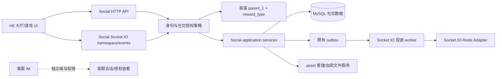

# 社交模块设计

阶段：平台级需求设计，首版范围供审核。社交模块包括公开社区与私密交流，与客服 IM 分属不同领域、不同授权和数据留存规则。用户已确认：若用户绑定的直属上级 `parent_1` 的 `reward_type` 为客损模式，则该用户不能看到或使用社交模块。

## 1. 产品范围

社交模块分为“社区”和“私信”两个入口，共享同一社交授权门禁，但使用独立的内容模型和可见范围。

社区功能：

- 发布帖子、跟帖/回复、按专属话题浏览；话题由运营后台创建和管理，帖子首版关联一个主话题。
- 帖子可带统一 Asset 管理的图片、动图和视频；支持举报、审核隐藏/恢复和有期限的管理员置顶。动图/视频需校验实际媒体格式、时长、尺寸和解码兼容性，前端不得仅依赖扩展名判断。
- 回复最多一级嵌套，避免无限层级带来的排序、通知与审核复杂度。
- 首版按时间倒序展示，不做依据充值、输赢、代理关系或行为画像的个性化排序。

熟人交流功能：

- 好友申请、同意/拒绝、好友列表与删除。
- 一对一文字/emoji 消息、图片/动图/视频附件、历史消息分页及已读位置；所有附件经统一 Asset 管理。
- 游戏房间内的短消息与邀请入口（仍使用社交授权判断）。
- 在线/离线与最后活跃提示复用平台 presence，不另存会话表。
- 屏蔽用户、举报消息/用户、基础频率限制和后台处置入口。
- 附件允许 JPEG/PNG/WebP/AVIF/GIF 图片及 MP4/WebM 视频；服务端校验实际格式、大小、归属、好友关系和授权，不信任客户端 MIME/文件名。陌生人只可按首句规则发送文字；图片、动图、视频均限好友间发送。消息引用 asset ID 与展示元数据，不把二进制塞进消息 DTO。

**媒体边界校准：** 社区帖子与私信共享统一 Asset 生命周期。现有生产 HTTP 仍没有 Asset 上传会话、密钥封装/授权读取、续传与媒体元数据端点；客户端已有 AES-128-CTR/HMAC 分块流原语。Browser API 私信演练现可把加密后的字节 Blob 持久化到 IndexedDB `assets` store，消息仅保存 asset ID/元数据，并按会话双方授权解密预览。演练密钥也保存在本机 IndexedDB，因此这只是本地流程与 DTO 验证，不代表生产密钥安全。生产接入必须由 Asset 服务负责密钥封装/授权、分块传输与撤销；未完成前不得将本地 asset 演练描述为生产上传闭环。公开社区媒体控件仍保持关闭。

首版不提供全站实时公开聊天室、语音/视频通话、群聊和端到端加密。公开社区帖子不自动允许读者私信作者。群聊可后续增加，待成员授权、退出、封禁和消息保留规则确定后再做。

## 2. 领域边界



帖子、回复、话题、好友、会话、消息、屏蔽和举报属于 `social` domain；客服 IM 仍属于 `support` domain。普通社区审核权限不自动包含私聊读取权；获授 `AGENT_SOCIAL_READ_PRIVATE_MESSAGES` 的代理可读取本域私聊。代理域启用后，社区内容、好友和会话都带服务端写入的域 scope；不同域的读取和写入默认隔离，平台公共 scope 独立。用户直属客损上级的 social gate 控制用户本人社交功能；域代理读取其管理范围历史内容走独立 `AgentDomainAccessPolicy`，不能据此重新开放该用户的社交操作。完整域授权规则见[代理域设计](./代理域设计.md)。

社交服务不能直连钱包、代理结算或游戏结果。社交事件只描述消息、好友关系、举报和在线状态，不以社交消息触发奖励、返佣或概率配置。

## 3. 客损模式授权规则

此社交访问门禁同时覆盖玩家社区、好友/私信和[金币集市](./社区论坛私信与金币集市SDD.md)。直属上级 `reward_type=LOSS` 时，以上入口全部不可见，且相应 API/Socket 统一拒绝；不得只隐藏论坛入口而让金币集市或私信深链继续可用。

授权由服务端基于当前有效邀请绑定计算：

```text
social_enabled(user) =
  true                         if user has no parent_1
  true                         if parent_1.reward_type == RECHARGE_REBATE
  false                        if parent_1.reward_type == LOSS_REBATE
```

`reward_type` 使用代码常量；不接受客户端提交的 `parent_1`、`reward_type` 或 `social_enabled` 作为授权依据。系统通过共享 `SocialAccessResponseDto` 返回社交可见性，H5 据此隐藏导航入口；这只是 UI 表现，所有 HTTP API、Socket.IO 事件、好友搜索/申请、消息收发、历史查询和房间邀请也必须在服务端做同一授权校验。失败返回统一的功能不可用结果，避免借错误差异探测绑定关系。

绑定关系变化、Admin 换绑、直属上级 `reward_type` 修改后，下一次用户请求立即按新值校验，并向在线客户端推送 `capabilities.updated` 以刷新界面。H5 使用 `GET /api/v1/me/social/access` 读取共享 `SocialAccessResponseDto` 并隐藏社区入口；Redis capability 缓存必须带短 TTL/版本，敏感写操作不得只信缓存；变更时主动失效。社交历史数据保留，不因功能关闭而删除。禁用状态期间用户社交写入和读取入口均拒绝，包括已存在会话；恢复允许时再按原规则访问。获授代理可以只读审查其域内内容，不代表用户本人获得社交使用权限。若换绑导致私聊双方落入不同域，整段会话随换绑用户迁移并在迁移完成后转为只读；原域另一方失去读取及发送权限，双方以后同域时可恢复正常互动。

此处只检查直属上级 `parent_1`，不检查更远的 `parent_2–parent_4`。上级自身的代理角色不会自动替代其 `reward_type`；字段来源仍以 user/referral binding 的权威关系为准。

## 4. 核心流程

### 4.1 好友申请

1. 用户先通过受控的好友码/用户名精确查找，避免任意枚举 user ID、手机号或邮箱。
2. 服务端验证申请双方均开启社交、没有互相屏蔽、未达到申请频率/待处理数量上限。
3. 创建或更新唯一 user pair 的关系状态；重复请求返回同一待处理结果，不产生重复好友边。
4. 对方通过 HTTP 拉取列表，在线时另经 Socket.IO 收到通知。Socket 只做提示，MySQL 关系状态为准。

### 4.2 私聊消息

1. 发送端提供 `client_message_id` 幂等键、会话 ID、文本和可选 asset 引用。
2. 服务端重新校验双方社交授权、会话成员、屏蔽关系、文本长度、附件归属/可读性和频率限制。
3. 消息及可靠投递 outbox 在同一 MySQL 事务提交；同一个 `client_message_id` 重试返回原消息。
4. 在线接收端经 Socket.IO 收到消息通知；断线端通过 HTTP 使用游标补拉。多节点采用官方开源 `@socket.io/redis-streams-adapter` 做跨节点广播，并可用于短暂连接中断后的 Socket.IO connection-state recovery；它不是长期消息归档或业务可靠队列。消息仍先持久化到 MySQL 并写 outbox，HTTP 游标负责权威补拉。Streams 有配置的最大长度，会裁剪旧包，不能代替消息历史。[Socket.IO Redis Streams Adapter](https://socket.io/docs/v4/redis-streams-adapter/) [Socket.IO 投递保证](https://socket.io/docs/v4/delivery-guarantees/)
5. 已读只记录会话的 `last_read_message_id` 或等价游标，不要求每条消息都写一行已读记录。

6. 消息详情使用 `/messages/private/:conversationId` 全屏二级路由。由会话列表打开时，返回回到会话列表；从他人主页私信时，返回回到原主页。详情隐藏一级导航，顶部固定返回、头像/昵称和刷新入口，消息区独立滚动，编辑区固定在底部安全区内。
7. 消息正文可以为空但必须有正文或附件；一条消息最多关联 4 个附件。前端先校验文件大小与签名，再经 AES-128-CTR + HMAC 分块加密，发送消息时只提交 asset ID 和展示元数据。好友可发送图片、GIF 和视频；陌生人只能发送文字，直到对方回复并开放当日交流。emoji 作为 Unicode 正文发送。发送失败保留正文与待发文件，成功后清理本机临时预览 URL。
8. 首屏仅自动解密最近 5 条消息的附件；更早附件由用户点按后加载，避免打开会话时一次拉取整段历史媒体。只允许 JPEG/PNG/WebP/AVIF/GIF 与 MP4/WebM；本机演练上限 50 MiB/附件、4 个/消息。此数值为开发版产品上限，生产应由系统配置和 Asset handler 再次校验。

发送时和读取时都再次校验授权，以防能力变化后通过旧 Socket 或旧会话继续操作。

### 4.3 屏蔽与举报

- 屏蔽立即禁止双方互相发起新消息/好友申请，并从默认好友搜索结果中隐藏；历史消息按保留策略不被静默删除。
- 举报保存被举报内容的 message ID、原因代码和最少必要证据；后台审查记录操作者与处置结果。
- 限流按 user、设备、IP 风险信号和会话组合实施；IP 只能作为反滥用信号，不可用于决定游戏概率或社交内容差别化。

### 4.4 社区发帖、跟帖与话题

1. 社区 feed 和话题页按 `topic_key + created_at/id` 游标分页；排序字段由服务端固定，不接受客户端任意排序表达式。
2. 发帖时校验话题启用状态、用户社交授权、正文长度、附件 asset 所有权、频率限制及审核策略。内容状态可配置为发布即展示或待审核，状态使用代码常量且不得为 0。
3. 回复必须属于同一帖子；引用回复最多一层。隐藏内容不进入普通 feed，但保留必要的举报证据及管理审计。
4. 新帖/回复提交后通过 outbox 生成通知；通知只是提示，正文通过 HTTP 拉取。管理员置顶必须设置到期时间并记录操作者和理由。
5. 屏蔽作者后，建议将其帖子/回复从屏蔽者的 feed 隐藏，并禁止双方互动；屏蔽不删除历史内容或审计记录。

社区所有读取入口（包括话题列表、公开链接、帖子详情、回复和搜索）均执行社交授权。直属上级为客损模式的用户不能通过分享链接绕过门禁。

### 4.7 他人可见的社区用户主页

社区帖子作者和回复作者可以点击进入只读的“用户主页”。主页是社区内二级页面，保留统一底部一级导航；从帖子流进入时返回原话题和滚动位置，从帖子详情/回复进入时返回原帖子及展开状态。路由使用不透明的 `publicProfileKey`（由既有 `user.public_code` 映射），不得把内部 `userId`、手机号、邮箱、邀请链或资产信息放入 URL 或公开作者 DTO。`SocialPostDto` / `SocialPostReplyDto` 使用服务端生成的 `authorProfileKey`，公开主页 endpoint 返回单独的最小 DTO，不复用 `SocialOwnProfileResponseDto` 或好友查找 DTO。

- 头像 `avatarAssetId`（无头像时用统一默认头像）、脱敏展示名 `displayName`、可选自述 `bio`（仅用户主动填写且符合长度/审核规则时返回）、加入时间、公开好友码 `publicCode`、可见帖子列表及分页游标。没有自述时不占空白区域。加入时间只显示年月，不公开精确注册时间。
- 公开游戏画像包含近 30 天总体胜率、近 30 天赢取金币，以及近 30 天最常玩的前 3 款游戏；每款常玩游戏卡片在游戏名下展示该游戏最近 5 局的“赢/输/平”结果和日期，不展示跨游戏逐局列表。有效局按游戏 handler 标准化结果：玩家本局游戏资产净变化（结算后游戏金币减去本局开始前游戏金币）大于 0 为赢、小于 0 为输、等于 0 为平；取消、未结算和练习局排除。近 30 天胜率 = 近 30 天有效局中的赢局数 ÷（赢局数 + 输局数），平局不进入分母；无有效局时显示“暂无记录”。近 30 天赢取金币 = 同一统计期内所有净变化大于 0 的已结算局净赢金币之和，输钱局不冲减该值；DTO 以十进制字符串传输，避免大整数精度损失。常玩游戏按近 30 天已结算局数倒序，最多显示 3 款，平手按稳定 game key 排序。此为公开社交摘要，不含 RTP/赔率或后台运营配置。
- 展示已完成的金币集市成交笔数：只计该用户作为买方或卖方参与、且状态为已完成的独立 `coin_market_trade`，一笔部分成交订单计一笔；取消、争议未决和失败交易不计。只显示总笔数，不显示买卖方向、对手、金额、收款方式或收款材料。
- 公开主页展示 `publicCode` 与二维码入口。二维码编码为主页 HTTPS 落地 URL（含 `publicProfileKey`，不含 user ID、好友码、联系方式或 JWT）；扫码进入主页，并可从主页查看公开好友码。好友查找二维码 `LG-FRIEND:<publicCode>` 仍属于“我的”好友码，不能混同为主页分享码。
- 只显示已发布且当前 viewer 有权读取的帖子；排除待审核、隐藏、已删除内容。帖子卡片复用社区卡片及“更多”交互，打开帖子详情后可回复（仍校验双方社交权限、域 scope、屏蔽与内容状态）。不展示关注/粉丝/好友数量、在线状态、资产、充值/提现、邀请关系或代理信息。
- 其他用户主页资料卡直接显示“关注/已关注”和“私信”，不放进“更多”；私信始终按陌生人首句、好友关系及屏蔽规则校验。右上角“更多”包含“加好友”（已是好友时隐藏，收到申请时为“处理好友申请”，已发申请时显示禁用的“申请已发送”）、“分享”“举报”“拉黑/取消拉黑”；本人主页只提供分享。举报选择原因并可补充说明，防止重复提交；拉黑须二次确认。关注状态与内容关注共用 `social_interactions`，不增加表；拉黑关系也复用该存储。拉黑后对方帖子/回复从本人 feed 隐藏，好友列表隐藏，关注、好友申请、会话打开、消息读取与发送均拒绝。被对方拉黑的主页按统一不可用结果处理。
- “分享主页”生成一张站内风格分享卡，包含头像、脱敏展示名、简短自述、常玩游戏（最多 3 款）、近 30 天胜率、好友码和主页二维码/短 URL；不包含逐局输赢、集市成交笔数或任何金额。使用 Web Share API 分享图片/链接；不支持时提供保存图片、复制 URL 两个降级动作。卡片由客户端按固定模板生成，不上传为用户 asset、不把原始密钥或 JWT 写入图片。
- “私信”沿用陌生人首句规则：非好友仅允许每天一条开场文字消息；对方回复后当天可继续发文字，图片仍限好友。点击 CTA 后进入现有 `/messages` 私信分类及对应会话；发送首句后展示已确认的温馨提示。不是好友时主页不提供图片/附件入口。
- 资料卡内“加入于 YYYY 年 MM 月”下方直接显示用户唯一码；点击唯一码复制，旁边的小二维码图标打开主页二维码弹层。二维码只编码主页 HTTPS 落地 URL，不授予额外访问权限。
- “常玩游戏”和“动态”合并为主页内容区域的两个 Tab，默认打开常玩游戏；帖子、空态和回复详情入口在动态 Tab 中展示。切换 Tab 不创建新路由或重置主页来源返回位置。
- 每篇帖子及回复的“更多”增加“分享帖子”。生成站内海报图片，展示作者脱敏名/头像、话题、标题、经审核的正文摘要、最多一张已授权可读的媒体缩略图和帖子落地页二维码/URL；不将评论、私信、内部 ID 或举报状态带入海报。海报客户端生成，可保存/系统分享；分享链接仍访问时重新校验当前 viewer 的 social gate、域 scope、内容状态和屏蔽关系。对加密媒体，只有当前用户有权解密时才可将缩略图绘入海报；否则不显示缩略图。
- 用户主页及作者帖子必须受 SocialAccessPolicy、屏蔽关系、审核状态和代理域 scope 一致约束。跨代理域不得通过公开 key 读取非当前域内容；公共 scope 内容按公共 scope 规则读取。客损模式用户不能访问主页深链，统一返回社交功能不可用，不透露其上级类型或具体原因。
- 无资料/无公开帖子展示友好空态；用户不存在、已注销/不可见、被屏蔽、域不可见和权限关闭对外采用不泄露存在性的统一不可用结果。加载、分页失败、网络重试和返回位置恢复均有明确状态。主页不提供编辑入口；自己的资料维护仍走“我的”。

建议的共享契约（后续落入 `packages/contracts/src/social.ts`，当前仅作 SDD，不代表已实现）：

```text
GET  /api/v1/social/users/:publicProfileKey
GET  /api/v1/social/users/:publicProfileKey/posts?cursor=...
POST /api/v1/me/social/users/:publicProfileKey/friend-request
POST /api/v1/me/social/users/:publicProfileKey/block
POST /api/v1/me/social/users/:publicProfileKey/report

SocialPublicProfileDto = {
  publicProfileKey, publicCode, displayName, avatarAssetId: string | null, bio: string | null,
  joinedMonth, recentWonCoins: decimal-string,
  recentWinRate: { wins, losses, draws, rateBps: number | null, periodDays: 30 },
  favoriteGames: [{ gameKey, gameName, settledRounds, recentResults: [{ result: WIN | LOSS | DRAW, settledAt }] }], completedCoinMarketTradeCount,
  profileLandingUrl,
  relationship: NONE | REQUEST_SENT | REQUEST_RECEIVED | FRIEND,
  followedByMe: boolean, blockedByMe: boolean, reportedByMe: boolean,
  capabilities: { canViewPosts, canReply, canMessage, canSendImage }
}
SocialPublicProfilePostPageDto = { items: SocialPostDto[], nextCursor: string | null }
SocialPublicShareCardDto = { displayName, avatarAssetId, bio, favoriteGames, recentWinRate, publicCode, profileLandingUrl }
SocialPostShareCardDto = { authorLabel, authorProfileKey, topicTitle, title, safeExcerpt, thumbnailAssetId: string | null, postLandingUrl }
```

`capabilities` 只是让 UI 选取正确动作的服务端提示，不取代每个命令和读取端点的授权校验。作者 DTO 的 `authorProfileKey` 与展示名由服务端生成，客户端不能提交/改写作者身份。公开统计需由游戏结算/集市成交权威数据产生，不能由前端累加；游戏 handler 必须输出稳定的有效结算结果分类。若帖子作者以后允许隐藏主页或限制公开范围，应在引入隐私设置之前补充可见范围常量和默认策略；当前按已发布社区内容可被同 scope 社区成员查看执行。分享链接/二维码是访问入口，不是访问授权凭证。

**主页设计闭环检查：**

- ✅ 入口、来源返回、关系 CTA、帖子浏览、分享主页和分享帖子均已定义。
- ✅ 每款常玩游戏最近 5 局输赢、近 30 天胜率、赢取金币（获胜局净收益合计）、常玩游戏、集市完成成交数和加入月份口径已定义；不展示跨游戏逐局结果列表。
- ✅ 公开号码、主页落地 URL/二维码、分享卡降级行为及帖子海报内容已定义。
- ✅ 客损门禁、代理域隔离、屏蔽、审核、陌生人消息规则和敏感字段边界已定义。
- 🟡 共享 DTO、Browser API、用户主页、关注状态、主页/帖子二维码海报和本地演练已实现并通过前端测试；真实游戏结算统计、生产集市成交统计及服务端权限尚未接入，不能标为生产闭环。

### 4.7.1 当前 H5 / Browser API 实施边界

作者导航字段、公开主页 DTO、主页帖子读取、举报/拉黑操作及路由返回恢复已接入共享 contracts、Social application 与 IndexedDB Browser API；主页和分享海报由 Vue 页面及浏览器 Canvas 生成，二维码使用项目 `qrcode` 依赖。主页 QR 指向 profile landing URL，帖子 QR 指向帖子落地路由；可用系统分享时分享图片/链接，不支持时可保存 PNG 或复制链接。生成图像不上传 Asset，也不包含认证凭证。拉黑记录复用 `social_interactions` IndexedDB store，不新增 store；本机演练中的举报也暂存为互动记录，不代表已进入生产审核工作台。

本机演练数据和生产事实必须区分：仅 `isDemoFixture` 用户使用确定性演示结果生成近 30 天胜率、Top 游戏及每个游戏最近 5 局结果和样例交易数；真实本机用户在没有游戏结算来源时显示暂无记录，集市成交数仅从本地已完成交易读取。生产端必须由授权后的游戏结算与集市交易查询生成这些统计，再经 HTTP DTO 返回；客户端不得伪造或长期缓存权威统计。当前社交 Browser API 尚无生产服务端授权、跨代理域隔离及生产屏蔽/举报审核链路，依赖真实社交服务后才能完成安全验收。

浏览器验收已确认 Chrome DevTools 中主页简介/加入月份、近 30 天胜率和赢取金币、Top 游戏及每款最近 5 局、集市笔数、可复制好友码、关注/私信、双 Tab 和“更多”菜单可见；主页二维码弹层已实际生成 SVG，尺寸 420×375，图片自然宽度 240px。Browser API 测试覆盖关注状态、唯一码复制/二维码、主页 Tab、举报记录、拉黑/取消拉黑及好友私信入口。桌面实测视口为 1200×2029，profile 宽 900px、高 561px；根 document scroll/client 为 1185/1200 × 2029/2029，无页面溢出。当前 DevTools 视口固定，无法切换到代表性手机视口，因此 Mobile 几何验收仍未完成。

### 4.5 当前前端离线演练边界

玩家 H5 的“话题广场”使用共享 `packages/contracts/src/social.ts` DTO/TypeBox schema、纯领域校验、application use case 和 `SocialRepositoryPort`。演练话题是包内可替换的本地目录配置；帖子与回复作为两个领域实体保留，通过一个按 `contentType` 区分的 IndexedDB `social_content` store 保存，仅对话题 feed 和帖子回复建立查询索引；记录中的 `ownerUserId` 用于标记本人内容。Browser API composition 从当前 JWT session 提供 actor；无有效本地会话时 application 拒绝读写。帖子/回复在提交后写入本机 IndexedDB，刷新或重建 application 后可继续读取；这仍不写入生产数据库、资产服务、公开服务端 feed 或真实通知。直属上级 `reward_type` 策略由 `SocialAccessPolicy` 读取本地 `referral_bindings`/users，经共享 `SocialAccessResponseDto` 提供入口状态；Browser API 对所有社交私有端点重复执行策略，客损上级会得到统一 `SOCIAL_ACCESS_DISABLED`。离线流程只证明本地页面可操作，不能据此记录真实发布成功或生产授权已完成。

离线话题流程支持按话题查看空态、创建纯文字帖子、读取回复、添加回复和表单取消/修正；回复最多一层。DTO schema 当前约束帖子标题最多 80 字、正文最多 2000 字、回复最多 1000 字、附件引用最多 4 个。

好友与私信已增加独立的 `LOCAL_BROWSER_SERVER` 纵向流程：授权用户可查看自己的好友码及二维码，以好友码或完整用户名精确查找用户，发起、接受或拒绝好友申请，删除好友关系，在好友间建立一对一文字会话，发送消息、幂等重试并按 HTTP 拉取最近 100 条消息。请求通过共享 TypeBox DTO/endpoint、JWT dispatcher、`SocialFriendsUseCases` 和 `SocialFriendsRepositoryPort`，由 `IndexedDbSocialRepository` 承担持久化；业务状态转换不直接访问 IndexedDB。关系和消息写入 IndexedDB，刷新后保留；每个 Browser API endpoint 均验证本地 JWT，客户端不能指定消息发送者。好友码为随机不透明代码，不暴露 user ID；生产 `SocialOwnProfileResponseDto.friendCode` 映射既有 `user.public_code`（唯一索引），本地 adapter 使用 users store 的 `friendCode` 同义字段，不新增生产表；二维码载荷固定 `LG-FRIEND:<friendCode>`，查找 API 接受好友码/扫码载荷/完整用户名，不接受邮箱、电话或 user ID 搜索。此实现仅用于浏览器开发数据，不能替代生产 SocialAccessPolicy、域 scope、限流、屏蔽、outbox/Socket.IO 可靠投递，也不能代表客损 gate 已实现。当前 Browser API 的直接消息为文字；图片上传/发送尚未接通，不得以未加密 Blob 或 URL 假装已支持图片。

**陌生人首句规则（HTTP application 必须校验）：** 双方未建立有效好友关系时，每个上海自然日（`Asia/Shanghai`）最多由一方先发送一条文字消息。接收方回复后，当天剩余时间双方均可继续发送；跨自然日后，重新适用一条首句规则。若当天没有回复，首发方不能再发第二条，接收方仍可回复。成为好友后不受该限制。查看历史消息不产生回复状态；好友关系被解除后再次按陌生人规则执行。前端按钮禁用只是提示，真正限制必须在 `SocialFriendsUseCases` 执行，并由生产事务原子保存消息与会话状态。首句发送成功后，发送端显示温馨提示，说明单条首句、回复后当日可继续交流、图片仅限好友互发及谨慎分享个人/收款信息；提示可关闭，不影响已经成功的消息。

**私信图片规则：** 图片消息必须满足当前好友关系，且消息引用发送者有权使用的 READY 私有 `asset_id`；服务端校验关系、资产所有权、状态、MIME/资源策略后才接受。社交好友限制和统一 asset 的客户端 AES-128-CTR + 分块完整性校验要求同时生效。当前 H5/Browser API 没有完整的 asset 上传和图片消息 DTO 链路，因此本轮只落实“好友方可发送”的产品规则，不提供虚假的图片发送控件；实现图片发送前必须先接通受加密资产客户端约束的上传、授权读取与消息提交链路。

**本地社交演示数据：** Vite 开发运行态首次访问时，在当前浏览器 IndexedDB 创建固定的合成社区帖子/回复、3 种好友关系（已接受、待处理入站、待处理出站）、好友和陌生人会话。测试模式不注入演示数据；数据不得发送到服务端或用于生产账户。金币集市本地演示通过现有挂牌创建用例写入三条合成卖家挂牌并冻结演示金币，卖家展示名前缀为“演示”，收款说明明确标注虚构；用户可用真实测试账号查看挂牌/成交流程，但本机演示数据不构成真实交易。

好友离线流程包含精确查找、无结果、重复申请、待处理入站/出站、通过/拒绝、好友删除二次确认、好友列表、打开私信、空消息态、发送失败保留草稿及重试；服务端 use case 校验双方身份和好友关系。删除好友后保留既有会话历史，但不允许继续发送，后续可重新申请并恢复关系。会话页每次打开通过 HTTP 拉取历史，故刷新与掉线后的基本恢复不依赖 Socket。真实服务仍需补充共同的 SocialAccessPolicy、代理域授权/迁移、unread/read cursor、消息完整游标、Socket 推送与 outbox。

### 4.6 Agent 域私聊只读审查

`AGENT_SOCIAL_READ_PRIVATE_MESSAGES` 与终端用户自己的 social gate 是两套授权：直属客损上级仍会关闭该用户的社区/好友/私聊；获得 capability 的代理可按代理域政策读取其域内社交内容。客服 IM 属于 support domain，不从 Agent 社交端点返回。代理域私聊先读不含消息正文的会话摘要；打开详情时发送明确的敏感读取命令：

| Method | Path | 请求/响应 | 约束 |
| --- | --- | --- | --- |
| `GET` | `/api/v1/agent/social/conversations` | `AgentSocialConversationListRequestDto` → `AgentSocialConversationListResponseDto` | 只返回当前域会话、双方展示名、条数与最后活动时间；不包含消息预览，不接受客户端 domain/user ID |
| `POST` | `/api/v1/agent/social/conversations/:conversationId/detail-reads` | `AgentSocialConversationReadRequestDto` → `AgentSocialConversationReadResponseDto` | 必填读取目的和 requestKey；服务端再验 user、域 ACTIVE、capability、会话当前域与参与方；原子写成功/拒绝 `agent_audit_event` 再返回消息正文 |
| `GET` | `/api/v1/agent/social/moderation-cases` | 复用 `SocialModerationQueryDto` → `SocialModerationListResponseDto` | `AGENT_SOCIAL_MODERATE`；服务端固定当前域过滤，只返回公开帖子/回复举报与审核上下文 |
| `POST` | `/api/v1/agent/social/moderation-cases/:caseId/decisions` | 复用 `SocialModerationDecisionRequestDto` → Agent 决策响应 DTO | 必填决定/理由/requestKey；复用社交纯状态转换；内容状态更新与 `SOCIAL_MODERATION_DECISION` audit 在一个事务中提交；响应审计 actor 是统一 user ID，不伪装成 Admin |

共享 TypeBox schema 位于 `packages/contracts/src/agent-social.ts`。同一 requestKey + conversation + reason 的重试返回同一只读结果；复用到不同资源或目的时冲突。审计只记资源类型/会话 ID、目的、结果和消息数量，不复制正文、附件密钥或消息快照。越域/不存在的会话采用不可枚举响应并追加拒绝审计。域迁移期间暂停访问；绑定提交后旧域立即失去会话查询及详情读取权限。

当前 Agent 页面使用内存内固定 `LOCAL_DEMO` 合成会话与消息，并复用 Admin 已有本机演练的 `social_moderation_cases` 样例，仅筛出 `agentDomainId` 与当前 demo scope 相等的案件；不从用户 H5 的 IndexedDB、客服队列或生产数据复制内容，也不创建社交内容表或额外 store。私聊详情读取审计、社区审核决定审计追加到既有 `agent_audit_events` store；社区决定与案件当前状态同一事务写入。此方式用于本机页面/授权/审计流程演练，不代表服务端已启用 capability、域过滤或真实数据审查；生产必须实现以上 endpoint 并复用同一 DTO。

发帖编辑器草稿属于尚未提交的客户端视图状态，不进入业务 DTO，也不写入本地持久存储。用户切换专属话题时，当前草稿按 `topic_key` 暂存在组件状态，返回原话题后恢复；取消编辑或发布成功后只清除该话题草稿，避免内容误投到新选的话题。

### 4.6 Admin 社区内容审核

Admin 社区审核页已使用共享 `SocialModerationCaseDto`、`SocialModerationDecisionRequestDto`、`SocialModerationAuditDto` 和 `SocialModerationEndpoint`。队列按资源类型、处置状态、关键词过滤并使用稳定 cursor 翻页；点击审核项读取脱敏作者、原文、话题、举报原因摘要和举报人数。审核/处置命令必须带不少于 3 个字符的原因和唯一 `requestKey`，不接受 Admin 页面提交的 reviewer 身份。

领域迁移规则：`APPROVE` 仅允许 `PENDING_REVIEW → PUBLISHED`；`HIDE` 将公开或待审内容设为 `HIDDEN`；`RESTORE` 仅允许 `HIDDEN → PUBLISHED`；`DISMISS` 只关闭举报、不改变内容状态。内容状态变化与举报 case 关闭、Admin 审核记录必须在生产服务端同一 MySQL 事务内完成。相同 case/动作/原因的 `requestKey` 重放返回原审计结果；同 key 改变参数拒绝；非 OPEN case 不允许新处置。此页不封禁用户；涉及账号安全的建议必须交给独立账号安全流程。

本机 `LOCAL_DEMO` 经共享 DTO runtime validation、`SocialModerationApplication`、纯 `applyModerationDecision` 领域函数和 Admin 专用 IndexedDB adapter 运行。`social_moderation_cases` 与 `social_moderation_audit` 是对现有 `social_report`/内容状态/`admin_audit_event` 边界的本机演练 stores，不与玩家社区 IndexedDB 内容互通，也不代表线上举报或生产 Admin capability。真实 JWT、capability、代理域数据授权和 MySQL 审计事务仍由服务端实现。

## 5. 数据设计方向

社区内容与私信是不同实体，不能混用一张泛型内容表。首版建议使用以下社交领域表；附件复用平台 `asset`，在线状态复用 Redis/presence，可靠通知复用既有 outbox：

| 表 | 支撑功能 | 核心字段方向 |
| --- | --- | --- |
| `social_topic` | 专属话题目录 | `topic_key`、名称、说明、可选封面 `asset_id`、排序和启停状态；topic key 唯一 |
| `social_post` | 社区帖子 | `user_id` 作者、`social_topic_id` 主话题、标题/正文、内容状态、置顶截止时间、审核字段、可选封面 `asset_id` |
| `social_post_reply` | 跟帖/回复 | `social_post_id`、`user_id` 作者、可空 `parent_social_post_reply_id`、正文、内容状态和审核字段；回复深度限制一层 |
| `social_friendship` | 好友申请/关系 | 规范化 `low_user_id/high_user_id`、`requester_user_id`、关系 `status`；pair 唯一约束 |
| `social_conversation` | 一对一会话与列表排序 | `low_user_id/high_user_id`、消息序号高水位与双方已读序号、陌生人首句等待方和开放日期；pair 唯一约束 |
| `social_message` | 文本/图片消息、补拉、幂等 | `social_conversation_id`、`sender_user_id`、`client_message_id`、`message_type`、`content`、可空 `asset_id`、发送时间；sender+client key 唯一约束 |
| `social_block` | 用户屏蔽关系 | `blocker_user_id`、`blocked_user_id`、状态；有向 pair 唯一约束 |
| `social_report` | 帖子/回复/用户/私信举报与审核处置 | `reporter_user_id`、目标类型与目标 ID、原因、状态、处理人员/时间、处置说明；目标类型用常量 |
| `social_content_interaction` | 用户对帖子/回复点“不喜欢”、关注作者及重复操作幂等 | `actor_user_id`、目标类型与目标 ID、`action_type`、状态；用户/目标/动作唯一约束。举报本身仍用 `social_report`，不在此重复建案 |

首版每帖只有一个主话题，因此不建多对多关联表；将来确认一帖多话题后再增加 `social_post_topic`。群聊开放时再评估独立 conversation member 表；首版一对一会话不需要泛化成员映射表。

九张表各自支撑话题、帖子、回复、对称好友关系、一对一会话、消息、单向屏蔽、举报及用户内容互动的独立生命周期；互动使用一张带目标类型的表容纳帖子/回复上的 dislike 和作者关注，不为每种按钮扩一张表；为保持首版精简，不再增加会话成员、帖子话题关联、附件映射、通知收件箱或每条消息已读表。回复和消息分别通过帖子/会话继承域 scope，不重复存储。`low_user_id/high_user_id` 是指向 user 表的角色化外键，遵循 `<role>_user_id` 命名纪律。

所有新表均遵守仓库[数据库设计规范与 Sequelize](../05_data/数据库设计规范与Sequelize方案.md)：`id BIGINT UNSIGNED`、所有状态/类型常量从 1 起、`created_at/updated_at/deleted_at DATETIME(3)`、小写 snake_case、表/字段注释、所有引用使用目标表名结尾的字段和 `BIGINT UNSIGNED`；不可变消息/审计按保留策略追加，不物理删除。若好友/会话的撤销或隐藏由状态表达，`deleted_at` 仍保留通用字段但不代替业务状态。物理字段、索引与九张表的功能映射以数据库 SDD 为准。

字段草案不是最终 DDL；落实数据库 SDD 时要补充每个状态常量、唯一键、外键策略、索引、消息保留/删除规则和 Sequelize migration 顺序。

## 6. 图片与资产安全

社交图片使用全站 asset 管理，不新增绕过资产系统的上传路径：

- 浏览器端生成文件密钥并用 AES-128-CTR 加密后上传；服务端存储密文和必要 nonce/算法版本元数据，不把密钥写入公开 asset manifest。
- 消息保存 `asset_id` 引用；发送者、会话另一方以及经过独立客服授权的查看流程才可获取受控解密材料。不能把密钥放在永久公开 CDN URL 中。
- 渲染层按用户授权请求解密 API/流式资源；PixiJS 游戏美术若属于公开静态素材，需与用户内容加密附件区分策略，不能把图片 AES-CTR 误当成防复制或完整性认证方案。
- 文件大小、MIME 类型、图片解码尺寸、恶意文件扫描、限速和到期清理由 asset service 统一负责。消息/asset 关联删除要按用户确认的保留和审计规范执行。

## 7. API 与 Socket.IO 事件建议

HTTP 用于可靠读写与断线恢复；Socket.IO 用于实时提示：

```text
HTTP
GET    /api/social/capabilities
GET    /api/social/topics
GET    /api/social/topics/:topicKey/posts?cursor=...
GET    /api/social/posts/:id
POST   /api/social/posts
POST   /api/social/posts/:id/replies
POST   /api/social/posts/:id/reports
GET    /api/social/friends?cursor=...
POST   /api/social/friend-requests
POST   /api/social/friend-requests/:id/accept
GET    /api/social/conversations?cursor=...
GET    /api/social/conversations/:id/messages?before=...
POST   /api/social/conversations/:id/messages
POST   /api/social/blocks
POST   /api/social/reports

Socket.IO client → server
social:conversation:subscribe
social:message:send       # 可选；也可统一走 HTTP
social:message:read

Socket.IO server → client
social:friend-request
social:message:new
social:message:read
social:presence:changed
capabilities:updated
```

每个事件使用带 schema version 的 envelope、`event_id`、服务端时间、幂等键/游标；room membership 由服务端根据 JWT 身份和会话成员校验后加入，不能由客户端指定任意 user room。事件 payload 不包含手机号、邮箱、邀请链、JWT 或附件解密密钥。

## 8. 权限、安全和数据策略

- 普通用户只能访问本人作为成员的好友关系、会话和消息。Admin 不默认读取普通用户私聊；获授代理可查看本域私聊；两者查看消息正文都记录操作者、域/permission、会话 ID、目的和时间，不复制正文到审计。
- 客服仅经客服会话授权查看客服对话所需附件；客服 IM 权限与代理的本域社交读取权限完全分离。
- 客户端隐藏社交入口不等于授权；每个应用服务和 Socket handler 都调用统一 `SocialAccessPolicy`。
- 所有消息输入按纯文本保存/呈现，不渲染 HTML；URL 预览首版关闭，避免 SSRF/钓鱼。
- JWT 撤销、账号封禁、社交权限关闭时，当前 Socket 事件也要重新校验或立即断开相应 namespace/room。
- 采用平台统一内容保留期限和用户举报处理流程。社交消息的保留周期目前没有单独确认，落地 SDD 前需与客服文件“2 年”策略分开确认；不得自动把客服 IM 的两年期限套给社交消息。

## 9. 监控与验收

1. 无直属上级用户与直属上级 `reward_type=充值返点` 用户可按权限使用社交；直属上级 `reward_type=客损返点` 用户在 UI、社区 feed/话题/帖子/回复、HTTP、Socket、私信补拉和房间邀请所有入口均不可见/不可访问。
2. 修改直属上级模式或 Admin 换绑后，旧 JWT/旧 Socket 不可绕过社交禁用；在线端收到 capability 更新，服务端立即生效。
3. 好友申请、消息发送和附件引用均验证两端权限、阻止状态、会话成员及速率限制；重试不重复创建。
4. Socket 断线后通过 HTTP 游标补齐消息；Redis/Socket.IO 重启不丢 MySQL 已提交消息。
5. Admin/客服没有默认社交私聊读取权；域代理仅在 capability 授权且目标位于本域时可读取，所有读取与附件解密均有审计。
6. 图片密文、asset 引用、授权解密失败、过期资产和非法格式均有确定处理。
7. 所有新表符合 Sequelize 与通用字段约束；关系 pair/message 幂等键唯一性由数据库保证。
8. 社区发帖、跟帖、话题筛选、置顶过期、审核隐藏/恢复、举报处置和屏蔽规则通过权限与状态测试；客损用户不能通过帖子分享 URL 访问内容。
9. ✅ Admin 审核离线流程覆盖状态/类型过滤、稳定分页、通过/隐藏/恢复/驳回、必填原因、状态非法迁移拒绝、重复命令与审计历史读取；服务端 scope、capability 与审计事务仍待联调。

## 10. 待产品评审

- 社交消息具体保留期限、用户删除申请及举报证据留存期限。
- ✅ 好友发现支持好友码/二维码和完整用户名精确查找；未开放邮箱、电话或 user ID 搜索。生产环境是否允许运营关闭用户名搜索，作为后台配置待实现项。
- 房间聊天是否随十三张首版一起交付，还是先完成好友/私聊后再启用。
- 单条文本、图片大小、好友数、未处理申请数和频率限制的配置值。
- 客服何种授权条件可查看普通社交会话（默认不允许）；客服 IM 授权不能自动沿用。
- 社区审核方式、图片/视频范围、点赞/收藏是否首发。首版建议先支持文字和图片，不做视频及个性化热榜。
- 客户端加密附件用于公开社区时的密钥分发方式；公开帖子不能把文件密钥放在任何公开 URL/manifest 中。


## 变更历史

| 日期 | 变更 |
| --- | --- |
| 2026-10-10 | 按项目约束新增变更历史区块；未改动原有正文。 |
| 2026-10-10 | 按文档性质归档并更新相关链接。 |
| 2026-10-10 | 与数据库 SDD 对齐社交表字段名、代理域 scope 继承和首版最小表集。 |
| 2026-10-14 | 补充社区话题离线演练边界及共享 Social DTO/application/repository 分层；明确本地内容、回复限制、文本长度和未实现的附件/好友/私信范围。 |
| 2026-10-14 | 将离线演练边界保留在工程文档，不在话题广场占用页面空间展示未接入提示；提交动作使用中性文案。 |
| 2026-10-14 | 明确未提交发帖草稿按话题隔离并只保存在当前组件内存；切换可恢复，取消或发布后清除。 |
| 2026-10-15 | 按用户确认同时支持好友码/二维码与用户名；完成 JWT 保护的本地好友查找、申请/接受/拒绝/删除、好友列表、一对一文字私信、消息幂等及历史恢复，并将 IndexedDB 升级至 v4；生产授权、Socket/outbox、屏蔽举报和媒体消息仍待施工。 |
| 2026-10-15 | 将社区离线帖子/回复从页面内存改为 IndexedDB v8 单一分类型 store 持久化；验证登录 actor、作者归属、application 重建后恢复及未登录门禁。 |
| 2026-10-15 | 增加共享社交访问 DTO 与直属上级 reward_type 策略；开发端导航按能力隐藏，所有 Browser API 社交私有端点执行服务端式拒绝校验。 |
| 2026-10-18 | 将好友主页私信接入独立全屏会话二级路由，返回恢复来源页面；补充文字/emoji、图片/GIF/视频的 DTO 与授权规则，并以本机 AES-128-CTR/HMAC IndexedDB Asset 演练验证附件发送和授权预览边界。 |
| 2026-10-15 | 增加 Admin 社区审核共享契约与 DDD 离线流程；定义通过/隐藏/恢复/驳回迁移、必填理由、幂等 requestKey 和追加式审计，生产授权事务仍待服务端。 |
| 2026-10-16 | 增加 Agent 域私聊摘要与显式详情读取契约、purpose/requestKey、越域拒绝及不含正文的追加审计；说明合成 LOCAL_DEMO 不读取或持久化真实私聊。 |
| 2026-10-16 | 补充 Agent 当前域社区举报列表与处理 endpoint；复用社交状态机、既有本机举报 store，并规定案件状态和 agent 审计原子提交，不新增 store。 |
| 2026-10-16 | 明确直属客损模式访问门禁覆盖金币集市，社交/私信/集市入口统一隐藏且所有对应 API/Socket 同策略拒绝。 |
| 2026-10-16 | 增加帖子/回复“更多”菜单的不喜欢、关注作者和举报规则；用单一内容互动表承载状态。补齐陌生人每日首句、收到回复后当天畅聊、好友图片消息授权及本地演示数据边界。 |
| 2026-10-16 | 按产品要求扩充社区帖子媒体目标为图片、动图和视频；明确 Asset API/密钥授权链路未闭环前不开放明文文件上传控件。 |
| 2026-10-17 | 设计社区作者可点击进入的他人主页：定义匿名 profile key、社交/域/屏蔽/陌生人私信边界、来源返回位置与空错态；标记现有帖子作者 DTO 缺少安全导航标识。 |
| 2026-10-17 | 按产品补充公开游戏画像、近 30 天胜率口径、最近 10 局结果及金币净输赢合计、常玩游戏、集市完成成交笔数、加入月份、公开好友码/主页二维码及主页/帖子分享海报规则；明确分享海报不含具体输赢金额。 |
| 2026-10-17 | 记录他人主页与二维码分享的 H5/Browser API 实现边界、演示统计 fixture 与生产权威数据缺口；更新主页/分享检查项并记录桌面网格修复和移动视口未验收。 |
| 2026-10-17 | 修正同一分享弹层在主页/帖子类型切换时复用旧海报的情况；每次分享数据变化都重新生成对应落地二维码 PNG。 |
| 2026-10-17 | 按产品最新指示将逐局输赢改为按常玩游戏展示最近 5 局，不再展示全局近期净额；定义主页“更多”菜单的好友、分享、举报、拉黑及本机复用互动存储边界。 |
| 2026-10-17 | 校准浏览器验收记录为最新页面结构和视口尺寸，并记录举报/拉黑用例测试范围。 |
| 2026-10-17 | 更新他人主页：胜率并列展示近 30 天赢取金币，关注/私信移出更多菜单，唯一码支持复制及主页二维码弹层，常玩游戏与动态改为双 Tab；明确统计口径与 DTO。 |
