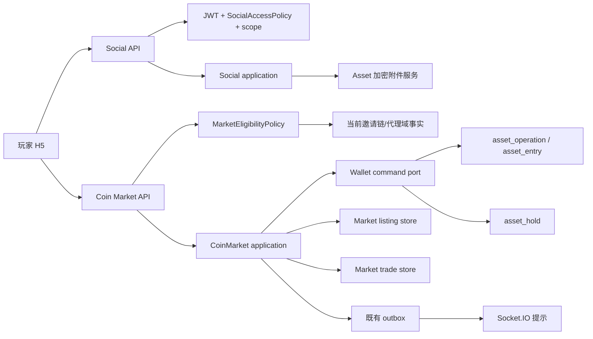

# 社区论坛、私信与金币集市 SDD

状态：论坛/私信按既有社交领域设计细化；金币集市核心交易与托管规则已确认。浏览器独立运行版本已完成买卖双方的本地纵向切片：公开挂牌浏览、挂牌收款方式/资料、卖方冻结、买方部分成交预占、买家提交付款说明、卖方确认后钱包转移、卖家申诉和双方文字补证。写操作通过共享 DTO、本机认证 API 和 IndexedDB 事务；它只是同一浏览器内的开发模拟，不构成真实付款、加密文件凭证、链上验款或生产托管。平台裁定/管理员延期复核、真实支付通道、加密 Asset 上传授权仍未闭环。本文件仍是产品/领域施工基线。玩家端页面与交互 checklist 见[后台与前台页面交互目录 §4.4](../06_ux/后台与前台页面交互目录.md)。

## 1. 目标与范围

将当前过度合并的“社区与私信”入口拆成清楚的玩家体验：

- **论坛**：话题广场、帖子详情、发帖/回复、好友互动入口、举报和内容状态提示。
- **私信**：好友查找/申请、会话列表、会话详情、文字/emoji/图片/GIF/视频/语音消息、未读及断线补拉。
- **金币集市**：非客损用户可进行人民币买卖金币；平台托管卖方金币。客损模式用户看不到整个社交模块，因此不可访问集市。

论坛/私信属于既有 `social` domain。金币集市不是普通好友转账：它有公开报价、库存占用、买方订单、托管、确认/超时/争议等独立生命周期，因此归属新 `coin_market` application/domain；资产移动仍只能由 `wallet` 领域通过 `asset_operation` / `asset_entry` 执行。前端不直接写账、不自行改变订单状态。

## 2. 已确认约束与待确认决议

| 项目 | 当前约束/候选 | 状态与影响 |
| --- | --- | --- |
| 普通金币转账 | 已存在独立钱包转账；手续费默认 5%，发送方额外支付；流水未完成禁止转出 | 已确认；集市成交必须再校验当前钱包资格，不能绕过流水、冻结或负余额限制 |
| 代理客损用户 | 直属上级 `reward_type=LOSS` 时，整个社交模块不可见/不可用；包括论坛、好友、私信、金币集市 | ✅ 已确认；H5 隐藏所有社交入口，Social API 与 Market API 都必须由服务端同一授权策略拒绝，不泄露客损关系 |
| 社交域隔离 | 平台公共 scope 与代理域 scope 隔离；内容随用户换绑迁移；跨域私聊整段迁移，旧域失去访问 | 已确认；市场不能暴露代理域交易用户/订单，换绑不能改变已成交账务事实 |
| 交易标的 | 玩家之间以人民币（RMB/CNY）买卖金币 | ✅ 挂牌价按每 1000 金币报价；同时展示按当前金币兑余额配置折合的参考 RMB 价 |
| 参与者范围 | 非客损用户均可参与；客损模式完全不可见社交与集市 | ✅ 已确认；市场只按现有 `SocialAccessPolicy` gate，不另建例外 |
| 托管范围 | 平台冻结并托管卖方金币；默认不使用平台支付通道，买方按卖方收款方式付款并提交凭证 | ✅ 已确认金币托管与默认场外付款方向；平台不代收人民币。平台通道仅在用户主动选择承担 20% 手续费后开放 |
| 部分成交 | 一张卖方挂牌可由多名买家分批成交 | ✅ 已确认；每笔部分成交独立建 trade，挂牌维护可售/预占/已成交数量并保持库存守恒 |
| 平台通道费用 | 使用平台支付通道时需用户主动选择；费率由 `system_config` 配置，默认 20%，从卖家应收中扣 | ✅ 已确认；100 元订单卖家净收 80 元；费率修改只影响之后创建的成交报价，每笔成交快照费率 |
| USDT 收款 | 买方提交交易凭证/交易标识后由平台核验 TRON/TRC-20 链上收款；按系统每日 CNY/USDT 汇率快照换算 | ✅ 已确认沿用 TRON/TRC-20 与每日汇率；链上校验沿用现有 TRON 支付基础设施规则 |
| 买家付款期限 | 买家接单后须在 48 小时内付款并提交凭证；超时关闭该笔成交并返还该数量 | ✅ 已确认；期限从该笔成交锁定时起算，服务端时间为准 |
| 普通收款与卖家响应 | 买家付款并提交凭证后等待卖家确认；卖家 48 小时未响应则自动放款 | ✅ 已确认；此 48 小时从买家提交付款凭证时起算，与买家付款窗口是两个独立期限 |
| 取消与争议 | 卖家未收到款可申诉；买卖双方依次补交证据，由平台裁定 | ✅ 已确认；争议中买家补证后卖家有 48 小时回应举证；卖家提交或期限届满后平台默认 48 小时内裁定；需延期时工作人员手动延长并留审计 |

平台支付通道默认关闭；启用时，其配置费率按成交创建时快照。任何未实现服务端钱包冻结、并发控制和审计的环境只能展示原型，不能声称资金已托管。

## 3. 领域职责与依赖方向



- `social` 继续负责话题、帖子、回复、好友、私信、屏蔽、举报和内容审核；社区审核不自动拥有私信正文权限。
- `coin_market` 负责卖方挂牌、多个买家部分成交、交易状态、付款/确认凭证引用及争议工作流。它不得直接依赖 Sequelize model 或操纵余额。
- `wallet` 是金币冻结/释放/扣划的唯一写入方。Marketplace 提供业务操作 ID、幂等键及预期交易状态给 wallet command；同一业务命令只有一个账本操作。
- `payments` 仅在确认平台需要验证人民币支付、收款或退款后接入。不得把普通 `order`、`external_settlement` 当作任意用户间交易的 T 型凭证，也不得伪造通道支付成功。
- Socket.IO 只通知“新消息/订单状态变化”；HTTP 读取订单、帖子和会话权威状态，断线后用 cursor 补齐。
- 浏览器独立运行阶段由 `BrowserApiServer` 按正式路径和共享 DTO 提供本机 API，数据写入 IndexedDB；玩家页面只依赖 application/API-client。将来接入服务端时替换 transport/composition，不把 local repository 或本地持久化结构暴露给页面。仅浏览器本地多标签事务范围内模拟原子性，不能宣称等同 MySQL 并发、服务端身份安全或生产托管。

后台争议权限不新增 staff/admin 身份表或 RBAC 角色表：普通工作人员是统一 `user` 上具备 `coin_market.dispute.adjudicate` 权限的后台账号，负责证据核验与裁决；管理员另具备 `coin_market.dispute.extend_deadline` 和 `coin_market.dispute.review` 权限，可手动延期或复核。所有 API path 登记在 `admin_permission`，授权码保存在 `user.permissions`。普通工作人员无权延期或复核；延期、裁决和复核均关联 `coin_market_trade_id` 写入 `admin_audit_event`。

## 4. 玩家端信息架构与页面设计

社区不再作为单个超长抽屉里三组 tab 的终点。大厅入口打开社区工作区；桌面采用左侧分区导航和主内容区，手机采用独立路由页面和全局底部一级导航。页面不显示“返回大厅”顶部按钮。帖子、会话、集市订单均用可分享但需授权的内部路由；编辑、筛选、成交确认可用 Dialog/Sheet，长内容使用页面。

### 4.0 玩家社区工作区路由与框架

玩家端采用 `/social/forum`、`/social/market`、`/social/friends`、`/social/messages` 四条页面路由，帖子详情使用 `/social/forum/posts/:postId`。大厅社区入口进入论坛；好友通知进入好友页。功能导航切换时同步浏览器历史，支持直达、刷新和前进/后退。桌面将社交分区导航固定在内容侧栏；手机顶部仅显示社区品牌/账号入口，分区使用横向导航，底部保留统一一级导航（大厅、钱包、社区、客服、我的），不显示返回大厅按钮，也不把社交页面包装为全屏 Dialog/抽屉。帖子详情是独立的社区二级页面：隐藏话题/分区选择与发帖入口，只显示返回区、帖子正文、附件及回复；从帖子或主页进入时保留来源路由和滚动位置。话题切换先保留当前内容，成功取得目标话题数据后再替换，并对内容区做短暂淡入淡出；尊重减少动态效果设置。钱包、客服、我的分别是 `/wallet`、`/support`、`/profile` 一级路由，并复用现有领域工作区。

页面框架只组合现有 Social、Coin Market application，不持有业务规则或直接访问本地仓库。各分区始终解释其用途；未登录时显示登录/恢复入口和分区预览，登录后由各工作区呈现真实本机 API 的加载、空、错误、重试及操作状态。客损模式既隐藏大厅入口，访问社交深链也必须重新查询 `SocialAccessResponseDto` 并拒绝展示；生产端仍由服务端 policy 再校验。当前路由与框架交互完成，不等于社交领域功能全部闭环：举报/编辑删除、未读和附件、生产支付托管与服务端授权仍按本 SDD 的分项状态追踪。

### 4.1 论坛

**论坛首页**：顶栏标题与搜索；横向话题筛选；“发布帖子”主按钮；帖子流卡片显示头像/脱敏昵称、时间、话题、正文摘要、授权图片缩略图、回复数。默认按时间倒序，不按输赢、充值、代理关系或行为画像排序。置顶帖和普通帖用清楚但克制的样式区分。

**帖子详情**：以 `/social/forum/posts/:postId` 作为独立二级页面，支持深链直达并通过按 ID 读取单篇帖子；返回操作回到进入前的话题 feed 或用户主页并恢复滚动位置。详情显示作者信息、完整正文/附件、回复列表、一级回复输入框；作者可编辑/删除自己的内容（软删除/状态化，已被举报内容按策略隐藏）；用户可举报帖子或回复。无回复时给出“写下第一条友善回复”的引导。被审核隐藏的帖子只对作者显示审核状态，不向其他用户泄露举报人。

**发帖流程**：选择一个启用话题 → 填标题/正文 → 可选添加最多配置数的加密图片 → 预览 → 发布。上传失败保留草稿和已完成附件；发布超时使用相同 `requestKey` 查状态，不重复建帖。帖子图片数量由 `system_config` 控制；图片 asset IDs 直接保存在帖子行的 JSON 数组中，不增加附件映射表。尚未确认首发编辑/视频能力：候选仅文字+图片，不做视频。

### 4.2 好友与私信

好友页显示好友、收到/发出的申请及好友码/二维码/完整用户名精确查找入口；不允许按手机号、邮箱、内部 user ID 搜索。用户先确认昵称/头像，再发起申请。重复申请显示既有待处理状态；屏蔽双方不能互发消息。好友行的“发消息”先创建或读取会话，再导航到 `/messages/private/:conversationId` 全屏会话页；会话页提供返回操作并回到原好友页，不能只在好友列表组件内更新隐藏的聊天状态。

私信入口显示会话列表、对方头像/脱敏昵称、最近消息摘要、时间和未读数；进入会话页后显示历史、在线状态（仅 presence 提示）、消息类型选择、媒体/语音附件、预览和输入框。图片、GIF、视频、语音均作为 Asset 附件引用；浏览器端语音使用 MediaRecorder 录制，输出仅接受 `audio/webm`、`audio/mp4`、`audio/ogg`，录音上限 3 分钟，预览确认后发送。Asset 与共享 DTO 都使用非零 `AUDIO` 类型；客户端先加密音频字节，再按普通附件授权解密。媒体和语音仅限好友发送；陌生人开场与回复后的当日消息仍为文字/emoji。聊天搜索只筛当前已加载的消息，不代表服务端历史全量检索。客户端消息有 `client_message_id`；断线保留未发送草稿，重连后以相同 ID 安全重试，并通过 HTTP cursor 补拉。消息是否已送达与是否已读分开呈现，不能把 Socket emit 成功当作持久化成功。

会话页面须显示域迁移带来的访问限制：迁移期间临时不可用；迁移到不同代理域后，原域另一方看不到该对话，换绑用户仍随自己迁移的完整历史；双方未来回到同域时按服务端授权恢复。客户端不自行复制/迁移消息。

### 4.3 金币集市（交易核心规则已确认）

**市场首页**：集市说明及托管状态解释；买入/卖出方向选择；价格、金币数量、最低/最高数量（若有）、发布时间和卖家信誉/已完成次数筛选；挂牌卡片只显示成交必要信息，不暴露联系方式、内部用户 ID、邀请链或代理域。列表与详情均按 cursor 分页。

**发布挂牌**：选择卖出金币，输入总数量与“每 1000 金币”的 RMB 挂牌价。页面同时展示 1000 金币按当前金币兑余额配置折合的参考 RMB 价，和卖家设置的市场挂牌价；参考价是说明信息，不能覆盖卖家报价。挂牌价以人民币分保存。部分成交应付金额按 `ceil(price_cents_per_1000_coins × trade_coins ÷ 1000)` 计算到分；每笔成交独立计算并快照 `gross_cents`。最低挂牌量由 `system_config.coin_market.minimum_listing_coins` 控制，默认 1000 枚；低于门槛不能发布。选择收款方式并预览买方需付金额、平台通道费用与卖家净收金额。平台默认不代收款；若卖家开放且买家主动选择平台支付通道，按成交金额扣取创建时配置的费率（默认 20%）并从卖家应收中扣除，例如 100 元订单卖家净收 80 元。挂牌创建时一次性冻结全量挂牌金币；每笔部分成交只预占挂牌冻结量，不再对钱包重复冻结。卖家撤销挂牌时释放未预占部分，已进行中的成交继续履行。

**交易详情/订单**：一张挂牌可同时有多笔独立成交，每笔成交有独立交易详情与截止时间。每笔成交金币量不得低于 `system_config.coin_market.minimum_trade_coins`，默认 1000 枚；它是下限，不要求按 1000 的整数倍。展示本笔买卖双方、锁定币数/人民币总额/费用快照、对应托管数量、卖家收款方式及脱敏收款信息、付款凭证、双方确认状态、买方付款截止时间和卖家确认截止时间。买家须在接单后 48 小时内付款并提交凭证；未按时提交则关闭本笔成交，并将对应数量恢复为挂牌可售库存（若挂牌已取消则释放给卖家）。若选择 USDT 收款，使用 TRON/TRC-20，按系统每日 CNY/USDT 汇率快照显示应付金额，买家提交交易哈希/支付凭证后平台核验链、token、收款地址、到账金额和确认数并自动放币；若为普通支付方式，买家上传付款凭证后由卖家确认，平台不根据图片 OCR 或买家声明自动放款。凭证提交后另开 48 小时卖家确认窗口，逾期自动放币；卖家可申诉进入平台裁决。接单后价格与费用快照不可被新配置改写。客户端不能直接命令“放币成功”。

**浏览器开发版边界**：当前挂牌仅允许选择一个普通收款方式并填写文字资料；资料只有在创建成交后才从本人订单 API 返回给参与者。交易凭证/补证当前是本机文字说明，尚未实现 Asset 上传、AES-128-CTR 加密、附件解密授权或实际图片查看。USDT 挂牌可展示为方式，但下单会被 `PAYMENT_HANDLER_UNAVAILABLE` 拒绝，不会伪造链上验证。管理员裁定、延期/复核和平台支付商户尚未实现。买家/卖家静默超时由本地 API 在读取市场或订单时惰性对账，非可靠后台 worker；正式服务端必须由持久任务/Outbox worker 执行。

**异常处理**：付款超时、卖家未确认、金额不符、重复提交、双方争议、账号被限制、掉线后恢复都有明确终态/下一步。无争议时，卖家在买家提交付款凭证后 48 小时未确认则自动放币。卖家提出未收到款的有效申诉后，立即暂停自动放币，先要求买家在 48 小时内提交进一步银行付款凭证；买家提交后，卖家有 48 小时提交回应证据。卖家提前提交回应证据或其 48 小时期限届满时，案件进入平台裁定，平台默认须在该时点起 48 小时内作出裁决。争议状态下，卖家回应超时不会触发自动放币；普通工作人员结合双方证据作出裁定。确需延长平台裁定期限时，由管理员手动调整该案件期限，必须填写原因并写入 Admin 审计。管理员也可复核普通工作人员的裁定；复核及可能的裁定变更均写入审计，任何资金修正只能追加账务操作，不能改写原操作。状态不确定时按原 `requestKey` 查询，不创建第二笔订单。平台裁决被用户标记为“不推荐方式”，界面应提示优先选 USDT 自动链上核验以减少人工纠纷。

**平台支付通道选项**：默认关闭且不是默认推荐路径。卖家发布挂牌时可开放平台通道，买家成交时主动勾选并确认当前费率，界面展示成交金额、费率、卖家净收额及服务说明（支付通道、跨境结算、税务处理等成本）；默认费率 20%，可由 Admin 配置。示例成交金额 100 元、费率 20%，卖家收到 80 元。每笔成交固化费率、费用基数、舍入结果及所选渠道；之后配置变化不改写已有成交。平台通道收款成功后，卖家净款计入其 CNY 可提现余额，并经现有提现审核/出款流程申请提现。费率使用精确整数/十进制计算，不使用 JS 浮点；货币最小单位舍入沿用统一金额规范的向上取整规则。

## 5. 挂牌与部分成交状态机

```text
listing: ACTIVE → PAUSED → ACTIVE | COMPLETED | CANCELLED | SUSPENDED
trade: PAYMENT_PENDING
  ├─ proof within 48h → SELLER_CONFIRMATION_PENDING
  │    ├─ seller confirms / USDT verified → RELEASED
  │    ├─ seller silent 48h → AUTO_RELEASED
  │    └─ seller appeals → DISPUTED → BUYER_EVIDENCE_PENDING
  │                         ├─ buyer evidence within 48h → SELLER_EVIDENCE_PENDING
  │                         └─ buyer evidence deadline passes → PLATFORM_REVIEW
  │    SELLER_EVIDENCE_PENDING
  │      ├─ seller evidence submitted → PLATFORM_REVIEW (decision due in 48h)
  │      └─ seller evidence deadline passes (48h) → PLATFORM_REVIEW (decision due in 48h)
  │    PLATFORM_REVIEW → RESOLVED_RELEASE | RESOLVED_RETURN
  │      └─ authorized manual extension → PLATFORM_REVIEW (audited new deadline)
  └─ payment deadline 48h → PAYMENT_EXPIRED
```

- **ACTIVE/PAUSED/CANCELLED**（挂牌）：挂牌库存由一笔 `asset_hold` 冻结。买家接受时在事务内递减可售数量并递增预占数量；一个挂牌可创建多笔交易，但所有买家竞争同一挂牌库存锁。卖家暂停/取消只阻止新成交，不取消已创建的交易。
- **库存守恒**：挂牌数量恒等于可售 + 预占 + 已成交 + 已取消数量。未满足流水或余额不足时拒绝挂牌。某笔成交超时或裁决返还时，其预占数量恢复为可售量（活动挂牌）或取消量（暂停/已取消挂牌）；结算成功将预占量转为已成交并消耗同一 `asset_hold` 中对应金额。
- **PAYMENT_PENDING**：买家按挂牌快照的收款方式付款，须在该笔成交创建后 48 小时内提交有效付款凭证；用户离开、刷新、断线均可从 HTTP 恢复当前状态。
- **PAYMENT_EXPIRED**：本笔买家付款窗口到期仍未提交凭证；服务端关闭该笔交易并把数量放回挂牌可售库存或释放回卖家。付款结果不确定的命令先按原 key 查状态，不能自动释放。
- **PAYMENT_PROOF_SUBMITTED**：买家提交凭证 Asset 或 USDT 交易标识；普通付款的提交时间由服务端记录并据此开始另一个 48 小时卖家确认期限。图片凭证加密并授权给交易对手及争议处理人员，不公开展示。
- **SELLER_CONFIRMATION_PENDING**：普通付款方式下等待卖家确认实际收到款项。USDT 以系统每日 CNY/USDT 快照计算订单应付数额，使用 TRON/TRC-20；链上校验器按既有 TRON 支付规则确认 token、收款地址、金额与确认数后自动满足收款条件。
- **AUTO_RELEASED**：普通付款凭证提交后卖家 48 小时内未确认、也无有效申诉时，服务端 worker 幂等释放金币；计时器重试不得重复记账。
- **RELEASED**：卖家确认收到普通付款，或 USDT 链上校验通过后，服务端调用 wallet，将托管金币从卖家资产转给买家，生成可追溯 `asset_operation` 与必要分录。
- **CANCELLED/EXPIRED**：只有符合取消条件才释放 hold；已付款或存在争议时不能由任一方单边取消。
- **DISPUTED/BUYER_EVIDENCE_PENDING/SELLER_EVIDENCE_PENDING**：卖家申诉后暂停自动放币，买家有 48 小时补交银行付款证据；买家提交后卖家有 48 小时提交回应证据。买家补证超时或卖家提交回应证据/回应期超时，均转 `PLATFORM_REVIEW`。在争议分支不因卖家沉默自动放币。
- **PLATFORM_REVIEW**：进入人工裁定时写 `platform_decision_deadline_at=entered_at+48h`。拥有 `coin_market.dispute.adjudicate` 权限的普通工作人员核验证据并裁决；超时不能自动推断任一方胜诉，也不能自动放币。管理员拥有 `coin_market.dispute.extend_deadline` 和 `coin_market.dispute.review` 权限，可手动延期或复核裁定。延期/复核写入 Admin 审计；若复核改变已执行的资金结果，必须由 wallet 追加补偿账务，不能改写原账。

须注意：当前资产余额允许负数以支持已审计冲正，但**不能**允许用户把负余额或不满足流水资格的金币挂单。市场托管不代表客户资金信托/法定托管结论；产品/支付结算及运营责任需另行确认后才进入真实资金施工。

## 6. 数据设计边界（领域实体已确认，字段进入数据库 SDD）

已有实体继续承担：

| 既有实体 | 本功能如何复用 |
| --- | --- |
| `social_topic` / `social_post` / `social_post_reply` | 论坛话题、帖子和一级回复 |
| `social_friendship` / `social_conversation` / `social_message` | 好友与私信；附件仅引用 Asset ID |
| `social_block` / `social_report` | 屏蔽和社交内容举报 |
| `asset` | 帖子、消息、交易证据的加密媒体资产，不复制二进制 |
| `outbox` / Socket.IO | 可靠消息提示，Socket 不作持久化事实 |
| `asset_account` / `asset_operation` / `asset_entry` | 玩家真实金币余额、转入/转出与不可变账务 |
| `asset_hold` | 挂牌卖币库存及进行中交易的可用金币占用，避免另造 escrow balance |
| `turnover_state` | 挂牌/成交前流水门禁；状态仅由 wallet/domain 读取和更新 |

金币集市需要两个拥有不同并发/生命周期的实体，且不为每个交易阶段单独扩表：`coin_market_listing` 表达一个卖家挂牌及其总库存；`coin_market_trade` 表达一个买家对挂牌的一次部分成交。两者的职责不可合并：一个挂牌可有多个买家各自付款/申诉/结算，挂牌则独立暂停、取消和维护库存；若揉成一行会覆盖并发买家状态及证据。无独立 escrow 表：全挂牌金币使用现有 `asset_hold` 冻结，单笔交易只预占挂牌数量，完成时消耗 hold 子额，取消/裁决返还时释放或恢复库存。

`coin_market_listing` 保存卖家、挂牌幂等键、挂牌币数及可售/预占/成交/取消数量、挂牌价格与单位、收款方式及必要的加密展示快照、平台通道选择、关联唯一 `asset_hold_id`、暂停/取消时间。库存计数由挂牌实体在行锁事务内维护，并满足守恒式。收款快照不得暴露在公开列表，按买卖双方授权返回。

`coin_market_trade` 保存挂牌 ID、买家、每笔成交币数和人民币应付额、成交时平台通道费率/金额/卖家净收快照、所选付款方式、状态、买方初始/补充证据及卖家回应证据 Asset、链上交易标识/当日 USDT 汇率快照、付款/卖家确认/买卖双方举证/平台裁定截止时间、裁决人员及结论、最终 `asset_operation_id` 和成交幂等键。每笔 trade 拥有自身状态和证据；不另建 participant、evidence、state-history 表，证据复用 `asset`，授权审计复用后台审计/账本操作，通知复用 outbox。平台通道收款接入前，需在支付/外部结算 handler 中显式增加对 trade 的关联校验；当前 schema 不将其伪装成普通商城 `order`。

状态与索引、字段注释、FK 和精确结算约束见[数据库设计 SDD §5.13](../05_data/数据库设计SDD.md)。最低挂牌量和最小成交量已配置化，定价展示的精度仍需运营配置确认。新增实体按项目规则有完整公共字段，所有常量均从 1 开始。

## 7. API/DTO 边界

API 的 method/path 和统一 envelope 遵循[HTTP 与共享 DTO 协议](../02_architecture/HTTP接口与共享DTO协议SDD.md)。下列路径作为本领域契约基线；开发者按此实现，不要求产品方逐条拼写路径。DTO 字段及错误码须在共享 contracts 中定稿。

| 功能 | API 方向 | 说明 |
| --- | --- | --- |
| 社交工作区 | `GET /api/v1/me/social/access` | 返回 capabilities、scope 展示类型；不返回上级敏感资料 |
| 话题与 feed | `GET /api/v1/social/topics`、`GET /api/v1/social/topics/:topicKey/posts` | scope 由服务端从 JWT/邀请关系推导；cursor 分页 |
| 帖子 | `POST /api/v1/social/posts`、`GET /api/v1/social/posts/:postId`、`POST .../replies`、`POST .../reports` | requestKey 幂等；状态/附件权限服务端校验 |
| 好友/私信 | 复用现有 `SocialEndpoint` 方向 | 好友查找只收 friend code/完整用户名；消息 HTTP 权威、Socket 提示 |
| 挂牌价格预览 | `POST /api/v1/coin-market/price-quotes` | 请求包含金币数及每 1000 金币市场价；响应分别返回动态参考价和向上取整后的应付分值，不创建业务记录 |
| 我的挂牌 | `GET /api/v1/me/coin-market/listings` | 返回当前用户的挂牌及状态；不能返回其他用户的收款资料 |
| 市场挂牌 | `GET /api/v1/coin-market/listings`、`POST /api/v1/coin-market/listings`、`GET /api/v1/coin-market/listings/:listingId` | 响应同时返回每 1000 金币市场价与按当前兑换配置计算的参考价；创建挂牌前校验资格并建立资产 hold |
| 挂牌管理 | `PATCH /api/v1/coin-market/listings/:listingId` | 仅接受暂停、恢复、取消等登记命令；服务端校验挂牌状态与卖家权限。当前 Browser API 先实现取消命令 |
| 创建成交 | `POST /api/v1/coin-market/listings/:listingId/trades` | 锁定挂牌库存并创建独立成交；校验最低成交量、幂等键和本人不能买自己的挂牌 |
| 成交查询 | `GET /api/v1/me/coin-market/trades`、`GET /api/v1/coin-market/trades/:tradeId` | 只能看本人参与的成交；管理员/客服敏感读取另设 capability + audit |
| 成交命令 | `POST /api/v1/coin-market/trades/:tradeId/payment-proof`、`POST /api/v1/coin-market/trades/:tradeId/appeals`、`POST /api/v1/coin-market/trades/:tradeId/buyer-evidence`、`POST /api/v1/coin-market/trades/:tradeId/seller-evidence`、`POST /api/v1/coin-market/trades/:tradeId/confirm-receipt` | 每个路径映射独立命令 DTO；服务端按当前状态校验，不接受客户端任意 state |
| 工作人员裁决 | `POST /api/v1/admin/coin-market/trades/:tradeId/adjudication` | 需要 `coin_market.dispute.adjudicate`；记录裁决及后台审计 |
| 管理员延期/复核 | `POST /api/v1/admin/coin-market/trades/:tradeId/extension`、`POST /api/v1/admin/coin-market/trades/:tradeId/review` | 分别需要 `coin_market.dispute.extend_deadline`、`coin_market.dispute.review`；普通工作人员不得调用 |

所有输入须经 TypeBox 运行时校验；金额整数最小单位、金币整枚数、比例/费率不使用 JS 浮点；外部支付回调若采用则独立走 payments handler。Socket 事件只含资源 ID、状态版本、通知类型，不发送私聊密钥或权威资产余额。

## 8. 风险、反滥用和运营后台

- 防双花：卖单创建与金币 hold 同一钱包事务；接单用状态版本/条件更新；一个挂牌只能按配置成交一次；幂等键作用域是 user+命令+资源。
- 防越权：卖家不能接受自己的挂牌；买卖双方只能读交易所需字段；市场用户搜索不等同好友搜索，不暴露联系方式；社交 gate、代理域 gate、账号禁用和交易限额全部由服务端校验。
- 风控：限速创建/取消/成交；检测同设备/同账户异常循环，但不可根据玩家游戏输赢调节市场资格或展示排序。阈值全部配置并有审计。
- 内容治理：帖子和市场挂牌分开举报原因/处理权限；广告、诱导私下交易、诈骗举报能从订单详情关联证据。市场客服不能因普通社交审核权限读取私信。
- Admin/工作人员工作台需有挂牌/订单队列、按状态与时间筛选、订单证据、托管 hold 与 asset operation 一键关联、工作人员裁决、管理员延期与复核、用户交易限制、不可变审计。API 按 permission code 分离能力，不能仅凭页面隐藏控件授权；对用户端显示的“托管”须与真实托管范围一致。
- Agent 不默认有市场订单/全平台用户资金权限。代理私聊访问仍受 Agent capability 和域隔离约束；市场权限不能隐含 `AGENT_DOWNLINE_READ` 或私聊读取。

## 9. 实施验收 checklist

### 论坛与私信（在现有设计上补齐产品级页面）

- ✅ 既有社交 API/DTO、话题/帖子/回复、好友申请、一对一文字消息本地演练已存在；明确不等于生产服务。
- ⬜ 把“社区与私信”大面板改为清晰的论坛、私信、集市工作区页面；桌面/手机分别设计导航和回退。
- ✅ 好友列表点击“发消息”后进入 `/messages/private/:conversationId` 全屏聊天页，聊天返回后恢复好友列表。
- ✅ “查看详情与回复”进入独立帖子详情路由；话题切换保留旧内容至新数据就绪，再进行柔和切换。
- ⬜ 论坛页面完整闭环：话题筛选、发帖、预览、图片上传失败恢复、帖子详情、回复、编辑/删除、举报、审核状态。
- 🟡 私信前端本机流程：好友查找/申请、会话列表、文字/emoji、图片/GIF/视频/语音发送与加密 Asset 预览、已加载消息搜索；生产 API/Socket、全量历史检索、未读同步、屏蔽/举报及可靠补拉仍未闭环。
- ⬜ 接入代理域 scope、换绑迁移和 social access 服务端策略；旧 Socket/深链越权测试。
- ⬜ 社区/私信相关 Admin/Agent capability、审计与代理域可见性联调。
- ⬜ 代表性 PC/Mobile 视口几何检查并记录 scrollWidth/clientWidth、scrollHeight/clientHeight。

### 金币集市（产品规则已确认，施工验收待实现）

- ✅ 确认人民币买卖金币、客损用户全社交门禁、全挂牌金币托管和部分成交。
- ✅ 确认买方付款/普通卖家确认各 48h；争议中买家补证 48h、卖家回应举证 48h，之后平台默认 48h 裁定，手动延期须审计。
- ✅ 确认平台通道费率可配置、默认 20%、从卖家应收扣除，费率按成交快照。
- ✅ 最低挂牌量、单笔最小成交量分别配置，默认均为 1000 枚；平台通道卖家净款记入 CNY 可提现余额。
- ✅ 挂牌价按每 1000 金币报价；人民币分保存；部分成交按比例计算并向上取整到分；价格预览 DTO/整数域计算已实现。
- ✅ 价格预览页面调用认证的 Browser API，独立展示当前兑换参考价、卖家挂牌价和按金币数计算的应付金额。
- ✅ 浏览器 API 纵向闭环：读取我的挂牌、创建挂牌、撤销挂牌；通过共享非零状态 DTO、用户级幂等键、配置最低挂牌量、流水门禁和可用金币校验，在单个 IndexedDB 事务内写挂牌/`asset_hold`/资产操作/冻结变化；钱包摘要与资产历史展示冻结/解冻。
- ✅ 公开挂牌只返回报价/可售数量/脱敏卖家标签/收款方式，不返回卖家 user ID 或收款资料；创建成交后才在参与者订单中返回所需收款资料。
- ✅ 支持一个挂牌预占多笔部分成交；取消挂牌只释放未预占量，已有订单继续使用 hold；确认收款时单个 IndexedDB 事务扣减卖家余额及冻结、增加买家金币、更新 hold/listing/trade，并以双分录及幂等 operation 记录；支付超时按读取触发惰性释放或恢复库存。
- ✅ 浏览器 API 支持买家付款说明、卖家确认放币、卖家未收到款申诉、买家补证、卖家回应补证和转平台待裁定；订单查询按参与者过滤，响应只返回当前参与方角色而不含对方内部 user ID。
- ✅ USDT/TRON 收款方式未连接链上核验器时拒绝创建成交，避免把用户/卖家手动操作伪装成验款放币。
- ⬜ 实现客户端加密 Asset 上传及交易附件授权读取；当前仅能提交文字凭证，未闭环此前确认的 AES-128-CTR 文件上传/查看规则。
- ⬜ 数据 SDD 完成账务守恒/并发/恢复评审；用一笔挂牌 asset_hold 表达占款，wallet 负责分录。
- ✅ 共享 DTO/schema 与 HTTP commands 覆盖挂牌、公开列表、创建成交、买卖双方订单命令；Web 前端类型检查、127 项前端测试通过，含双账号挂牌/公开隐私断言/冻结/付款说明/确认放币/双分录到账及申诉-买家补证-卖家回应-平台待裁定流程。
- 🟡 已实现部分成交库存模型、取消时仅释放可售数量、买家付款超时恢复库存/释放冻结、普通卖家超时放币和双方举证窗口；尚未测试真实并发多标签竞争、任务重试和崩溃恢复，也未实现平台裁定后的 release/return 账务路径。
- ⬜ 前台 PC/Mobile 页面、客服与 Admin 争议工作台完成；无真实支付/托管时不对外显示已托管。
- ⬜ 生产支付/服务端/域权限/弱网联调完成；仅本机演练不打勾。

## 10. 尚待运营细化（不影响已确认核心流程）

1. USDT 链确认数与地址/到账匹配细节沿用 TRON 支付基础设施配置；平台通道真实支付商户及合规结算接入另行审核。

已确认核心路线是：卖家发布挂牌后冻结全量金币，最低挂牌量和最小成交量默认均为 1000 枚且分别可配置，支持多个买家部分成交；挂牌按每 1000 金币标价，显示当前兑换配置算出的参考 RMB 价，挂牌价用人民币分保存，部分成交价按比例向上取整到分。默认场外支付，普通支付由卖家确认，提交凭证后 48 小时沉默则自动放币；USDT(TRON/TRC-20)按每日汇率核验。进入争议后，买家补证后卖家再有 48 小时回应；卖家提交回应或逾期后，平台默认 48 小时内裁定。普通工作人员裁决，管理员可延期或复核，均按 Admin 审计规则留痕。平台支付通道费率可配置，默认 20%，从卖家应收扣除并按成交快照；卖家净款进入 CNY 可提现余额。仅真实支付商户接入仍待审核。

## 变更历史

| 日期 | 变更 |
| --- | --- |
| 2026-10-16 | 新建社区论坛、私信和金币集市领域 SDD；复用现有社交/钱包实体，明确托管交易边界、页面流程、状态候选、施工验收与待用户决议。 |
| 2026-10-16 | 将玩家社交工作区落为四条独立路由，明确桌面侧栏、手机页面导航、历史记录与客损深链门禁。 |
| 2026-10-16 | 明确社区不设顶部返回按钮、统一使用底部一级导航；钱包/客服/我的增加独立路由，帖子详情支持深链。 |
| 2026-10-16 | 确认金币集市以人民币买卖金币、所有用户原则上可参与；客损模式动作权限及人民币收付/托管范围仍待确认。 |
| 2026-10-16 | 确认平台冻结卖方金币、普通付款凭证由卖家确认、48 小时无响应自动放款、USDT 由平台核链、平台支付通道可选并收 20%；补充申诉、银行凭证与裁决流程，并列出剩余实施决议。 |
| 2026-10-16 | 明确客损用户不可见整个社交模块；确认平台通道 20% 从卖家交易金额扣除、USDT 沿用 TRON/TRC-20 与每日汇率、买家付款期限 48 小时，并区分买家付款和卖家确认两个超时窗口。 |
| 2026-10-16 | 确认支持挂牌部分成交；申诉后买家补证期限为 48 小时，逾期转平台人工裁定；平台通道费率可配置且默认 20%。更新挂牌/成交双实体职责、库存守恒及状态机。 |
| 2026-10-16 | 确认最低挂牌量及单笔最小成交量均可配置、默认 1000 枚；平台通道卖家净款进入 CNY 可提现余额；解释人工裁定 SLA 与买家补证期的区别。 |
| 2026-10-16 | 细化争议举证顺序：买家补证后卖家有 48 小时回应；卖家提交或超时后平台默认 48 小时裁定，延期需工作人员手动操作并审计；普通无争议卖家沉默仍按时自动放币。 |
| 2026-10-16 | 明确争议权限：普通工作人员负责裁决；管理员负责手动延期和复核，按统一 user 权限码及 admin_audit_event 审计，不新增角色表。 |
| 2026-10-16 | 明确集市报价币种为 RMB/CNY；固定本领域 API 路径由工程侧按 HTTP/DTO 规范制定；帖子多图改由 social_post.asset_ids JSON 保存，不增加附件映射表。 |
| 2026-10-16 | 确认集市按每 1000 金币展示市场价及当前兑换配置参考价；挂牌价以人民币分保存，部分成交按比例向上取整到分。 |
| 2026-10-16 | 开始集市实现：新增共享价格预览 DTO 与本机整数/BigInt 报价计算，明确参考兑换价值向下取整、卖家报价的部分成交额向上取整；后端挂牌和托管流程未完成。 |
| 2026-10-16 | 完成价格预览纵向切片：接入 Browser API 认证与直属上级社交权限门禁、前端 API application 和集市报价页面；挂牌/托管/成交仍未闭环。 |
| 2026-10-16 | 完成浏览器端卖方挂牌库存闭环：共享 DTO/API、本机 IndexedDB 原子创建与撤销、可用余额/流水门禁、hold 冻结释放及幂等处理；明确挂牌仍仅卖方可见，支付方式、公开浏览与买家成交未实现。 |
| 2026-10-16 | 补齐本地资产历史中的挂牌冻结/解冻显示；将 Browser API 路径校准为 SDD 的挂牌 PATCH 命令并补充业务错误状态码。 |
| 2026-10-16 | 实现金币集市买卖双方浏览器 API 切片：公开挂牌/隐私字段过滤、收款方式和成交后资料、部分成交预占、订单凭证说明、确认放币、申诉及双方文字补证；钱包账本原子转移、超时惰性对账和 USDT 未接链拒绝策略。更新未闭环边界与验收项。 |
| 2026-10-16 | 增加双账号完整放币与争议举证路径集成测试；验证 dispute 进入平台待裁定期间卖家金币仍保持冻结，未被自动放出。 |
| 2026-10-18 | 私信 composer 增加消息类型选择、MediaRecorder 语音与当前已加载消息搜索；扩展共享附件 DTO 和本机加密 Asset 支持，并明确陌生人仍只能发送文字/emoji。 |
| 2026-10-18 | 修复好友列表“发消息”仅创建会话但不进入可见聊天页的问题；明确其导航到全屏私信会话并保留返回好友页。 |
| 2026-10-18 | 将帖子详情闭环为可直达的独立二级页面，按 ID 读取帖子并从历史返回来源/恢复滚动；话题切换加入减弱动态友好的淡入淡出。 |
