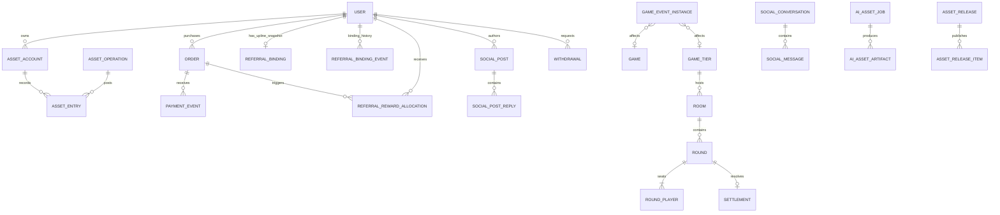

# 数据库设计 SDD（审核稿）

**状态：待业务与技术审核，不是可直接执行的迁移脚本。版本：0.13（金币集市裁决/延期/复核权限补充稿，2026-10-16）。**

本轮校准统一了各文档的物理模型：`user` 是全平台唯一身份表；转账由单个 `asset_operation` 和多条 `asset_entry` 表达；代理链固定为直属至第四级祖先列；奖励冻结复用 `asset_hold`；配置表保存当前字符串值并由审计记录变更；用户资金退回申请复用 `withdrawal/payout_attempt`。设备当前凭证并入 `device`；恢复二维码凭证保留历史、同一账号仅一份有效且在替换前可重复使用；启用 TOTP 时二维码恢复仍需 TOTP，遗失 TOTP 转客服人工处理且二维码不能重置 TOTP；玩家 COIN/CNY 余额允许因已审计追回/冲正而变负；Admin 和普通用户的 TOTP 均为自愿启用。客服 IM 以 MySQL 保存会话/消息，Socket.IO 负责实时通信，Redis 只存在线临时状态。不再规划独立 `admin_user`、转账参与方表、代理闭包/成员表、配置版本表、牌局比较明细表或 `device_credential` 表。全库定义 62 张表，每张均有完整公共字段及表/字段注释。金币集市仅新增 `coin_market_listing` 与 `coin_market_trade` 两个不同生命周期实体，挂牌库存复用一笔 `asset_hold`，部分成交数量由挂牌原子计数；不增加 escrow、participant 或证据表。跨文档功能映射与实体责任同步见各领域说明。本版进一步明确支付商户选择、USDT 每日汇率刷新及逐订单地址、提现费额外扣除和 72 小时出款等待、费用向上取整，以及赠币默认 5 倍流水。

本稿展开本项目 MySQL 物理 schema，覆盖大厅/十三张、账号会话、金币和人民币余额、支付提现、邀请返佣、Admin、牌局恢复及 AI 素材台账。遵循 [数据库设计规范与 Sequelize 方案](./数据库设计规范与Sequelize方案.md)。所有平台账号（玩家、代理、系统账号和管理员）统一保存在 `user`；通过常量化 `role_type` 区分身份能力，不另建 `admin_user`。设计重点是领域实体和清楚的所有权：每个业务事实由其领域实体维护，用显式引用和领域用例连接，避免全能流水表或全塞入 JSON。

本版新增运营默认值与玩法控制约束：新用户赠币 1000 枚（沿用默认 5 倍流水），提现费率 5%，恢复二维码/邀请链接有效 2 年，客服附件保留 2 年；所有可选玩法由 `game_config` 启停，关闭项不参与该局结算；支付首期提供开发/测试专用 Mock 操作页。

## 1. 目标及边界

- MySQL 持久化用户、设备凭证、资产、支付/提现、邀请关系、奖励、牌局检查点和素材发布。Redis 持有可过期/可撤销的玩家与 Admin 会话，包括刷新令牌轮换状态；也保存房间热状态、presence、匹配队列及短期 IP 邀请归因。Redis 不是账本权威；会话 Redis 丢失会要求重新登录，不影响账号和资产。
- 玩家、代理、系统账号和 Admin 共用 `user`；Admin 的登录 audience、权限校验和审计仍由独立流程隔离，但身份主记录不重复建表。
- 每表主键为 `BIGINT UNSIGNED AUTO_INCREMENT`；所有金额/余额使用有符号精确整数。金币发行系统账户以及经账务冲正/追回的玩家资产账户允许负数；系统人民币账户不允许透支。
- 规定每张表有 id/status/created_at/updated_at/deleted_at；所有常量/枚举值（状态、类型、来源、动作、策略等）均不得为 0，`0` 仅作为查询筛选 DTO 的“未选择/不筛选”哨兵，进入领域逻辑前转换为未指定条件。全部表名、字段名小写 snake_case；每张表和字段都须写 MySQL COMMENT。
- 不把配置、对账、资产变动、支付事件、和 Admin 审计揉成一张宽表。JSON 仅承载有版本 schema 的快照/外部负载，不能代替关系、索引或状态机。

## 2. 全表规范

### 2.1 每表公共字段

下文每张表均物理包含以下五列；字段表列出业务列。迁移必须为公共列逐表生成字段 comment。

| 字段 | MySQL 类型 | 约束 | 注释 |
| --- | --- | --- | --- |
| id | BIGINT UNSIGNED | PK AUTO_INCREMENT NOT NULL | 此表主键，对外以十进制字符串表示 |
| status | SMALLINT UNSIGNED | NOT NULL DEFAULT 1；限领域状态常量 | 此行工作状态，取值由领域 status 常量定义 |
| created_at | DATETIME(3) | NOT NULL | UTC 创建时间 |
| updated_at | DATETIME(3) | NOT NULL | UTC 最后修改时间 |
| deleted_at | DATETIME(3) | NULL DEFAULT NULL | 逻辑删除时间；不可变记录永远 NULL |

不可变流水、支付证据和审计行禁止 update/destroy，status 固定 RECORDED=1、时间不更新。可改工作状态的实体更新 `updated_at`。删除只软删允许恢复的资料，不级联删除关联和资金历史。

### 2.2 命名、类型、事务

1. 表名小写单数 snake_case；数据库表 `user` 是保留关键字风险对象，MySQL migration 始终用 QueryInterface/引用符，原始 SQL 必须引用 `user`。保存目标表主键的外键字段命名 `<table>_id`；同一行多次引用同一目标表时，使用角色前缀加表名，如 `parent_1_user_id`、`admin_user_id`。因此 Admin 审计/操作者字段 `admin_user_id` 也引用统一 `user.id`，并由领域校验该行含 ADMIN 位。类型同 `BIGINT UNSIGNED`。JWT/API/Socket 主键以十进制字符串传输。
2. 参与方固定且有限的账务用例不额外建参与方关系表；每个参与账户各写一条 `asset_entry`，同属一个 `asset_operation`。只有参与方数量可变且自身有独立生命周期时才拆关联实体。
3. FK 默认 RESTRICT 删除与更新，全部 `_id` 字段建索引。跨表事实一致性由持有这些实体的领域用例在单 Sequelize transaction 内校验；不由任意模块直接改别域表。JSON 快照若含本库实体 ID，键名仍须为 `<table>_id`；JSON 只留快照，不作为可变关系查询入口。
4. 金币和人民币采用 signed BIGINT 最小单位。系统 COIN 允许 amount<0 且冻结为0；玩家 COIN/CNY 余额也允许因已审计的奖励追回、账务冲正等操作变成负数。所有账户 `frozen_amount>=0` 且 `frozen_amount<=GREATEST(amount,0)`；系统 CNY 不允许负数。负余额不得用于下注、转账、兑换或提现；同一资产的后续合法入账先抵扣该资产的负余额，再形成可用余额。高精计价中间量用 DECIMAL(38,12)，外币 amount_atomic 精确按 token 原子单位记录。费率及具体分子/舍入需锁定后生效。
5. 所有状态、类型、来源、动作、策略等业务常量/枚举使用从1起的具名 enum，禁止定义值为0；`0` 只在查询筛选 DTO 表达“未选择/不筛选”，进入领域逻辑时转换为未指定。可选数据库外键用 NULL 表达缺失。金额、计数、房间座次、relationship depth、排序序号等普通数值在业务允许时可为0，不能把常量规则误用于这些数量值。
6. ID/外键与资产 delta 分开：asset delta 有符号。TS `number` 不承载大 ID 或跨越安全整数的金额；mysql2 连接层、JSON mapper、迁移必须验证精度。
7. MySQL DDL 在独立 migration task 用 Umzug 执行；所有字段/表注释和约束与下文一致。不使用 `sync({alter:true})`/`force`。可能发生 implicit commit 的 DDL 失败要检查结构后修复。
8. **扩表必须证明必要性。** 新表只在其数据具有独立身份/生命周期，或需要独立唯一约束、并发控制、访问隔离、保留策略，且无法由现有领域实体可靠表达时创建。提出新表时先说明领域所有者、具体读写用例、约束/索引、生命周期，以及为什么不能复用现有表字段、关联实体、可版本化 JSON 快照或允许丢失/重建的 Redis 状态。固定且少量的属性优先列，游戏 handler 私有且不参与通用查询的结果可用带版本 JSON；临时且可重建的热状态可用 Redis。不能为了页面、消息类型、统计指标或单次流程机械地一项一表；可由账本/业务事实可靠推导的汇总不重复持久化，除非有明确性能证据和一致性维护方案。新模块的实体方案先做最小模型评审，再决定是否增加物理表，表数本身不设目标。
9. **模拟计算不产生持久化业务数据。** 期望计算器的模拟轮次、样本玩家、虚拟资金/奖池和试算结果均只在内存或临时计算进程中存在，不创建牌局、账务、审计明细或专用结果表。发布配置时按配置发布规则记录变更审计；模拟报告摘要若要持久保存，须另行证明运营需要并单独审核，不作为默认设计。


### 2.3 索引约定

字段索引栏中 `U(a,b)` 表示唯一索引，`I(a,b)` 表示普通索引，`COALESCE(x,0)` 表达全局配置空档位的归一索引，`active_marker` 是条件成立为1否则NULL的 generated column，以唯一索引表达唯一活跃行。Migration 明确命名 `uq_<table>_<purpose>` 与 `ix_<table>_<purpose>`。


### 2.4 领域模块边界

| 领域 | owns/唯一写入的主要实体 | 不越界操作 |
| --- | --- | --- |
| identity | user/device/recovery_credential；Redis sessions | `user` 是玩家、代理、系统和 Admin 唯一身份表；设备行合并当前设备凭证；身份用例不直接写资产或邀请关系 |
| customer_support | support_conversation/support_message | Admin 作为客服人员；支持会话分派、消息历史及人工安全处置关联 |
| coin_market | coin_market_listing/coin_market_trade | 挂牌并发库存、部分成交、付款/争议生命周期；只调用 wallet 命令，不直接写余额或冻结额 |
| catalog/config | game/game_tier/current config values | 不修改进行中 round 的规则快照 |
| wallet | asset_account/operation/entry/hold | 不调用渠道或自己发起 Socket 副作用 |
| payments | provider/channel/product/order/payment_event/external settlement/withdrawal | 不绕过 wallet 直接改余额 |
| referral | referral_binding/referral_binding_event/referral_reward_allocation | 不负责客损线下结算；平台奖励仅限充值返点 |
| game | room/round/round_player/round_event/settlement | 游戏 handler 写版本化 JSON；每局只能请求 wallet 用例结算一次 |
| admin | user 上的 Admin 身份与 permission code JSON/admin_permission 路由目录/admin audit | Admin 登录用例隔离；通过目标领域命令改配置、审核、调账 |
| assets | AI 生成任务/artifact/release | 不把 OpenAI 密钥或生成接口放入客户端 |
| file assets | asset metadata/storage locator | 文件二进制不写入 MySQL；业务实体只保存 asset_id |

模块间只通过应用层用例与 typed command/result 协作；即使首版模块化单体，也保持所有权明确。

### 2.5 Redis 会话模型（不建 MySQL session 表）

玩家及 Admin 的短期 session、access/refresh token 轮换状态直接存 Redis；SQL 不建 `session`、`refresh_credential`、`admin_session` 或 `admin_refresh_credential`。建议每个会话一个 Redis hash：

```text
auth:session:{sid}
  status                 RedisSessionStatus，ACTIVE=1/REVOKED=2/EXPIRED=3
  principal_type         PLAYER=1/ADMIN=2
  user_id 十进制字符串（Admin 会话也使用同一 user_id）
  device_id              玩家会话需要
  auth_version           建立时绑定的账号权限版本
  refresh_token_hash     服务端密钥 HMAC 摘要，不存明文 refresh token
  rotation_seq           原子刷新递增序号
  created_at/expires_at  UTC epoch 毫秒
```

Redis 键 TTL 不超过 session expires_at；access JWT 带 `sid`，验签后检查 Redis session 仍 ACTIVE 并比对 auth_version。每个用户的当前 session key 集合可以由 Redis Set 辅助批量撤销，必须有过期清理策略。登出、改密、Admin 停权由身份用例撤销 Redis session；刷新令牌比对、轮换和重放检测用单个 Lua/原子操作，旧 refresh 重放撤销该会话并写 `user_security_event`。Socket 握手验证同一 session，撤销后断开关联连接；Redis 不可用时需拒绝新的受保护请求。

这是有状态 JWT：JWT 负责签名身份声明，Redis 负责即时撤销与刷新状态。Redis 全量丢失会让仍未过期的 JWT 因缺少 session 一律重新登录；不会恢复旧刷新令牌，也不会改写 MySQL 用户/资产。要求 Redis AOF/高可用和内存告警，但不能把 session 同步影子写到 MySQL；审计只把不透明 `session_key` 写入 SQL，不 FK 到 Redis。


## 3. 状态常量（草案）

所有状态值都从1开始，0不是合法状态。下列 map 是 TS 领域常量允许值；各表字段 `status` 采用对应命名 enum。此规则扩展到全部业务常量/枚举，而不只状态；筛选 DTO 可用 0 表示未选择，但不得将该哨兵传入领域逻辑或持久化字段。

| enum | 允许值 |
| --- | --- |
| ActiveStatus | ACTIVE=1/DISABLED=2/RETIRED=3 |
| UserStatus | ACTIVE=1/DISABLED=2/CLOSED=3 |
| CredentialStatus | ACTIVE=1/REVOKED=2/EXPIRED=3 |
| RedisSessionStatus | ACTIVE=1/REVOKED=2/EXPIRED=3 |
| RecoveryStatus | ISSUED=1/REVOKED=2/EXPIRED=3 |
| SupportConversationStatus | WAITING_SUPPORT=1/WAITING_USER=2/CLOSED=3 |
| SupportMessageStatus | VISIBLE=1/REDACTED=2 |
| SupportSenderType | CUSTOMER=1/ADMIN=2/SYSTEM=3 |
| SupportMessageType | TEXT=1/IMAGE=2/SYSTEM_NOTICE=3 |
| SupportCategoryType | ACCOUNT=1/PAYMENT=2/WITHDRAWAL=3/GAME=4/OTHER=5 |
| EntryStatus | QUEUED=1/SEATED=2/FINISHED=3/CANCELLED=4/EXPIRED=5 |
| OperationStatus | POSTED=1 |
| RecordStatus | RECORDED=1 |
| HoldStatus | OPEN=1/PARTIAL=2/CONSUMED=3/RELEASED=4 |
| ProductStatus | DRAFT=1/ON_SALE=2/OFF_SALE=3/RETIRED=4 |
| OrderStatus | CREATED=1/PAYING=2/PAID=3/FULFILLED=4/EXPIRED=5/EXCEPTION=6/CANCELLED=7 |
| ExternalStatus | OPEN=1/RECONCILED=2/DISPUTED=3/REVERSED=4 |
| WithdrawalStatus | REQUESTED=1/REVIEWING=2/APPROVED=3/PAYING=4/SUCCEEDED=5/REJECTED=6/CANCELLED=7/UNKNOWN=8/FAILED=9 |
| PayoutStatus | PREPARED=1/SENDING=2/UNKNOWN=3/SUCCEEDED=4/FAILED=5 |
| ChainDepositStatus | SEEN=1/CONFIRMING=2/CONFIRMED=3/MATCHED=4/UNMATCHED=5/FAILED=6/REORGED=7 |
| RelationStatus | ACTIVE=1/ENDED=2/REVOKED=3 |
| RewardStatus | POSTED=1/SKIPPED=2 |
| TurnoverStatus | ACTIVE=1/COMPLETE=2/REVERSED=3 |
| RoomStatus | WAITING=1/ACTIVE=2/RECOVERING=3/CLOSED=4 |
| MembershipStatus | SEATED=1/LEFT=2 |
| RoundStatus | PREPARING=1/ACTIVE=2/SETTLING=3/SETTLED=4/CANCELLED=5/RECOVERING=6 |
| RoundPlayerStatus | ACTIVE=1/SUBMITTED=2/SETTLED=3/ABORTED=4 |
| SettlementStatus | PREPARED=1/COMMITTED=2/CANCELLED=3 |
| OutboxStatus | PENDING=1/PROCESSING=2/SENT=3/DEAD=4 |
| MigrationStatus | RUNNING=1/SUCCEEDED=2/FAILED=3 |
| AiJobStatus | QUEUED=1/RUNNING=2/SUCCEEDED=3/FAILED=4/CANCELLED=5/REVIEW_REQUIRED=6 |
| ArtifactStatus | GENERATED=1/APPROVED=2/REJECTED=3 |
| ReleaseStatus | DRAFT=1/REVIEW=2/PUBLISHED=3/RETIRED=4 |
| AssetStatus | STORED=1/READY=2/QUARANTINED=3/RETIRED=4 |
| Asset operation actor_role | REQUEST=1/APPROVE=2 |
| PaymentProviderType | AGGREGATOR=1/SELF_TRON=2/MOCK=3 |

`ConfigType` 是配置值的领域常量而非状态字段：`STRING=1/BOOLEAN=2/INTEGER=3/DECIMAL=4/JSON=5`。值以字符串持久化；对应配置键只允许注册的 parser 按此类型安全转换，JSON 也只是 JSON 编码的字符串。

`RoundingMode` 是计算策略常量而非状态字段：涉及手续费或用户需支付的金币等值时使用 `CEIL_CHARGE=1`，兑换人民币余额不足一分时使用 `FLOOR_CREDIT=2`；先用整数/精确十进制计算，再按规则取目标最小单位。金币转账费率默认 500 bps，手续费 `ceil(转账金币×500/10000)`；例如转 101 枚，手续费为 6 枚。提现金额按用户期望实际到账的净额填写，提现手续费按当时配置的 bps 计算并向上取整到人民币分；总冻结额为净额+手续费。默认 1:10 下，净到账 100 元、假设手续费率 10%，需冻结 110 元人民币余额，对应 1100 枚金币等值；最低提现门槛/整数倍只检验净到账额对应的金币数。示例 10% 不是默认提现费率。USDT 基础报价先按已确认规则截断到 0.1 USDT，再叠加订单识别尾数；该规则独立于手续费向上取整。

`AssetOperationType` 是账务操作领域常量而非状态字段：`TRANSFER=1/COIN_EXCHANGE=2/GIFT_GRANT=3/GAME_SETTLEMENT=4/ORDER_FULFILLMENT=5/WITHDRAWAL_HOLD=6/WITHDRAWAL_SETTLEMENT=7/WITHDRAWAL_RELEASE=8/ADMIN_ADJUSTMENT=9/COMPENSATION=10/REFERRAL_REWARD=11/COIN_MARKET_HOLD=12/COIN_MARKET_TRADE=13/COIN_MARKET_RELEASE=14`。新增类型必须通过代码常量和迁移评审，不能在运行期任意写入数值。

`ExternalFlowType` 是外部资金记录类型常量而非状态字段：`IN=1/OUT=2/FEE_ADJUSTMENT=3/FUNDING=4`。用户申请提现或资金退回都进入 `withdrawal → payout_attempt` 出款流程，实际外部流出统一记为 OUT，不单设 REFUND 类型。已确认的渠道拒付按封禁账号和人工处置，不自动冲减用户账本，也不新增拒付 flow type。必须由按 flow type 注册的 `ExternalSettlementFlowHandler` 校验；未注册类型、关联对象不符、方向/金额不合法或原交易不可调整时拒绝写入，不允许通用默认 handler 放行。

资产操作状态使用 POSTED=1，已成功资产事实不可被改写；补偿由新的 asset_operation 追加，并通过 reverses_asset_operation_id 引用原操作。奖励 POSTED/SKIPPED 同样是不可变结论；追回或冲正须新增调整事件并保存原因。


## 4. 关系总览



图仅表达主干，字段表的 FK、成员角色和跨行约束为实施依据。

## 5. 逐表结构

字段列含 MySQL 类型、空值、默认/取值、用途注释；公共字段按 2.1 对**每张表**落列和 comment。索引/唯一约束单独列出。

### 5.1 身份与会话

#### user

**表注释：** 全平台统一账号身份。 **状态 enum：** UserStatus。

| 字段 | MySQL 类型 | 可空 | 默认值/取值 | 用途与约束 |
| --- | --- | --- | --- | --- |
| role_type | SMALLINT UNSIGNED | 否 | 1 | 角色位标记：PLAYER=1/AGENT=2/ADMIN=4/SYSTEM=8；合法值为 PLAYER、PLAYER|AGENT、ADMIN、SYSTEM |
| reward_type | SMALLINT UNSIGNED | 否 | 1 | 本用户作为上级的返点模式，RECHARGE=1/LOSS=2 |
| public_code | VARCHAR(32) | 否 | 无 | 随机不透明的公开好友码，可编码为 `LG-FRIEND:<public_code>` 二维码查找；不作为登录凭证；唯一索引 |
| username | VARCHAR(64) | 是 | NULL | 规范化用户名，设置后用于账号登录 |
| password_hash | VARCHAR(255) | 是 | NULL | 可选用户名密码的 Argon2id/bcrypt 哈希，不保存明文密码 |
| password_set_at | DATETIME(3) | 是 | NULL | 首次设置密码的时间 |
| email | VARCHAR(254) | 是 | NULL | 用户邮箱，规范化后唯一 |
| email_verified_at | DATETIME(3) | 是 | NULL | 邮箱验证成功时间 |
| phone | VARCHAR(32) | 是 | NULL | 规范化 E.164 手机号，唯一 |
| phone_verified_at | DATETIME(3) | 是 | NULL | 手机验证成功时间 |
| totp_secret_ciphertext | VARBINARY(512) | 是 | NULL | 可选 TOTP 共享密钥的认证加密密文；不得明文存储或写日志 |
| totp_enabled_at | DATETIME(3) | 是 | NULL | TOTP 完成二次验证并启用的时间；NULL 表示未启用 |
| totp_last_accepted_counter | BIGINT UNSIGNED | 是 | NULL | 最近成功使用的时间步，原子拒绝同一 TOTP 时间步重放 |
| totp_recovery_code_hashes | JSON | 是 | NULL | TOTP 启用时生成的一次性登录备用码哈希数组；消费后原子移除，不存明文；不能用于关闭/重绑 TOTP |
| nickname | VARCHAR(64) | 否 | 无 | 玩家昵称 |
| asset_id | BIGINT UNSIGNED | 是 | NULL | 用户头像文件引用，指向 asset 表 |
| auth_version | BIGINT UNSIGNED | 否 | 1 | 身份权限撤销版本 |
| permissions | JSON | 否 | 应用写入空数组 | 仅 Admin 使用；获授的 permission_code 字符串数组，不存任意 URL |
| last_login_at | DATETIME(3) | 是 | NULL | 最后一次成功登录时间 |
| invite_code | VARCHAR(32) | 是 | NULL | 普通玩家邀请代码；系统和 Admin 账号必须为空 |
| invite_code_expires_at | DATETIME(3) | 是 | NULL | 邀请链接/代码失效时间；默认生成后 2 年 |
| system_marker | TINYINT UNSIGNED GENERATED | 是 | 表达式 | 有效系统角色生成为 1，用唯一索引限制唯一系统用户 |

**索引/约束：** U(public_code)；U(username)；U(email)；U(phone)；U(invite_code)；U(system_marker)；I(status,created_at,id)；CHECK(role_type IN (1,3,4,8))
**实体规则：** 用户名、邮箱小写规范化后唯一，phone 使用 E.164 唯一索引；MySQL UNIQUE 允许多个 NULL 表示未绑定。email/phone 可空；邮箱和手机号绑定/换绑均不进行验证码验证，因此 `email_verified_at`/`phone_verified_at` 不因绑定写入。普通用户 `password_hash` 可空，未设置时 `password_set_at` 为空。TOTP 对所有 user 均为自愿启用，Admin 与普通用户没有强制策略；未启用时 secret 与启用时间均为空，启用后两者必须同时非空，`totp_last_accepted_counter` 只单调递增。`role_type` 按位标记：普通玩家为 PLAYER，可同时带 AGENT；所有普通用户均可使用邀请能力，不另设 INVITER 位。ADMIN 与 SYSTEM 是排他的专用身份位，不与 PLAYER/AGENT 组合；管理员凭证和 permissions 存在同一 user 行，权限仅对 ADMIN 身份生效；非 Admin 的 permissions 必须为空数组。SYSTEM 行不得有登录邮箱、电话、用户名、密码、TOTP 或 invite_code；ADMIN 不创建游戏资产账户。唯一身份/登录资料和安全版本放一个 user aggregate；不单独建 admin_user/user_contact/password_credential。system_marker 仅有效 SYSTEM 身份生成为1。

**generated 列表达式：** `system_marker = CASE WHEN (role_type & 8)=8 AND status=ACTIVE AND deleted_at IS NULL THEN 1 ELSE NULL END`。

Email/phone 的唯一索引保证一个规范化联系方式不会同时绑定多个账号。邮箱和手机号均不发送验证码；换绑分别要求输入当前完整邮箱/手机号（手机页面提示末三位），服务端规范化后与现值精确比较。匹配后在单个事务中替换 user 字段并清空对应的 `verified_at`，旧值立即可由其他账号重新绑定；email/phone 的绑定状态只表示账号记录了该联系方式，不代表已验证收件能力。不能仅凭新持有者取得旧手机号/邮箱就转移原账号或资产。若账号已设置密码，联系方式操作须在当前会话重新验证密码；若尚未设置密码，则依赖已认证的当前 JWT 会话，并在启用 TOTP 时额外验证 TOTP。无密码状态不要求用户先绕行到密码设置页才能打开联系方式表单。操作结果仍写安全事件，安全事件只存脱敏值或不可逆摘要，不长期保留明文旧联系方式。

TOTP 使用 RFC 6238 兼容认证器，建议默认 30 秒时间步。启用时，后端在 Redis 保存有短 TTL 的待绑定 secret；用户扫描只展示一次的 otpauth 二维码并提交当前验证码，验证成功后将密钥认证加密后写入 user，再清除 Redis 待绑定值。登录及敏感账号变更时按账号启用状态要求验证码；校验需限速、采用窄时钟漂移窗口，并以原子比较更新 `totp_last_accepted_counter` 防止同一时间步重放。关闭 TOTP 需要密码/当前认证器二次验证。二维码恢复只恢复账号/设备访问，不重置或关闭 TOTP；已启用 TOTP 的账号必须提交当前验证码。无法提供验证码或提出异议时转客服 IM，由具备专门权限的 Admin 完成人工身份核验后执行恢复，并关联客服会话写入账号安全事件和 Admin 审计；该人工路径的核验步骤由客服运营方案定义。密钥加密密钥由部署密钥管理设施持有，密文封装可带算法/密钥标识，不增加数据库 key_version 字段。RFC 6238 定义时间因子 TOTP，并给出默认 30 秒步长。[RFC 6238](https://www.rfc-editor.org/rfc/rfc6238)

联系方式换绑的字段操作补充：同类换绑（邮箱换邮箱、手机换手机）只替换对应字段并保留另一种联系方式；跨类型替换（邮箱改手机或手机改邮箱）只更新目标字段并清空原字段及其 `verified_at`，不发送验证码。新值已被其他账号占用或事务失败时，原绑定保持不变。提交成功后旧值立即释放并可被其他账号重新绑定。安全事件记录脱敏的新旧值，不保存明文旧值。已设置密码时需当前密码；未设置密码时当前有效登录会话作为授权基础；已启用 TOTP 时两种情况都须通过当前 TOTP 验证。

#### device

**表注释：** 设备识别及账号归属。 **状态 enum：** ActiveStatus。

| 字段 | MySQL 类型 | 可空 | 默认值/取值 | 用途与约束 |
| --- | --- | --- | --- | --- |
| user_id | BIGINT UNSIGNED | 否 | 无 | 所属用户 |
| fingerprint_hash | BINARY(32) | 否 | 无 | 规范化设备指纹摘要，不作为认证凭证 |
| device_digest | BINARY(32) | 否 | 无 | 设备摘要，允许指纹相似但凭证不同 |
| credential_key | CHAR(36) | 是 | NULL | 当前设备登录凭证的公开随机定位号，唯一；撤销后置空 |
| credential_secret_hash | BINARY(32) | 是 | NULL | 当前高熵设备秘密的服务端验证摘要；撤销后置空 |
| credential_status | SMALLINT UNSIGNED | 是 | NULL | 当前凭证状态：ACTIVE=1/REVOKED=2/EXPIRED=3；NULL 表示从未签发，失效状态保留在此字段 |
| credential_expires_at | DATETIME(3) | 是 | NULL | 当前设备凭证到期时间 |
| credential_revoked_at | DATETIME(3) | 是 | NULL | 当前凭证撤销或轮换时间 |
| platform_type | SMALLINT UNSIGNED | 否 | 1 | 平台，WEB=1/IOS=2/ANDROID=3/WINDOWS=4/MACOS=5/LINUX=6 |
| last_seen_at | DATETIME(3) | 是 | NULL | 最后访问时间 |

**索引/约束：** U(credential_key)；I(user_id,status,id)；I(fingerprint_hash)；I(device_digest)；I(credential_status,credential_expires_at)
**实体规则：** 每台 device 行同时保存设备识别信息和当前设备凭证；玩家同一时刻可有多个设备，每个设备最多一个当前凭证。设备码用于识别，不能仅凭相同指纹接管账号。凭证轮换时更新本行摘要和状态；旧凭证因与当前摘要不符而拒绝，轮换/撤销事件写入 user_security_event，不单独保留每代设备密钥摘要历史。撤销设备凭证不必删除设备识别记录。

#### recovery_credential

**表注释：** 密码保护二维码恢复凭证的当前及历史记录。 **状态 enum：** RecoveryStatus。

| 字段 | MySQL 类型 | 可空 | 默认值/取值 | 用途与约束 |
| --- | --- | --- | --- | --- |
| user_id | BIGINT UNSIGNED | 否 | 无 | 被恢复的账号 |
| credential_key | CHAR(36) | 否 | 无 | 二维码的随机定位值 |
| secret_hash | BINARY(32) | 否 | 无 | 恢复秘密哈希 |
| active_marker | TINYINT UNSIGNED GENERATED | 是 | 表达式 | 每个 user 最多一条当前有效二维码凭证为1，否则NULL |
| expires_at | DATETIME(3) | 是 | NULL | 过期时间；默认签发后 2 年 |
| last_used_at | DATETIME(3) | 是 | NULL | 最近一次成功使用时间；使用不消费或撤销二维码 |
| revoked_at | DATETIME(3) | 是 | NULL | 被新二维码替换或由用户/管理员撤销的时间 |

**索引/约束：** U(credential_key)；U(user_id,active_marker)；I(user_id,status,id)；I(expires_at,id)
**实体规则：** 本表只保存 QR 恢复凭证；登录/TOTP challenge 与频率计数放 Redis，联系方式绑定不使用验证码 challenge。二维码含密码加密的高熵恢复秘密，不含明文账户密码；服务端不保存二维码解密密码。每个 user 可保留多条历史记录，但最多一条 status=ISSUED 的有效凭证。成功使用只更新 `last_used_at` 并写入安全事件，不消费或撤销凭证；该二维码在被新二维码替换、主动撤销或过期之前可重复使用。账号已启用 TOTP 时，二维码恢复仍必须输入当前 TOTP；二维码流程不得关闭或重置 TOTP。用户无法提供 TOTP 时转人工客服处理，客服处置须经 Admin 授权并留下审计。生成新二维码时，在一个数据库事务中将原有效行更新为 REVOKED、填入 revoked_at，再插入新 ISSUED 行；唯一索引保证不会同时出现两条有效凭证。过期凭证需先更新为 EXPIRED 再签发新的有效记录。生成或替换失败时事务回滚，原有效二维码仍有效。生成操作使用幂等键，避免弱网重试误生成多张二维码。

**generated 列表达式：** `active_marker = CASE WHEN status=ISSUED AND deleted_at IS NULL THEN 1 ELSE NULL END`。


### 5.2 大厅、规则与配置

#### game

**表注释：** 大厅游戏目录与外接 Stub。 **状态 enum：** ActiveStatus。

| 字段 | MySQL 类型 | 可空 | 默认值/取值 | 用途与约束 |
| --- | --- | --- | --- | --- |
| game_code | VARCHAR(64) | 否 | 无 | 稳定游戏代码，如 thirteen |
| name | VARCHAR(64) | 否 | 无 | 显示名称 |
| integration_type | SMALLINT UNSIGNED | 否 | 1 | INTERNAL=1/EXTERNAL_STUB=2 |
| client_module_key | VARCHAR(128) | 是 | NULL | 前端注册表模块键，不为任意执行 URL |
| asset_id | BIGINT UNSIGNED | 否 | 无 | 大厅展示封面，引用 asset |
| sort_order | INT | 否 | 0 | 大厅排序，数值不是状态 |

**索引/约束：** U(game_code)；I(asset_id)；I(status,sort_order,id)
**实体规则：** 该行状态由此领域模块维护；通过唯一业务键幂等创建，不以客户端数据作为事实。

#### game_tier

**表注释：** 游戏难度厅及金币准入范围。 **状态 enum：** ActiveStatus。

| 字段 | MySQL 类型 | 可空 | 默认值/取值 | 用途与约束 |
| --- | --- | --- | --- | --- |
| game_id | BIGINT UNSIGNED | 否 | 无 | 所属游戏 |
| tier_code | VARCHAR(64) | 否 | 无 | 游戏内唯一档位代码 |
| name | VARCHAR(64) | 否 | 无 | 档位名称 |
| min_coins | BIGINT | 否 | 无 | 准入金币下限 |
| max_coins | BIGINT | 是 | NULL | 准入金币上限，NULL 表示无上限 |
| sort_order | INT | 否 | 0 | 档位排序 |

**索引/约束：** U(game_id,tier_code)；I(game_id,status,sort_order,id)
**实体规则：** CHECK min_coins>=0 AND (max_coins IS NULL OR max_coins>=min_coins)。每水金币、固定有效下注、倍数及时长在 game_config，档位与配置更新事务同步校验最大赔付预算。

#### system_config

**表注释：** 当前全局配置项。 **状态 enum：** ActiveStatus。

| 字段 | MySQL 类型 | 可空 | 默认值/取值 | 用途与约束 |
| --- | --- | --- | --- | --- |
| config_key | VARCHAR(128) | 否 | 无 | 配置键，如 wallet.exchange |
| config_type | SMALLINT UNSIGNED | 否 | 无 | STRING=1/BOOLEAN=2/INTEGER=3/DECIMAL=4/JSON=5 等 parser 类型 |
| config_value | TEXT | 否 | 无 | 原始字符串；由 config_type 和 config_key 对应的运行时 parser 严格转换 |
| description | VARCHAR(255) | 否 | 无 | 面向 Admin 的用途及单位说明 |

**索引/约束：** U(config_key)；I(status,config_type)
**实体规则：** 一项配置一条当前记录，更新原值；不设 config version/effective version。值变更由同事务 admin_audit_event 保存变更前后字符串、config_type、管理员和原因。无需单独的 config_actor：配置修改人始终是 Admin，admin_audit_event.admin_user_id 已表达行为人并保留审计上下文；另建关系表会重复表达一次操作且不适合保存修改前后值。服务端按注册 parser allowlist 转换，再按 config_key 校验范围/单位；解析失败拒绝更新，不动态执行代码。JSON 是可选 config_type，只有确实需要集合值的配置使用，列本身仍是字符串。

集市相关 system_config 键由 `coin_market` 模块注册 parser：`platform_fee_rate_bps` 默认 2000；`minimum_listing_coins` 默认 1000；`minimum_trade_coins` 默认 1000。最低挂牌量只在新建挂牌时校验，最小成交量在每笔部分成交时校验；二者均为下限，不要求成交数量按 1000 的整数倍。更新配置不回改已创建挂牌或成交。

#### game_config

**表注释：** 当前游戏及档位配置项。 **状态 enum：** ActiveStatus。

| 字段 | MySQL 类型 | 可空 | 默认值/取值 | 用途与约束 |
| --- | --- | --- | --- | --- |
| game_id | BIGINT UNSIGNED | 否 | 无 | 配置所属游戏 |
| game_tier_id | BIGINT UNSIGNED | 是 | NULL | 档位配置引用；全游戏配置为空 |
| agent_domain_id | BIGINT UNSIGNED | 是 | NULL | 配置所属代理域；NULL 表示平台基准配置 |
| scope_type | SMALLINT UNSIGNED | 否 | 无 | GAME=1/TIER=2 |
| config_key | VARCHAR(128) | 否 | 无 | 游戏配置键 |
| config_type | SMALLINT UNSIGNED | 否 | 无 | STRING=1/BOOLEAN=2/INTEGER=3/DECIMAL=4/JSON=5 等 parser 类型 |
| config_value | TEXT | 否 | 无 | 按领域 parser 转换的原始字符串 |
| description | VARCHAR(255) | 否 | 无 | 配置用途与计量单位 |

**索引/约束：** U((COALESCE(agent_domain_id,0)),game_id,(COALESCE(game_tier_id,0)),config_key)；I(agent_domain_id,game_id,status,scope_type)；I(game_tier_id)
**实体规则：** 一项域/游戏/难度范围内的键只保留一条当前行，变更原字符串并在 Admin/代理审计保存前后值；不增加配置草稿/版本/发布历史表。NULL 域表示平台基准配置；唯一索引中的 0 只用于域/全游戏配置的 NULL 归一，不是状态或有效 ID（实际 agent_domain_id 和 game_tier_id 均不得为 0）。CHECK scope_type 与 game_tier_id 是否为空相匹配；事务验证 game_tier.game_id 等于 game_id，非空 agent_domain_id 必须是 Active 域。域配置只能覆盖游戏 handler 登记的可调参数，并通过平台硬边界及其 game math model；平台安全值、跨域参数和未登记 key 不可覆盖。解析失败拒绝更新。`rules.*.enabled` 明确控制每一玩法是否启用；关闭时该玩法不进入比牌或结算，开启时使用同一配置项内的结算参数。牌局创建/入场时将解析后的完整有效值、配置来源（平台/域）、handler/schema/math model 版本合并为不可变 `round.rules_snapshot`，已开局牌局不随后台配置更新改变。模拟候选只存在客户端编辑态/隔离 worker，不写本表。

### 5.2.1 代理域

#### agent_domain

**表注释：** 已获批普通用户拥有的运营权限与数据隔离范围，不表示独立账号。 **状态 enum：** AgentDomainStatus。

| 字段 | MySQL 类型 | 可空 | 默认值/取值 | 用途与约束 |
| --- | --- | --- | --- | --- |
| user_id | BIGINT UNSIGNED | 否 | 无 | 代理域所有者，关联统一 user；该用户仍使用原 user ID 登录 |
| capabilities | JSON | 否 | 空数组 | Admin 已授予的 capability code 字符串数组，不存任意 path/script |
| approved_at | DATETIME(3) | 是 | NULL | Admin 批准时间 |
| suspended_at | DATETIME(3) | 是 | NULL | 最近一次暂停时间 |
| revoked_at | DATETIME(3) | 是 | NULL | 撤销时间；实体保留供审计 |

**索引/约束：** U(user_id)；I(status,created_at,id)
**实体规则：** 不另建 agent 身份表；一名 user 至多有一个 agent_domain。待审核时 user 保持普通玩家 role；Admin 批准时在同一事务加入既有 `role_type` AGENT 位，撤销时清除 AGENT 位但保留玩家身份及账号。申请可先创建 Pending 状态的 agent_domain，不新增申请表；用户撤回状态为 WITHDRAWN=5，Admin 拒绝/撤销状态为 REVOKED=4。审批、capabilities 修改、暂停/恢复和撤销均由 `admin_audit_event` 保存操作者、前后权限快照与理由。AgentDomainStatus 从 1 开始并由共享代码常量限定：PENDING_REVIEW=1、ACTIVE=2、SUSPENDED=3、REVOKED=4、WITHDRAWN=5。仅 ACTIVE 域可执行获授功能；恢复前必须重新校验 user.role_type。域内成员从 `referral_binding` 关系链推导，不复制一份代理成员树。嵌套代理域按最近的 Active 域计算有效归属；父域只读子域代理层级和聚合统计，不能读其域内明细内容。所有资源操作由服务端计算并校验 agent_domain_id，不信任客户端或 JWT 内缓存的域归属。

#### game_entry

**表注释：** 游戏准入及当前入局资格。 **状态 enum：** EntryStatus。

| 字段 | MySQL 类型 | 可空 | 默认值/取值 | 用途与约束 |
| --- | --- | --- | --- | --- |
| user_id | BIGINT UNSIGNED | 否 | 无 | 入局玩家 |
| game_id | BIGINT UNSIGNED | 否 | 无 | 目标游戏 |
| game_tier_id | BIGINT UNSIGNED | 否 | 无 | 目标难度厅 |
| entry_key | CHAR(36) | 否 | 无 | 准入请求幂等定位值 |
| rules_snapshot | JSON | 否 | 无 | 解析后的准入和规则配置快照 |
| room_id | BIGINT UNSIGNED | 是 | NULL | 匹配成功后的房间 |
| expires_at | DATETIME(3) | 否 | 无 | 待匹配资格有效期 |
| active_marker | TINYINT UNSIGNED GENERATED | 是 | 表达式 | 有效未删除入局资格为 1，否则 NULL |

**索引/约束：** U(entry_key)；U(user_id,active_marker)；I(game_tier_id,status,created_at,id)；I(room_id)
**实体规则：** EntryStatus.QUEUED=1/SEATED=2 的 active_marker=1；一个用户全平台最多一个有效准入。Redis 匹配队列不是权威，开局重验余额并冻结。

**generated 列表达式：** `active_marker = CASE WHEN status IN (QUEUED,SEATED) AND deleted_at IS NULL THEN 1 ELSE NULL END`。


### 5.3 资产与内部流转

#### asset_account

**表注释：** 系统和玩家的分资产余额账户。 **状态 enum：** ActiveStatus。

| 字段 | MySQL 类型 | 可空 | 默认值/取值 | 用途与约束 |
| --- | --- | --- | --- | --- |
| user_id | BIGINT UNSIGNED | 否 | 无 | 账户主体 |
| account_type | SMALLINT UNSIGNED | 否 | 无 | PLAYER=1/SYSTEM=2，由身份复制且不可修改 |
| asset_type | SMALLINT UNSIGNED | 否 | 无 | COIN=1/CNY_BALANCE=2 |
| currency | CHAR(3) | 否 | 无 | 金币为 COI，人民币余额为 CNY |
| amount | BIGINT | 否 | 0 | 有符号资产总额，金币枚或人民币分 |
| frozen_amount | BIGINT | 否 | 0 | 有效占款总额，不是额外资产 |
| version | BIGINT UNSIGNED | 否 | 1 | 每次资产或冻结变更递增版本 |

**索引/约束：** U(user_id,asset_type,currency)；I(account_type,asset_type)
**实体规则：** CHECK 币种与资产对应；系统金币 frozen_amount=0 且 amount 可负；玩家 COIN/CNY amount 可因审计冲正或追回为负；系统 CNY amount 不可负。所有账户均满足 `frozen_amount>=0` 且 `frozen_amount<=GREATEST(amount,0)`。负余额不会形成可用额度，常规下注、转账、兑换和提现门禁要求扣款后余额不为负；同一资产的后续合法入账先抵扣该资产负额。PLAYER 账户只能归属于含 PLAYER 位的 user，SYSTEM 账户只能归属于 SYSTEM 身份；ADMIN 身份不得创建资产账户。account_type 在开户时由 user.role_type 推导并禁止修改。系统可每种资产一行。

#### asset_operation

**表注释：** 跨账户记账操作及幂等根。 **状态 enum：** RecordStatus。

| 字段 | MySQL 类型 | 可空 | 默认值/取值 | 用途与约束 |
| --- | --- | --- | --- | --- |
| operation_key | VARCHAR(160) | 否 | 无 | 全局业务语义幂等键，不只是随机请求号 |
| operation_type | SMALLINT UNSIGNED | 否 | 无 | 资金用例类型常量 |
| request_hash | BINARY(32) | 否 | 无 | 规范化请求摘要，防同键不同内容 |
| initiated_by_user_id | BIGINT UNSIGNED | 是 | NULL | 玩家发起人；系统任务为空 |
| operated_by_admin_user_id | BIGINT UNSIGNED | 是 | NULL | Admin 操作人；人工资产调整时必填 |
| approved_by_admin_user_id | BIGINT UNSIGNED | 是 | NULL | 双人复核审批人；非复核操作为空 |
| admin_session_key | CHAR(36) | 是 | NULL | 发起操作的 Redis Admin 会话定位键 |
| reverses_asset_operation_id | BIGINT UNSIGNED | 是 | NULL | 本操作冲正/补偿的原操作；部分补偿可多次引用同一原操作 |
| reason | VARCHAR(500) | 是 | NULL | 人工调整或补偿原因 |
| extra | JSON | 是 | NULL | 用例级不可变细节快照；账务金额仍以分录为准 |
| result_snapshot | JSON | 是 | NULL | 提交后可重复返回的结果 |
| committed_at | DATETIME(3) | 是 | NULL | 成功资金事务提交业务时间 |

**索引/约束：** U(operation_key)；I(initiated_by_user_id,created_at,id)；I(operated_by_admin_user_id,created_at,id)；I(approved_by_admin_user_id,created_at,id)；I(reverses_asset_operation_id)；I(status,created_at,id)
**实体规则：** 操作类型见常量章；先抢幂等根，所有分录、业务结果和 outbox 同事务。转账没有额外 transfer/participant 表：用户身份从 asset_entry → asset_account 取得；例如本金 100、费率 5% 时，发送账户写 -105、接收账户 +100、系统手续费账户 +5，三条分录同属一个 operation。extra 保存费率/舍入规则，以及受限供币操作时授权依据的当前邀请链快照。冲正操作用 reverses_asset_operation_id 直接指向原操作，不设 asset_operation_link。人工复核的申请人与审批人字段必须不同。

#### asset_entry

**表注释：** 不可变资产变动及冻结分录。 **状态 enum：** RecordStatus。

| 字段 | MySQL 类型 | 可空 | 默认值/取值 | 用途与约束 |
| --- | --- | --- | --- | --- |
| asset_operation_id | BIGINT UNSIGNED | 否 | 无 | 记账幂等根 |
| asset_account_id | BIGINT UNSIGNED | 否 | 无 | 对应资产账户 |
| asset_hold_id | BIGINT UNSIGNED | 是 | NULL | 此分录创建、消耗或释放的具体占款；非占款分录为空 |
| entry_seq | INT UNSIGNED | 否 | 无 | 同一操作内分录序号 |
| entry_type | SMALLINT UNSIGNED | 否 | 无 | INTERNAL=1/EXTERNAL=2/HOLD=3/COMPENSATION=4 |
| delta | BIGINT | 否 | 无 | 资产总额变动，有符号整数 |
| frozen_delta | BIGINT | 否 | 0 | 冻结变动，冻结释放不增加总额 |
| amount_after | BIGINT | 否 | 无 | 变更后资产总额 |
| frozen_after | BIGINT | 否 | 无 | 变更后冻结额 |
| account_version | BIGINT UNSIGNED | 否 | 无 | 变更后账户版本 |
| memo | VARCHAR(500) | 否 | 无 | 分录含义及人工调整原因 |

**索引/约束：** U(asset_operation_id,entry_seq)；U(asset_account_id,account_version)；I(asset_account_id,created_at,id)；I(asset_hold_id,created_at,id)
**实体规则：** 每条分录对应账户的一次版本变更；同一账户在同一操作中如涉及多个独立占款，按占款拆成多条分录并分别递增 account_version。创建/消耗/释放占款的分录必须带 `asset_hold_id`，其他分录为空；占款变更与对应 asset_hold.remaining_amount/status 在同一事务更新。不允许 delta 与 frozen_delta 同时为0。冻结变化也递增账户版本并记分录。所有历史不可改删。

#### asset_hold

**表注释：** 资产冻结/占款及其释放生命周期。 **状态 enum：** HoldStatus。

| 字段 | MySQL 类型 | 可空 | 默认值/取值 | 用途与约束 |
| --- | --- | --- | --- | --- |
| asset_account_id | BIGINT UNSIGNED | 否 | 无 | 被占用账户 |
| asset_operation_id | BIGINT UNSIGNED | 否 | 无 | 创建占款的操作 |
| hold_key | VARCHAR(160) | 否 | 无 | 业务语义唯一占款键 |
| hold_type | SMALLINT UNSIGNED | 否 | 无 | GAME=1/WITHDRAWAL=2/REWARD=3/CHANNEL_UNSETTLED=4/COIN_MARKET_LISTING=5 |
| amount | BIGINT | 否 | 无 | 创建占款金额 |
| remaining_amount | BIGINT | 否 | 无 | 尚未释放或消耗金额 |
| expires_at | DATETIME(3) | 是 | NULL | 奖励可释放时刻或业务期限 |
| closed_at | DATETIME(3) | 是 | NULL | 占款关闭时间 |

**索引/约束：** U(hold_key)；I(asset_account_id,status,id)；I(hold_type,status,expires_at,id)
**实体规则：** CHECK 0<=remaining_amount<=amount AND amount>0；有效占款之和等于账户 frozen_amount。提现未知结果不因时间到了自动释放。

金币集市用 `hold_type=COIN_MARKET_LISTING=5`。每个挂牌恰有一笔挂牌 hold，由 `COIN_MARKET_HOLD` 操作创建；创建时冻结挂牌总量。部分成交只在挂牌库存中预占数量，不建立多个 wallet hold；成交成功由 `COIN_MARKET_TRADE` 消耗对应 hold 子额并转移金币，取消/裁决返还或挂牌撤销由 `COIN_MARKET_RELEASE` 释放相应子额或恢复为挂牌可售量。挂牌取消释放尚未预占数量，已存在 trade 仍按自身状态继续处理。

#### coin_exchange

**表注释：** 金币兑人民币余额。 **状态 enum：** RecordStatus。

| 字段 | MySQL 类型 | 可空 | 默认值/取值 | 用途与约束 |
| --- | --- | --- | --- | --- |
| user_id | BIGINT UNSIGNED | 否 | 无 | 兑换用户 |
| asset_operation_id | BIGINT UNSIGNED | 否 | 无 | 兑换操作 |
| coins | BIGINT | 否 | 无 | 用户扣除金币 |
| cash_cents | BIGINT | 否 | 无 | 用户增加人民币分 |
| fee_cents | BIGINT | 否 | 0 | 独立兑换费用，默认无新增费用 |
| rate_coin_units | BIGINT | 否 | 无 | 比例金币整数分子，默认 10 |
| rate_cash_cents | BIGINT | 否 | 无 | 比例人民币分分母，默认 100 |
| rounding_type | SMALLINT UNSIGNED | 否 | 2 | `RoundingMode.FLOOR_CREDIT=2`；兑入人民币余额不足 1 分向下取整到分 |
| preview_key | CHAR(36) | 否 | 无 | 用户确认的报价定位值 |

**索引/约束：** U(asset_operation_id)；U(preview_key)；I(user_id,created_at,id)
**实体规则：** 兑换比例从 `cny_to_coin_ratio` 配置读取，确认时校验；默认只设计金币兑余额，不默认为双向。兑入人民币分不足 1 分向下取整，费用/应扣金币最小单位小数仍向上取整；默认 10 COIN : 100 CNY cents 可整除。用户金币→系统金币、系统人民币→用户人民币，同事务。Browser API 可在现有 `asset_operation.extra` 保存解析比例和舍入快照，不因此增加 IndexedDB store。

#### gift_grant

**表注释：** 赠币及配置快照。 **状态 enum：** RecordStatus。

| 字段 | MySQL 类型 | 可空 | 默认值/取值 | 用途与约束 |
| --- | --- | --- | --- | --- |
| user_id | BIGINT UNSIGNED | 否 | 无 | 领取用户 |
| asset_operation_id | BIGINT UNSIGNED | 否 | 无 | 赠币操作 |
| order_id | BIGINT UNSIGNED | 是 | NULL | 商品附赠金币的来源订单 |
| grant_key | VARCHAR(160) | 否 | 无 | 注册或活动发奖语义键 |
| coins | BIGINT | 否 | 无 | 实际赠送金币 |
| turnover_multiplier | DECIMAL(12,4) | 否 | 5 | 流水倍数快照；默认 5 倍，场景配置在发放时固化 |
| required_turnover_coins | BIGINT | 否 | 无 | 实际增加的整数流水要求 |

**索引/约束：** U(asset_operation_id)；U(grant_key)；I(user_id,created_at,id)
**实体规则：** 赠币入账时，本表记录赠送金币与该笔要求额，默认流水倍数为 5，`required_turnover_coins=ceil(coins×turnover_multiplier)`；`asset_operation/asset_entry` 同时给用户金币余额加上 `coins`，同一事务将要求额累加到 `turnover_state`。赠币是普通金币，不隔离钱包、不追踪来源。

### 5.4 支付、汇率与链到账

#### payment_provider

**表注释：** 代理商和自建支付适配器。 **状态 enum：** ActiveStatus。

| 字段 | MySQL 类型 | 可空 | 默认值/取值 | 用途与约束 |
| --- | --- | --- | --- | --- |
| provider_code | VARCHAR(64) | 否 | 无 | 稳定提供商代码 |
| provider_type | SMALLINT UNSIGNED | 否 | 无 | `PaymentProviderType`：AGGREGATOR=1/SELF_TRON=2/MOCK=3 |
| name | VARCHAR(100) | 否 | 无 | 提供商名称 |
| adapter_key | VARCHAR(64) | 否 | 无 | 服务器适配器注册表键 |
| secret_reference | VARCHAR(255) | 是 | NULL | 非 Mock provider 的密钥管理器引用，非密钥值 |
| capability_snapshot | JSON | 否 | 无 | 下单查询对账及出款能力声明 |

**索引/约束：** U(provider_code)
**实体规则：** 公开 API 不返回 secret_reference 或内部配置；这里的能力不代表商户已开通。AGGREGATOR/SELF_TRON 必须配置密钥引用；`MOCK` 不需要 secret_reference，只用于本地/测试环境，生产启动配置必须拒绝该 adapter，Mock 回调不能生成可提款的真实余额或正式支付成功事实。

#### payment_channel

**表注释：** 支付方法与提供商路由。 **状态 enum：** ActiveStatus。

| 字段 | MySQL 类型 | 可空 | 默认值/取值 | 用途与约束 |
| --- | --- | --- | --- | --- |
| payment_provider_id | BIGINT UNSIGNED | 否 | 无 | 所属提供商 |
| channel_code | VARCHAR(64) | 否 | 无 | 渠道唯一代码 |
| method_type | SMALLINT UNSIGNED | 否 | 无 | ALIPAY=1/WECHAT=2/BANK=3/UNIONPAY_QR=4/ECNY=5/USDT_TRON=6 |
| channel_config | JSON | 否 | 无 | 非秘密商户路由及计费配置 |
| fee_config | JSON | 否 | 无 | 手续费算法、费率和舍入规则 |
| priority | INT | 否 | 0 | 玩家支付方式列表展示顺序；按 priority、id 稳定排序 |

**索引/约束：** U(payment_provider_id,channel_code)；I(method_type,status,priority,id)
**实体规则：** 向玩家展示所有启用的 provider/channel 组合，使用 `priority、id` 稳定排序；用户选择后将具体 `payment_channel_id` 固定在订单，不能在创建后切换提供商。Admin 调整 priority 控制展示顺序。该行状态由此领域模块维护；通过唯一业务键幂等创建，不以客户端数据作为事实。

#### product

**表注释：** 商城可售商品目录及版本。 **状态 enum：** ProductStatus。

| 字段 | MySQL 类型 | 可空 | 默认值/取值 | 用途与约束 |
| --- | --- | --- | --- | --- |
| product_code | VARCHAR(64) | 否 | 无 | 稳定商品代码 |
| product_type | SMALLINT UNSIGNED | 否 | 无 | COIN_TOP_UP=1；其他商品类型由商城领域常量扩展 |
| version | BIGINT UNSIGNED | 否 | 无 | 商品版本 |
| name | VARCHAR(100) | 否 | 无 | 显示名称 |
| price_amount | DECIMAL(36,12) | 否 | 无 | 商品价格数量 |
| price_currency | VARCHAR(16) | 否 | 无 | 标价币种，如 CNY |
| fulfillment_spec | JSON | 否 | 无 | 商品履约定义；金币商品含购买金币、赠币及流水要求 |
| active_marker | TINYINT UNSIGNED GENERATED | 是 | 表达式 | 在售未删除取 1，否则 NULL |

**索引/约束：** U(product_code,version)；U(product_code,active_marker)
**实体规则：** 在售版本不改价或履约内容，修改新建版本。订单保存商品快照；金币商品购买币与附赠币分别入账，附赠才计补贴。目录模型不限定商品必须是金币。

**generated 列表达式：** `active_marker = CASE WHEN status=ON_SALE AND deleted_at IS NULL THEN 1 ELSE NULL END`。

#### order

**表注释：** 通用商城订单、支付及商品履约状态。 **状态 enum：** OrderStatus。`order` 是 MySQL 保留字，Sequelize migrations 和 SQL 查询必须正确引用。

| 字段 | MySQL 类型 | 可空 | 默认值/取值 | 用途与约束 |
| --- | --- | --- | --- | --- |
| user_id | BIGINT UNSIGNED | 否 | 无 | 购买用户 |
| product_id | BIGINT UNSIGNED | 否 | 无 | 下单时商品版本 |
| payment_channel_id | BIGINT UNSIGNED | 否 | 无 | 固定支付路由 |
| order_key | CHAR(36) | 否 | 无 | 内部订单号及下单幂等定位值 |
| provider_order_key | VARCHAR(160) | 是 | NULL | 外部渠道订单号 |
| payment_currency | VARCHAR(16) | 否 | 无 | 实际支付币种 |
| requested_amount | DECIMAL(36,12) | 否 | 无 | 请求原币支付金额 |
| actual_amount | DECIMAL(36,12) | 是 | NULL | 确认实付原币金额 |
| actual_cny_cents | BIGINT | 是 | NULL | 商业订单的实际支付人民币金额/锁定人民币等值，充值返点基数；USDT 识别尾数不计入商品价格 |
| extra | JSON | 否 | 无 | 商品履约快照、USDT 汇率来源/汇率/采样时间、赠送要求及返点政策；支付币种金额仍以列保存 |
| asset_operation_id | BIGINT UNSIGNED | 是 | NULL | 成功履约资金操作 |
| expires_at | DATETIME(3) | 否 | 无 | 订单超时 |
| paid_at | DATETIME(3) | 是 | NULL | 验证支付成功时间 |
| fulfilled_at | DATETIME(3) | 是 | NULL | 金币和返点履约完成时间 |

**索引/约束：** U(order_key)；U(payment_channel_id,provider_order_key)；U(asset_operation_id)；I(user_id,created_at,id)；I(status,expires_at,id)
**实体规则：** USDT/CNY 汇率 adapter 每日获取一次，把当日汇率短期缓存于 Redis；不建 FX 快照表。下单时将实际采用的汇率、来源、采样时间写入 `extra`，订单始终按该快照核账。若当天取价失败或 Redis 中没有当日有效报价，暂停新建 USDT 订单，不沿用过期报价。技术候选可评估 CoinMarketCap `quotes/latest` 对 USDT/CNY 的支持，实施前通过官方 fiat map 核实 CNY，并确认商业计划/项目用途许可；CoinGecko 当前 API 条款禁止在提供在线赌博的产品中使用其 API，因此不列为本项目可用 provider，除非取得书面授权。TRON USDT 订单先按锁定汇率计算 `人民币商品金额 ÷ USDT/CNY 汇率`，按已确认规则截断到 1 位小数，再叠加分配的小数槽位，最终精确收款金额写入 `requested_amount`；尾数只用于识别订单，不改变商品人民币标价或充值返点基数。链上到账按锁定收款金额和该订单独立地址匹配，不重新计算汇率。超时到账、金额不正确或无法唯一匹配时保留 `chain_deposit_event` 并转客服处理，不自动发币；不因订单超时忽略已收款。附赠业务使用独立 gift_grant，但所有入账共享履约事务。

玩家端读取已启用的支付商户/支付方式列表，按 `payment_channel.priority、id` 排序显示；用户选定后将对应 `payment_channel_id` 固定到订单。`MOCK` provider 只在开发与集成测试环境可用，生产配置检查必须阻止其启动，不能模拟真实支付成功。

#### payment_event

**表注释：** 不可变支付回调及查询证据。 **状态 enum：** RecordStatus。

| 字段 | MySQL 类型 | 可空 | 默认值/取值 | 用途与约束 |
| --- | --- | --- | --- | --- |
| payment_provider_id | BIGINT UNSIGNED | 否 | 无 | 消息提供商 |
| order_id | BIGINT UNSIGNED | 是 | NULL | 可定位的商城订单 |
| payout_attempt_id | BIGINT UNSIGNED | 是 | NULL | 可定位的出款尝试 |
| coin_market_trade_id | BIGINT UNSIGNED | 是 | NULL | 可定位的平台通道集市成交 |
| event_key | VARCHAR(160) | 否 | 无 | 提供商事件号或规范化语义去重键 |
| event_type | SMALLINT UNSIGNED | 否 | 无 | CALLBACK=1/QUERY=2/RECONCILIATION=3 |
| verification_result | SMALLINT UNSIGNED | 否 | 无 | VERIFIED=1/REJECTED=2 |
| payload_hash | BINARY(32) | 否 | 无 | 规范化原消息哈希 |
| payload_ciphertext | MEDIUMBLOB | 否 | 无 | 必要审计消息的加密密文 |
| occurred_at | DATETIME(3) | 否 | 无 | 渠道事件时间 |
| received_at | DATETIME(3) | 否 | 无 | 服务端接收时间 |

**索引/约束：** U(payment_provider_id,event_key)；I(order_id,id)；I(payout_attempt_id,id)；I(coin_market_trade_id,id)；CHECK 三个目标引用恰有一个非 NULL
**实体规则：** 一条支付事件只关联一种业务目标：商城订单、出款尝试或平台通道集市成交，handler 必须检查相应目标与 provider/channel 的归属匹配。未验证事件不能驱动资产；不能仅依赖回调到达顺序，终态成功不被旧失败覆盖。确认属于渠道拒付/争议的消息时，将对应 `user.status` 设为 DISABLED、写入 `user_security_event` 并触发人工处置；首版不自动冲减已发资产，尚未出款的提现保持占款并暂停，不得自动付款或释放，等待 Admin 处理。消息不储存密钥或完整授权头。

#### external_settlement

**表注释：** 平台外部资金收支及渠道对账。 **状态 enum：** ExternalStatus。

| 字段 | MySQL 类型 | 可空 | 默认值/取值 | 用途与约束 |
| --- | --- | --- | --- | --- |
| payment_provider_id | BIGINT UNSIGNED | 是 | NULL | 渠道提供商，自有资金注入可为空 |
| order_id | BIGINT UNSIGNED | 是 | NULL | 入款订单 |
| payout_attempt_id | BIGINT UNSIGNED | 是 | NULL | 出款尝试 |
| coin_market_trade_id | BIGINT UNSIGNED | 是 | NULL | 平台通道集市成交 |
| related_external_settlement_id | BIGINT UNSIGNED | 是 | NULL | 手续费调整所对应的原外部资金记录 |
| asset_operation_id | BIGINT UNSIGNED | 是 | NULL | 内部收支记账操作 |
| settlement_key | VARCHAR(160) | 否 | 无 | 外部收支语义键 |
| external_transaction_key | VARCHAR(160) | 否 | 无 | 渠道流水或链交易定位 |
| flow_type | SMALLINT UNSIGNED | 否 | 无 | ExternalFlowType：IN=1/OUT=2/FEE_ADJUSTMENT=3/FUNDING=4 |
| original_currency | VARCHAR(16) | 否 | 无 | 实际外部币种 |
| original_amount | DECIMAL(36,12) | 否 | 无 | 原币有符号收支数量 |
| gross_cny_cents | BIGINT | 否 | 无 | 人民币等值毛额，有符号 |
| fee_cny_cents | BIGINT | 否 | 0 | 有符号费用分；正数增加费用，负数表示费用退回/冲减 |
| net_cny_cents | BIGINT | 否 | 无 | 内部人民币净变动 |
| valuation_snapshot | JSON | 否 | 无 | 计价、是否实换汇和费用证据 |
| settled_at | DATETIME(3) | 是 | NULL | 渠道实际结算完成时刻 |

**索引/约束：** U(settlement_key)；I(payment_provider_id,status,settled_at,id)；I(order_id)；I(payout_attempt_id)；I(coin_market_trade_id)；I(related_external_settlement_id)；I(asset_operation_id)；CHECK(net_cny_cents=gross_cny_cents-fee_cny_cents)；CHECK(flow_type 与业务关联列组合相符)
**实体规则：** 每行表示一条外部资金会计事实，不表示渠道批次；实际渠道批次若包含多笔交易，按其明细逐笔写入。关联列 CHECK 为：IN 必须且只能有关联 `order_id` 或 `coin_market_trade_id` 之一，不能有 payout_attempt_id/related_external_settlement_id；OUT 必须有 payout_attempt_id，不能有关联订单/集市成交或 related_external_settlement_id；FUNDING 不关联订单、出款尝试、集市成交或原结算；FEE_ADJUSTMENT 必须有 related_external_settlement_id，可带其原 order_id 或 coin_market_trade_id。CHECK 只管本行字段组合，关联目标类型/状态由 handler 校验。`flow_type` 必须由对应 `ExternalSettlementFlowHandler` 完成类型化校验：IN 校验有效商城订单或平台通道集市成交及其支付证据；OUT 校验有效出款尝试；FUNDING 校验系统资金注入凭证；FEE_ADJUSTMENT 必须指向可调整的原 IN 记录，且若填写业务关联 ID 必须与原记录一致。手续费调整不改写原入账，而追加一笔 `gross_cny_cents=0` 的调整记录，费用增加时 `fee_cny_cents>0`、净变动为负，退回手续费时费用为负、净变动为正。用户申请提现或资金退回统一走 withdrawal/payout_attempt；外部出款记为 OUT。渠道争议/拒付属于支付事件及渠道异常处理，不视为用户提现或独立 REFUND flow type。渠道未结算净额创建系统 CNY hold。USDT 持仓与 CNY 标价不混同；原币独立核对。

#### payout_account

**表注释：** 用户指定收款账户的版本。 **状态 enum：** ActiveStatus。

| 字段 | MySQL 类型 | 可空 | 默认值/取值 | 用途与约束 |
| --- | --- | --- | --- | --- |
| user_id | BIGINT UNSIGNED | 否 | 无 | 账户所有者 |
| account_key | CHAR(36) | 否 | 无 | 稳定收款账户定位值 |
| version | BIGINT UNSIGNED | 否 | 无 | 收款资料版本 |
| method_type | SMALLINT UNSIGNED | 否 | 无 | 提供商支持的出款方法常量 |
| account_ciphertext | VARBINARY(8192) | 否 | 无 | 收款人、号码等加密资料 |
| lookup_hash | BINARY(32) | 否 | 无 | 规范化账户摘要，供查询和去重 |
| masked_label | VARCHAR(128) | 否 | 无 | 客户端脱敏显示名称 |

**索引/约束：** U(account_key,version)；I(user_id,status,id)；I(lookup_hash)
**实体规则：** 资料变化新增版本，不覆盖处理中出款目标；出款方法不默认包含 USDT。

#### withdrawal

**表注释：** 人民币提现申请审核与占款。 **状态 enum：** WithdrawalStatus。

| 字段 | MySQL 类型 | 可空 | 默认值/取值 | 用途与约束 |
| --- | --- | --- | --- | --- |
| user_id | BIGINT UNSIGNED | 否 | 无 | 提现用户 |
| payout_account_id | BIGINT UNSIGNED | 否 | 无 | 固定收款账户版本 |
| asset_operation_id | BIGINT UNSIGNED | 否 | 无 | 创建占款操作 |
| asset_hold_id | BIGINT UNSIGNED | 否 | 无 | 用户人民币占款 |
| withdrawal_key | CHAR(36) | 否 | 无 | 申请业务幂等定位值 |
| cash_cents | BIGINT | 否 | 无 | 用户要求实际到账的净额，人民币分；提现门槛以该净额对应金币数检验 |
| fee_cents | BIGINT | 否 | 0 | 申请时确认费用，默认尚无额外规则 |
| coin_equivalent | DECIMAL(38,12) | 否 | 无 | 门槛检验的金币等值 |
| minimum_coins | BIGINT | 否 | 无 | 最小金币等值快照，默认 1000 |
| policy_snapshot | JSON | 否 | 无 | 身份门禁、流水、比例及手续费快照 |
| payout_not_before_at | DATETIME(3) | 否 | 无 | 最早可提交线下/外部出款的时间，默认申请时间后 72 小时 |
| approval_key | CHAR(36) | 是 | NULL | 一次性审批事件定位值 |
| approved_at | DATETIME(3) | 是 | NULL | 平台余额提现审核通过时间 |
| completed_at | DATETIME(3) | 是 | NULL | 实际出款完成时间 |
| failure_reason | VARCHAR(500) | 是 | NULL | 失败或拒绝原因 |

**索引/约束：** U(withdrawal_key)；U(asset_operation_id)；U(asset_hold_id)；U(approval_key)；I(user_id,created_at,id)；I(status,payout_not_before_at,id)
**实体规则：** 用户提现或资金退回申请统一使用此实体及其审核/占款/出款流程，不另建退款申请实体；申请金额表示用户希望实际收到的净额，fee_cents 另行增加，申请时冻结额为 `cash_cents + fee_cents`。例如净到账 100 CNY、10% 提现费为 10 CNY，则冻结/扣款 110 CNY；按默认 1:10 计算为 1100 金币等值。默认需等待申请时间后 72 小时才能提交出款；审核可提前完成，但 `payout_attempt` 不得早于 `payout_not_before_at`。拒付/风险封禁用户不能发起提现。平台提现仅适用于平台支持的余额提现用户；代理客损模式用户线下结算，不创建平台提现申请。最低提现门槛和整数倍只校验净到账额对应的金币等值，不把额外手续费计入门槛；门槛用整数交叉乘检验，不以 DECIMAL 展示近似值判整除。

#### payout_attempt

**表注释：** 外部出款尝试与未知结果恢复。 **状态 enum：** PayoutStatus。

| 字段 | MySQL 类型 | 可空 | 默认值/取值 | 用途与约束 |
| --- | --- | --- | --- | --- |
| withdrawal_id | BIGINT UNSIGNED | 否 | 无 | 对应提现 |
| payment_channel_id | BIGINT UNSIGNED | 是 | NULL | 可用代理出款渠道，人工出款为空 |
| attempt_no | INT UNSIGNED | 否 | 无 | 明确失败后才可递增的尝试序号 |
| payout_key | VARCHAR(160) | 否 | 无 | 渠道幂等出款请求号 |
| provider_payout_key | VARCHAR(160) | 是 | NULL | 渠道返回流水号 |
| request_hash | BINARY(32) | 否 | 无 | 同键请求一致性摘要 |
| requested_at | DATETIME(3) | 是 | NULL | 开始请求时间 |
| resolved_at | DATETIME(3) | 是 | NULL | 结果明确时间 |
| active_marker | TINYINT UNSIGNED GENERATED | 是 | 表达式 | 未明确完成或失败为 1，否则 NULL |

**索引/约束：** U(withdrawal_id,attempt_no)；U(payout_key)；U(withdrawal_id,active_marker)；I(status,updated_at,id)
**实体规则：** 此表记录一次向银行/支付代理提交出款的外部副作用尝试。它与 withdrawal 分开，因为一笔提现申请可能发生明确失败后重试，也可能因网络超时处于 UNKNOWN；UNKNOWN 时必须用相同 payout_key 查询原请求结果，不能盲目再付。SENDING/UNKNOWN 共用唯一有效尝试；只有确认失败才可创建下一 attempt_no。人工出款需 Admin 审计和外部流水证明。

**generated 列表达式：** `active_marker = CASE WHEN status IN (PREPARED,SENDING,UNKNOWN) AND deleted_at IS NULL THEN 1 ELSE NULL END`。

#### chain_address

**表注释：** TRON 收款地址归属。 **状态 enum：** ActiveStatus。

| 字段 | MySQL 类型 | 可空 | 默认值/取值 | 用途与约束 |
| --- | --- | --- | --- | --- |
| user_id | BIGINT UNSIGNED | 否 | 无 | 唯一地址归属用户 |
| order_id | BIGINT UNSIGNED | 否 | 无 | 唯一绑定的 TRON 入款订单；每单随机分配一个地址 |
| chain_code | VARCHAR(32) | 否 | 无 | 含主网或测试网的链标识 |
| address | VARCHAR(128) | 否 | 无 | 规范化收款地址 |
| signer_reference | VARCHAR(255) | 是 | NULL | 隔离签名服务引用，不是私钥 |
| assigned_at | DATETIME(3) | 否 | 无 | 分配时刻 |

**索引/约束：** U(order_id)；U(chain_code,address)；I(user_id,chain_code,status,id)
**实体规则：** 每个 USDT 订单从可用地址中随机分配一个地址，并且地址与订单一对一绑定；该地址不得再分配给其他订单，即使订单超时也保留原订单归属。`user_id` 必须与 `order.user_id` 一致。超时到账、实际金额不符或无法唯一匹配时，记录链上事件并进入人工客服处理，不自动发币；不得把后续订单款项自动认领给旧订单或反向认领。每日 FX 采样和地址/金额匹配为独立机制。

#### chain_deposit_event

**表注释：** TRC20 转账发现确认和订单匹配。 **状态 enum：** ChainDepositStatus。

| 字段 | MySQL 类型 | 可空 | 默认值/取值 | 用途与约束 |
| --- | --- | --- | --- | --- |
| chain_address_id | BIGINT UNSIGNED | 否 | 无 | 接收地址 |
| order_id | BIGINT UNSIGNED | 是 | NULL | 审定匹配的商城订单 |
| chain_code | VARCHAR(32) | 否 | 无 | 链及网络标识 |
| tx_hash | VARCHAR(128) | 否 | 无 | 链交易哈希 |
| event_index | INT UNSIGNED | 否 | 无 | 同一交易日志事件位置 |
| contract_address | VARCHAR(128) | 否 | 无 | 白名单 USDT 合约 |
| sender_address | VARCHAR(128) | 否 | 无 | 付款链地址 |
| amount_atomic | DECIMAL(36,0) | 否 | 无 | 代币最小单位整数 |
| token_decimals | SMALLINT UNSIGNED | 否 | 无 | 代币精度快照 |
| block_height | BIGINT UNSIGNED | 否 | 无 | 所在区块高度 |
| block_hash | VARCHAR(128) | 否 | 无 | 区块标识 |
| confirmed_at | DATETIME(3) | 是 | NULL | 满足固化及成功执行条件时间 |
| confirmation_snapshot | JSON | 是 | NULL | 固化区块、执行结果和校验依据 |

**索引/约束：** U(chain_code,tx_hash,event_index)；I(chain_address_id,status,block_height,id)；I(order_id)；I(status,block_height,id)
**实体规则：** 唯一去重不只 tx_hash。链金额与合约、接收地址、执行成功均验证；确认依据固定，回滚/异常追加审计及补偿操作。

#### chain_scan_cursor

**表注释：** 链扫描检查点及接管版本。 **状态 enum：** ActiveStatus。

| 字段 | MySQL 类型 | 可空 | 默认值/取值 | 用途与约束 |
| --- | --- | --- | --- | --- |
| chain_code | VARCHAR(32) | 否 | 无 | 链及网络 |
| scanner_key | VARCHAR(64) | 否 | 无 | 合约和地址集合扫描任务键 |
| last_finalized_height | BIGINT UNSIGNED | 否 | 0 | 已处理固化区块高度 |
| last_block_hash | VARCHAR(128) | 是 | NULL | 检查点区块标识 |
| owner_key | VARCHAR(128) | 是 | NULL | 当前扫描进程身份 |
| fencing_token | BIGINT UNSIGNED | 否 | 0 | 接管版本，旧进程写入被拒绝 |
| lease_until | DATETIME(3) | 是 | NULL | 接管租约期限 |

**索引/约束：** U(chain_code,scanner_key)
**实体规则：** 同批事件写入和游标推进同事务，留重叠补扫窗口；扫描器不持私钥。


### 5.5 邀请关系与返佣

#### referral_binding

**表注释：** 用户当前邀请上级链快照，最多保存直属上级至第四级上级。 **状态 enum：** ActiveStatus。

| 字段 | MySQL 类型 | 可空 | 默认值/取值 | 用途与约束 |
| --- | --- | --- | --- | --- |
| user_id | BIGINT UNSIGNED | 否 | 无 | 当前被邀请用户，每人至多一行 |
| parent_1_user_id | BIGINT UNSIGNED | 否 | 无 | 直属上级，奖励层级1 |
| parent_2_user_id | BIGINT UNSIGNED | 是 | NULL | 上上级，奖励层级2 |
| parent_3_user_id | BIGINT UNSIGNED | 是 | NULL | 第三级上级 |
| parent_4_user_id | BIGINT UNSIGNED | 是 | NULL | 第四级上级，奖励层级4 |
| parent_1_benefit_cents | BIGINT UNSIGNED | 否 | 0 | 当前绑定关系有效期间，此用户为直属上级累计产生的已发人民币返点分；查询投影 |
| parent_2_benefit_cents | BIGINT UNSIGNED | 否 | 0 | 当前绑定关系有效期间，此用户为第二级上级累计产生的已发返点分；查询投影 |
| parent_3_benefit_cents | BIGINT UNSIGNED | 否 | 0 | 当前绑定关系有效期间，此用户为第三级上级累计产生的已发返点分；查询投影 |
| parent_4_benefit_cents | BIGINT UNSIGNED | 否 | 0 | 当前绑定关系有效期间，此用户为第四级上级累计产生的已发返点分；查询投影 |
| bound_at | DATETIME(3) | 否 | 无 | 当前上级链生效时间 |
| binding_source | SMALLINT UNSIGNED | 否 | 无 | IP_ATTRIBUTION=1/INVITE_CODE=2/ADMIN=3 |

**索引/约束：** U(user_id)；I(parent_1_user_id,parent_1_benefit_cents,user_id)；I(parent_2_user_id,parent_2_benefit_cents,user_id)；I(parent_3_user_id,parent_3_benefit_cents,user_id)；I(parent_4_user_id,parent_4_benefit_cents,user_id)
**实体规则：** 这是针对固定五层返佣的有意反范式化，不是支持任意深度的通用树。未绑定用户没有此行；user.invite_code 保存邀请代码，`invite_code_expires_at` 保存邀请链接有效期，默认生成后 2 年；Redis 的 IP 归因临时键另用独立 TTL。层级字段采用连续的 `parent_1_user_id` 至 `parent_4_user_id` 命名，便于代码按固定层级映射处理；本人是第1层，最多四级上级，更深层不存储、不参与返佣。各 `parent_n_user_id` 均有 user 外键。链字段必须连续，不能出现 parent_2 有值而 parent_3 为空的断链；不得包含本人或重复用户。新绑定时从直属上级的 referral_binding 复制后续上级，验证环路与层级。每个 `parent_n_benefit_cents` 是本用户当前绑定关系期间、该层上级因本用户实际已发放的累计充值返点，只在对应 referral_reward_allocation 成功入账的同一事务增加；它是查询投影，不替代 allocation 账本。Admin 换绑时对该用户及最多向下三代受影响用户重建新链并将新关系投影归零，关系变更前的历史仍按 allocation 的订单和 ancestry_snapshot 统计。预计单个代理下级数量有限，Admin 在同一事务内重算所有受影响关系、收益投影并写审计；该关系更新遵循统一锁顺序。监控事务耗时与锁等待，如生产数据证明规模造成瓶颈，再评估其他执行策略。索引允许按某上级筛选并从覆盖索引汇总其当前下级贡献；代价是返点入账与换绑有额外写入，日后扩层需迁移字段、索引和回填逻辑。

#### referral_binding_event

**表注释：** 初绑及管理换绑不可变证据。 **状态 enum：** RecordStatus。

| 字段 | MySQL 类型 | 可空 | 默认值/取值 | 用途与约束 |
| --- | --- | --- | --- | --- |
| user_id | BIGINT UNSIGNED | 否 | 无 | 被绑定或换绑用户 |
| previous_parent_1_user_id | BIGINT UNSIGNED | 是 | NULL | 换绑前直属上级 |
| new_parent_1_user_id | BIGINT UNSIGNED | 否 | 无 | 新绑定或换绑后的直属上级 |
| admin_user_id | BIGINT UNSIGNED | 是 | NULL | 仅 Admin 换绑操作人 |
| binding_key | VARCHAR(160) | 否 | 无 | 绑定操作幂等键 |
| request_key | VARCHAR(160) | 否 | 无 | 同一批子树重算事件的关联请求键 |
| source_type | SMALLINT UNSIGNED | 否 | 无 | IP_ATTRIBUTION=1/INVITE_CODE=2/ADMIN=3 |
| invite_code_used | VARCHAR(32) | 是 | NULL | 本次归因使用的邀请码快照 |
| ip_lookup_hash | BINARY(32) | 是 | NULL | 成功归因时 IP 的限期带密钥摘要 |
| attribution_version | VARCHAR(64) | 是 | NULL | Redis 中最后有效邀请版本 |
| relation_snapshot | JSON | 否 | 无 | before/after 两份链快照；键为 parent_1_user_id 至 parent_4_user_id |
| reason | VARCHAR(500) | 否 | 无 | 绑定或换绑原因 |

**索引/约束：** U(binding_key)；I(request_key)；I(user_id,created_at,id)；I(previous_parent_1_user_id)；I(new_parent_1_user_id)；I(admin_user_id)
**实体规则：** 不可变地保存初绑和 Admin 换绑的前后链、来源及原因；同一管理员请求重算多个下级时，共用 request_key，逐用户写事件，支持完整审计。预计每个代理下级规模有限，正常换绑将受影响用户链重建、收益投影归零及审计写入放在一个数据库事务内完成；不预设批处理机制。若运行数据表明扇出或锁等待明显，再按实测结果调整。

#### referral_reward_allocation

**表注释：** 每个来源每个上级的奖励或跳过记录。 **状态 enum：** RewardStatus。

| 字段 | MySQL 类型 | 可空 | 默认值/取值 | 用途与约束 |
| --- | --- | --- | --- | --- |
| user_id | BIGINT UNSIGNED | 否 | 无 | 领取奖励的上级 |
| ancestry_snapshot | JSON | 否 | 无 | 奖励计算时的四级上级 ID 快照，键为 parent_1_user_id 至 parent_4_user_id |
| order_id | BIGINT UNSIGNED | 否 | 无 | 金币购买返点评估来源订单 |
| asset_operation_id | BIGINT UNSIGNED | 否 | 无 | 履约或审核资金操作 |
| asset_hold_id | BIGINT UNSIGNED | 是 | NULL | 正金额返点的余额冻结 |
| reward_type | SMALLINT UNSIGNED | 否 | 无 | 上级模式快照；本表只记录充值返点 |
| ancestor_depth | SMALLINT UNSIGNED | 否 | 无 | 1 到 4；1 为直属 |
| rate_bps | INT UNSIGNED | 否 | 无 | 本级比例快照，默认 1000/800/500/300 |
| basis_subcents | DECIMAL(38,12) | 否 | 无 | 精确人民币分基数 |
| exact_reward_subcents | DECIMAL(38,12) | 否 | 无 | 舍入前人民币分奖励 |
| reward_cents | BIGINT | 否 | 无 | 实际入账人民币分 |
| rounding_snapshot | JSON | 否 | 无 | 舍入方式与余数 |
| unlock_at | DATETIME(3) | 是 | NULL | 充值返点入账后 2 天可解冻时刻 |
| skip_reason | VARCHAR(255) | 是 | NULL | 模式不符或不足一分等原因 |

**索引/约束：** U(order_id,user_id)；U(asset_hold_id)；I(user_id,created_at,id)；I(asset_operation_id)
**实体规则：** 每条记录对应一个已履约金币购买订单及当时邀请链中的一个上级，保存实际奖励或跳过结果；user_id 是该上级，ancestor_depth 与 ancestry_snapshot 固化触发时层级，不依赖之后可能变化的绑定。`RECHARGE` 模式按实付金额产生平台充值返点；`LOSS` 模式记录为模式不符并跳过，不产生平台客损返点。正额奖励入账时，同一事务按来源用户当前绑定链和 `ancestor_depth` 增加对应的 `parent_n_benefit_cents` 投影；模式跳过或零额不更新。reward_cents=0 不建 hold；正额立即转入上级总余额并冻结，释放不再次增加总余额。历史归因和精确资金事实仍以本表与 asset_entry 为准。


### 5.6 流水资格

#### turnover_state

**表注释：** 每用户金币提现/转出资格的累计流水汇总。 **状态 enum：** ActiveStatus。

| 字段 | MySQL 类型 | 可空 | 默认值/取值 | 用途与约束 |
| --- | --- | --- | --- | --- |
| user_id | BIGINT UNSIGNED | 否 | 无 | 用户 |
| remaining_coins | BIGINT | 否 | 0 | 用户所有赠币要求合计后仍须完成的有效下注额 |
| version | BIGINT UNSIGNED | 否 | 1 | 每次流水要求变更递增 |

**索引/约束：** U(user_id)
**实体规则：** `user_id` 外键指向 user；资格与金币钱包通过同一 `user_id` 关联，金币余额取 `asset_account` 中 `asset_type=COIN` 的账户。每个有流水要求的用户一行；没有此行表示没有待完成要求，按剩余 0 处理。该表只保存剩余流水，不是金币余额、不冻结资产；累计要求总额可由 `gift_grant.required_turnover_coins` 汇总。赠币增加 remaining；结算成功的牌局按 `round_player.wager_coins` 减少 remaining。只扣到 0，超出的下注不结转到将来新赠币。首笔赠币创建该行；赠币、结算、转出资格检查都锁定同一行，避免并发重复使用流水。

### 5.7 房间、牌局和恢复

#### room

**表注释：** 房间生命周期、规则快照及当前游戏进程接管栅栏。 **状态 enum：** RoomStatus。

| 字段 | MySQL 类型 | 可空 | 默认值/取值 | 用途与约束 |
| --- | --- | --- | --- | --- |
| game_id | BIGINT UNSIGNED | 否 | 无 | 游戏 |
| game_tier_id | BIGINT UNSIGNED | 否 | 无 | 难度厅 |
| room_key | VARCHAR(64) | 否 | 无 | 公开房号 |
| room_type | SMALLINT UNSIGNED | 否 | 无 | PRIVATE=1/MATCHED=2 |
| capacity | SMALLINT UNSIGNED | 否 | 无 | 游戏/档位配置的最大玩家数快照 |
| rules_snapshot | JSON | 否 | 无 | 创建时解析规则，发布配置不改当前局 |
| version | BIGINT UNSIGNED | 否 | 1 | 房间持久事件版本 |
| owner_key | VARCHAR(128) | 是 | NULL | 当前持有房间的游戏进程实例标识 |
| fencing_token | BIGINT UNSIGNED | 否 | 1 | 每次进程接管递增，拒绝旧进程写入 |
| checkpoint_version | BIGINT UNSIGNED | 否 | 0 | 当前已持久化房间检查点版本 |
| closed_at | DATETIME(3) | 是 | NULL | 关闭时间 |

**索引/约束：** U(room_key)；I(game_tier_id,status,created_at,id)
**实体规则：** Redis 管热房态及带 TTL 的当前进程租约；SQL 保存房间实体。租约成功接管后，在事务内更新 owner_key 并递增 fencing_token；关键牌局写入必须校验 `round.fencing_token=room.fencing_token`。未持有租约的旧进程会因 token 过期被拒绝。`version` 是房间业务事件版本，`fencing_token` 是进程接管代次，两者用途不同。SQL 记录创建、成员变更、开局及关闭，不存拖拽帧。

#### room_membership

**表注释：** 房间座位及用户有效归属。 **状态 enum：** MembershipStatus。

| 字段 | MySQL 类型 | 可空 | 默认值/取值 | 用途与约束 |
| --- | --- | --- | --- | --- |
| room_id | BIGINT UNSIGNED | 否 | 无 | 房间 |
| user_id | BIGINT UNSIGNED | 否 | 无 | 玩家 |
| seat_no | SMALLINT UNSIGNED | 否 | 无 | 座位编号 1 到 4 |
| joined_at | DATETIME(3) | 否 | 无 | 入座时间 |
| left_at | DATETIME(3) | 是 | NULL | 离座时间 |
| game_state_ciphertext | MEDIUMBLOB | 是 | NULL | 当前这次房间成员关系的游戏专属累积状态密文；用于可跨 round 恢复的积分进度等，平台不解释其内部字段 |
| game_state_version | BIGINT UNSIGNED | 否 | 1 | 当前成员游戏状态的并发版本；每次成功更新或清空递增，不使用 0 |
| active_marker | TINYINT UNSIGNED GENERATED | 是 | 表达式 | 有效入座且未删除为 1，否则 NULL |

**索引/约束：** U(user_id,active_marker)；U(room_id,seat_no,active_marker)；I(room_id,status,id)
**实体规则：** 房间 capacity 和 seat_no 在开座事务校验；同一用户不能跨房重复入座。准备及实时离线状态放 Redis，断线不自动释放牌局成员；玩家断线但 membership 仍有效时保留 `game_state_ciphertext`。游戏模块可在其中保存本次 membership 范围的私有累积进度（如跨本房间多局的奖励积分），内容必须版本化并加密，使用 `game_state_version` 做并发控制。round 结算事务和成员离房事务锁定同一 membership 行，按确定先后原子处理：结算先完成后，离房清空该积分；离房先完成时，旧局结算不再更新积分。round/settlement 幂等键避免重复累计。成员离房、被移出或房间关闭时，在同一事务将状态密文清空并递增版本；再次入房创建新的 `room_membership`，不从历史 membership 复制进度。该字段不得承载钱包余额或账务事实；Redis 仅作缓存，MySQL membership 是断线恢复/服务器重启后的权威状态。

**generated 列表达式：** `active_marker = CASE WHEN status=SEATED AND deleted_at IS NULL THEN 1 ELSE NULL END`。

#### round

**表注释：** 一局通用生命周期、handler 版本和恢复输入。 **状态 enum：** RoundStatus。

| 字段 | MySQL 类型 | 可空 | 默认值/取值 | 用途与约束 |
| --- | --- | --- | --- | --- |
| room_id | BIGINT UNSIGNED | 否 | 无 | 所属房间 |
| round_no | BIGINT UNSIGNED | 否 | 无 | 房间内局号 |
| round_key | CHAR(36) | 否 | 无 | 全局牌局业务编号 |
| fencing_token | BIGINT UNSIGNED | 否 | 无 | 本局所有权版本 |
| handler_version | VARCHAR(64) | 否 | 无 | 创建本局时使用的游戏 handler 版本，保证历史局可回放 |
| rules_snapshot | JSON | 否 | 无 | 游戏 handler 提供的完整规则快照，平台不解释其内部字段 |
| rules_hash | BINARY(32) | 否 | 无 | 规则快照摘要 |
| game_state_ciphertext | MEDIUMBLOB | 是 | NULL | handler 私有的随机/状态恢复数据，平台不解释内容 |
| playing_started_at | DATETIME(3) | 是 | NULL | 本局可交互阶段开始时间 |
| playing_deadline_at | DATETIME(3) | 是 | NULL | handler 规定的本局操作截止时间 |
| settlement_input | JSON | 是 | NULL | 已封存的 handler 结算输入与超时结果 |
| settlement_input_hash | BINARY(32) | 是 | NULL | 不可变结算意图摘要 |
| settled_at | DATETIME(3) | 是 | NULL | 资金与战绩提交时间 |

**索引/约束：** U(room_id,round_no)；U(round_key)；I(status,playing_deadline_at,id)
**实体规则：** 房间绑定的游戏 handler 生成并解释规则、随机状态及结算输入；这些内容由 handler 版本化并保存在快照中。平台只校验 handler 版本、快照摘要、牌局生命周期和 fencing token，不根据特定游戏的字段计算结果。免费轮/翻倍轮是同一个 `round` 的奖励链，不新增奖励轮表；配置/模型版本进入 `rules_snapshot`，必要恢复步骤进入 `round_event`，最后由 `settlement.result_snapshot` 保存整条奖励链的结果。SETTLING 后输入不再改写；异常通过恢复/作废流程处理。详见[奖励轮与派奖倍数机制 SDD](../03_game_systems/奖励轮与派奖倍数机制SDD.md)。

#### round_player

**表注释：** 通用牌局参与人、资产风险和结算结果。 **状态 enum：** RoundPlayerStatus。

| 字段 | MySQL 类型 | 可空 | 默认值/取值 | 用途与约束 |
| --- | --- | --- | --- | --- |
| round_id | BIGINT UNSIGNED | 否 | 无 | 牌局 |
| user_id | BIGINT UNSIGNED | 否 | 无 | 玩家 |
| room_membership_id | BIGINT UNSIGNED | 是 | NULL | 房间局开局时锁定的成员关系；非房间运行模式为空 |
| seat_no | SMALLINT UNSIGNED | 否 | 无 | 本局座次 |
| asset_hold_id | BIGINT UNSIGNED | 否 | 无 | 开局最大赔付金币占款 |
| player_state_ciphertext | MEDIUMBLOB | 是 | NULL | handler 私有的玩家状态加密数据 |
| submission_snapshot | JSON | 是 | NULL | handler 定义的玩家提交内容，平台不解释内部字段 |
| submission_key | CHAR(36) | 是 | NULL | 提交命令幂等定位值 |
| submission_hash | BINARY(32) | 是 | NULL | 提交内容摘要 |
| submitted_at | DATETIME(3) | 是 | NULL | 成功持久化提交时间 |
| submission_type | SMALLINT UNSIGNED | 是 | NULL | MANUAL=1/TIMEOUT_AUTO=2 |
| wager_coins | BIGINT | 否 | 无 | 本局规则定义的有效下注额 |
| max_loss_hold_coins | BIGINT | 否 | 无 | 赔付上限，独立于 wager |
| net_coin_delta | BIGINT | 是 | NULL | 实际金币净变化 |

**索引/约束：** U(round_id,user_id)；U(round_id,seat_no)；U(asset_hold_id)；U(submission_key)；I(user_id,created_at,id)；I(room_membership_id,round_id)；FK(room_membership_id)
**实体规则：** 玩家资格、下注/最大赔付冻结和最终金币净变化属于平台通用字段；私牌、牌型、阵容等由 handler 放入加密私有状态或提交快照。房间局创建时写入当时有效的 `room_membership_id`，由应用校验该 membership 对应本局 room/user 且处于有效状态；该引用在本局内不可变。积分奖励结算只可更新该引用指向且仍有效的 membership；若其已离房/清空，则本局资产与牌局结算照常提交，但舍弃积分进度，绝不按 user_id 查找并修改新 membership。非房间运行模式该字段为空。重复 submission_key 返回原结果，具体提交合法性由该局 handler 校验。

#### round_event

**表注释：** 低频可恢复牌局事件。 **状态 enum：** RecordStatus。

| 字段 | MySQL 类型 | 可空 | 默认值/取值 | 用途与约束 |
| --- | --- | --- | --- | --- |
| round_id | BIGINT UNSIGNED | 否 | 无 | 牌局 |
| round_player_id | BIGINT UNSIGNED | 是 | NULL | 涉及某玩家时引用 |
| seq | BIGINT UNSIGNED | 否 | 无 | 局内连续事件序号 |
| event_key | VARCHAR(160) | 否 | 无 | 命令或事件幂等语义键 |
| event_type | SMALLINT UNSIGNED | 否 | 无 | START=1/SUBMIT=2/INTENT=3/SETTLE=4/RECOVER=5/CANCEL=6 |
| fencing_token | BIGINT UNSIGNED | 否 | 无 | 写入 owner 版本 |
| payload_ciphertext | MEDIUMBLOB | 否 | 无 | 可恢复事件加密负载 |

**索引/约束：** U(round_id,seq)；U(event_key)；I(round_player_id)
**实体规则：** handler 私有数据不写公开 outbox。事件提交后才 ACK；客户端动画与心跳不持久化。奖励机制只持久化触发决定、需要恢复的步骤状态和必要检查点；免费轮 UI 事件不能作为重复扣款/派奖凭据，Socket 重复投递由 event key/序号去重。

#### settlement

**表注释：** 唯一牌局资产结算与战绩。 **状态 enum：** SettlementStatus。

| 字段 | MySQL 类型 | 可空 | 默认值/取值 | 用途与约束 |
| --- | --- | --- | --- | --- |
| round_id | BIGINT UNSIGNED | 否 | 无 | 被结算牌局 |
| asset_operation_id | BIGINT UNSIGNED | 是 | NULL | 完成资产操作，作废局可为空 |
| input_hash | BINARY(32) | 否 | 无 | 匹配牌局封存输入 |
| result_hash | BINARY(32) | 否 | 无 | 最终结果摘要 |
| result_snapshot | JSON | 否 | 无 | 游戏 handler 生成的完整结算结果，含其 schema/version 和展示数据 |
| completed_at | DATETIME(3) | 是 | NULL | 结算完成时刻 |

**索引/约束：** U(round_id)；U(asset_operation_id)
**实体规则：** 资产净变化、关联牌局及幂等结论由平台管理；游戏输赢、牌型比较、免费轮/翻倍轮奖励链及动画所需明细由 handler 解释 `result_snapshot`。奖励链的实际下注只按付费投入计一次；免费轮没有新下注，不能增加金币扣款或有效流水。需要复算历史局时，按 `round.handler_version` 选择兼容 handler；不为任一款游戏增加专属比较表。


### 5.8 Admin 权限、安全事件和基础任务

#### admin_permission

**表注释：** 后台操作权限。 **状态 enum：** ActiveStatus。

| 字段 | MySQL 类型 | 可空 | 默认值/取值 | 用途与约束 |
| --- | --- | --- | --- | --- |
| permission_code | VARCHAR(128) | 否 | 无 | 权限码，如 wallet.adjust |
| name | VARCHAR(100) | 否 | 无 | 权限名称 |
| http_method | VARCHAR(12) | 否 | 无 | 路由方法，如 GET、POST、PATCH、DELETE |
| path_pattern | VARCHAR(255) | 否 | 无 | 后台 API 路由模板，如 /api/admin/users/:user_id；不含 query string |

**索引/约束：** U(permission_code)；U(http_method,path_pattern)
**实体规则：** 后台路由的权限目录；请求需同时匹配方法和规范化路由模板，再检查当前 `user.role_type` 含 ADMIN 位且 `user.permissions` 包含该 permission_code。路由自身显式声明权限码，路径表用于校验配置与提供 Admin 管理/展示信息；不能仅用未经规范化的原始 URL 前缀授权。权限 JSON 保存代码而非复制路径，代码在权限目录中不存在或已停用时一律拒绝访问。首版不建 Role 和多对多关联表；出现批量权限模板需求后可以再添加角色层。

#### agent_audit_event

**表注释：** 代理后台敏感数据读取与运营操作的不可变审计。 **状态 enum：** RecordStatus。

| 字段 | MySQL 类型 | 可空 | 默认值/取值 | 用途与约束 |
| --- | --- | --- | --- | --- |
| agent_domain_id | BIGINT UNSIGNED | 否 | 无 | 操作所属代理域 |
| user_id | BIGINT UNSIGNED | 否 | 无 | 代理操作者，关联统一 user |
| action_code | VARCHAR(128) | 否 | 无 | 已登记动作，如 DOWNLINE_DETAIL_READ/PRIVATE_MESSAGE_READ/CONFIG_PUBLISH |
| resource_type | VARCHAR(64) | 否 | 无 | 目标资源类型，如 SOCIAL_CONVERSATION/ASSET_OPERATION/ROUND |
| resource_key | VARCHAR(160) | 否 | 无 | 目标资源标识；不作为任意表外键 |
| purpose | VARCHAR(255) | 否 | 无 | 读取私聊/导出等敏感操作的业务目的或工单引用 |
| request_key | VARCHAR(160) | 否 | 无 | 一次后台请求的幂等审计键 |
| result_type | SMALLINT UNSIGNED | 否 | 无 | SUCCESS=1/DENIED=2/FAILED=3 |
| snapshot | JSON | 否 | 无 | 脱敏查询条件/影响计数；不得含消息正文或认证秘密 |
| ip_hash | BINARY(32) | 否 | 无 | 操作来源 IP 的带密钥摘要 |

**索引/约束：** U(request_key)；I(agent_domain_id,created_at,id)；I(user_id,created_at,id)；I(resource_type,resource_key,created_at,id)
**实体规则：** 只记录具备 Active 域且通过 capability 检查的代理后台读取/写入行为；拒绝请求也记录结果。查看私聊正文以会话资源为粒度留痕，导出记录筛选范围及行数，不复制正文或整份导出内容。域游戏配置发布使用 `action_code=CONFIG_PUBLISH`、`resource_type=GAME_CONFIG_SCOPE`、`resource_key` 标识 game/tier scope；同一发布事务将变更 key 列表、每项 `game_config_id/config_type/before_value/after_value`、math model/schema 版本、模拟样本数及报告摘要写入 `snapshot`。不得写入逐局模拟结果或敏感玩家数据。一个 scope 的多 key 原子发布仅写一条带唯一 `request_key` 的审计；发布配置行与审计在同一事务提交。回滚以新发布事件记录，不修改旧审计。事件追加写入，不允许普通更新/删除；Admin 的授权、审批与暂停仍记录在 `admin_audit_event`。

#### admin_audit_event

**表注释：** 后台不可变操作审计。 **状态 enum：** RecordStatus。

| 字段 | MySQL 类型 | 可空 | 默认值/取值 | 用途与约束 |
| --- | --- | --- | --- | --- |
| admin_user_id | BIGINT UNSIGNED | 否 | 无 | 管理操作人 |
| admin_session_key | CHAR(36) | 是 | NULL | Redis 后台会话的不透明审计关联键，不作为外键 |
| user_id | BIGINT UNSIGNED | 是 | NULL | 涉及的玩家 |
| target_admin_user_id | BIGINT UNSIGNED | 是 | NULL | 本次权限/账号管理操作的目标管理员 |
| asset_operation_id | BIGINT UNSIGNED | 是 | NULL | 资产操作 |
| withdrawal_id | BIGINT UNSIGNED | 是 | NULL | 审核提现 |
| system_config_id | BIGINT UNSIGNED | 是 | NULL | 本次改动的全局配置记录 |
| game_config_id | BIGINT UNSIGNED | 是 | NULL | 本次改动的游戏配置记录 |
| agent_domain_id | BIGINT UNSIGNED | 是 | NULL | 涉及的代理域；代理域授权、广播或域配置操作使用 |
| referral_binding_event_id | BIGINT UNSIGNED | 是 | NULL | 管理换绑事件 |
| support_conversation_id | BIGINT UNSIGNED | 是 | NULL | 客服分派、消息管理或人工账号恢复对应的客服会话 |
| coin_market_trade_id | BIGINT UNSIGNED | 是 | NULL | 集市争议裁决、延期或复核对应的成交 |
| request_key | VARCHAR(160) | 否 | 无 | 请求与操作关联值 |
| action_code | VARCHAR(128) | 否 | 无 | 权限对应动作码 |
| result_type | SMALLINT UNSIGNED | 否 | 无 | SUCCESS=1/DENIED=2/FAILED=3 |
| reason | VARCHAR(500) | 否 | 无 | 操作理由及失败说明 |
| snapshot | JSON | 否 | 无 | 脱敏前后数据与关联对象 |
| ip_hash | BINARY(32) | 否 | 无 | 访问 IP 带密钥摘要 |

**索引/约束：** I(admin_user_id,created_at,id)；I(admin_session_key)；I(user_id,created_at,id)；I(target_admin_user_id,created_at,id)；I(request_key)；I(asset_operation_id)；I(withdrawal_id)；I(system_config_id)；I(game_config_id)；I(agent_domain_id,created_at,id)；I(referral_binding_event_id)；I(support_conversation_id)；I(coin_market_trade_id,created_at,id)；CHECK(system_config_id IS NULL OR game_config_id IS NULL)
**实体规则：** 配置变更必须且只能关联 system_config_id 或 game_config_id 之一，并与前后值审计同事务；普通审计事件两者均为空。CHECK 防止同时关联两种配置，配置动作必须有一个关联由应用用例校验。一次批量配置修改逐键写多条审计，共用 request_key。Admin 权限授予/撤销同时记录操作者 admin_user_id 与 target_admin_user_id、前后 permission code 快照，并递增目标账号 auth_version。集市争议的工作人员裁决、Admin 延期和复核分别写独立审计，包含 trade ID、操作前后状态/截止时间、理由及关联 asset_operation；不以 `user.permissions` 代替操作审计。拒绝/失败在业务事务回滚后单独记审计。

#### user_security_event

**表注释：** 账号凭证及联系绑定安全历史。 **状态 enum：** RecordStatus。

| 字段 | MySQL 类型 | 可空 | 默认值/取值 | 用途与约束 |
| --- | --- | --- | --- | --- |
| user_id | BIGINT UNSIGNED | 否 | 无 | 被操作用户 |
| session_key | CHAR(36) | 是 | NULL | Redis 玩家会话定位键，不是数据库外键 |
| admin_session_key | CHAR(36) | 是 | NULL | Redis 管理会话定位键，不是数据库外键 |
| admin_user_id | BIGINT UNSIGNED | 是 | NULL | 由 Admin 处理时的身份 |
| device_id | BIGINT UNSIGNED | 是 | NULL | 本事件涉及的设备；设备凭证轮换/撤销时填写 |
| support_conversation_id | BIGINT UNSIGNED | 是 | NULL | 人工客服参与的账号恢复或安全处置会话 |
| event_key | VARCHAR(160) | 否 | 无 | 安全事件去重键 |
| action_type | SMALLINT UNSIGNED | 否 | 无 | LOGIN=1/CONTACT=2/PASSWORD=3/RECOVERY=4/REVOKE=5/TOTP=6 |
| result_type | SMALLINT UNSIGNED | 否 | 无 | SUCCESS=1/DENIED=2/FAILED=3 |
| snapshot | JSON | 否 | 无 | 脱敏安全事件，不含密码秘密和验证码 |

**索引/约束：** U(event_key)；I(user_id,created_at,id)；I(session_key)；I(admin_session_key)；I(admin_user_id)；I(device_id,created_at,id)；I(support_conversation_id,created_at,id)
**实体规则：** 该行状态由此领域模块维护；通过唯一业务键幂等创建，不以客户端数据作为事实。CONTACT 事件记录换绑、解绑结果及脱敏的新旧联系方式；TOTP 事件记录启用、停用、验证失败、恢复，不记录 OTP、共享密钥或恢复码。

#### outbox

**表注释：** 数据库提交后的可靠通知与任务。 **状态 enum：** OutboxStatus。

| 字段 | MySQL 类型 | 可空 | 默认值/取值 | 用途与约束 |
| --- | --- | --- | --- | --- |
| event_key | VARCHAR(160) | 否 | 无 | 消费者幂等事件值 |
| topic | VARCHAR(128) | 否 | 无 | 事件或任务主题 |
| user_id | BIGINT UNSIGNED | 是 | NULL | 玩家私有通知目标 |
| asset_operation_id | BIGINT UNSIGNED | 是 | NULL | 资金操作源 |
| round_id | BIGINT UNSIGNED | 是 | NULL | 公开牌局源 |
| payload | JSON | 否 | 无 | 版本化最小负载，不含私牌和密钥 |
| payload_version | INT UNSIGNED | 否 | 1 | 事件 schema 版本 |
| available_at | DATETIME(3) | 否 | 无 | 允许投递时间 |
| attempts | INT UNSIGNED | 否 | 0 | 重试次数 |
| locked_by | VARCHAR(128) | 是 | NULL | 领取任务的进程 |
| lease_until | DATETIME(3) | 是 | NULL | 任务领取租约 |
| sent_at | DATETIME(3) | 是 | NULL | 完成投递时间 |
| last_error_code | VARCHAR(64) | 是 | NULL | 脱敏失败代码 |

**索引/约束：** U(event_key)；I(status,available_at,id)；I(lease_until,id)；I(user_id,id)；I(asset_operation_id)；I(round_id)
**实体规则：** 至少一次投递，消费者语义幂等；只宣称投递成功，不宣称客户端已看到。余额通知含账户版本，重连从权威快照补齐。代理下线换绑在 referral 事务中为每个实际发生有效域变化的用户写唯一 `SOCIAL_DOMAIN_MIGRATION` 任务，payload 固化源/目标域与 referral_binding_event_id；消费端分批更新全部关联社交实体并做数量校验后才标 sent。迁移 worker 幂等重跑；社交授权查询会排除与未完成任务相关的对象，防止旧域在物理迁移前读取，也阻止迁移中出现新消息或关系写入。

`outbox` 是事务后任务队列，不是用户通知收件箱，不保存用户已读状态。首版不建通用 `user_notification` 表：Socket.IO 只提示变化；HTTP 从各自权威领域读取订单/资产、安全事件、客服会话、社交好友请求/消息及平台活动。红点和事项摘要由领域接口聚合，已读游标仍由拥有该事实的领域维护；平台营销公告不提供 per-user 已读回执。

#### game_event_instance

**表注释：** 跨牌局持续的平台活动状态及其安全公告快照。 **状态 enum：** GameEventInstanceStatus。

| 字段 | MySQL 类型 | 可空 | 默认值/取值 | 用途与约束 |
| --- | --- | --- | --- | --- |
| event_key | CHAR(36) | 否 | 无 | 对外不透明活动 ID，不暴露自增主键 |
| trigger_key | VARCHAR(160) | 否 | 无 | 来源事实与触发规则组合出的幂等键 |
| event_type | SMALLINT UNSIGNED | 否 | 无 | 注册的平台事件类型常量，取值由共享代码维护 |
| agent_domain_id | BIGINT UNSIGNED | 是 | NULL | 活动域；NULL 表示平台级，非空时仅限此域 |
| audience_scope_type | SMALLINT UNSIGNED | 否 | 无 | GLOBAL=1/GAME=2/GAME_TIER=3，控制公告主要展示范围 |
| game_id | BIGINT UNSIGNED | 是 | NULL | 主要影响游戏；GAME/GAME_TIER 范围必填 |
| game_tier_id | BIGINT UNSIGNED | 是 | NULL | 主要影响难度厅；GAME_TIER 范围必填 |
| source_round_id | BIGINT UNSIGNED | 是 | NULL | 触发活动的牌局；非牌局来源为空 |
| source_actor_type | SMALLINT UNSIGNED | 否 | 无 | USER=1/BOT=2/SYSTEM=3，区分真实来源 |
| subject_user_id | BIGINT UNSIGNED | 是 | NULL | 公告主体；服务端向该用户及其设备排除本活动 |
| state_version | BIGINT UNSIGNED | 否 | 1 | 活动状态每次变化递增的并发/客户端版本 |
| starts_at | DATETIME(3) | 否 | 无 | 活动开始时间 |
| expires_at | DATETIME(3) | 否 | 无 | 配置的自然到期时间 |
| ended_at | DATETIME(3) | 是 | NULL | 实际结束时间，奖池耗尽/撤销/自然到期时填写 |
| end_reason_type | SMALLINT UNSIGNED | 是 | NULL | EXPIRED=1/POOL_EXHAUSTED=2/ADMIN_CANCELLED=3 |
| config_snapshot | JSON | 否 | 无 | 创建时生效的触发规则、配置版本和范围快照 |
| effect_snapshot | JSON | 否 | 无 | 有版本的影响档位、概率/派奖变更及目标列表；目标 ID 键遵守引用命名规则 |
| runtime_snapshot | JSON | 是 | NULL | 可重建的展示/运行投影，不作为资金账本或概率配置权威 |
| announcement_snapshot | JSON | 否 | 无 | 已校验的公告模板键、脱敏参数和详情路由快照 |

**索引/约束：** U(event_key)；U(trigger_key)；I(status,starts_at,expires_at,id)；I(agent_domain_id,status,expires_at,id)；I(game_id,game_tier_id,status,expires_at,id)；I(subject_user_id,created_at,id)；I(source_round_id)；CHECK audience_scope_type 与 game_id/game_tier_id 空值组合匹配；CHECK ACTIVE 未结束且 ENDED/CANCELLED 有 ended_at 和对应原因。
**实体规则：** `GameEventInstanceStatus` 为 ACTIVE=1/ENDED=2/CANCELLED=3；达到奖池终止条件时转 ENDED，具体终止原因由 `end_reason_type` 表达。每次 worker 消费使用 `trigger_key` 幂等创建或按 `state_version` 条件更新。event worker 先提交事件状态和 outbox，再由 outbox 投递给平台 Socket.IO；大厅、子厅和游戏 HUD 读取同一实例及版本。一个实例的多个影响档位保存在有版本 `effect_snapshot` 中，不为每个展示位置/档位另建关联表；公告投影复用同一行，不增加 broadcast 或 recipient 表。资金变化必须通过 `asset_operation/asset_entry` 记账，`runtime_snapshot` 仅为可重建投影。主体排除同时作用于 Socket 推送及 HTTP 快照/历史查询。活动行在有效期结束后保留供审计与详情查询，不作高频逐用户投递记录。

#### migration_history

**表注释：** 符合全表规范的迁移执行历史。 **状态 enum：** MigrationStatus。

| 字段 | MySQL 类型 | 可空 | 默认值/取值 | 用途与约束 |
| --- | --- | --- | --- | --- |
| name | VARCHAR(255) | 否 | 无 | 迁移文件名称 |
| checksum | CHAR(64) | 否 | 无 | 迁移内容 SHA256 |
| action_type | SMALLINT UNSIGNED | 否 | 无 | UP=1/DOWN=2 |
| execution_no | BIGINT UNSIGNED | 否 | 无 | 该迁移递增执行序号 |
| started_at | DATETIME(3) | 否 | 无 | 开始时间 |
| finished_at | DATETIME(3) | 是 | NULL | 结束时间 |
| executor_key | VARCHAR(128) | 否 | 无 | 单一迁移任务身份 |
| error_code | VARCHAR(64) | 是 | NULL | 失败代码 |

**索引/约束：** U(name,execution_no)；I(name,status,action_type,id)
**实体规则：** Umzug 自定义存储，executed() 根据最新成功 UP/DOWN 计算；失败 DDL 检查真实结构后修复，不删除迁移历史。

### 5.9 客服 IM

用户通过 HTTP 创建/查询自己的客服会话、分页补拉历史及关闭会话；客服后台通过权限目录查询未分派队列、领取/转派会话并回复。实时消息走 Socket.IO。消息先在 MySQL 事务中写入，提交后才 ACK 并推送；断线后按 message id 补拉。Redis 只保存在线状态、正在输入等临时数据，不保存权威聊天历史。客服人员使用统一 `user` 的 ADMIN 身份和 `support.*` 权限，不另建客服账号表。首版支持文本，以及每条消息引用一个私有 `asset` 的图片或白名单附件；多文件通过多条消息发送。附件走统一资产上传、校验和存储流程，不在聊天服务另建文件存储。内部备注、群聊、多客服协同和值班 SLA 不纳入首版。

#### support_conversation

**表注释：** 用户与客服之间的一次服务会话。 **状态 enum：** SupportConversationStatus。

| 字段 | MySQL 类型 | 可空 | 默认值/取值 | 用途与约束 |
| --- | --- | --- | --- | --- |
| user_id | BIGINT UNSIGNED | 否 | 无 | 发起咨询的用户 |
| assigned_admin_user_id | BIGINT UNSIGNED | 是 | NULL | 当前负责的客服 Admin；NULL 表示待领取 |
| category_type | SMALLINT UNSIGNED | 否 | 无 | ACCOUNT=1/PAYMENT=2/WITHDRAWAL=3/GAME=4/OTHER=5 |
| subject | VARCHAR(160) | 否 | 无 | 用户提交的问题标题 |
| order_id | BIGINT UNSIGNED | 是 | NULL | 关联的商城订单（如适用） |
| withdrawal_id | BIGINT UNSIGNED | 是 | NULL | 关联的提现申请（如适用） |
| last_message_at | DATETIME(3) | 是 | NULL | 最近一条消息时间，用于队列排序 |
| user_unread_count | INT UNSIGNED | 否 | 0 | 用户侧未读消息计数 |
| support_unread_count | INT UNSIGNED | 否 | 0 | 客服侧未读消息计数 |
| closed_at | DATETIME(3) | 是 | NULL | 会话关闭时间 |

**索引/约束：** I(user_id,status,updated_at,id)；I(status,assigned_admin_user_id,updated_at,id)；I(order_id)；I(withdrawal_id)
**实体规则：** 一个用户可创建多个独立问题会话；新会话为 WAITING_SUPPORT，客服回复后转 WAITING_USER，用户回复后转 WAITING_SUPPORT，关闭后不可继续追加消息，需要新开会话。客服认领/转派和关闭等管理动作写 `admin_audit_event`。关联订单/提现必须由服务端验证属于该 user。未读计数与消息写入同事务更新，客户端不能自行指定计数。

#### support_message

**表注释：** 持久化客服会话消息。 **状态 enum：** SupportMessageStatus。

| 字段 | MySQL 类型 | 可空 | 默认值/取值 | 用途与约束 |
| --- | --- | --- | --- | --- |
| support_conversation_id | BIGINT UNSIGNED | 否 | 无 | 所属客服会话 |
| message_key | CHAR(36) | 否 | 无 | 客户端生成的幂等键，弱网重试不得重复发消息 |
| sender_user_id | BIGINT UNSIGNED | 是 | NULL | 发信 user；SYSTEM 通知为空，其他消息指向统一 user |
| sender_type | SMALLINT UNSIGNED | 否 | 无 | CUSTOMER=1/ADMIN=2/SYSTEM=3 |
| message_type | SMALLINT UNSIGNED | 否 | 无 | TEXT=1/IMAGE=2/ATTACHMENT=3/SYSTEM_NOTICE=4 |
| body_text | TEXT | 是 | NULL | 文本内容；不得包含密码、OTP、TOTP secret 或支付密钥 |
| asset_id | BIGINT UNSIGNED | 是 | NULL | 图片/附件消息必填，必须是私有且 READY 的 asset；TEXT/SYSTEM_NOTICE 为空 |
| redacted_by_user_id | BIGINT UNSIGNED | 是 | NULL | 执行脱敏/撤回的客服 Admin |
| redacted_at | DATETIME(3) | 是 | NULL | 消息被脱敏时间 |

**索引/约束：** U(message_key)；I(support_conversation_id,id)；I(sender_user_id,created_at,id)；I(asset_id)；CHECK((sender_type=SYSTEM AND sender_user_id IS NULL) OR (sender_type IN (CUSTOMER,ADMIN) AND sender_user_id IS NOT NULL))
**实体规则：** 消息按 id 递增分页；同一 `message_key` 重试返回已存消息。CUSTOMER 必须等于会话的 user_id；ADMIN 必须有对应 support 权限并满足指派策略。发送图片/附件前，客户端通过统一资产接口申请私有上传，先在浏览器加密，再上传密文；服务端校验密文大小、分块封装结构、摘要及 asset 用途后置为 READY。由于服务端不能读取客户端加密文件明文，图片/附件类型和 MIME 白名单是在客户端选择与声明，不能作为服务端安全扫描结论；发消息接口只接受当前发送者有权引用、用途允许用于客服且状态为 READY 的 asset_id。IMAGE/ATTACHMENT 必须符合消息类型与 asset 元数据的允许组合；文本/系统通知不得携带 asset_id，图片/附件消息须携带 asset_id。文件下载不暴露对象存储公开 URL，由受鉴权的下载接口校验会话参与权限后签发短时私有 URL 或代理读取；客户端取回密文后必须先验证分块 MAC，再解密、解码和渲染。客服经授权可查看会话附件：密钥服务校验会话访问权限后将文件密钥包装给客服浏览器临时公钥，并记录 Admin 审计。消息不硬删除，撤回/隐私清理以 REDACTED 状态保留消息记录并清空正文、附件引用，原因和操作者写 Admin 审计；无其他业务引用的附件按资产生命周期清理规则回收。客服人工 TOTP 恢复必须关联会话，并同时写 `user_security_event` 与 `admin_audit_event`；服务端校验不通过前不得更改 TOTP。

客服附件自上传起保留 2 年，之后按资产生命周期清理；附件大小/MIME 白名单、客服响应 SLA 和人工恢复身份核验步骤待客服运营方案确定。已确认授权客服可以查看会话附件；每次密钥请求仍需校验会话访问权限并记录审计。客服权限码由 `admin_permission` 目录登记并写入 Admin 的 `user.permissions`，至少分开队列读取、回复、分派、附件解密查看、消息脱敏和账号恢复授权。

### 5.10 文件资产

#### asset

**表注释：** 统一文件资产元数据和对象存储定位。 **状态 enum：** AssetStatus。

| 字段 | MySQL 类型 | 可空 | 默认值/取值 | 用途与约束 |
| --- | --- | --- | --- | --- |
| asset_type | SMALLINT UNSIGNED | 否 | 无 | IMAGE=1/ANIMATED_IMAGE=2/VIDEO=3/ATLAS=4/MANIFEST=5/BINARY=6 |
| storage_provider | SMALLINT UNSIGNED | 否 | 无 | S3_COMPATIBLE=1/LOCAL_DEV=2 |
| bucket_name | VARCHAR(128) | 否 | 无 | 对象存储桶或环境内资源区 |
| object_key | VARCHAR(512) | 否 | 无 | 唯一对象定位键；只在 asset 存储 |
| content_hash | BINARY(32) | 否 | 无 | 内容 SHA-256，发布完整性校验 |
| mime_type | VARCHAR(128) | 否 | 无 | 明文可见资产的服务端检测 MIME；客户端加密资产仅记录客户端声明，不作为可信检测结果 |
| byte_size | BIGINT UNSIGNED | 否 | 无 | 文件大小字节 |
| width | INT UNSIGNED | 是 | NULL | 位图宽度 |
| height | INT UNSIGNED | 是 | NULL | 位图高度 |
| duration_ms | BIGINT UNSIGNED | 是 | NULL | 音视频时长毫秒 |
| codec | VARCHAR(64) | 是 | NULL | WebP/AVIF/H.265 等编码 |
| visibility | SMALLINT UNSIGNED | 否 | 无 | PRIVATE=1/PUBLIC=2 |
| storage_metadata | JSON | 是 | NULL | 非敏感对象存储元数据，不放凭证 |

**索引/约束：** U(storage_provider,bucket_name,object_key)；U(content_hash,byte_size)；I(asset_type,status,created_at,id)
**实体规则：** 硬盘/对象二进制、URL 和 CDN 地址不复制到业务表；URL 由发布端基于 asset_id 和资源域名计算。对象成功上传、hash 校验后转 READY；引用未 READY 资产的游戏封面/发布清单不能公开。相同内容 hash 是否跨桶去重属于存储优化，不合并不同可见权限对象。所有经 `asset` 管理上传的客户端二进制资源（如游戏图片、图集、视频和客服附件）均在客户端加密后再上传；这不表示要另行加密 HTTP JSON 或 Socket.IO 文本。密文仍由本表管理，`storage_metadata` 只保存算法/格式版本、分块大小及计数等非密钥元数据，不存密钥或明文下载 URL。CDN 可缓存/分发密文，但不能对其转码、生成缩略图或执行依赖明文的内容处理；这些处理需在客户端完成，或由明确授权的可信处理端完成。

**客户端文件加密与使用流程（设计基线）：** 目标是让传输链路中间节点/CDN 不能直接探测资源图片等明文内容；所有经 `asset` 上传的客户端二进制资源在本地加密后再上传。按用户指定采用 AES-128-CTR（128 位密钥、128 位计数器块），但 CTR 本身不提供完整性，必须对每个分块使用独立 HMAC-SHA-256 做 Encrypt-then-MAC。每块计数器不得在同一文件密钥下重复；MAC 覆盖 asset 标识、格式版本、块序号/总数、计数器及密文，防止篡改、重排和截断。分块头、IV/计数器、密文及 MAC 编入可校验容器。不能仅凭 CTR 解密后渲染。前端先校验 MAC，再解密并将明文分块交给消费端；校验失败时丢弃该块，不将其送入解码器。上传接口校验密文大小、分块容器结构和摘要；服务端看不到明文时，真实 MIME、恶意内容扫描及转码能力受限，不能把客户端声明当作可信检测结果。HTTPS/TLS 和客户端脚本完整性仍是必要前提；资源加密不替代 TLS，也不能防止中间人篡改已被攻陷的页面脚本。公开发行资源可缓存和分发密文，必须由客户端解密后再渲染；CDN 不做密文转码、缩略图或图像优化。

每个上传文件使用独立随机内容密钥（AES 密钥与 MAC 密钥分离），并以受控密钥服务的公钥包装后随加密文件头保存；数据库和 `asset.storage_metadata` 不保存明文密钥。资源所有者或经授权的客服可以请求密钥服务；客服解密必须校验 `support_conversation` 参与/分派权限并记录 Admin 审计。密钥服务只将解包后的密钥加密给请求浏览器临时公钥，应用 API 不接收明文密钥。此方案保护对象存储/CDN 与普通业务 API 不接触明文，但信任密钥服务的授权和审计边界，不属于密钥服务也不可解密的端到端加密。密钥算法、轮换、临时公钥交换协议及 KMS/HSM 实现需在安全实现设计中锁定，且不得把密钥放入 URL、普通日志或 Service Worker 缓存。

Web Crypto `SubtleCrypto.encrypt/decrypt` 接收 `BufferSource` 并返回完整操作结果，不提供任意长文件的内建流式接口；应用将密文响应体拆成固定块，在页面内通过 `ReadableStream`/`TransformStream` 逐块验 MAC、解密，并利用背压控制网络读取和内存占用。解密 API 由应用显式提供，例如 `AssetClient.openDecryptedStream(assetId, context): Promise<ReadableStream<Uint8Array>>`；它负责鉴权获取密钥、下载密文、校验块序/完整性并输出明文流。无需拦截全局 `fetch` 或浏览器渲染，也不要求 Worker 才能访问页面权限；Worker 仅作为可选的 CPU/内存隔离优化，主线程 API 路径必须可用。

PixiJS 8 通过 `Assets` 自定义 parser/resolver 接入该 API：加密资源的 parser 显式调用 `AssetClient.openDecryptedStream()`，完成完整性校验和解密后再调用浏览器图片解码器，并创建 Pixi `Texture`。图片可以在网络层边下载边解密，但常见静态图片解码和 GPU 纹理上传仍可能需要完整压缩图像数据及 GPU 纹理内存，不能承诺零缓冲流式渲染；视频/音频要用各自容器/分段消费适配器。CDN 缓存密文，解密后的明文不写入 Cache Storage/IndexedDB；对内存中的明文缓冲区应及时释放。Web Crypto 的数据接口和 AES-CTR 完整性风险见 [W3C Web Crypto](https://www.w3.org/TR/WebCryptoAPI/)；流式管线见 [Streams API TransformStream](https://developer.mozilla.org/en-US/docs/Web/API/TransformStream)，PixiJS 接入点见 [PixiJS Assets](https://pixijs.com/8.x/guides/components/assets)。

### 5.11 AI 素材生产台账与发布

#### ai_asset_job

**表注释：** 通过 OpenAI API 执行的素材任务。 **状态 enum：** AiJobStatus。

| 字段 | MySQL 类型 | 可空 | 默认值/取值 | 用途与约束 |
| --- | --- | --- | --- | --- |
| job_key | CHAR(36) | 否 | 无 | 素材任务定位值 |
| asset_key | VARCHAR(128) | 否 | 无 | 目标素材语义键 |
| asset_kind | SMALLINT UNSIGNED | 否 | 无 | BACKGROUND=1/CHARACTER=2/CARD=3/ICON=4/EFFECT=5 |
| provider_code | VARCHAR(32) | 否 | OPENAI | 服务商代码 |
| main_model_code | VARCHAR(128) | 否 | 无 | 实际有权限的 GPT-6 系列 API 主模型代码，不是本库 FK |
| image_model_code | VARCHAR(128) | 否 | 无 | 独立图像生成模型代码，不是本库 FK |
| api_mode | SMALLINT UNSIGNED | 否 | 无 | RESPONSES_IMAGE_TOOL=1/IMAGES=2 |
| prompt | MEDIUMTEXT | 否 | 无 | 可审计生成指令 |
| prompt_hash | BINARY(32) | 否 | 无 | 指令内容摘要 |
| style_version | VARCHAR(64) | 否 | 无 | 卡通风格规范版本 |
| generation_config | JSON | 否 | 无 | 尺寸透明背景参考图策略等非秘密参数 |
| provider_request_key | VARCHAR(160) | 是 | NULL | API 请求或响应定位值 |
| usage_snapshot | JSON | 是 | NULL | Token 图像用量及实际计费依据 |
| cost_micro_usd | BIGINT | 是 | NULL | 实际或明确标识的估算费用，百万分之一美元 |
| attempts | INT UNSIGNED | 否 | 0 | 受预算控制的重试次数 |
| completed_at | DATETIME(3) | 是 | NULL | 生成结束时间 |

**索引/约束：** U(job_key)；I(asset_key,created_at,id)；I(status,created_at,id)
**实体规则：** 无默认虚构 gpt6 ID；实施前核实权限，GPT-6 主模型和图像模型分开记录。秘密只留内部执行端。

#### ai_asset_artifact

**表注释：** 生成原图及前端衍生资源版本。 **状态 enum：** ArtifactStatus。

| 字段 | MySQL 类型 | 可空 | 默认值/取值 | 用途与约束 |
| --- | --- | --- | --- | --- |
| ai_asset_job_id | BIGINT UNSIGNED | 否 | 无 | 生成任务 |
| asset_id | BIGINT UNSIGNED | 否 | 无 | 生成文件，引用统一 asset |
| artifact_type | SMALLINT UNSIGNED | 否 | 无 | ORIGINAL=1/WEBP=2/AVIF=3/ATLAS=4/METADATA=5 |
| license_snapshot | JSON | 否 | 无 | 生成条款及引用素材来源 |
| review_note | VARCHAR(1000) | 是 | NULL | 质量审核与缺陷说明 |

**索引/约束：** U(asset_id)；I(ai_asset_job_id,artifact_type,id)
**实体规则：** 一个 AI artifact 对应一个 asset 文件；对象键、hash、MIME、字节数和宽高只保存在 asset。

#### ai_asset_reference

**表注释：** 素材生成任务的输入参考产物。 **状态 enum：** RecordStatus。

| 字段 | MySQL 类型 | 可空 | 默认值/取值 | 用途与约束 |
| --- | --- | --- | --- | --- |
| ai_asset_job_id | BIGINT UNSIGNED | 否 | 无 | 使用参考图的目标任务 |
| asset_id | BIGINT UNSIGNED | 否 | 无 | 输入参考文件，引用 asset |
| reference_role | SMALLINT UNSIGNED | 否 | 无 | STYLE=1/CHARACTER=2/EDIT_TARGET=3 |
| sort_order | INT UNSIGNED | 否 | 0 | 参考顺序 |

**索引/约束：** U(ai_asset_job_id,asset_id,reference_role)；I(asset_id)
**实体规则：** 外部参考先登记为 asset，再关联生成任务；不能在公开清单暴露生成 Prompt 或账户密钥。

#### asset_release

**表注释：** 大厅和子游戏资源发布版本。 **状态 enum：** ReleaseStatus。

| 字段 | MySQL 类型 | 可空 | 默认值/取值 | 用途与约束 |
| --- | --- | --- | --- | --- |
| game_id | BIGINT UNSIGNED | 是 | NULL | 子游戏发布，NULL 表示大厅公共资源 |
| release_key | VARCHAR(128) | 否 | 无 | 发布版本业务编号 |
| asset_id | BIGINT UNSIGNED | 否 | 无 | 发布清单文件，引用 asset |
| manifest_hash | BINARY(32) | 否 | 无 | 资源清单哈希 |
| published_at | DATETIME(3) | 是 | NULL | 上线时间 |
| review_note | VARCHAR(1000) | 否 | 无 | 发布审核说明 |

**索引/约束：** U(release_key)；I(asset_id)；I(game_id,status,published_at,id)
**实体规则：** Workbox 按版本和哈希缓存；回退选择旧发布，不覆盖同 URL 的内容。客户端下载不写每个用户资源完成进度入 SQL。

#### asset_release_item

**表注释：** 资源发布包含的已审核产物。 **状态 enum：** RecordStatus。

| 字段 | MySQL 类型 | 可空 | 默认值/取值 | 用途与约束 |
| --- | --- | --- | --- | --- |
| asset_release_id | BIGINT UNSIGNED | 否 | 无 | 发布版本 |
| asset_id | BIGINT UNSIGNED | 否 | 无 | 实际发布文件，引用 asset |
| resource_key | VARCHAR(128) | 否 | 无 | 前端资源语义键 |
| load_phase | SMALLINT UNSIGNED | 否 | 无 | SHELL=1/ENTRY=2/BACKGROUND=3/OPTIONAL=4 |
| priority | INT | 否 | 0 | 网络调度优先级 |

**索引/约束：** U(asset_release_id,resource_key)；U(asset_release_id,asset_id)；I(asset_id)
**实体规则：** 只发布 READY 且审核通过的 asset；清单包括根据 asset 生成的 URL/hash/大小/MIME 和依赖，供网络空闲调度，不包含内部模型密钥或生成日志。

### 5.12 社交

首版社交使用八个持久实体：话题、帖子、回复、好友关系、私聊会话、消息、屏蔽关系和举报。它们分别支撑独立的内容/关系/审核生命周期；附件复用 `asset`，消息投递复用 `outbox`，在线状态复用 Redis，不为点赞、收件箱、会话成员、单个附件映射或每次 Socket 投递增加表。固定一对一会话直接保存双方与已读游标；回复直接属于帖子并限制一级嵌套。

平台公共内容以 `agent_domain_id=NULL` 表示；域内容由服务端写入其有效域。回复继承所属帖子 scope，消息继承所属会话 scope，不重复存一份容易漂移的 domain ID。好友、屏蔽及举报行自身保存 scope。所有用户写入/读取均重新检查直属上级 reward_type 与当前域权限。

#### social_topic

**表注释：** 平台公共或代理域专属的社区话题目录。 **状态 enum：** ActiveStatus。

| 字段 | MySQL 类型 | 可空 | 默认值/取值 | 用途与约束 |
| --- | --- | --- | --- | --- |
| agent_domain_id | BIGINT UNSIGNED | 是 | NULL | 话题所属代理域；NULL 表示平台公共话题 |
| topic_key | VARCHAR(64) | 否 | 无 | scope 内稳定话题键 |
| name | VARCHAR(100) | 否 | 无 | 展示名称 |
| description | VARCHAR(1000) | 是 | NULL | 话题说明 |
| cover_asset_id | BIGINT UNSIGNED | 是 | NULL | 话题封面，引用 asset |
| sort_order | INT | 否 | 0 | 同域展示排序；数值不是状态常量 |

**索引/约束：** U(COALESCE(agent_domain_id,0),topic_key)；I(agent_domain_id,status,sort_order,id)；I(cover_asset_id)
**实体规则：** 平台与代理域分别管理话题；话题停用后历史帖子保留但不能新发。帖子迁域时按 `topic_key` 在目标域复用或创建目标话题，不迁移整个话题目录。

#### social_post

**表注释：** 社区公开帖子及其可见范围/审核状态。 **状态 enum：** SocialPostStatus。

| 字段 | MySQL 类型 | 可空 | 默认值/取值 | 用途与约束 |
| --- | --- | --- | --- | --- |
| agent_domain_id | BIGINT UNSIGNED | 是 | NULL | 帖子 scope；NULL 表示平台公共社区 |
| social_topic_id | BIGINT UNSIGNED | 否 | 无 | 帖子主话题 |
| user_id | BIGINT UNSIGNED | 否 | 无 | 作者 |
| post_key | VARCHAR(160) | 否 | 无 | 创建/重试幂等键 |
| title | VARCHAR(160) | 是 | NULL | 可选标题 |
| body_text | MEDIUMTEXT | 是 | NULL | 正文；脱敏/删除时清空 |
| asset_ids | JSON | 否 | 空数组 | 帖子图片对应的 asset.id 数组；不存文件 URL 或密钥 |
| pinned_until | DATETIME(3) | 是 | NULL | 运营置顶失效时间 |
| pinned_by_user_id | BIGINT UNSIGNED | 是 | NULL | 执行置顶的 Admin/代理 user |
| moderated_by_user_id | BIGINT UNSIGNED | 是 | NULL | 最近处理内容的 Admin/代理 user |
| moderated_at | DATETIME(3) | 是 | NULL | 最近审核时间 |
| moderation_note | VARCHAR(500) | 是 | NULL | 脱敏审核理由，不记录私密凭证 |

**索引/约束：** U(post_key)；I(agent_domain_id,status,created_at,id)；I(social_topic_id,status,created_at,id)；I(user_id,created_at,id)；I(pinned_until,status,id)；I(pinned_by_user_id)；I(moderated_by_user_id)
**实体规则：** `SocialPostStatus` 为 PENDING_REVIEW=1/PUBLISHED=2/HIDDEN=3/REDACTED=4。公开 feed 只返回 PUBLISHED 且 scope 匹配的帖子；状态 4 时清除正文与 asset_ids，但保留审计事实。`asset_ids` 必须是无重复的正整数 ID 数组；数组长度由 `system_config.social.post_image_limit` 限制。写入时逐个校验 asset 归属作者、READY 状态、图片 MIME 与加密策略；读取时只为已授权用户解析资产。多附件直接存 JSON，不增加映射表；JSON 内 ID 不建立数据库外键，须由 Social application 在写入时校验。

#### social_post_reply

**表注释：** 社区帖子下的一级回复与跟帖。 **状态 enum：** SocialPostReplyStatus。

| 字段 | MySQL 类型 | 可空 | 默认值/取值 | 用途与约束 |
| --- | --- | --- | --- | --- |
| social_post_id | BIGINT UNSIGNED | 否 | 无 | 所属帖子 |
| parent_social_post_reply_id | BIGINT UNSIGNED | 是 | NULL | 被回复的一级回复；NULL 表示直接回复帖子 |
| user_id | BIGINT UNSIGNED | 否 | 无 | 作者 |
| reply_key | VARCHAR(160) | 否 | 无 | 创建/重试幂等键 |
| body_text | TEXT | 是 | NULL | 回复正文；脱敏/删除时清空 |
| moderated_by_user_id | BIGINT UNSIGNED | 是 | NULL | 最近处理内容的 Admin/代理 user |
| moderated_at | DATETIME(3) | 是 | NULL | 最近审核时间 |
| moderation_note | VARCHAR(500) | 是 | NULL | 脱敏审核理由 |

**索引/约束：** U(reply_key)；I(social_post_id,status,created_at,id)；I(parent_social_post_reply_id,created_at,id)；I(user_id,created_at,id)；I(moderated_by_user_id)
**实体规则：** `SocialPostReplyStatus` 为 PENDING_REVIEW=1/PUBLISHED=2/HIDDEN=3/REDACTED=4，与帖子内容状态一致；回复深度最多一层，应用用例验证 parent reply 属于同一帖子且其 parent 为空。scope 通过 `social_post_id` 继承，不重复保存 `agent_domain_id`。帖子隐藏时回复不进入普通读取，举报证据按保留策略处理。

#### social_friendship

**表注释：** 两位用户之间的好友申请和关系状态。 **状态 enum：** SocialFriendshipStatus。

| 字段 | MySQL 类型 | 可空 | 默认值/取值 | 用途与约束 |
| --- | --- | --- | --- | --- |
| agent_domain_id | BIGINT UNSIGNED | 是 | NULL | 当前关系 scope |
| low_user_id | BIGINT UNSIGNED | 否 | 无 | pair 中较小 user ID |
| high_user_id | BIGINT UNSIGNED | 否 | 无 | pair 中较大 user ID |
| requester_user_id | BIGINT UNSIGNED | 否 | 无 | 发起好友申请的 user |
| responded_at | DATETIME(3) | 是 | NULL | 接受或拒绝时间 |
| ended_at | DATETIME(3) | 是 | NULL | 删除好友关系时间 |

**索引/约束：** U(low_user_id,high_user_id)；I(agent_domain_id,status,updated_at,id)；I(requester_user_id,status,created_at,id)
**实体规则：** `SocialFriendshipStatus` 为 PENDING=1/ACCEPTED=2/REJECTED=3/REMOVED=4；保存时规范化 low/high 且 CHECK `low_user_id < high_user_id`，requester 必须是 pair 成员。重复申请复用当前 pair 行；仅同一有效 scope 的用户可以建立关系，任何一方屏蔽均阻断申请/消息。

#### social_conversation

**表注释：** 固定一对一私聊会话及双方阅读游标。 **状态 enum：** SocialConversationStatus。

| 字段 | MySQL 类型 | 可空 | 默认值/取值 | 用途与约束 |
| --- | --- | --- | --- | --- |
| agent_domain_id | BIGINT UNSIGNED | 是 | NULL | 会话当前 scope |
| low_user_id | BIGINT UNSIGNED | 否 | 无 | pair 中较小 user ID |
| high_user_id | BIGINT UNSIGNED | 否 | 无 | pair 中较大 user ID |
| last_message_no | BIGINT UNSIGNED | 否 | 0 | 当前会话消息序号高水位；普通计数，允许 0 |
| user_low_read_through_no | BIGINT UNSIGNED | 否 | 0 | low 用户已读消息序号 |
| user_high_read_through_no | BIGINT UNSIGNED | 否 | 0 | high 用户已读消息序号 |
| last_message_at | DATETIME(3) | 是 | NULL | 最近消息时间 |
| pending_first_message_user_id | BIGINT UNSIGNED | 是 | NULL | 陌生人首句发送方；等待另一方回复时记录，好友关系建立后忽略 |
| open_messaging_day | DATE | 是 | NULL | 收到首句回复后允许陌生人双方继续发送的上海自然日 |

**索引/约束：** U(low_user_id,high_user_id)；I(agent_domain_id,status,updated_at,id)
**实体规则：** `SocialConversationStatus` 为 ACTIVE=1/READ_ONLY=2/CLOSED=3。首版仅一对一，不建 participant 表；pair ID 规范化且禁止 self-chat。陌生人每日首句状态在该行表达：`pending_first_message_user_id` 非空时只允许另一方回复；回复成功同事务清除此字段并设置当前 `open_messaging_day`；上海日期变化后，一方可以重新发送当天第一句。有效好友不受该限制，已移除关系禁止向原会话继续发送。发送消息时锁定会话行并递增 `last_message_no`，已读游标只能单调递增且不得超过高水位。会话与参与者不同域时禁止双方访问；换绑时整段会话迁到被换绑用户的新域，原域另一方失去读取/发送权，直到双方有效域再次一致才恢复互动。

#### social_message

**表注释：** 一对一社交消息、游标补拉与发送幂等。 **状态 enum：** SocialMessageStatus。

| 字段 | MySQL 类型 | 可空 | 默认值/取值 | 用途与约束 |
| --- | --- | --- | --- | --- |
| social_conversation_id | BIGINT UNSIGNED | 否 | 无 | 所属会话及 scope 权威来源 |
| message_no | BIGINT UNSIGNED | 否 | 无 | 会话内单调递增序号 |
| sender_user_id | BIGINT UNSIGNED | 否 | 无 | 发送者，必须是会话成员 |
| client_message_id | VARCHAR(160) | 否 | 无 | 发送端幂等键 |
| message_type | SMALLINT UNSIGNED | 否 | 无 | TEXT=1/IMAGE=2 |
| body_text | TEXT | 是 | NULL | 文本内容；加密附件不放正文 |
| asset_id | BIGINT UNSIGNED | 是 | NULL | 单个私有加密附件；引用统一 asset |
| redacted_by_user_id | BIGINT UNSIGNED | 是 | NULL | 执行脱敏的 Admin/获授权代理 |
| redacted_at | DATETIME(3) | 是 | NULL | 脱敏时间 |

**索引/约束：** U(social_conversation_id,message_no)；U(sender_user_id,client_message_id)；I(social_conversation_id,id)；I(sender_user_id,created_at,id)；I(asset_id)；I(redacted_by_user_id)
**实体规则：** `SocialMessageStatus` 为 SENT=1/REDACTED=2。文本消息必须有 body_text 且无 asset_id；图片消息必须引用发送者有权使用的 READY 私有 asset。消息 scope 通过会话继承，历史按 id 游标分页，Socket 断线后从 MySQL 补拉。状态 2 清空正文/asset 引用但留不可变消息位置与审计，不硬删除。消息留存期限尚未决定，在政策通过前不得自动清理。

#### social_content_interaction

**表注释：** 用户对帖子或回复的轻量互动状态。 **状态 enum：** SocialContentInteractionStatus。

| 字段 | MySQL 类型 | 可空 | 默认值/取值 | 用途与约束 |
| --- | --- | --- | --- | --- |
| interaction_key | VARCHAR(160) | 否 | 无 | 服务端生成的 actor/target/action 稳定组合键，保证同一互动只有一条当前状态 |
| actor_user_id | BIGINT UNSIGNED | 否 | 无 | 执行互动的 user |
| target_type | SMALLINT UNSIGNED | 否 | POST=1/POST_REPLY=2/USER=3 | 帖子 dislike、回复 dislike 或作者关注 |
| social_post_id | BIGINT UNSIGNED | 是 | NULL | target_type=POST 时填写 |
| social_post_reply_id | BIGINT UNSIGNED | 是 | NULL | target_type=POST_REPLY 时填写 |
| target_user_id | BIGINT UNSIGNED | 是 | NULL | target_type=USER 时填写；FOLLOW_AUTHOR 的目标作者 |
| action_type | SMALLINT UNSIGNED | 否 | DISLIKE=1/FOLLOW_AUTHOR=2 | 互动类型；举报独立记录在 social_report |
| ended_at | DATETIME(3) | 是 | NULL | 取消 dislike/关注时记录结束时间 |

**索引/约束：** U(interaction_key)；I(actor_user_id,status,updated_at,id)；I(target_type,social_post_id,status,id)；I(target_type,social_post_reply_id,status,id)；I(target_user_id,status,id)；CHECK 仅一个目标列非空且与 target_type 一致；CHECK 用户不能关注自己。**实体规则：** `SocialContentInteractionStatus` 为 ACTIVE=1/REMOVED=2。dislike 和关注作者均可撤销，更新 status/ended_at，不物理删除；关注以 `target_user_id` 为目标，因此从同一作者的不同帖子进入菜单会显示同一关注状态。该表只支撑帖子/回复“更多”菜单的“不喜欢”和“关注作者”；举报仍走 `social_report`，不把举报案生命周期混入偏好状态表。

#### social_block

**表注释：** 单向用户屏蔽关系。 **状态 enum：** SocialBlockStatus。

| 字段 | MySQL 类型 | 可空 | 默认值/取值 | 用途与约束 |
| --- | --- | --- | --- | --- |
| agent_domain_id | BIGINT UNSIGNED | 是 | NULL | 屏蔽关系 scope |
| blocker_user_id | BIGINT UNSIGNED | 否 | 无 | 发起屏蔽的 user |
| blocked_user_id | BIGINT UNSIGNED | 否 | 无 | 被屏蔽的 user |
| ended_at | DATETIME(3) | 是 | NULL | 解除屏蔽时间 |

**索引/约束：** U(blocker_user_id,blocked_user_id)；I(blocked_user_id,status,created_at,id)；I(agent_domain_id,status,created_at,id)；CHECK(blocker_user_id <> blocked_user_id)
**实体规则：** `SocialBlockStatus` 为 ACTIVE=1/REMOVED=2。屏蔽是有向关系；任一方向的 ACTIVE block 均阻止好友申请和消息。解除时更新状态并记录时间，不删除历史。

#### social_report

**表注释：** 社交内容/账号举报及其审核处理状态。 **状态 enum：** SocialReportStatus。

| 字段 | MySQL 类型 | 可空 | 默认值/取值 | 用途与约束 |
| --- | --- | --- | --- | --- |
| agent_domain_id | BIGINT UNSIGNED | 是 | NULL | 举报审核 scope；按目标内容归属 |
| report_key | VARCHAR(160) | 否 | 无 | 举报创建幂等键 |
| reporter_user_id | BIGINT UNSIGNED | 否 | 无 | 举报人 |
| target_type | SMALLINT UNSIGNED | 否 | 无 | POST=1/POST_REPLY=2/MESSAGE=3/USER=4 |
| social_post_id | BIGINT UNSIGNED | 是 | NULL | 帖子目标；仅对应 POST |
| social_post_reply_id | BIGINT UNSIGNED | 是 | NULL | 回复目标；仅对应 POST_REPLY |
| social_message_id | BIGINT UNSIGNED | 是 | NULL | 私聊消息目标；仅对应 MESSAGE |
| reported_user_id | BIGINT UNSIGNED | 是 | NULL | 仅 target_type=USER 时的举报目标；内容作者从目标实体读取 |
| reason_code | SMALLINT UNSIGNED | 否 | 无 | 已登记举报原因常量 |
| details | VARCHAR(1000) | 是 | NULL | 举报补充说明，不复制整段私聊/帖子作为证据 |
| handled_by_user_id | BIGINT UNSIGNED | 是 | NULL | 处理举报的 Admin/获授权代理 |
| handled_at | DATETIME(3) | 是 | NULL | 处理时间 |
| resolution_code | SMALLINT UNSIGNED | 是 | NULL | 处理结果常量；未结案为空 |
| resolution_note | VARCHAR(1000) | 是 | NULL | 处理说明 |

**索引/约束：** U(report_key)；I(agent_domain_id,status,created_at,id)；I(reporter_user_id,created_at,id)；I(social_post_id)；I(social_post_reply_id)；I(social_message_id)；I(reported_user_id)；I(handled_by_user_id)；CHECK(target_type 与四个目标引用中恰有一个匹配)
**实体规则：** `SocialReportStatus` 为 OPEN=1/RESOLVED=2/DISMISSED=3。每条举报只引用一个目标，target_type 与非空目标 FK 必须严格匹配；私聊举报正文仍从受限 social_message 读取，不复制进举报快照。普通社区审核员不能因此获得私聊读取能力。目标迁域时举报 scope 随目标同步；审核处置按 Admin/Agent 审计分别留痕。

### 5.13 金币集市

金币集市仅增加挂牌和成交两个实体：挂牌维护卖方可售库存及其生命周期；每个部分成交单独保存买方、付款/申诉/裁定状态。该拆分支撑同一挂牌多买家并发成交，避免一个交易状态覆盖另一交易。挂牌金币由 `asset_hold` 一次冻结，钱包账本仍是余额权威；没有独立 escrow、participant、evidence 或状态历史表。图片凭证复用 `asset`，业务状态变化通过 `outbox` 通知，账务事实使用 `asset_operation/asset_entry`。

挂牌库存恒等式：`listed_coins = available_coins + reserved_coins + filled_coins + cancelled_coins`。挂单事务锁定 listing 行并原子更新库存；已接单交易不因挂牌暂停或取消而被取消。已取消挂牌仍有待处理 trade 时保留其 hold 中相应子额，直到成交或裁决终结。超时/裁定退回后，若挂牌仍 ACTIVE 则恢复可售量，否则计入 cancelled 并释放钱包占款。放币成功时 `filled_coins` 增加、hold 子额消耗，并将 COIN 从卖家资产转至买家；任何失败均整笔回滚或使用幂等补偿操作恢复。

#### coin_market_listing

**表注释：** 卖家发布的一张金币挂牌及可被多个买家部分成交的库存状态。 **状态 enum：** CoinMarketListingStatus。

| 字段 | MySQL 类型 | 可空 | 默认值/取值 | 用途与约束 |
| --- | --- | --- | --- | --- |
| seller_user_id | BIGINT UNSIGNED | 否 | 无 | 挂牌卖家 |
| listing_key | VARCHAR(160) | 否 | 无 | 创建/重试幂等键 |
| asset_hold_id | BIGINT UNSIGNED | 否 | 无 | 本挂牌唯一金币占款 |
| listed_coins | BIGINT | 否 | 无 | 挂牌总量，必须大于 0 |
| available_coins | BIGINT | 否 | 无 | 当前可成交量 |
| reserved_coins | BIGINT | 否 | 0 | 尚未完成的交易预占量 |
| filled_coins | BIGINT | 否 | 0 | 已完成成交量 |
| cancelled_coins | BIGINT | 否 | 0 | 挂牌关闭后释放的剩余量 |
| price_cents_per_1000_coins | BIGINT UNSIGNED | 否 | 无 | 每 1000 金币的挂牌价，单位为人民币分；正整数 |
| receive_method | SMALLINT UNSIGNED | 否 | 无 | 已登记收款方式常量；首版支持方式沿用支付渠道/USDT 目录 |
| receive_snapshot | JSON | 是 | NULL | 加密或脱敏的卖家收款方式快照；仅交易参与方按权限读取 |
| platform_payment_opt_in | TINYINT UNSIGNED | 否 | 0 | 0/1 仅为普通布尔值，不是状态或枚举；默认不允许平台通道，卖家是否主动开放该挂牌的平台支付路径 |
| cancelled_at | DATETIME(3) | 是 | NULL | 撤销时间 |
| suspended_by_user_id | BIGINT UNSIGNED | 是 | NULL | 暂停/冻结挂牌的 Admin 或有权运营者 |

**索引/约束：** U(listing_key)；U(asset_hold_id)；I(status,created_at,id)；I(seller_user_id,status,created_at,id)；I(receive_method,status,created_at,id)；I(suspended_by_user_id)；CHECK `listed_coins=available_coins+reserved_coins+filled_coins+cancelled_coins`；CHECK 各数量非负且 `listed_coins>0`。
**实体规则：** `CoinMarketListingStatus` 为 ACTIVE=1/PAUSED=2/COMPLETED=3/CANCELLED=4/SUSPENDED=5。所有数量变动必须在 listing 行锁事务内执行；`listed_coins` 不得低于创建时生效的 `minimum_listing_coins` 配置；`COMPLETED` 要求 available/reserved 均为0且 filled=listed；主动取消先把 available 转 cancelled 并释放相应 hold，reserved 保留给现有成交。管理员冻结同样不取消已存在成交。`price_cents_per_1000_coins` 是每 1000 金币的挂牌价，币种 RMB/CNY，单位为分；它是卖家设定的市场价。页面另按当前金币兑余额配置计算每 1000 金币的参考价，该参考值为动态展示数据，不写入挂牌行。部分成交 `gross_cents=ceil(price_cents_per_1000_coins × coins ÷ 1000)`，按成交创建时的挂牌报价计算并固化在 trade；整数计算必须避免溢出，不能使用浮点。

#### coin_market_trade

**表注释：** 买家对一张金币挂牌的一笔独立部分成交及其付款、争议和结算过程。 **状态 enum：** CoinMarketTradeStatus。

| 字段 | MySQL 类型 | 可空 | 默认值/取值 | 用途与约束 |
| --- | --- | --- | --- | --- |
| coin_market_listing_id | BIGINT UNSIGNED | 否 | 无 | 来源挂牌 |
| buyer_user_id | BIGINT UNSIGNED | 否 | 无 | 本笔买家 |
| trade_key | VARCHAR(160) | 否 | 无 | 接受挂牌幂等键 |
| coins | BIGINT | 否 | 无 | 本笔预占金币数量，必须大于 0 |
| gross_cents | BIGINT | 否 | 无 | 本笔买家应付人民币分 |
| payment_mode | SMALLINT UNSIGNED | 否 | 无 | DIRECT=1/PLATFORM_CHANNEL=2/USDT=3 |
| payment_channel_id | BIGINT UNSIGNED | 是 | NULL | 平台通道成交所选支付方式 |
| fee_rate_bps | INT UNSIGNED | 否 | 0 | 本笔平台通道费率快照；默认配置 2000 bps，非平台通道为0 |
| fee_cents | BIGINT | 否 | 0 | 从卖家应收中扣除的费用，按统一货币舍入规则 |
| seller_net_cents | BIGINT | 否 | 0 | 平台通道成交卖家净收金额；直接场外付款为0（不经平台钱包） |
| payment_proof_asset_id | BIGINT UNSIGNED | 是 | NULL | 买家付款凭证；私有加密 asset |
| chain_tx_id | VARCHAR(160) | 是 | NULL | USDT 链上交易标识，唯一性由 TRON payment handler 校验 |
| usdt_rate_snapshot | DECIMAL(20,8) | 是 | NULL | 该笔交易锁定的每日 CNY/USDT 汇率 |
| payment_deadline_at | DATETIME(3) | 否 | 无 | 接受挂牌后 48h 截止 |
| seller_response_deadline_at | DATETIME(3) | 是 | NULL | 凭证提交后 48h 截止；USDT 核验路径可空 |
| buyer_evidence_deadline_at | DATETIME(3) | 是 | NULL | 卖家申诉后买家补证截止（48h） |
| buyer_evidence_asset_id | BIGINT UNSIGNED | 是 | NULL | 买家针对申诉提交的补充银行付款凭证 |
| buyer_evidence_submitted_at | DATETIME(3) | 是 | NULL | 买家补充证据提交时间；开始卖家回应举证窗口 |
| seller_evidence_deadline_at | DATETIME(3) | 是 | NULL | 买家补证后卖家回应证据截止（48h） |
| seller_evidence_asset_id | BIGINT UNSIGNED | 是 | NULL | 卖家针对买家补证提交的回应凭证 |
| seller_evidence_submitted_at | DATETIME(3) | 是 | NULL | 卖家回应证据提交时间 |
| platform_decision_deadline_at | DATETIME(3) | 是 | NULL | 卖家提交回应或回应期届满后，平台默认 48h 裁定截止；手动延期时更新并审计 |
| seller_dispute_note | VARCHAR(1000) | 是 | NULL | 卖家申诉说明；不得填写完整支付账号或敏感凭证 |
| paid_at | DATETIME(3) | 是 | NULL | 买家付款凭证/链上交易提交时间 |
| support_conversation_id | BIGINT UNSIGNED | 是 | NULL | 关联本笔争议客服会话；会话内容仍由客服领域管理 |
| adjudicated_by_user_id | BIGINT UNSIGNED | 是 | NULL | 普通工作人员裁决人员 |
| resolution_code | SMALLINT UNSIGNED | 是 | NULL | RELEASE_TO_BUYER=1/RETURN_TO_SELLER=2；未裁决为空 |
| resolution_note | VARCHAR(1000) | 是 | NULL | 裁决理由，禁止写入支付凭证明文 |
| adjudicated_at | DATETIME(3) | 是 | NULL | 普通工作人员作出裁定的时间 |
| asset_operation_id | BIGINT UNSIGNED | 是 | NULL | 成交放币/返还对应的钱包操作 |

**索引/约束：** U(trade_key)；U(chain_tx_id)（允许多个 NULL）；U(asset_operation_id)（允许多个 NULL）；I(coin_market_listing_id,status,created_at,id)；I(buyer_user_id,status,created_at,id)；I(status,payment_deadline_at,id)；I(status,seller_response_deadline_at,id)；I(status,buyer_evidence_deadline_at,id)；I(status,seller_evidence_deadline_at,id)；I(status,platform_decision_deadline_at,id)；I(payment_channel_id)；I(payment_proof_asset_id)；I(buyer_evidence_asset_id)；I(seller_evidence_asset_id)；I(support_conversation_id)；I(adjudicated_by_user_id)。
**实体规则：** `CoinMarketTradeStatus` 为 PAYMENT_PENDING=1/SELLER_CONFIRMATION_PENDING=2/DISPUTED=3/BUYER_EVIDENCE_PENDING=4/SELLER_EVIDENCE_PENDING=5/PLATFORM_REVIEW=6/RELEASED=7/AUTO_RELEASED=8/PAYMENT_EXPIRED=9/RESOLVED_RETURN=10/CANCELLED=11。创建 trade 与 listing 库存预占同事务；本笔 `coins` 不得低于创建时生效的 `minimum_trade_coins` 配置。`gross_cents` 按挂牌快照的 `price_cents_per_1000_coins × coins ÷ 1000` 向上取整到分。成交时快照平台通道费率（`coin_market.platform_fee_rate_bps`，默认 2000）及所有金额。手续费只从卖家应收扣除，买家付款仍为 gross。用户主动选择平台通道时 `seller_net_cents=gross_cents-fee_cents`，实际支付成功后由 payment handler 与 wallet 同步结算；seller_net 记入卖家 CNY 可用余额，之后通过现有 withdrawal 审核/出款流程申请提现。直接场外路径不伪造人民币到账分录，仅在确认收款后转移 COIN。卖家提出未收到款的申诉后暂停自动放币，买家在 `buyer_evidence_deadline_at` 前补交；买家提交后启动 48h `seller_evidence_deadline_at`，卖家提交 `seller_evidence_asset_id` 或该期限届满后进入人工裁定，并设置默认 48h 的 `platform_decision_deadline_at`。买家补证超时则同样进入平台裁定。普通工作人员通过 `coin_market.dispute.adjudicate` 权限负责最终裁定并写 `adjudicated_by_user_id/adjudicated_at`；管理员另持 `coin_market.dispute.extend_deadline` 与 `coin_market.dispute.review`，可手动延长截止时间及复核裁定。所有延期和复核通过带 `coin_market_trade_id` 的 `admin_audit_event` 记录操作前后快照与理由；争议期间卖家沉默不能自动放币。普通无争议路径下，卖家在 48h 内未确认仍按既有规则自动放币。客服关联复用 `support_conversation`，不为市场纠纷新建客服表。裁定及放币命令按当前状态和幂等键校验；`asset_operation_id` 唯一且仅由 wallet 用例写入。金额、费率以整数/精确 DECIMAL 计算，不使用浮点。拒绝前端提交状态码。

## 6. 领域事务及记账不变量

### 6.1 功能到表职责映射

下表说明每张表支撑的可见功能或内部处理步骤。`entity` 是业务事实的持久化边界；“projection”是可从事实重建的查询状态；外部支付、Redis 和账本之间通过下列用例串接，而不是让控制器跨表直接写入。

| 功能域/流程 | 表 | 该表在功能中的职责 |
| --- | --- | --- |
| 登录与身份 | `user` | 玩家、代理、系统账户和 Admin 的统一主档；保存凭证、联系信息、role_type、Admin 权限码和邀请码。 |
| 登录与身份 | `device` | 关联设备摘要与所属用户，供设备识别和风险控制。 |
| 登录与身份 | `recovery_credential` | 保存密码保护二维码凭证的历史；每个账号最多一条有效，重新生成会使旧凭证失效；TOTP 开启时恢复仍须输入 TOTP，不可借二维码重置。 |
| 客服 IM | `support_conversation` | 用户咨询、问题分类、客服分派、关联订单/提现及双方未读计数。 |
| 客服 IM | `support_message` | 持久化消息、发送幂等、历史分页、附件引用和脱敏撤回。 |
| 金币集市挂牌 | `coin_market_listing` | 一张卖家挂牌、收款展示快照和可售/预占/成交/取消库存；唯一 `asset_hold` 冻结整张挂牌金币。 |
| 金币集市成交 | `coin_market_trade` | 每位买家一笔部分成交，保存应付/费用快照、付款凭证、48 小时时限、争议证据及最终钱包操作；多笔 trade 共享挂牌库存，但各自隔离交易状态。 |
| 金币集市支付 | `payment_event` / `external_settlement` | 仅用户主动选择平台支付通道时关联 `coin_market_trade_id`；ExternalSettlement handler 按 IN 类型校验成交和支付证据。场外直付不伪造平台人民币入账。 |
| 社交话题 | `social_topic` | 维护平台公共或代理域专属话题目录；迁域按 topic_key 复用目标域话题。 |
| 社交社区 | `social_post` | 保存帖子正文、单主话题、多图 asset ID JSON、可见域和审核/置顶状态。 |
| 社交社区 | `social_post_reply` | 保存帖子一级回复；scope 从所属帖子继承，不重复存域 ID。 |
| 社交关系 | `social_friendship` | 规范化双用户 pair，管理申请/接受/拒绝/删除状态。 |
| 社交私信 | `social_conversation` | 一对一会话、scope 和双方已读序号，不建会话成员表。 |
| 社交私信 | `social_message` | 保存文本/单 asset 消息及发送幂等；scope 从 conversation 继承。 |
| 社交关系 | `social_block` | 保存有向屏蔽边，阻止好友申请与消息。 |
| 社交审核 | `social_report` | 保存举报目标、原因和处置状态；私信正文不复制到举报行。 |
| 大厅 | `game` | 定义大厅游戏入口、封面资产、排序和内部/外部 Stub 类型。 |
| 大厅 | `game_tier` | 定义子厅难度、金币准入上下限和展示顺序。 |
| 规则配置 | `system_config` | 提供全局开关、比例、奖励和流水参数的当前值。 |
| 集市运营配置 | `system_config` | 提供平台支付通道费率（默认 20%）、最低挂牌量和最小单笔成交量（默认各 1000 金币）；市场用例在创建/接单时读取并校验。 |
| 规则配置 | `game_config` | 覆盖全局规则或特定游戏/难度厅参数。 |
| 代理域 | `agent_domain` | 记录普通 user 获批后的域状态和 capability codes；不建立独立 agent 身份。 |
| 代理域配置 | `game_config.agent_domain_id` | 保存受平台硬边界约束的域级游戏/难度 override。 |
| 匹配/入厅 | `game_entry` | 持久化用户一次排队、占座、完成或取消的入厅结果；实时队列仍在 Redis。 |
| 钱包 | `asset_account` | 缓存玩家或系统各资产当前余额、冻结额与并发版本。 |
| 钱包 | `asset_operation` | 一次资产用例的幂等根、操作类型、操作者和冲正来源。 |
| 钱包 | `asset_entry` | 不可变复式分录，是余额变化、冻结变化及对账重放的账本事实。 |
| 钱包 | `asset_hold` | 为牌局、提现、奖励解冻或渠道未结算资金保留可用额。 |
| 金币集市占款 | `asset_hold` | 一张卖家挂牌冻结一次总金币量；部分成交与撤单按挂牌库存分配消耗/释放，不另建 escrow 账户或 hold 明细表。 |
| 兑换 | `coin_exchange` | 保存一次金币兑人民币余额的数量、比例、舍入结果及对应资产操作。 |
| 赠币 | `gift_grant` | 记录新手/活动/商品赠币数量及对应流水倍数；金币来源不做分类追踪。 |
| 支付接入 | `payment_provider` | 配置聚合支付或自建 TRON 适配器的服务器端能力和密钥引用。 |
| 支付接入 | `payment_channel` | 配置支付宝、微信、银行卡、银联二维码、数字人民币或 USDT 的具体路由与费率。 |
| 商城 | `product` | 定义不同类型商品的价格、币种和履约规格；并不限定为金币商品。 |
| 商城订单 | `order` | 保存买家、商品/汇率快照、应付实付金额、支付状态和履约状态。 |
| 支付证据 | `payment_event` | 留存回调、主动查询和对账消息的验签结果与幂等证据；不直接改余额。 |
| 渠道对账 | `external_settlement` | 记录渠道实际收付、手续费、净额和外部交易号，核对平台外部资金。 |
| 提现账户 | `payout_account` | 保存用户收款资料的加密版本；处理中提现固定使用某一版本。 |
| 提现申请 | `withdrawal` | 记录用户提现申请、审核、政策快照和用户余额占款。 |
| 提现出款 | `payout_attempt` | 记录每次向外部支付方提交出款的请求及未知结果恢复。 |
| USDT 充值 | `chain_address` | 绑定 TRON 收款地址与用户，提供链上充值归属。 |
| USDT 充值 | `chain_deposit_event` | 记录链上转账事件、确认状态及其匹配订单。 |
| USDT 充值 | `chain_scan_cursor` | 保存扫描器区块进度与 fencing token，支持崩溃恢复和防旧进程写入。 |
| 邀请关系 | `referral_binding` | 每个被邀请用户一行，直接保存直属至第四级上级，供绑定展示及返佣遍历。 |
| 邀请审计 | `referral_binding_event` | 记录初次归因、Admin 换绑及受影响下级的前后上级链。 |
| 代理域授权 | `agent_domain` | 保存统一 user 获批后的域状态、域 owner 与 capability codes；不复制用户或下线成员树。 |
| 代理域审计 | `agent_audit_event` | 审计代理读取下线资产/支付/游戏明细、查看私聊、导出和发布域配置/广播。 |
| 邀请返佣 | `referral_reward_allocation` | 对符合条件的金币购买订单，逐上级保存充值返点/跳过结果、层级和比例快照；不承载客损返点。 |
| 提现/转出资格 | `turnover_state` | 只存用户当前剩余有效流水，作为转出门禁；总要求额可从 `gift_grant` 汇总，本表不持有或冻结金币。 |
| 房间 | `room` | 保存房间生命周期、开局规则、owner 标识及持久 fencing token；高频租约保存在 Redis。 |
| 房间 | `room_membership` | 保存用户座位及进离房历史，唯一约束阻止重复占位。 |
| 牌局 | `round` | 保存通用牌局生命周期、handler/规则版本、规则快照摘要及恢复输入。 |
| 牌局 | `round_player` | 保存平台需要的玩家归属、下注/占款/金币变化；游戏私有状态与提交数据是不透明的 handler 负载。 |
| 牌局 | `round_event` | 保存需要断线恢复的牌局事件，不记录逐帧动画或拖拽过程。 |
| 牌局 | `settlement` | 记录唯一结算、通用资产操作引用和 handler 生成的版本化 JSON 结果。 |
| Admin | `user` 的 Admin 身份字段 | 以 `role_type` 的 ADMIN 位区分；登录凭证、可选 TOTP 配置及权限码 JSON 均在统一账号行。 |
| Admin | `admin_permission` | 后台操作权限码、HTTP 方法和路由模板目录。 |
| Admin 审计 | `admin_audit_event` | 记录 Admin 调账、配置修改、提现审核及代理换绑的操作者和结果。 |
| 集市争议审计 | `admin_audit_event` | 通过可空 `coin_market_trade_id` 关联案件；工作人员裁决、Admin 延期/复核均保存操作者、理由和前后状态/期限快照，不增加市场审计表。 |
| 安全审计 | `user_security_event` | 记录玩家密码、设备、邮箱、手机和会话安全事件。 |
| 可靠通知 | `outbox` | 与业务事务同提交，供 Worker 重试发送 Socket 通知、回调或异步任务；不代表客户端已读。 |
| 平台事件与广播 | `game_event_instance` | 跨牌局保存活动生命周期、配置/效果/公告快照与状态版本；一个实例服务多目标，不另建公告或收件人表。 |
| 数据库迁移 | `migration_history` | 记录 Umzug 迁移执行、校验和及错误，支持部署诊断。 |
| AI 素材 | `ai_asset_job` | 记录一次 AI 素材请求、模型配置、提示词版本、执行和审核状态。 |
| AI 素材 | `ai_asset_artifact` | 记录生成的原始图像及裁切/压缩等衍生资产。 |
| AI 素材 | `ai_asset_reference` | 记录一次生成任务引用的参考图片及其用途。 |
| 素材发布 | `asset_release` | 组织经过审核的一组大厅/游戏资源版本。 |
| 素材发布 | `asset_release_item` | 将资源语义键映射到 asset、加载阶段和预取优先级。 |
| 文件资源 | `asset` | 保存对象存储定位、hash、MIME、尺寸和发布可见性；不保存二进制文件。 |

### 6.2 充值/支付

这些表分属三层事实，不能互相替代：`payment_event` 是支付方发来的回调、查询或对账消息，供验签、审计和防重；`external_settlement` 每行是一条确认后的外部资金会计记录，回答“渠道/链上实际收了或付了多少、扣了多少费、净额是多少”；`asset_operation`/`asset_entry` 是平台内部账户的记账事实，回答“平台给哪个账户增加或扣除了多少余额/金币”。收到一条支付消息不等于渠道资金已经结算，也不等于可以重复给用户记账。

payments 按代码注册 `ExternalFlowType → ExternalSettlementFlowHandler`，不是由 DB 中的类名/脚本动态调用。handler 在创建记录前验证 flow type 对应的业务引用、原交易状态、原币与人民币金额符号/精度、`net_cny_cents = gross_cny_cents - fee_cny_cents`、幂等键及需要关联的 asset operation；基础关联组合再用 CHECK 约束兜底。类型校验失败不得写入，不能退化为通用“保存任意 JSON”。

典型充值：用户购买价值 100 元的商品，支付渠道确认收款后，先把渠道消息写为 `payment_event` 并验证订单、金额和交易号；订单成功后，由一个幂等的 `asset_operation` 完成商品履约及用户资产入账。确认这笔外部收款时另写 `external_settlement`，例如原币 CNY 100、毛额 +10,000 分、渠道费 300 分、净额 +9,700 分，并关联 `order_id` 与对应 `asset_operation_id`。渠道尚未把这笔净款结算给平台时，系统 CNY 账户的可用额不能当作已到账现金使用；按实体规则用 `asset_hold` 占住未结算净额，确认渠道实际结算后再释放冻结额，不重复记一笔用户充值。

典型提现/资金退回：用户申请及审核都走 `withdrawal`，`payout_attempt` 表示向支付渠道发起的一次出款尝试；渠道确认实际付款后，`external_settlement` 记录有符号的外部流出额、费用及净现金影响，并关联该次 `payout_attempt` 和必要的内部 `asset_operation`。例如付出 100 元、另扣 2 元手续费时，可记录毛额 -10,000 分、费用 200 分、净变动 -10,200 分。用户所称退款沿用这条申请、占款、审核、出款及记账链路，不额外创建 REFUND flow type。渠道超时但结果未知时先由 `payout_attempt` 承接重试/查询，不应伪造一笔已结算记录；后续回调、查询与对账命中同一笔外部交易时必须通过唯一 `settlement_key` 幂等归并。已确认手续费差异时保留原记录，再追加费用调整记录，避免改写历史。渠道争议/拒付属于支付事件及渠道异常处理，不视为用户主动申请退款。

因此，`external_settlement` 不负责给用户钱包加钱或扣钱，也不是支付回调日志；它把平台账本与平台之外的银行、聚合支付商或链上资金事实对起来。对账时按渠道、原币、外部交易号和结算时间核验，人民币估值与实际原币收付分开保存。USDT 的 CNY 报价只是估值证据，只有 TRON 上确认的 USDT 数量才是链上原币到账。任何回调重放不得重新履约；通道费只按渠道配置/对账证据记录，不借用金币转账 5% 费率。

USDT 下单金额示例：用户选择人民币 100 元，订单锁定的报价为 1 USDT = 6.7 CNY，则原始换算约为 14.925 USDT。先截断到 1 位小数得到 14.9 USDT，再分配该时间窗口内未使用的递增槽位，例如 0.010、0.011、0.012 USDT，最终三个订单的 `requested_amount` 分别为 14.910、14.911、14.912 USDT。这里的尾数是订单识别码，不是汇率精度，也不改变 100 元对应的基础商品价值；实际到账应精确匹配订单金额和收款地址。

金额分配器按配置的订单有效窗口工作，默认 15 分钟；尾数位数/可分配槽位范围、随机起始尾数和过期后的保留时间均由配置控制。每个窗口随机选取一个可用起始槽位，后续订单按槽位顺序递增；到达范围末端时只能跳过仍被占用的槽位，不能覆盖有效订单。分配必须原子化：在同一 TRON 网络、USDT 合约及收款地址池范围内，当前有效窗口中的订单金额不得重复；新订单取得槽位后立即持久化到 `order.requested_amount`，并以 Redis Lua/原子操作避免并发撞号。Redis 状态丢失时，先从仍在有效或迟到识别保留期内的订单重建占用集合，再恢复发号。订单过期后收到的链上转账仍要记录为 `chain_deposit_event` 并进入迟到/异常处理，不能因金额槽位复用而自动认领给新订单；保留期结束后的无法唯一归属款项需人工处理。

USDT 链到账以 `chain_code + tx_hash + event_index` 唯一定位，校验合约、收款人、精度、固化高度和实际执行成功；留存 TRON 原币计量、订单锁定 USDT/CNY 报价。标价资产不等于 CNY 外部资金到账。

### 6.3 资产操作/分录

每个内部 use case 建立 asset_operation 幂等根，锁资产账户，更新 amount/frozen/version，按操作内账户合并写 asset_entry，插入关联实体/outbox，然后一起提交。`asset_entry.delta` 对真实资产有符号，`frozen_delta` 单独记占用释放；冻结释放不重复增加 amount。回调网络与通知都在事务外。

- 充值购买：用户金币增加 purchased coins；系统金币对应减少，可变成负余额。CNY 系统账本增加实际净现金（扣渠道费），外部 unsettled 状态另用 hold 管可提款资金。
- 转账100枚、手续费5：发送者−105、接收者+100、系统金币+5；流水需已清零。
- 兑换金币为余额：只对 RECHARGE 模式及平台允许兑币的用户开放；各资产分别内部守恒，不把不同单位的分数相加。默认100金币↔10 CNY；具体比例配置快照。
- 真实提现只在外部确认成功时扣用户占款并记实际流出；系统不会第二次扣内部 CNY 余额。未知结果保留占款，查询同一 payout key。
- 返点即时进入上级CNY amount+frozen；奖励到期仅释放frozen。充值返点冻结2天。客损模式返点由代理线下结算，不进入平台账本。


### 6.4 流水资格与代理客损模式边界

**流水不是第二种资金，也不需要逐笔“映射”。** `asset_account` 的 COIN 账户是用户真实金币余额；赠币通过 `asset_operation/asset_entry` 增加这份余额，牌局净输赢也通过资产分录改变这份余额。`turnover_state` 只保存用户还差多少流水；赠币总要求可以汇总 `gift_grant`，不需要再存已完成额或拆分每笔要求。它不存钱、不冻结金币，也不标记哪些金币来自赠送。`round_player.wager_coins` 只作为流水计算基数，本身不是扣款；玩家本局实际金币变化由牌局结算分录决定。

| 数据 | 怎么关联 | 记录什么 |
| --- | --- | --- |
| `asset_account` | `user_id` + `asset_type=COIN` | 用户当前真实金币余额；余额变化看 `asset_entry`。 |
| `gift_grant` | 同一个 `user_id`；`asset_operation_id` 指向赠币账务操作 | 赠了多少金币，以及这笔赠币附带多少流水要求。赠币金币已计入 COIN 余额。 |
| `round_player` | 同一个 `user_id`；`round_id` 属于已成功结算的牌局 | 本局有效下注额 `wager_coins`。它减少流水要求；净输赢另行影响 COIN 余额。 |
| `turnover_state` | 同一个 `user_id`，一用户最多一行 | 仅保存该用户当前还须完成的总流水。没有行等于剩余 0。 |

流程只有三步：

1. 发放赠币时，`gift_grant` 记赠送数量和倍数快照，例如赠 500 枚、倍数 2，产生 1000 枚要求；同一事务给 COIN 余额加 500，并把 `turnover_state.remaining_coins` 加 1000。
2. 每局结算时，`round_player.wager_coins` 已记录本局有效下注。只有结算成功才用下注额减少 `turnover_state.remaining_coins`；赢多少、输多少不影响扣减量。状态更新和牌局结算、资产账在同一事务提交；`settlement` 对每局唯一，不能重复算同一局。
3. 金币转账、金币兑余额或平台余额提现申请时，检查 `remaining_coins == 0`，避免从任一出口绕过要求。不满足就拒绝；满足后按普通金币/余额流程处理。完成超出的下注不保留给以后新发的赠币要求。

例如，用户当前金币余额 1500、还差 1000 流水。完成一局有效下注 300 后，用户资金余额按牌局输赢记账，流水只变成还差 700；下一局下注 800 即可清零，超出的 100 不结转。系统不保存每笔赠币目标与每笔下注之间的对应关系。

因此只有 `gift_grant`、`round_player` 和 `turnover_state` 参与该资格流程；其中 `round_player` 本来就是牌局实体，不新增流水专用下注表。`turnover_state` 可由赠币记录及已结算牌局重建。异常冲正通过牌局恢复事件和补偿资产操作同步修正汇总，不另建映射表。

**客损模式由代理线下经营：** 客损基数仍按“充值减提现”的口径由代理自行掌握和结算，平台不收集代理线下充值/提现数据，不计算、不记账、不发放客损返点。因此平台不建立客损统计、快照或结算表，也不将牌局输赢、赠币来源或金币转账重分类成客损事实。平台的 `referral_reward_allocation` 仅保存平台实际发放的充值返点。

当用户直属上级的 `reward_type=LOSS` 时，平台不展示用户金币购买/金币兑余额入口，并拒绝平台金币充值订单；用户可由其当前邀请链中的直属至第四级上级（B、C、D 等祖先）转入金币。平台内部需提供受限的上级供币操作：在同一事务中锁定当前 `referral_binding`，验证发起人属于收款人的当前祖先链，写入普通 `asset_operation/asset_entry` 并记录发起用户；`asset_operation.extra` 固化授权时的关系链快照。换绑只影响之后的供币授权，不改写历史操作。该笔转入不作为充值订单或触发充值返点。牌局结算及必要的账务纠错按普通内部资产操作处理。客损用户不能使用平台余额提现流程；其提现及客损返点由代理线下办理。非客损模式（直属上级 `reward_type=RECHARGE`）按平台商品购买及充值返点规则运行。


### 6.5 游戏结算/恢复

平台只定义通用牌局生命周期、参与用户、金额占款、幂等结算及恢复栅栏。每个游戏 handler 负责规则校验、随机状态、玩家提交、牌型/胜负计算，并把其定义的内容序列化到 `round` 的规则/输入快照、`round_player` 的私有状态/提交快照和 `settlement.result_snapshot`。`round.handler_version` 固定历史局所用 handler 版本；平台通过通用结算接口读取净金币变化并记账，不解析游戏 JSON。唯一 settlement 和唯一 asset_operation 防止重复记账；成功结算时，下注额、金币分录和用户 `turnover_state` 同一事务提交。

Redis 租约负责短期房间进程所有权；每次接管先递增 `room.fencing_token`，随后新进程才可处理房间。关键写事务必须校验 `round.fencing_token=room.fencing_token`，老节点不得续写。事件 ACK 代表其已在 MySQL 持久化；重连从事件/检查点恢复，不重洗牌。公用 outbox 不含私牌。


## 7. 表清单摘要

| 域 | 实体数 | 主要职责 |
| --- | ---: | --- |
| 身份与设备凭证 | 3 | user, device, recovery_credential；当前设备凭证并入 device；邮箱、电话、密码和 TOTP 在 user，会话在 Redis |
| 大厅、规则与配置 | 5 | game, game_tier, system_config, game_config, game_entry |
| 资产与内部流转 | 6 | asset_account, asset_operation, asset_entry, asset_hold, coin_exchange, gift_grant |
| 支付、汇率与链到账 | 12 | payment_provider, payment_channel, product, order, payment_event, external_settlement, payout_account, withdrawal, payout_attempt, chain_address, chain_deposit_event, chain_scan_cursor |
| 邀请关系与返佣 | 3 | referral_binding, referral_binding_event, referral_reward_allocation；invite_code 在 user |
| 流水资格 | 1 | turnover_state；赠币要求在 gift_grant，实际有效下注在 round_player |
| 房间、牌局和恢复 | 6 | room, room_membership, round, round_player, round_event, settlement；游戏专属结果由 handler 写入 JSON 快照 |
| Admin/代理域权限、安全事件和基础任务 | 7 | agent_domain, admin_permission, agent_audit_event, admin_audit_event, user_security_event, outbox, migration_history；身份在 user，域能力在 agent_domain，会话在 Redis |
| 客服 IM | 2 | support_conversation, support_message；会话与消息持久化在 MySQL，在线状态放 Redis |
| 平台事件与广播 | 1 | game_event_instance；活动状态、配置效果/公告快照及版本，不建独立公告收件人表 |
| 社交 | 9 | social_topic, social_post, social_post_reply, social_friendship, social_conversation, social_message, social_content_interaction, social_block, social_report；附件复用 asset，投递复用 outbox |
| 金币集市 | 2 | coin_market_listing 管理卖家挂牌与部分成交库存；coin_market_trade 管理每一笔买方成交、付款、申诉和裁定；金币占款复用 asset_hold |
| AI 素材生产台账与发布 | 5 | ai_asset_job, ai_asset_artifact, ai_asset_reference, asset_release, asset_release_item |
| 文件资产 | 1 | asset |

本稿包含 63 张表。所有身份统一保存在 `user`；Admin 使用 `role_type` 专用位及 `permissions` JSON，代理也是普通 user，通过 `role_type` 的 AGENT 位及唯一 `agent_domain` 表达获批权限与数据范围，不设 `agent` 或 `agent_user` 身份表。`admin_permission` 保存 Admin 路由目录，不设 `admin_user`、Role 或角色关联表。`agent_audit_event` 记录代理查看下线明细、私聊及运营操作，不复用 Admin 操作审计。每台设备的当前认证凭证并入 `device`；`recovery_credential` 保留二维码凭证历史并以唯一约束保证每个账号至多一个有效凭证。会话及刷新令牌由 Redis 管理；客服会话和消息持久化在 MySQL，在线状态放 Redis；客损统计与返点由代理线下处理，不纳入平台 schema。牌局结果不建游戏专属比较表，由 handler 管理版本化 JSON。集市仅新增挂牌/成交两个必要实体，托管余额、图片凭证、审计和通知复用既有账本、Asset、Admin 审计及 outbox。社交内容偏好仅新增一张通用互动表，避免为 dislike/follow 分别建表。该数量是领域设计覆盖面结果，不是 Microservice 数量或必须一次性上线数量。

## 8. 查询路径和容量

- MySQL 落持久权威；Redis 落匹配队列、短期归因、在线状态和房间热状态。大厅静态素材与 AI 图像/图集在对象存储及 CDN，关系库只记产物 hash/元数据。
- 按索引表列出的真实查询运行 EXPLAIN；20k在线按接入/游戏房/闲时下载分层施压，不写逐帧动画/拖牌/Socket心跳到MySQL。
- 首版不做分区表，不拆独立数据库。先测 system asset_account 热行锁、房间写owner锁、支付回调重放、outbox积压和锁等待；热行出现瓶颈后保留逻辑系统账户聚合再优化。
- 全局事务锁顺序由模块间规范固定：业务幂等根 → 房间/邀请/流水状态 → asset_account（按 asset_type 和 user_id 排序）→ asset_hold → operation entries/outbox。跨流程保持同样顺序，事务内不执行外部IO。
- USDT scanner 有持久 cursor/fencing token，仅读链、无私钥。密钥管理/地址签名/归集是隔离服务能力，不写进普通 Koa/Worker 数据库凭证。

## 9. 待审核决议

| 审核点 | 当前建模选择 | 需补充决议 |
| --- | --- | --- |
| 领域表数量与职责 | 按业务事实拆细实体；非每表都是独立服务 | 确认是否同意这些核心边界；允许次要表在migration前再合并 |
| 社交消息保留 | 消息脱敏保留行、附件复用 asset；不创建独立附件/已读表 | 具体社交消息与举报证据保留期限尚待产品/运营确认；确认前不自动物理清理 |
| 用户事项/通知 | 不建通用 inbox 表；Socket.IO 提示，HTTP 聚合各领域权威事实，已读状态归各领域 | 已定首版不提供跨领域统一已读回执；若以后要求跨设备持久已读再独立评估必要性 |
| 活动奖池账务关联 | `game_event_instance` 只保存活动生命周期及非权威运行投影；任何资产变动必须由既有账本表达 | 启用资金奖池前，需明确资金池余额如何从 `asset_operation/asset_entry` 识别、重放和核对；不预建独立奖池表 |
| 运营默认值与玩法开关 | 新用户赠币 1000、提现费 5%、恢复二维码/邀请链接 2 年、客服附件保留 2 年；玩法由 game_config 启停 | 已确定；Admin 配置界面仍须校验输入范围并审计 |
| 代理树 | 已确认本人计入五级，固定存直属至第四级上级；Admin 换绑会更新受影响后代行 | 已定：下级规模通常有限，使用单一数据库事务完成关系与统计投影更新；上线后观察锁等待和事务耗时，只有实测成为瓶颈时再调整 |
| 客损模式边界 | 客损差额与返佣由代理线下计算、线下结算；祖先链上级可发起供币，平台按操作时关系链校验并在 `asset_operation.extra` 留快照 | 确认操作审计与资金对账流程符合预期 |
| 各类失败追回 | 原账不可变，新 reversal/compensation 操作对冲；追回可使玩家 COIN/CNY 资产为负，后续入账先抵扣负余额 | 已定负余额可表达追回形成的欠账；具体追回申请的 Admin 审核权限与申诉流程由 Admin 用例细化 |
| 支付和出款 | 多商户/渠道由用户选择，订单固定 channel；MockHandler 配套开发/测试操作页；用户退回沿用 withdrawal/payout_attempt；提现等待 72 小时，费率默认 5% | 生产商户、支持的 method 和出款能力按合同接入；超时及失败恢复规则届时按合同配置 |
| USDT入账 | 每单随机分配独立 TRON 地址；每日汇率写订单 extra；尾数识别订单；异常转客服 | 链上确认数、每日采样具体时刻/时区及汇率 provider 在接入真实链路前确定 |
| 渠道拒付 | 识别拒付后封禁账号并人工处置；不自动冲减用户账本、不新建 REFUND flow | 首版无待决的拒付账务规则 |
| 金额舍入 | 5% 转账费向上取整；提现费向上取整到分；兑换兑入余额向下取整到分；需扣金币等值向上取整；提款门槛检验净到账额 | 已定：比例造成不足 1 分的余额向下取整 |
| 唯一联系信息 | email/phone 在 user 表规范化且唯一；换绑核验完整旧值后原子替换，成功提交后立即释放旧值供他人复用 | 已定；不发验证码、不表示收件能力已验证；不可凭新持有人对旧值的控制接管原账号，换绑写安全事件 |
| 可选双因素认证 | TOTP 密文和启用/重放字段放 user；待绑定 secret 放 Redis；安全操作记 user_security_event | 已定：Admin 与普通用户均可自行启用或关闭，不存在强制策略。 |
| 代理换绑影响面 | 固定四级祖先列；Admin 换绑重算受影响下级，保存前后快照和收益投影 | 已定：预计下级少，单事务完成；监测生产耗时，当前不引入批处理或额外表 |
| 收款与凭证加密 | 敏感值使用 AEAD 密文，凭证只存单向摘要；密钥标识封装在密文元数据中，不新增独立 key_version 列 | 密钥托管、恢复二维码格式及客服人工恢复的授权/核验流程在安全与客服实现方案中锁定 |
| 客服 IM 运营 | 首版支持用户/客服一对一会话、文本/单附件消息、分派、已读计数和 Socket 实时投递；客服附件保留 2 年 | 文件大小/MIME 白名单、客服 SLA、人工账号恢复核验规则由客服运营方案确定 |
| 文件客户端加密 | `asset` 管理的客户端二进制资源按 AES-128-CTR 分块加密并逐块 HMAC 认证，用于降低传输中间节点探测明文的风险；授权客服可查看附件；密文可由 CDN 缓存 | 密钥服务/KMS 或 HSM 选型、分块格式参数、浏览器兼容基线及图片/视频媒体适配协议在安全实现设计中锁定；HTTPS/TLS 与脚本完整性仍是前提 |
| MySQL镜像 | 开发基线 MySQL 9.7.2 LTS | Compose 已锁定；Sequelize migration、索引/约束及目标托管版仍须集成验证 |
| 表与索引范围 | 当前覆盖主要账务/运维/Admin/AI生产台账 | 删减前确认首发范围；游戏市场排行/风控/IP保留时长还需别案 |

用户审核上述设计后，将意见直接反映为S​DD版本修订，再生成小步、可回滚/前滚核对的Sequelize migration；当前未部署数据库或创建迁移。

## 10. 验收标准（供 schema/集成实现使用）

1. information_schema 检查每表 id/status/三时间、表列 comment、每列 comment、snake_case、FK字段名和 unsigned 类型。
2. 迁移检查每个 `*_id` 指向真实表 id，所有 FK 有索引；表达式/active_marker 索引与 MySQL目标版本契合。
3. 精度验证 BIGINT 大ID > JS MAX_SAFE_INTEGER 往返；系统 COIN 和玩家 COIN/CNY 可按已审计操作变负，系统 CNY 不可负；负余额不得冻结或继续消费。
4. 资金 rollback 注入故障后账户、`turnover_state`、充值奖励、业务实体、outbox 一起回滚；支付相同语义事件重复不再入账。
5. 同 user 准入、关系唯一上级、房间唯一seat、单提现active外部请求由唯一索引防竞态。
6. 牌局 ACK 前后崩溃恢复相同deck/提交/结果，旧owner fencing token写入失败。
7. 根据 asset_entry 重放余额与 frozen，与 asset_account 完全相等；每条冻结/释放分录可由 asset_hold_id 定位到占款，所有未结占款 remaining_amount 之和等于账户 frozen_amount；对外资金按原币与 external_settlement 对账。
8. 客损模式用户不能发起平台金币充值、金币兑余额或平台余额提现；直属至第四级上级供币交易均记入资产账本并带有发起人，不能触发平台充值返点。充值模式用户的充值返点只在有效支付成功后产生。
9. 含敏感值字段加密抽检，日志、审计、DTO及资源清单不存在原支付签名、口令或 API secret。
10. 社交帖子/好友/会话/屏蔽/举报按当前 scope 授权；换绑迁移任务重放安全，迁移中暂停受影响用户社交读写，迁移后旧域无法读取；回复/消息从帖子/会话继承 scope。
11. 平台事件通过 `trigger_key` 幂等，状态版本单调递增；Socket 与 HTTP 快照/历史均按域过滤并排除公告主体；outbox 重试不重复改变活动或资金。不存在通用通知收件箱及全局已读状态。
12. 表定义、领域功能映射与表清单摘要均精确对应 60 个实体；所有业务常量/枚举定义均无值 0，查询 DTO 的 0 哨兵不得进入领域数据或数据库常量字段。

## 11. 参考来源

- [Sequelize v6 model basics](https://sequelize.org/docs/v6/core-concepts/model-basics/)；[transactions](https://sequelize.org/docs/v6/other-topics/transactions/)；[migrations](https://sequelize.org/docs/v6/other-topics/migrations/)。
- [Umzug Sequelize migrations](https://github.com/sequelize/umzug)。
- [MySQL 9.7 CHECK constraints](https://dev.mysql.com/doc/refman/9.7/en/create-table-check-constraints.html)，[indexes/functional indexes](https://dev.mysql.com/doc/refman/9.7/en/create-index.html)，[implicit commits](https://dev.mysql.com/doc/refman/9.7/en/implicit-commit.html)。
- 汇率接口候选：[CoinMarketCap 最新报价](https://coinmarketcap.com/api/documentation/guides/get-latest-crypto-prices)、[支持的法币与 convert 参数](https://coinmarketcap.com/api/documentation/guides/standards-and-conventions)、[API plan 与 commercial use](https://coinmarketcap.com/api/pricing/)。报价端点和许可需实施前再次核实。
- [CoinGecko Simple Price API](https://docs.coingecko.com/reference/simple-price) 技术上可请求目标法币及报价时间，但其[当前 API 条款](https://www.coingecko.com/en/api_terms)明文禁止将 API 用于提供在线赌博的产品，因此不作为本项目 provider 候选，除非取得书面授权。
- [项目支付/流水决策](../04_domains/支付渠道流水要求与直连归因.md)、[关系返佣](../04_domains/邀请归因返佣与数据规范.md)、[客损](../04_domains/累计客损结算口径.md)、[系统资产记账](../04_domains/系统账户与资产记账设计.md)。

**审核稿：未执行建库。文中标注需审核的口径不视为产品已决定。**


## 变更历史

| 日期 | 变更 |
| --- | --- |
| 2026-10-10 | 按用户确认将奖励积分生命周期定义为单次房间 membership；增加 membership 加密状态/版本及 round_player 来源关联，明确离房清空、重进重置和并发结算边界，不新增积分表。 |
| 2026-10-10 | 与奖励轮/派奖倍数机制 SDD 对齐：免费轮及翻倍轮复用 round、round_event 和 settlement.result_snapshot，不新增奖励专属表；实际下注及有效流水只计付费投入。 |
| 2026-10-10 | 补齐代理域 game_config 发布与 agent_audit_event 的原子审计细节，明确不新增草稿/配置版本/模拟结果表。 |
| 2026-10-10 | 按项目约束新增变更历史区块；未改动原有正文。 |
| 2026-10-10 | 按文档性质归档并更新相关链接。 |
| 2026-10-10 | 校正全库表数量为 51，并增加扩表评审与模拟数据持久化边界。 |
| 2026-10-10 | 将常量非零规则扩展到全部业务枚举，并明确筛选 DTO 的 0 哨兵转换边界。 |
| 2026-10-10 | 增加扩表必要性评审门槛，并明确期望计算模拟数据默认不持久化。 |
| 2026-10-10 | 补充社交八表和单一活动实例表；明确不建通用通知收件箱，并校准总表数为 60。 |
| 2026-10-10 | 将数据库开发基线从 MySQL 8.4 校准为 Compose 已启动验证的 MySQL 9.7.2 LTS，保留 migration/托管版集成验收。 |
| 2026-10-15 | 将 `user.public_code` 明确为随机不透明好友码并设唯一索引，二维码仅编码该公开好友码，不新增好友码表或字段。 |
| 2026-10-15 | 将 agent_domain 的用户撤回状态常量化为 WITHDRAWN=5，沿用既有代理实体，不增加申请表。 |
| 2026-10-15 | 锁定金币兑换人民币余额不足一分时向下取整；说明 production coin_exchange 与现有 asset_operation/asset_entry 的关系及 IndexedDB 不扩表原则。 |
| 2026-10-16 | 按已确认的集市部分成交、48 小时补证和可配置 20% 平台费率增加挂牌/成交两实体；挂牌复用单笔 asset_hold，支付事件/外部结算通过 flow handler 强校验 trade 关联，总表数校准为 62。 |
| 2026-10-16 | 确认集市最低挂牌量和最小单笔成交量可配置、默认均为 1000 金币；平台支付净款记入卖家 CNY 可用余额并沿用提现流程。 |
| 2026-10-16 | 明确争议证据时序及裁定期限字段：买家补证后卖家回应 48h，回应提交或超时后平台默认 48h 裁定；人工延期更新截止并审计，争议期间不自动放币。 |
| 2026-10-16 | 明确后台争议权限：普通工作人员裁决，管理员延期和复核；以 user permission codes 区分能力，并用 admin_audit_event.coin_market_trade_id 关联审计，不增角色或审计表。 |
| 2026-10-16 | 社区帖子改用 `asset_ids` JSON 保存多张图片的 Asset ID，不新增附件表；集市按每 1000 金币的人民币分报价，部分成交按比例向上取整到分。 |
| 2026-10-16 | 增加 `social_content_interaction` 一张表承载帖子/回复 dislike 与关注作者的可撤销状态；社交实体数和总表数由 8/62 校准为 9/63，举报仍使用 `social_report`。 |
| 2026-10-16 | 在既有 `social_conversation` 增加陌生人首句等待回复及当日开放状态字段；以会话行锁保证首句/回复限制并发一致，不新增表。 |
| 2026-10-18 | 明确未设置密码账号可通过已认证会话直接打开并绑定联系方式；有密码时仍验证密码，TOTP 启用时始终验证 TOTP，匹配前台编辑入口和身份 API DTO。 |
| 2026-10-18 | 邮箱/手机绑定统一免验证码；换绑输入完整旧值，成功后清除 verified_at 并立即释放旧值。 |
