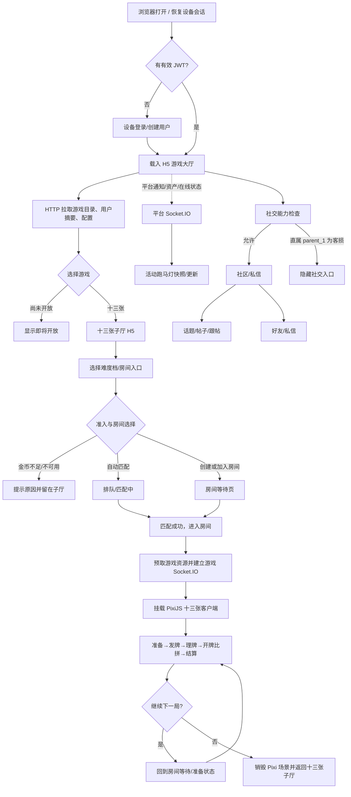
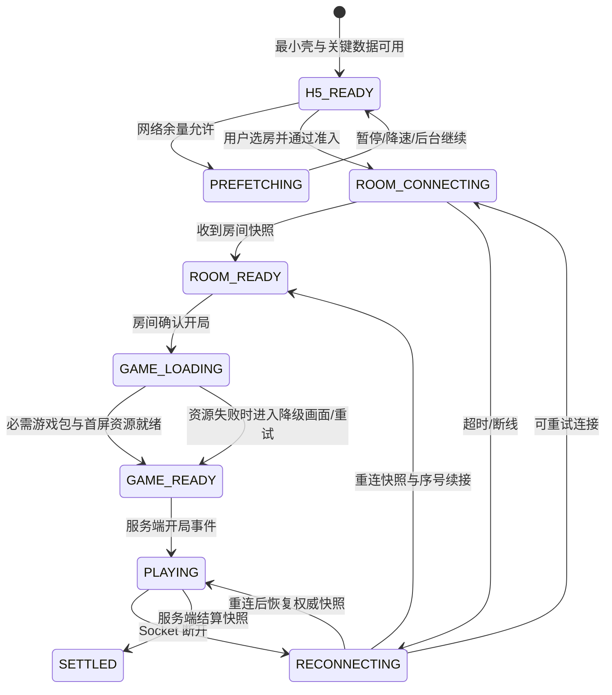

# 用户流程与低保真线框图

版本：0.2（目标流程与当前前端实现分层）  
范围：浏览器首版的目标产品流程——会话进入、横向游戏大厅、系统跑马灯、社区/私信、十三张子厅/难度厅、房间匹配、PixiJS 联机牌桌与结算返回。本文中的目标流程不等于当前代码已实现；实际浏览器前端现状和当前独立施工顺序见本节后续基线表。

大厅、子厅、账户、社交、客服和十三张牌桌的弹窗级交互与闭环检查见[后台与前台页面交互目录](./后台与前台页面交互目录.md)；本文负责主流程与页面级低保真，不重复维护每个弹窗的 DTO 清单。

首次进入、关键步骤说明、牌桌教程、资产确认和弱网恢复的引导策略见[交互引导需求分析与 UI/UX 设计](./交互引导需求分析与UIUX设计.md)。

## 1. 全局边界

- 登录后、进入具体游戏前均由 Vue/H5 页面承载；只有进入十三张牌局后才挂载 PixiJS 游戏客户端。
- 游戏大厅以横向游戏卡片为主要浏览方式。桌面端横向排列；手机竖屏允许横向滑动卡片，不强制把整个站点旋转。牌桌优先适配横屏，窄屏/竖屏使用单独布局并提供旋转提示但不阻断操作。
- 浏览器首次访问创建/恢复设备会话并取得 JWT。邀请归因 bootstrap 在页面/App 入口阶段调用独立的直连接口；其余业务 HTTP 与 Socket.IO 按既定 CF 接入路径处理。
- 页面数据通过 HTTP 加载；平台通知、资产变更和在线状态走平台 Socket.IO；房间/牌局使用游戏 Socket.IO 命名空间。游戏资源按网络估算器的保守档位预取，资源加载失败不得阻塞大厅可操作性。
- 未开放的游戏入口展示为“即将开放”，可进入显式标注的 H5 模块预览页；预览页不挂载游戏、不接受下注/扣款，也不展示虚构结果。

### 1.1 当前前端实现基线（2026-10-15）

`apps/web` 已实现静态启动壳、Vue 游戏大厅、桌面十三张子厅、手机卡内选档、规则/设置面板、玩家登录/恢复流程视图和牌桌加载/失败层。登录页可通过 History API 直达 `/entry` 并返回；开发模式通过隔离的 Browser API、IndexedDB 和共享 Identity DTO 走设备注册/登录、随机账号密码校验及恢复 QR 本机解密。Dev fixture 可生成两年有效恢复资料；恢复成功签发本地开发 session 并撤销旧 session，凭证在替换前可复用。扫码图片不受支持的浏览器可粘贴加密恢复码文本。个人菜单可退出，退出后刷新仍保持未登录，直到用户主动选择本设备登录；本地 session 不是生产身份。个人资料支持用户名/密码、邮箱/手机验证绑定、TOTP 启用/关闭、登录 challenge、备用码一次性使用与轮换、恢复二维码两阶段替换。首次设备注册已在本地账本幂等发放 1000 金币，并为钱包显示 5000 金币有效下注流水要求；钱包转账、金币兑余额、提现资料维护和提现申请/待审取消已有本地 Browser API 流程；充值下单与履约、真实提现审核/出款、正式账本仍待后端。`games/shisanshui/client` 提供本地发牌、摆牌和演示结算。十三张房间流程现可在不连接后端的情况下完整演练：进入房间面板、快速匹配/创建/加入、房间号和密码校验、加练习机器人、准备/取消准备、开局、以房间号与座位名进入 Pixi 练习、退出回子厅；这是隔离的本地房间，不产生线上玩家、金额或服务端状态。社区话题区已通过共享 Social DTO 和 DDD application/local adapter 支持按话题浏览空态、创建本机文字帖子、读取并添加一级回复；已提交内容按当前账号写入 IndexedDB v9 `social_content`，刷新或重建 application 后可读取，未提交草稿仍按话题保存在当前组件状态，切换后可恢复，取消或成功发布后清除。内容只保存在本机开发数据库，不发布到公开社区。好友和一对一文字私信已用 IndexedDB 离线演练；社交附件、客服附件/坐席后台、Admin/Agent 领域操作仍未全部闭环。平台公告共享 DTO/schema、详情页和 HTTP 访问器可本地验证，正式数据授权和 Socket.IO 仍待服务端。其他游戏有模块预览，不能替代各自玩法、游戏过程及自动模式用例。

现有健康检查只用于大厅顶部“当前在线/离线”提示，不构成登录、房间或游戏后端。PC 子厅选档先进入离线房间工作流，Mobile 卡内选档可直接进入单人练习；档位与下注数仍是演示值。PC 本地房间只用于体验匹配/建房/入房/准备/开局路径，真实匹配、权威座位和重连仍依赖后端 HTTP/Socket.IO。

| 页面/能力 | 当前代码状态 | 当前可独立闭环 | 服务端依赖 |
| --- | --- | --- | --- |
| 启动壳 | `index.html` 有品牌、估算百分比、15 秒等待/重试 | 首屏冷缓存/慢网浏览器验收 | 否 |
| H5 大厅 | 横向游戏卡、PC 全宽卡带、Mobile 固定底栏、规则/设置/服务占位面板 | 现有布局、卡带、面板关闭/恢复、资源退化及说明文案 | 目录、余额、跑马灯、通知等真实数据依赖后端 |
| 十三张子厅 | PC 页面有规则、演示档位和背景转场；Mobile 按确认设计跳过独立子厅 | 视口、四档横滑、返回路径和加载状态 | 正式难度/准入/房间操作依赖后端配置与房间服务 |
| 十三张本地匹配/建房/加入/等待室 | H5 子厅内打开房间工作流；支持快速匹配（本地建房+机器人）、创建房、加入可加入房间、密码校验、准备和离开确认 | 共享 `GameRoomSnapshotDto` 经 TypeBox 校验；domain/application/repository port/local adapter 分层；测试覆盖容量、准备门槛、密码/房间错误、开局和离开；开局向 Pixi 传入房号与其他座位显示名。Headless Chrome 已测 1280×800/650、390×844、320×568，根文档宽高等于视口；弹层背景 inert、body/html 滚动锁定，关闭恢复焦点和页面状态 | 在线队列、真实成员、HTTP 命令 ACK/幂等、Socket.IO 快照/序号/重连与服务器房间状态 |
| 十三张本地牌桌 | Pixi 内存牌局：手动摆牌、自动建议、演示对手、结算 | 本地牌桌操作、揭牌可读性和返回体验 | 真正发牌、牌权威、提交 ACK、托管、重连和资产结算依赖后端 |
| 钱包/社交/客服/个人等 | 个人设置、钱包、社交和客服页面按领域拆分 | Identity、欢迎赠币、转账/兑币、提现申请（待审/可取消）、好友/私信和文本工单可走本地 DDD；不存在真实充值/出款或线上社交内容 | Koa/MySQL 真实资金、支付/审核出款、媒体附件、授权与实时推送依赖服务端 |
| 未开放游戏模块预览 | 七款游戏均可从大厅入口进入带直达 URL 的页面预览；已确认内容与待定义项分开显示 | 页面跳转可用；自动模式/投入/局数控件仅禁用示意，无游戏启动或投注命令 | 规则、DTO、handler、配置、异常流程及正式牌桌仍待各游戏模块施工 |
| 登录、Admin/Agent | 玩家设备、密码与恢复流程走 LOCAL_BROWSER_SERVER，使用共享 Identity contract；开发夹具生成随机账号和恢复资料。Admin 有禁用凭证的 `/admin/login` 与多领域结构页，Agent 权限仍待实现 | 玩家离线登录/恢复、TOTP challenge/备用码消费与轮换、绑定设置、登出、session 撤销、恢复 QR 资料设置均已走通；失效 access 自动 refresh 已完成，生产认证与限速仍待服务端。生产认证与限速尚待服务端 | Koa 身份服务、challenge、限速、撤销与恢复审计需要服务端 |

## 2. 主用户流程



### 2.1 页面与网络调用顺序

1. App shell 先渲染最小 HTML/H5 骨架，不等待游戏大包或装饰资源。
2. 会话有效时并行请求用户摘要、游戏目录、大厅展示配置；会话失效时走设备登录/恢复流程。
3. 大厅首屏关键资源加载完成后先可交互，再通过共享资源调度器低优先级预取十三张子厅资源。预取使用偏保守的带宽估算；前台交互或网络变差时立即让路。
4. 选择十三张难度后，先由 HTTP 校验大厅配置、余额/准入与房间操作，再由 Socket.IO 接管房间实时状态。
5. 匹配/房间确认后，预取或加载该游戏入口包与当前桌面 P1 资源；服务端创建或确认 `roundId` 后，才挂载 PixiJS 游戏客户端。
6. 结算数据以服务器结果为准。返回子厅时 dispose Pixi 应用、纹理/监听器和游戏 Socket 房间订阅；平台会话和平台 Socket 可继续存在。

## 3. 低保真页面线框

### 3.1 会话进入（H5）

```text
┌──────────────────────────────────────────────────────────┐
│  [品牌标识]                                      [帮助]   │
│                                                          │
│                  欢迎回来 / 创建游戏账号                  │
│                                                          │
│       [ 当前设备身份摘要 / 新设备继续方式 ]                │
│       [ 继续使用此设备 ]                                   │
│       [ 使用账号凭证恢复 ]                                 │
│                                                          │
│       设备码/二维码恢复入口（用户主动打开时显示）           │
│       联系方式或用户名+密码校验                             │
└──────────────────────────────────────────────────────────┘
```

首次使用的匿名设备会创建当前浏览器开发会话；玩家稍后可在个人资料中设置用户名/密码。邮箱、手机和 TOTP 使用独立验证流程；备用恢复码启用或轮换后只显示一次、每码只能消费一次。恢复二维码在个人资料安全设置中重新生成：输入当前账号密码、可选的 TOTP/备用码及独立二维码密码；客户端加密并生成 PNG，下载后再次确认才替换旧 QR。JWT 只在客户端按会话策略保存，不在 URL 或可分享二维码中明文暴露。

### 3.2 横向游戏大厅（H5）

```text
┌────────────────────────────────────────────────────────────────────────────┐
│ [品牌]  游戏大厅       [金币余额] [消息] [头像/个人菜单] [设置]              │
├────────────────────────────────────────────────────────────────────────────┤
│ ◉ 系统活动：陈先生在十三张·标准厅达成高光事件 · [活动说明]             ▶ │
├────────────────────────────────────────────────────────────────────────────┤
│                                                                            │
│  推荐游戏                                                                  │
│                                                                            │
│  ◀ [ 十三张封面       ]   [ 游戏 2 封面       ]   [ 游戏 3 封面       ] ▶  │
│    十三张                  即将开放                  即将开放              │
│    [进入子厅]              [敬请期待]                [敬请期待]            │
│                                                                            │
│  [充值] [钱包/转账] [战绩] [邀请代理] [社区] [私信] [客服]                 │
└────────────────────────────────────────────────────────────────────────────┘
```

桌面端卡片优先横向并列；手机窄屏用可拖动/滑动的横向卡片带，保留可见的下一张卡片提示。卡片封面使用 `game.cover_asset_id` 对应资源；大厅只下载当前展示尺寸与质量档，不提前拉取整套牌桌资源。顶部资产变更由平台通知驱动，金额仍以 HTTP/服务端快照校准。

手机端十三张采用同一张纵向展开的游戏卡：封面 Logo 与标题同行，标题下设简介，问号/“规则”入口打开玩法弹层；各难度的最低下注、当前倍率、最高倍率直接展示在卡片内，选档后直接进入练习，不再单独进入子厅。桌面仍由游戏卡进入十三张子厅，子厅展示玩法规则与相同难度参数。手机大厅底部快捷导航固定；连接状态离线时状态控件可点击重连。详细排布见[玩家大厅 Mobile 布局与视觉 SDD](./玩家大厅Mobile布局与视觉SDD.md)。

跑马灯消费平台事件服务生成的公告 DTO，不由游戏客户端拼文案。大厅、适用子厅和牌桌可展示同一公告；显示受事件范围与受众过滤控制。若公告主体是玩家，主体本人不接收以自己为主体的那条公告，其他用户看到服务端脱敏身份（例如“陈先生”）。点活动说明进入 H5 详情页，查看范围、有效期、规则版本及经计算器审核的概率/派奖规则；纯播报事件必须标明“仅事件播报”，不能暗示概率变化。用户可折叠/静音跑马灯。

社交入口按服务端 capabilities 显示。直属上级 `parent_1` 属于客损模式时，隐藏社区/私信入口；大厅、钱包和跑马灯保持可见。深链/API 仍由服务端执行相同授权校验。

### 3.2.1 社区首页与专属话题（H5）

```text
┌────────────────────────────────────────────────────────────────────────────┐
│ [大厅] 社区                                         [通知] [个人资料]       │
├────────────────────────────────────────────────────────────────────────────┤
│ [推荐] [十三张] [Slot] [捕鱼] [活动交流]                 [搜索话题]        │
├────────────────────────────────────────────────────────────────────────────┤
│ [写帖子]  社区规范 / 举报说明                                           │
│                                                                            │
│ ┌──────────────────────────────────────────────────────────────────────┐ │
│ │ [话题] 帖子标题与正文摘要                         [查看全文] [举报]   │ │
│ │ 头像 昵称 · 时间      图片缩略图（可选）       回复 12                │ │
│ └──────────────────────────────────────────────────────────────────────┘ │
│ ┌──────────────────────────────────────────────────────────────────────┐ │
│ │ [置顶] [话题] 管理员置顶内容（显示到期时间/置顶标识）                 │ │
│ └──────────────────────────────────────────────────────────────────────┘ │
│                              [加载更多]                                   │
└────────────────────────────────────────────────────────────────────────────┘
```

话题由后台创建，首版每帖关联一个主话题。列表按时间倒序，管理员置顶需有到期时间。用户卡片只展示公开昵称与头像，不暴露联系方式、设备码、邀请链或资产信息。帖子图片走统一 asset 上传/授权流程。

### 3.2.2 发帖、帖子详情与跟帖（H5）

```text
┌──────────────────────────────────────────────┐
│ [取消]                 发布帖子              │
├──────────────────────────────────────────────┤
│ 话题 *   [选择专属话题                  ▼]   │
│ 标题     [______________________________]   │
│ 正文     [______________________________]   │
│          [______________________________]   │
│ 图片     [+ 添加图片] [缩略图 / 移除]        │
│ 社区规范提示                                 │
│                         [保存草稿] [发布]    │
└──────────────────────────────────────────────┘

┌──────────────────────────────────────────────┐
│ [← 社区] [话题]                [举报] [•••]   │
│ 标题 / 正文 / 图片                           │
│ 作者昵称 · 时间                               │
│ 跟帖 (N)                                     │
│ [头像] 昵称：回复内容                  [举报]│
│        [回复]                                 │
│   [头像] @昵称：一级引用回复                  │
│ [写一条回复____________________] [发送]      │
└──────────────────────────────────────────────┘
```

跟帖最多一级嵌套；待审核或隐藏内容显示明确状态，不与空列表混淆。手机端分为社区列表、帖子详情两个页面。

### 3.2.3 好友与私信（H5）

```text
┌─────────────────────────────────────────────────────────────────────┐
│ [大厅] 私信                          [好友] [申请 2] [+ 找好友]      │
├──────────────────────┬──────────────────────────────────────────────┤
│ 最近会话             │ 头像 昵称                       [屏蔽] [•••] │
│ ● 陈先生  新消息      ├──────────────────────────────────────────────┤
│   林女士  昨天        │                                              │
│                      │ 文字消息 / 授权图片                           │
│                      │                                              │
│                      ├──────────────────────────────────────────────┤
│                      │ [输入消息____________________] [图片] [发送] │
└──────────────────────┴──────────────────────────────────────────────┘
```

手机端采用会话列表→会话详情。首版通过好友码或受控精确查询查找好友，不暴露手机号/email，也不提供陌生人私信入口。客损模式用户访问深链时由服务端拒绝并显示统一不可用提示，不透露上游绑定信息。

### 3.3 十三张子厅与难度选择（H5）

```text
┌────────────────────────────────────────────────────────────────────────────┐
│ [← 游戏大厅]  十三张                         [金币余额] [个人菜单]          │
├────────────────────────────────────────────────────────────────────────────┤
│ [十三张主题横幅/规则入口]                                                   │
│  四人对局 · 13 张 · 头墩 3 张 / 中墩 5 张 / 底墩 5 张                        │
├────────────────────────────────────────────────────────────────────────────┤
│ 选择房间                                                                    │
│                                                                            │
│ [休闲厅]                 [标准厅]                 [高手厅]                 │
│ 准入: 100–1,000 金币    准入: 1,000–10,000      准入: 10,000+             │
│ 底分: 配置值             底分: 配置值             底分: 配置值              │
│ [快速匹配]               [快速匹配]               [快速匹配]                │
│                                                                            │
│ [创建私人房]   [输入房间号加入]                       [玩法说明]             │
└────────────────────────────────────────────────────────────────────────────┘
```

档位、准入上下限、底分、开放玩法、房间入口均由后台发布的游戏配置驱动；示例数字不是最终配置。余额不满足准入时禁用对应入口并说明原因。点选规则说明只打开 H5 面板，不加载 Pixi 游戏包。

### 3.4 匹配中/房间等待（H5）

此处区分“正在找桌”的匹配状态与“已经进入具体房间”的等待状态。匹配不是房间等待页中的空位动画；取消匹配、离开房间和断线恢复使用不同命令与状态。

#### 3.4.1 快速匹配中

桌面在子厅上方使用居中匹配 Dialog；手机使用底部 Sheet。界面保留所选难度和准入摘要，玩家可以取消并继续浏览子厅。服务端没有可靠等待时间数据时不显示预估秒数。

```text
PC
┌──────────────────────────────────────────────────────────────┐
│                  正在寻找对局 · 十三张                       │
│                  [策略厅] · 入场 100 练习分                  │
│                                                              │
│             [动效/阶段] 正在为你寻找合适的牌桌               │
│             已等待 00:18 · 匹配状态：搜索中                  │
│             找到房间后会自动进入，不会重复扣除入场费用        │
│                                                              │
│                [取消匹配]                                    │
└──────────────────────────────────────────────────────────────┘

Mobile
┌──────────────────────────────┐
│ 子厅仍在背景中                 │
├──────────────────────────────┤
│          ━━━━━                │
│ 正在寻找对局 · 策略厅         │
│ 入场 100 练习分               │
│ [阶段动效]                    │
│ 已等待 00:18                  │
│ 找到牌桌后自动进入            │
│                              │
│        [取消匹配]             │
└──────────────────────────────┘
```

取消按钮发出幂等取消命令。服务端确认取消前保留“正在取消”状态；如果匹配成功与取消同时发生，以服务端最终状态为准，显示“已匹配，正在进入房间”或“已取消”。超时/断线使用同一 `entryKey` 查询最终结果，不重新入队、不重复扣费。

#### 3.4.2 已进入房间等待

```text
PC
┌──────────────────────────────────────────────────────────────────────────┐
│ [← 子厅] 十三张 · 策略厅   房间 8K2F1 [复制] [邀请] [规则]                │
├──────────────────────────────────────────────────────────────────────────┤
│                                                                          │
│   [座位 2：头像/昵称]                          [座位 3：头像/昵称]       │
│   已准备 / 在线                                 等待准备 / 在线          │
│                                                                          │
│              ┌──────── 房间状态 ────────┐                               │
│              │ 2 / 4 人 · 等待其他玩家  │                               │
│              │ 房主：陈先生             │                               │
│              │ 规则和难度已锁定摘要     │                               │
│              └──────────────────────────┘                               │
│                                                                          │
│   [自己座位：头像/昵称]                        [座位 4：邀请空位]       │
│   未准备 / 在线                                 [邀请好友]              │
│                                                                          │
├──────────────────────────────────────────────────────────────────────────┤
│ [邀请] [复制房间号]                 [准备] [离开房间]                   │
└──────────────────────────────────────────────────────────────────────────┘

Mobile
┌──────────────────────────────┐
│ [← 子厅] 十三张 · 策略厅      │
│ 房间 8K2F1 [复制] [邀请]      │
├──────────────────────────────┤
│ 2 / 4 人 · 等待其他玩家       │
│ 房主：陈先生                  │
│                              │
│ [座位2 已准备] [座位3 等待]  │
│                              │
│ [自己 未准备] [邀请空位 +]   │
│                              │
│ 规则摘要 · 查看完整规则       │
├──────────────────────────────┤
│ [邀请] [准备] [离开房间]      │
└──────────────────────────────┘
```

座位只展示服务端提供的公开头像/昵称、准备和连接状态；空座位的邀请操作受房主/房间规则授权。底部动作根据 `RoomCapabilityDto` 呈现：准备/取消准备、房主开局、离开。房主开局条件不满足时解释缺少人数或准备状态，不提供本地强制开局。

房间状态、座位、准备、房主与开局权限由 Socket.IO 快照和有序事件更新；断线重连后先应用完整快照，再应用更高序号事件。等待页需要覆盖：首屏加载、等待玩家、全员就绪/开局倒数、开始失败、离线重连、房间关闭、被移出、主动离开。每次页面恢复都以服务端快照为准；离开须得到服务端确认后才回子厅。开局确认后进入已有的游戏资源加载页面。

#### 3.4.3 创建/加入房间入口

创建私人房在桌面使用 560–720px Dialog、手机使用全屏 Sheet；依次选择已开放难度、服务端允许的房间选项和可选访问密码，提交前显示准入/费用 quote。创建成功显示房间号、复制/邀请动作并直接进入等待页。加入房间先输入房间号，服务端返回可公开的游戏/难度/房主摘要后再确认；密码仅在需要时二次输入。格式错误保留输入，房间不可用/无权限显示安全通用原因，命令超时用原 `requestKey` 查询结果。

### 3.5 十三张牌桌（PixiJS；界面外壳由 H5 承载）

```text
┌────────────────────────────────────────────────────────────────────────────┐
│ H5 外壳: [退出/返回]  房间号  [弱网状态] [设置/静音] [倒计时 00:32]        │
├────────────────────────────────────────────────────────────────────────────┤
│                                                                            │
│      对手 2：头像 / 昵称 / 已提交                 对手 3：头像 / 昵称       │
│                                                                            │
│                         对手 1 手牌背/状态                                 │
│                                                                            │
│       ┌────────头墩 3 张────────┐                                          │
│       ┌────────────中墩 5 张────────────┐                                  │
│       ┌──────────────底墩 5 张──────────────┐                              │
│                                                                            │
│                       自己手牌 13 张（可拖拽/点选）                        │
│                                                                            │
│ [自动摆牌] [撤销] [清空]                         [提交牌组]                │
└────────────────────────────────────────────────────────────────────────────┘
```

上图是宽屏逻辑结构，不规定具体牌桌像素布局。手机布局要确保 13 张牌可选、三墩目标区可拖放、关键按钮可触达；必要时允许手牌横向滚动、墩区分页聚焦或拖放后自动吸附。牌型强弱提示和倒道校验在客户端即时反馈，服务端仍执行最终合法性校验。自动摆牌是建议，玩家可调整后提交。

### 3.6 比牌与结算

```text
┌─────────────────────────────────────────────────────────────┐
│                   本局结算 · 第 12 局                         │
├─────────────────────────────────────────────────────────────┤
│                 头墩       中墩       底墩                    │
│  你              +1         -1         +1                    │
│  对手 A          -1         +1         -1                    │
│                                                             │
│  特殊奖励/打枪/全垒打：仅展示服务端确认且配置启用的项目        │
│                                                             │
│  本局积分/金币变化: +N                                       │
│        [再来一局]                    [返回十三张子厅]          │
└─────────────────────────────────────────────────────────────┘
```

比牌按头、中、底顺序揭示。一次性结果快照携带 `roundId`、规则配置版本和各墩结果；客户端动画重复触发需按事件 ID 去重。结算动画失败仍显示静态结果和继续入口，不影响服务端资产结算。

## 4. 弱网与失败流程



- 主线程始终保留轻量加载/错误 UI；网络估算只影响后台预取并发和码率档，不决定服务端对局状态。
- 必需 JS chunk/游戏包失败时支持重试与版本校验；图像/音效可延迟或用低档资源，不应卡死房间状态。
- 对局中断线不重置服务端截止时间。客户端显示离线/重连状态；自动提交、结算和资金写入仍由服务端负责。
- 房间快照使用版本号/事件序号，命令使用稳定 `commandId` 做重试幂等；成功确认未到达时客户端查询/重连恢复状态，不盲目重复扣费或提交。

## 5. 前端路由与模块映射

| 页面/层 | 建议路由 | 主要责任 | 进入具体游戏代码 |
| --- | --- | --- | --- |
| 会话入口 | `/entry` | 设备会话、账号恢复、归因 bootstrap | 否 |
| 游戏大厅 | `/hall` | 游戏目录、通知、资产摘要、入口卡片 | 否 |
| 活动详情 | `/events/:eventId` | 跑马灯公告对应的规则、范围、版本及有效期 | 否 |
| 社区首页 | `/social` | 社交能力检查、话题目录、帖子 feed | 否 |
| 话题页 | `/social/topics/:topicKey` | 话题下帖子列表 | 否 |
| 帖子详情 | `/social/posts/:postId` | 帖子、一级跟帖、举报入口 | 否 |
| 发帖页 | `/social/posts/new` | 话题选择、正文与图片 asset 上传 | 否 |
| 好友/私信 | `/social/messages/*` | 好友、申请、一对一会话与补拉 | 否 |
| 游戏子厅 | `/games/:gameKey` | 游戏介绍、难度档/房间入口、玩法说明 | 否 |
| 等待房间 | `/games/:gameKey/rooms/:roomId` | 房间快照、准备、匹配/邀请与重连 | 否 |
| 游戏运行 | `/games/:gameKey/rooms/:roomId/play` | GameHost 装载、资源状态、生命周期 | 是，动态 import |
| 个人/钱包等 | `/profile/*` | 账户、资产、设置、历史等独立 feature | 否 |

路由只是展示边界，不授权操作。HTTP/Socket 每次均由服务端依据 JWT、用户/设备状态、房间成员关系和命令状态校验。

## 6. 后续逐页设计与施工顺序

施工顺序按“现有可运行前端先闭环、联机页等契约”执行；不为没有后端状态的匹配/房间页伪造真实交互：

| 顺序 | 页面/页面组 | 桌面与手机设计重点 | 逐页闭环 checklist |
| --- | --- | --- | --- |
| 1 | 启动页与大厅 `/` | 首屏静态启动壳、百分比估算、桌面卡带、Mobile 固定工具栏、现有面板 | ✅ Headless Chrome 桌面/移动几何、大厅本地交互及 Docker production preview 冷缓存模拟 4G；⬜ 真实手机/真实 CDN 网络、安全区与全量面板验收 |
| 2 | 十三张子厅（桌面） | 规则、演示档位横向访问、背景过渡、返回大厅 | ✅ 1280×800/650 与四档横向滚动浏览器验收；练习返回路径由前端测试覆盖；⬜ 真机 Safari/Chrome 与真实服务端档位配置 |
| 3 | 十三张本地练习牌桌 | 13 张手牌、3/5/5 摆牌、演示对手、摊牌、重复练习 | ✅ 本地玩法/摊牌/倒道确认、语义化键盘与读屏替代操作和 7 个浏览器视口几何已验；⬜ VoiceOver/TalkBack 真机无障碍验收；联机属于后端阶段 |
| 4 | 大厅现有面板与页面外壳 | 设置为本地偏好；钱包、战绩、邀请、消息、资料、社区和客服按领域分区并呈现服务未接状态 | ✅ Headless Chrome 逐项测量 320×568 与 1280×650：根文档分别为 320/320、568/568 和 1280/1280、650/650；抽屉关闭按钮全部 44×44 且可见，超长内容使用抽屉内滚动；社区话题/好友/私信三视图和键盘切换由 Vitest 验证；⬜ 真机 Safari/Chrome 窄屏、安全区和读屏验收；不伪造后端成功 |
| 5 | 会话入口 `/entry` 与个人资料安全设置 | 设备登录、账号凭证、恢复 QR、用户名/密码、邮箱/手机验证和安全状态 | 🟡 Browser API 本地已验证登录、恢复、用户名/密码、邮箱/手机绑定与更换、TOTP、备用码消费/轮换、恢复 QR 替换及失效 access 自动刷新；改密撤销其他会话，换绑释放旧值。桌面 QR 签发/激活由 Chrome MCP 实测。移动几何、refresh-token replay 和 Koa 联调待做。 |
| 6 | 平台事件跑马灯与详情 `/events/:announcementId` | 大厅/子厅跑马灯、仅播报与有效果区分、详情快照、静音/折叠、直达链接 | 🟡 共享 TypeBox DTO、白名单模板、前端 HTTP 校验、历史导航和组件已完成；Headless Chrome 测试公告在 320×568/390×844 下跑马灯为 296×64/358×64，页面自然纵向滚动且无横溢；1280×650 跑马灯 1189×60，根 scroll/client 为 1265/1280、650/650；无数据直达详情在 320×568、390×844、1280×650/800 均无横溢。⬜ API/主体排除/代理域受众过滤、Socket.IO 更新/重连补拉与真实数据验收 |
| 7 | 十三张本地匹配/房间流程 | 子厅选择难度→快速匹配/创建/加入→房间座位→机器人陪练/准备→开局→进入带房间上下文的本地 Pixi 牌局→退出回子厅 | ✅ 离线前端 DDD 切片与共享 DTO 已实现，失败路径和返回可走通；⬜ 在线队列、真实玩家、服务端 ACK、Socket.IO 快照及弱网重连 |
| 8 | 联机游戏运行 `/play` | 服务端发牌/校验、自动托管边界、重连、真实结算 | ⬜ 后端 handler 与房间协议接入后单独验收 |
| 9 | 个人/钱包/社交/客服/Agent/Admin | 玩家领域面板逐步由共享 DTO 与 LOCAL_BROWSER_SERVER application/use case 驱动；Agent/Admin 结构页继续按领域拆分 | 🟡 身份、welcome gift、转账/兑币、提现待审核与取消、好友/私信、话题演练和客服文本工单有离线流程；充值履约、真实审核出款、社交媒体/授权、客服附件/坐席后台及 Agent/Admin 命令仍待施工；真实权限和数据待服务端 |

### 6.1 逐页设计交付标准

每页先写清用户目标、进入条件、页面主次信息和退出/返回路径；再分别画 PC 与 Mobile 线框。随后逐个设计二级页面内的空/载入/成功/失败/离线状态和三级弹窗；标注 DTO 数据来源、权限 capability、用户输入、确认前摘要、成功后去向与失败恢复动作。设计 checklist 全部完成后才能进入该页代码施工；实现后必须按 [AGENTS.md](../../AGENTS.md) 记录桌面和移动代表尺寸，并验收页面/滚动容器实际宽高。

## 7. 待评审清单

本版按已确认约束作了以下产品假设，评审时只需指出不符合预期的项：

1. 游戏大厅手机竖屏采用横滑游戏卡片，不强制旋转；牌桌优先横屏，同时提供窄屏布局。
2. 进入难度厅后的默认主操作是快速匹配；私人房创建/加入作为并列入口。
3. 连续开局在房间内准备，不强制每局返回难度页；退出才回到十三张子厅。
4. 房间等待页使用简化座位示意，不先加入语音、表情等未确定功能。
5. 钱包/客服/充值等只保留大厅入口，详细表单不纳入本轮主路径线框。
6. 跑马灯是跨大厅/子厅/牌桌的公告投影；主体本人不接收自身公告，公开身份脱敏，详情使用 H5 页面。
7. 社区首版包含话题、帖子和一级跟帖；私信与社区内容分域，直属客损上级用户两者均不可见/不可访问。


## 变更历史

| 2026-10-14 | 将玩家登录/恢复从禁用展示页改为可操作的 LOCAL_DEMO 流程：设备检查、账号表单、本机 QR 读取和 TOTP 格式校验；明确离线不认证、不签发 JWT、不持久化秘密。 |
| 日期 | 变更 |
| --- | --- |
| 2026-10-10 | 按项目约束新增变更历史区块；未改动原有正文。 |
| 2026-10-10 | 补充交互引导设计文档入口。 |
| 2026-10-10 | 补充牌桌玩法示意与用户引导联动说明。 |
| 2026-10-10 | 按文档性质归档并更新相关链接。 |
| 2026-10-10 | 补充手机游戏卡内嵌规则/难度直达、桌面子厅难度参数和离线重连控件约定。 |
| 2026-10-10 | 明确手机卡片 Logo/标题并排、标题下游戏简介与问号规则弹层入口。 |
| 2026-10-10 | 细化匹配状态、PC/Mobile 房间等待、创建/加入房间线框与弱网闭环；增加逐页设计施工顺序和验收标准。 |
| 2026-10-11 | 校准目标流程与当前 Vue/Pixi 实现的差异，区分本地练习/服务端占位/联机依赖，并调整页面施工顺序先完成可独立闭环的前端。 |
| 2026-10-12 | 逐页 checklist 按浏览器已验证的大厅、子厅、本地练习和弹层前端闭环拆分完成项/未完成项；联机页面继续标记为后端依赖。 |
| 2026-10-12 | 刷新当前前端实现基线日期，继续以真实服务端流程未接入作为联机页面的阻塞边界。 |
| 2026-10-12 | 更新启动页逐页 checklist：记录 production preview 冷缓存模拟 4G 通过，区分真实设备/CDN 网络待验。 |
| 2026-10-12 | 大厅弹层背景 inert 由自动化测试验证，并同步到大厅实现 checklist。 |
| 2026-10-12 | 将弹层关闭及主要可操作控件 44 px 触控目标纳入当前页面闭环记录，并保留真机/读屏待验项。 |
| 2026-10-12 | 逐个浏览器测量当前九个大厅面板在 320×568 下的尺寸与关闭可见性，并测量 1280×650 下八个大厅入口面板；保留内容/交互及真机验收待办。 |
| 2026-10-12 | 将十三张本地练习牌桌的语义化键盘/读屏替代操作纳入已实现范围，并按 7 个视口的真实浏览器几何更新逐页验收状态。 |
| 2026-10-13 | 为大厅内未开放游戏补充可直达的 H5 模块预览页及自动模式控件结构；规则与真实游戏逻辑明确保持待实现。 |
| 2026-10-12 | 校准 Admin 独立应用启动状态：新增壳/总览及通用领域路由占位，明确登录、数据页面、Agent 与真实服务端流程仍未实现。 |
| 2026-10-12 | 刷新当前实现基线，纳入 Admin 禁用凭证登录展示页与 `/admin/...` 路由；明确玩家会话与恢复页仍未实现。 |
| 2026-10-12 | 将 Admin 用户列表结构页纳入当前实现基线；查询 API 未接入，不返回静态用户记录。 |
| 2026-10-12 | 将 Admin 用户详情分区页纳入实现基线，并明确 URL ID 仅做格式校验、不代表资源存在或授权。 |
| 2026-10-13 | 校准玩家个人与社交入口状态：将各领域面板列为已实现结构，将真实凭证、资产、消息和客服操作列为后端依赖。 |
| 2026-10-13 | 新增玩家会话入口的设备/密码/二维码恢复模式视图，所有凭证提交保持禁用；注明实际 URL 路由与身份服务仍未实现。 |
| 2026-10-13 | 补齐登录模式标签的左右方向键循环和 roving tabindex，并纳入前端键盘交互测试。 |
| 2026-10-13 | 为会话入口增加 History API `/entry` 直达和浏览器历史导航，并更新逐页 checklist；身份 API 仍未接入。 |
| 2026-10-13 | 将社区面板拆成可键盘切换的话题/好友/私信三视图；交互只切换本地空态，不模拟服务端数据或授权。 |
| 2026-10-13 | 完成平台事件跑马灯/详情页前端及共享 DTO 校验，并将 HTTP/Socket.IO 服务端闭环明确列为待做。 |
| 2026-10-13 | 新增十三张匹配、创建房、加入房和等待室 H5 结构预览及直达路径；所有服务端数据/命令禁用并在页面标明未闭环。 |
| 2026-10-14 | 将十三张房间与匹配现状更新为离线 DDD 工作流，并把房间号与座位显示名接入 Pixi 练习入口；在线协议和重连仍列为服务端待办。 |
| 2026-10-14 | 更新玩家社交前端基线：话题广场支持本地 DDD 发帖/一级回复演练；明确内存隔离、未发布范围和其余社交工作流待办。 |
| 2026-10-14 | 补充话题切换时草稿按 topic key 暂存/恢复、取消或成功发布后清理的本地视图状态规则。 |
| 2026-10-14 | 校准身份登录/恢复实现基线：开发 Browser API 已验证恢复 QR 本机解密、session 建立与旧 session 撤销；账号安全设置和服务端身份仍列为未闭环。 |
| 2026-10-14 | 补入个人菜单登出和重载保持登出的浏览器实测，明确再次登录需要用户主动操作。 |
| 2026-10-14 | 校准个人资料安全设置线框实现状态：用户名与密码可离线设置/修改，其余联系方式和 TOTP 流程待后续实现。 |
| 2026-10-14 | 更新账号安全流程实况：邮箱/手机验证码绑定已接入共享 challenge DTO、开发态验证码检查器和本地 Browser API。 |
| 2026-10-14 | 校准会话和个人资料流程：补记 TOTP setup/disable、登录 challenge 与一次性备用码的共享 DTO/本地 DDD 闭环，并将 QR 管理及移动验收保留为待办。 |
| 2026-10-15 | 增加个人资料中恢复二维码重新签发的两阶段交互线框说明。 |
| 2026-10-15 | 更新个人资料安全流程 checklist，记录 TOTP 备用恢复码轮换已接入。 |
| 2026-10-15 | 更新会话失效处理与 access 自动刷新 checklist；弱网刷新失败保留可重试状态。 |
| 2026-10-15 | 更新玩家流程状态：首次注册赠币及钱包余额/流水摘要已有离线闭环，钱包交易能力继续标记待实现。 |
| 2026-10-15 | 更新总览 checklist：客服用户侧文本工单已可离线创建/续写/关闭，附件与坐席后台仍待实现。 |
| 2026-10-15 | 校准钱包主流程状态：收款方式、最低额/手续费报价、身份与流水门禁、提现申请冻结及待审取消释放已接入共享 DTO/Browser API；明确真实审核出款仍属服务端工作。 |
| 2026-10-15 | 校准社区离线持久化现状：已提交帖子/回复保存于 IndexedDB v9，页面草稿仍为组件状态；修正此前“内容只在内存”的过期描述。 |
